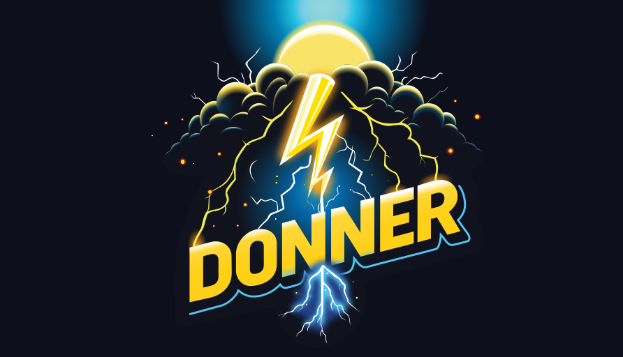

# Donner SVG Editor & Engine

[](https://github.com/jwmcglynn/donner/actions/workflows/main.yml) [](https://opensource.org/licenses/ISC)
[](https://www.codefactor.io/repository/github/jwmcglynn/donner)
<br>
[](https://codecov.io/gh/jwmcglynn/donner)


A native SVG editor built on its own SVG2 and CSS3 engine, written from scratch in C++20. The
engine targets browser-grade correctness, security, and performance, and you can embed it in your
own application.



[Try it out online!](https://jwmcglynn.github.io/donner-editor/)

## Why Donner

- **Editor**: select, move, resize, and rotate shapes, draw paths with the pen tool, and edit text
  with real fonts. Layers, undo, and an XML source view that stays in sync with the canvas. The
  document you edit is the SVG file itself, on desktop or in the browser.
- **Animation**: declarative SVG animation (`<animate>`, `<set>`, `<animateTransform>`,
  `<animateMotion>`), on by default with a host-controlled clock. The editor's Preview mode plays
  it and responds to pointer events, and the CLI exports animated GIFs.
- **Rendering**: SVG 2 with CSS3 styling, gradients, patterns, markers, masks, clipping, and all
  17 filter primitives, checked against the resvg test suite in CI.
- **Two backends, one API**: a compact tiny_skia CPU renderer (the default) and Geode, a GPU
  renderer for Vulkan, Metal, and WebGPU that drives the editor canvas.
- **Text**: `<text>`, `<tspan>`, and `<textPath>` with a compact built-in font stack, or an
  optional full stack with FreeType, HarfBuzz shaping, and WOFF2 web fonts. Both stacks resolve
  bidirectional ordering for ordinary unwrapped horizontal text; the full stack also joins Arabic
  across compatible paint spans. See the [text layout profile](docs/design_docs/0069-bidi_text_layout.md#current-implementation-scope).
- **Security**: designed for untrusted input, with bounded parsing and decoding, continuous
  fuzzing, and no network access unless the host application supplies a resource loader.
- **Embedding**: a C++20 Bazel module with an exception-free, RTTI-free API, a size-optimized
  build, and CMake support.

See the [SVG element reference](https://jwmcglynn.github.io/donner/SvgElementReference.html) for
per-element detail and the [issue tracker](https://github.com/jwmcglynn/donner/issues) for known
gaps.

## CLI Tool: donner-cli

```sh
bazel run //donner/svg/tool:donner-cli -- donner_splash.svg --output output.png  # Render to PNG
bazel run //donner/svg/tool:donner-cli -- donner_splash.svg --preview  # Terminal preview
bazel run //donner/svg/tool:donner-cli -- donner_splash.svg --interactive  # Mouse selection
```

The deprecated Bazel label `//donner/svg/tool:donner-svg` resolves to the same executable
and will be removed at the next breaking version. `:tool` remains a convenience alias.

See the [donner-cli CLI docs](https://jwmcglynn.github.io/donner/DonnerSvgTool.html) for all
options, including animated GIF export.

## C++ API examples

### Inspect and edit an SVG

```cpp
const std::string_view source =
    R"(<svg xmlns="http://www.w3.org/2000/svg"><path d="M1 1 L4 5"/></svg>)";
donner::ParseWarningSink warnings;
auto parsed = donner::svg::parser::SVGParser::ParseSVG(source, warnings);
if (parsed.hasError()) return 1;

auto document = std::move(parsed.result());
auto element = document.querySelector("path");
if (!element || !element->isa<donner::svg::SVGPathElement>()) return 1;
auto path = element->cast<donner::svg::SVGPathElement>();
if (auto spline = path.computedSpline()) {
  std::cout << spline->pathLength() << '\n';
}
path.setStyle("stroke: red");
```

Full program: [svg_tree_interaction.cc](examples/svg_tree_interaction.cc)
([annotated](https://jwmcglynn.github.io/donner/svg_tree_interaction_8cc-example.html)), run with
`bazel run //examples:svg_tree_interaction`.

### Render an SVG to PNG

```cpp
if (argc != 2) return 1;
auto file = donner::ReadFileBounded(
    argv[1], donner::svg::parser::SVGParser::kDefaultMaximumInputSize);
const auto* source = std::get_if<std::string>(&file);
if (!source) return 1;
donner::ParseWarningSink warnings;
auto parsed = donner::svg::parser::SVGParser::ParseSVG(*source, warnings);
if (parsed.hasError()) return 1;

auto document = std::move(parsed.result());
donner::svg::Renderer renderer;
renderer.draw(document);
return renderer.save("output.png") ? 0 : 1;
```

Full program: [svg_to_png.cc](examples/svg_to_png.cc)
([annotated](https://jwmcglynn.github.io/donner/svg_to_png_8cc-example.html)), run with
`bazel run //examples:svg_to_png -- donner_splash.svg`.

## Documentation

- [Getting Started](https://jwmcglynn.github.io/donner/GettingStarted.html),
  [API Documentation](https://jwmcglynn.github.io/donner/DonnerAPI.html), and
  [Examples](https://jwmcglynn.github.io/donner/examples.html)
- [SVG Element Reference](https://jwmcglynn.github.io/donner/SvgElementReference.html)
- [System Architecture](https://jwmcglynn.github.io/donner/SystemArchitecture.html) and
  [Threat Model](docs/threat-model.md)
- [Building Donner](https://jwmcglynn.github.io/donner/BuildingDonner.html), including the
  [CMake build](https://jwmcglynn.github.io/donner/BuildingDonner.html#cmake-build) with the
  tiny_skia backend
- [Project Status](https://github.com/jwmcglynn/donner/issues/149) and
  [Build Report](docs/build_report.md)

## Other Libraries

- C++ | **[LunaSVG](https://github.com/sammycage/lunasvg)**: A lightweight library with an embedded
  renderer, suitable for embedded applications
- C++ | **[ThorVG](https://github.com/thorvg/thorvg)**: A production vector graphics engine with
  software, OpenGL/ES, and WebGPU backends and Lottie support; targets SVG Tiny 1.2 rather than full
  SVG
- C | **[NanoSVG](https://github.com/memononen/nanosvg)**: A minimal single-header SVG parser and
  rasterizer, widely embedded where footprint matters; supports a small subset of SVG
- Rust | **[librsvg](https://gitlab.gnome.org/GNOME/librsvg)**: Renders SVGs in one shot; does not
  provide a DOM or animation
- Rust | **[resvg](https://github.com/RazrFalcon/resvg)**: Library that focuses on correctness,
  safety, and portability for static SVGs
- Rust | **[Vello](https://github.com/linebender/vello)**: A GPU compute-centric 2D renderer from
  the Linebender ecosystem; renders SVG through companion crates rather than natively
- Java | **[Apache Batik](https://xmlgraphics.apache.org/batik/)**: A full dynamic SVG
  implementation with DOM, scripting, and declarative animation; the closest reference for
  browser-style dynamic SVG outside a browser engine

## Acknowledgments

Donner's CI uses remote build execution and caching provided by
[BuildBuddy](https://www.buildbuddy.io/).

<a href="https://www.buildbuddy.io/">
  <picture>
    <source media="(prefers-color-scheme: dark)" srcset="docs/img/acknowledgments/buildbuddy_white.svg">
    
  </picture>
</a>
