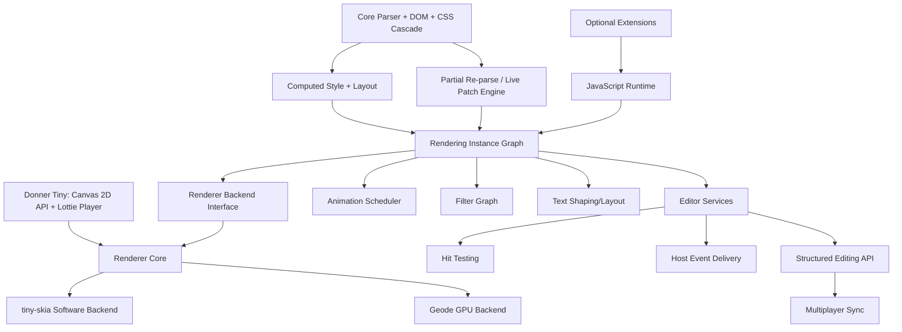

# Project Roadmap {#DonnerProjectRoadmap}

**Status:** Active
**Updated:** 2026-11-13

## Summary

Donner is **Donner SVG Editor & Engine**: an SVG editor application plus the rendering, geometry,
parsing, and authoring engine needed to build SVG tooling.

v0.1 established the static rendering baseline. v0.5 added the renderer abstraction, a complete
software rasterizer, text shaping, and all 17 SVG filter primitives. **v0.8**, released on
2026-10-23, shipped the first working editor (native on macOS and Linux, and in the browser), the
Geode GPU renderer on Donner's own GPU runtime (Metal, Vulkan, and browser WebGPU), declarative SVG
animation, and hardened handling of untrusted documents, with the tiny-skia CPU renderer remaining
the default for embedders. See [RELEASE_NOTES.md](../RELEASE_NOTES.md).

The next release target is **v1.0**, the production-quality release for animation, diagramming,
an embeddable runtime, conformance completion, parser hardening, and ecosystem integration. Work is
tracked on the [v1.0 milestone](https://github.com/jwmcglynn/donner/milestone/3). Multiplayer
editing and scripting remain planned directions that do not gate v1.0; see
[Future Work](#future-work-post-v10).

---

## v0.1: Static Rendering Baseline (shipped)

Core static SVG path/shape rendering and CSS cascade foundation. Established the ECS architecture,
XML parser, CSS parser, and Skia-based renderer.

---

## v0.5: Rendering Engine (shipped)

Renderer abstraction, software rasterizer, text rendering, and filter effects.

### Renderer Architecture

- **Renderer interface abstraction**: `RendererInterface` split from the original full-Skia renderer with
  `RendererDriver` traversing a flat render tree. Enables future backend swaps.
  ([design](design_docs/0003-renderer_interface_design.md))
- **tiny-skia software renderer**: Full software rasterizer (fill, stroke, gradients, patterns,
  shaders, lowp/highp pipeline) as an alternative to Skia. All render operations within 1.5x of
  Skia performance.

### Text Rendering

- Phases 1-5: stb_truetype font loading, glyph outlines, `TextLayout`, WOFF2 support,
  `dominant-baseline`.
- Phase 6: Optional HarfBuzz text shaping tier (`--config=text-full`).
- `<textPath>` element support for text rendered along arbitrary paths.
- ([design](design_docs/0010-text_rendering.md))

### SVG Filter Effects

- All 17 SVG filter primitives implemented in the current tiny-skia backend; the former full-Skia
  path provided native `SkImageFilter` lowering before its removal.
- Float-precision filter pipeline with SIMD optimizations (NEON): Gaussian blur, morphology,
  color matrix, turbulence, convolution, blend, composite, lighting, displacement map, component
  transfer, flood, offset, merge, tile.
- All 23 filter benchmarks within 1.5x of Skia; 21 of 23 are faster.
- ([perf](design_docs/0014-filter_performance.md))

### Parser Diagnostics and Conformance

- **Unified diagnostics** (#459): `ParseDiagnostic` carries a `DiagnosticSeverity`
  (`Warning`/`Error`) and a half-open `SourceRange` (`donner/base/FileOffset.h`), and non-fatal
  warnings flow through the zero-cost `ParseWarningSink`. Every parser entry point takes an
  explicit warning sink, and subparser ranges are remapped into parent coordinates by
  `ParseWarningSink::mergeFromSubparser`
  ([#442](https://github.com/jwmcglynn/donner/issues/442)). See
  [parser_diagnostics](parser_diagnostics.md).
- **XML parser conformance** (#462): `Name` tokens are validated against the XML 1.0
  `NameStartChar`/`NameChar` productions
  ([#304](https://github.com/jwmcglynn/donner/issues/304)).
- **`<clipPath>` `<use>` support**: `<use>` children referencing path/shape elements inside
  `<clipPath>` resolve per the CSS Masking spec
  ([#238](https://github.com/jwmcglynn/donner/issues/238)).

### Infrastructure

- Auto-detect font backends, crash handling hardening.
- Filter and render benchmark suites with perf regression tests (1.5x threshold enforcement).
- resvg test suite integration for golden image validation, updated to the post-Great-Rename
  `linebender/resvg-test-suite` with a reason-string Skip/RenderOnly/WithThreshold API (#500).
  Text resvg tests are enabled; remaining gaps are tracked in
  [resvg_feature_gaps](design_docs/0021-resvg_feature_gaps.md).
- The in-tree Donner Editor under `donner/editor` (#529).

---

## v0.8: Donner SVG Editor & Engine (shipped)

Released 2026-10-23. See [RELEASE_NOTES.md](../RELEASE_NOTES.md) for the full notes, and
[v0_8_showcase](design_docs/0047-v0_8_showcase.md) and its
[retrospective](design_docs/0059-v0_8_showcase_retrospective.md) for the showcase work.

### Editor

- A first working editor, native on macOS and Linux, and in the browser: selection and transform,
  undo, save, source focus and source-reference links, style chips, and source/canvas selection
  sync.
- Shape cut/copy/paste with source sync, undo, Paste in Front, and deterministic ID handling; a
  tuned Pen tool; boolean path operations backed by in-tree PathOps; compound path unbundle.
- A complete Layers panel with previews, stable names, and visibility and lock controls.
- Text creation and editing, Convert Text to Outlines, viewport SVG export, and optional overlay
  SVG export of selected outlines, bounds, and handles.
- The eyedropper and active Fill/Stroke controls (#1376), and animation Preview (#1893).
- Composited, viewport-bounded canvas rendering for fluid zoom and drag (#531, #598,
  [0044-2](design_docs/0044-2-editor_fluid_canvas_rendering.md)), with the path overlay presented
  in the same frame as the document pixels. The browser editor renders only through Geode
  ([0056](design_docs/0056-geode_only_web_editor_runtime.md)).
- An automated showcase fixture generated from `donner_splash.svg` and kept as a CI smoke fixture.

### Structured Editing

- **Structured editing API** (#598): `SVGDocument::setElementAttribute`, `insertElement`,
  `removeElement`, and `setElementTextContent` return an `ApplySourceEditResult` whose
  `XMLMutation` stream drives incremental re-render through the ECS
  (`donner/svg/tests/SVGInvalidation_tests.cc`).
- **Partial re-parsing** (#598): `XMLIncrementalParser` and `XMLDocument::applySourceEdit` reparse
  the smallest affected scope (an attribute value, opening tag, text node, or element subtree)
  and splice the result into the live document.
- **Reverse serialization** (#598): Canvas and DOM operations emit byte-level `XMLSourceDelta`s
  through `XMLSourceStore`, and `DocumentSyncController::mirrorSourceDeltas` replays them into the
  source pane in place, preserving the surrounding text and formatting. See
  [structured_source_editing](structured_source_editing.md).
- **Invalid-region tolerance** (#531): `DocumentSyncController::syncParseErrorMarkers` surfaces
  parse diagnostics as source-pane markers, and selection and document state survive transiently
  invalid source, covered by
  `DocumentSyncControllerTest.PartialOpeningTagEditPreservesSelectionWhileInvalid` and the editor
  state-machine fuzzer.

### Engine

- Geode renders through Donner's own GPU runtime: native Metal on macOS, native Vulkan on Linux,
  and WebGPU in the browser. WGSL shaders compile at build time, and shipped products need no Rust
  toolchain or Rust-built GPU library ([0053](design_docs/0053-native_gpu_hal.md),
  [GPU runtime](gpu_runtime.md)).
- The full Skia backend is removed; tiny-skia is the default for Bazel, Bazel Central Registry,
  and CMake consumers.
- Declarative SVG animation (#1893): `<animate>`, `<set>`, `<animateTransform>`,
  `<animateMotion>`, and `<mpath>` parse by default, with clock, event, syncbase, and repeat timing
  and host-supplied time ([animation](design_docs/animation.md)).
- Hit testing, cursor, and link queries on `DonnerController` (see Interactivity under v1.0).
- **Node removal cleanup** (#596): `NodeLifetimeComponent` tracks detached-root metadata and
  `NodeLifetimeCollector` destroys detached subtrees once no public handle or render snapshot
  retains them, with detached-node diagnostics counters and the
  `//donner/benchmarks:dom_lifetime_perf_capture` budget. See
  [dom_element_lifetime](dom_element_lifetime.md).
- **`<symbol>` and `<marker>` units**: `<symbol>` refX/refY keywords and lengths resolve against
  the symbol's viewBox (#638, [#318](https://github.com/jwmcglynn/donner/issues/318)), and
  `<marker>` refX/refY/markerWidth/markerHeight percentages and keywords resolve against the
  referencing viewport at render time (#636, [#316](https://github.com/jwmcglynn/donner/issues/316)).

### Security

- A security pass across the input-bounding series (#1033, #1035, #1036, #1037, #1038, #1044,
  #1053) bounded base parsing, CSS parsing and selector work, SVG runtime payloads and reference
  work, external resource admission, glyph decoding, CLI input, and renderer geometry
  materialization. Fuzzers cover CSS, animation timing (`ClockValueParser`, `AnimateValue`,
  `AnimateTransformValue`), edit/patch paths (`XMLParser_structured`, `EditorStateMachine`,
  `ShapeClipboardPaste`, `ViewportSvgExportRoundTrip`), and external references (`UrlLoader`,
  `SandboxedFileResourceLoader`, `ImageLoader`); `.github/workflows/fuzz.yml` runs a scheduled
  sanitizer-backed mutation lane on top of per-PR corpus replay.
- The v0.8 security review of untrusted inputs and editor surfaces is complete, and the
  [threat model](threat-model.md) documents the trust boundaries.

### Open v0.8 Follow-up

- [ ] **Bazel Central Registry**: Downstream validation of the 0.8.0 module from its release
      source archive and its BCR publication
      ([#1426](https://github.com/jwmcglynn/donner/issues/1426),
      [0018](design_docs/0018-bcr_release.md)).
- [ ] **Live showcase recording**: style the release-facing composition in Donner Editor, screen
      record the authoring session, and review its legibility, pacing, composition, and editor UI
      clarity ([retrospective](design_docs/0059-v0_8_showcase_retrospective.md)).

---

## v1.0: Production Release (next release)

The production-quality release that follows v0.8, tracked on the
[v1.0 milestone](https://github.com/jwmcglynn/donner/milestone/3).

Focus: interactive editing, diagramming, conformance, parser hardening, an embeddable runtime, and
ecosystem integration. Multiplayer editing and scripting are planned directions under
[Future Work](#future-work-post-v10) and do not gate v1.0.

### Landed on main since v0.8

- Text: CSS `white-space`, `overflow-wrap`, `text-indent`, full-width `text-transform`,
  `text-decoration-line`, `-style`, `-color`, and thickness painted in CSS order,
  `font-synthesis-style` and small-caps synthesis, `@font-face` weight, width, and style matching,
  visual ordering of normal bidirectional text, vertical-text orientation and baseline fixes,
  `textPath` `method="stretch"`, and per-cluster font fallback.
- CSS `clip-path` basic shapes: `circle()`, `ellipse()`, `polygon()`, `inset()` (including
  rounded), and `path()`.
- Warnings when `@media` and `@supports` rules are ignored.
- Mitchell cubic resampling for quality `image-rendering`.
- Size-optimized native release builds that keep hot paths optimized for speed.
- Downstream modules can present Geode frames to a macOS window or a browser canvas.
- Versioned API documentation with a release/main selector, published automatically for main.

### SVG Animation

Declarative animation shipped in v0.8. Remaining work is qualification: presentation-attribute
coverage with a published support matrix, and Chromium, Firefox, and Safari animation checks with
frame-pacing measurement ([animation design and support matrix](design_docs/animation.md),
[#1239](https://github.com/jwmcglynn/donner/issues/1239)). `<discard>` is outside the current
animation model.

- [ ] **Lottie playback (probable)**: Play back Lottie animations (the JSON-based After Effects
      export format, `.json`/`.lottie`) on an ECS-free timeline and interpolation module that the
      SVG animation system and the Donner Tiny runtime also use. Lottie is the dominant interchange
      format for production vector animation, and runtimes such as ThorVG and dotLottie demonstrate
      the demand.

### Composited Rendering

The editor's composited canvas shipped in v0.8. Remaining:

- [ ] Layer-based caching for animation and the remaining phases of
      [composited_rendering](design_docs/0025-composited_rendering.md).

### Interactivity

Donner answers hit-testing queries and accepts host-delivered events; it runs no event loop and
executes no scripts. Available today:

- `DonnerController::findIntersecting` and `findAllIntersecting` return the topmost or every
  painted element at a document-space point. `HitTestMode::SvgPointerEvents` (the default) honors
  `pointer-events`, and `HitTestMode::EditorSelection` tests visible painted geometry for editor
  selection. `captureHitTest` returns an immutable `HitTestSnapshot` for one rendered frame.
- `DonnerController::cursorAt` returns the inherited CSS `cursor` value, and `hitTestLink`
  resolves the enclosing `<a>` so the host can drive link hover and activation.
- `SVGDocument::dispatchMouseEvent` and `dispatchAnimationEvent` deliver host events to declarative
  animation begin/end triggers.

Remaining:

- [ ] **Event listeners**: A public API for registering listeners and dispatching pointer events
      to them. `donner/svg/core/Event.h` defines `Event`, `ListenerHandle`, and `EventCallback`,
      but no public API registers or dispatches to listeners yet.
- [ ] **Spatial index**: Accelerated hit testing with incremental index updates.
- [ ] **Region and bounds queries**: Public `DonnerController` queries for the elements
      intersecting a rectangle and for an element's world bounds.
- [ ] `pointer-events` hit testing for text, images, and clipped content
      ([#1233](https://github.com/jwmcglynn/donner/issues/1233)).
- [ ] Inline `<a>` link hit testing inside text content
      ([#1240](https://github.com/jwmcglynn/donner/issues/1240)).
- [ ] `cursor` `image-set()`, base URL resolution, loading, and platform mapping
      ([#1234](https://github.com/jwmcglynn/donner/issues/1234)).
- [ ] `<use>` instance interaction in the editor
      ([#1942](https://github.com/jwmcglynn/donner/issues/1942)).

### Incremental Invalidation

- [ ] **Partial computed tree invalidation**: When DOM mutations occur, only invalidate the
      affected subtree of the computed style/layout tree rather than recomputing the entire
      document. CSS restyling performs differential updates: identify which elements' computed
      styles are affected by a change and re-resolve only those, propagating inherited property
      changes down the affected subtree
      ([0005](design_docs/0005-incremental_invalidation.md)). Open dependency bugs: `textPath`
      text does not follow a moved path ([#1726](https://github.com/jwmcglynn/donner/issues/1726)),
      and `feImage` results are not invalidated when the referenced element moves
      ([#1727](https://github.com/jwmcglynn/donner/issues/1727)).

### Interactive SVG Editing

Production editor scope: a hybrid structured/freeform SVG editor workflow beyond the v0.8 showcase.
The structured editing API, partial re-parsing, reverse serialization, and invalid-region tolerance
shipped in v0.8 (see Structured Editing under v0.8). Open editor issues on the v1.0
milestone include [#1942](https://github.com/jwmcglynn/donner/issues/1942) and
[#1965](https://github.com/jwmcglynn/donner/issues/1965).

### Diagramming

Structured diagramming as sugar over real SVG. Diagram semantics (nodes, ports, connectors, layout
constraints) live in a Donner XML namespace attached to ordinary SVG shapes, so any SVG viewer
renders the diagram and a tool that drops the namespace keeps the picture, losing only the
diagram editing semantics. This section does not gate the v1.0 release criteria. See
[0068](design_docs/0068-diagramming.md).

- [ ] **Diagram namespace**: Namespaced metadata on real `<g>`, `<rect>`, `<path>`, and `<text>`
      elements describing node types, connection points, and connector endpoints. The metadata is
      re-validated against the geometry on load.
- [ ] **Diagram editing**: Shape libraries, connectors that follow their endpoints with
      obstacle-avoiding routing and waypoints, auto-layout, and templates.
- [ ] **Mermaid-compatible mode**: A Mermaid text view of the representable subset of the
      diagram. Edits in either view update the other; layout and styling that Mermaid cannot
      express stay in the Donner namespace, and the Mermaid parser follows the same resource limits
      and fuzzing as other parsers.

### Parser Improvements

Unified diagnostics and XML name conformance shipped in v0.5 (see Parser Diagnostics and
Conformance under v0.5).

- [ ] **CSS parser update**: The CSS tokenizer is a pull source with no `vector<Token>`
      materialization, and declarations and rules carry `SourceRange`s
      ([0019](design_docs/0019-css_token_stream.md), which rejected coroutine token generation by
      measurement). Remaining: incremental CSS updates matching the XML parser's capabilities.
- [ ] **CSS3 gap closure**: Audit CSS3 property and selector support against the properties
      used by SVG2. Close gaps in selectors, cascading, specificity, shorthand expansion, and
      value parsing for properties referenced by the SVG2 spec. Filed gaps on the v1.0 milestone
      include `transform-box` ([#1241](https://github.com/jwmcglynn/donner/issues/1241)),
      `text-overflow` ([#1242](https://github.com/jwmcglynn/donner/issues/1242)), the remaining
      CSS Text 3 properties ([#1244](https://github.com/jwmcglynn/donner/issues/1244)),
      `line-height` and `vertical-align` ([#1245](https://github.com/jwmcglynn/donner/issues/1245)),
      OpenType feature and variation control
      ([#1247](https://github.com/jwmcglynn/donner/issues/1247)), the remaining text decoration
      properties ([#1248](https://github.com/jwmcglynn/donner/issues/1248)), and `@media` and
      `@supports` ([#1253](https://github.com/jwmcglynn/donner/issues/1253)).

### DOM Support

- [ ] **SVG2 DOM gap analysis**: Audit current DOM implementation against the full SVG2 DOM
      specification. Identify missing interfaces, attributes, and methods across all element types.
      The [SVG2 audit](svg2_audit.md) records that most `animVal` getters still alias `baseVal`.
- [ ] **Close DOM gaps**: Implement missing DOM interfaces and properties identified by the audit,
      prioritizing those needed for interactive editing and JavaScript integration.

### Conformance & Testing

- [ ] **SVG2 conformance pass**: Audit the pinned latest SVG2 Editor's Draft and close applicable
      gaps across chapters, tables, algorithms, and interfaces. See [audit](svg2_audit.md) and
      [suite design](design_docs/0057-donner_svg2_test_suite.md). Static paint, image, text, clip,
      and mask parity and resvg exception tracking are planned in
      [0062](design_docs/0062-svg_parity_completion.md)
      ([#1166](https://github.com/jwmcglynn/donner/issues/1166)); bidirectional text layout is
      planned in [0069](design_docs/0069-bidi_text_layout.md)
      ([#1171](https://github.com/jwmcglynn/donner/issues/1171)).
- [ ] **donner-svg-suite**: Reusable full resvg superset plus SVG2 SVG/PNG cases, sharing a C++
      GoogleTest/pixelmatch harness and native animation/input scenarios with autonomous triage.
- [ ] **90% code coverage**: Achieve and maintain >=90% line coverage across all production code,
      from a verified complete report. v0.8 gated on 85% complete-main coverage
      ([#1415](https://github.com/jwmcglynn/donner/issues/1415)). Identify under-covered subsystems
      and add targeted tests.
- [ ] **Animation test suite**: Comprehensive test coverage for the animation system, including
      timing edge cases, interpolation correctness, and event-based triggers. Native animation
      timing, interpolation, motion, and event scenarios are integrated in the
      [suite](design_docs/0057-donner_svg2_test_suite.md); broader interaction coverage remains.
- [ ] **Add Donner to resvg test harness**: Prepare and execute Donner backend integration with
      automated pixel comparison and agent triage; upstream contribution has a separate submission
      review. See [suite design](design_docs/0057-donner_svg2_test_suite.md).

### SVG Feature Gaps

Open feature gaps on the v1.0 milestone:

- [ ] `<view>` and SVG view fragment navigation
      ([#1236](https://github.com/jwmcglynn/donner/issues/1236)).
- [ ] `<foreignObject>` ([#1237](https://github.com/jwmcglynn/donner/issues/1237)).
- [ ] A typed cascade and documented backend policy for the rendering hints
      ([#1235](https://github.com/jwmcglynn/donner/issues/1235)).
- [ ] Filters on the root `<svg>` element, and an evaluation of `backdrop-filter`
      ([#1252](https://github.com/jwmcglynn/donner/issues/1252)).
- [ ] A settled contract for the at-risk SVG 2 `vector-effect` values
      ([#1232](https://github.com/jwmcglynn/donner/issues/1232)).
- [ ] Clip silhouettes for bitmap-only glyphs
      ([#1231](https://github.com/jwmcglynn/donner/issues/1231)).

### Security

The input-bounding series and the v0.8 security review shipped in v0.8 (see Security under v0.8).
Open follow-ups from the v0.8 reviews:

- [ ] Confirmed low-severity security-review follow-ups
      ([#1828](https://github.com/jwmcglynn/donner/issues/1828)).
- [ ] Lower-priority dependency, CI, and release review findings
      ([#1816](https://github.com/jwmcglynn/donner/issues/1816)).
- [ ] A scheduled ThreadSanitizer lane for the editor and GPU runtime
      ([#1815](https://github.com/jwmcglynn/donner/issues/1815)).

### Optimization

- [ ] **Performance profiling**: Profile end-to-end render paths and identify remaining
      bottlenecks. Target hot paths in parsing, style resolution, layout, and rasterization.
      Related designs: retained raster caching for tiny-skia
      ([0060](design_docs/0060-tinyskia_retained_raster_cache.md)) and multithreaded rendering
      ([0061](design_docs/0061-multithreaded_rendering.md)).
- [ ] **Code size reduction**: Audit binary size contributions by subsystem. Reduce template
      bloat, eliminate dead code, and ensure optional features (text, filters, JS) compile out
      cleanly. Size report tooling, a measured baseline, and the first native and WebAssembly
      reductions are in place ([0055](design_docs/0055-binary_size.md)), and linked-size budgets
      for the shipped products are defined in
      [0064](design_docs/0064-gpu_release_matrix.md).
- [ ] **Memory usage**: Reduce peak and steady-state memory consumption. Audit ECS component
      sizes, pixmap allocations, and intermediate buffers in filter/render pipelines.
- [ ] **Compile time**: Reduce build times. Audit heavy template instantiations, consider
      explicit template instantiation, forward declarations, and pimpl patterns where header
      fan-out is excessive.
- [ ] **SVG engine build profiles**: A minimal-footprint SVG engine tier that strips text, filters,
      animation, and JavaScript, producing the smallest possible binary for embedded/constrained
      environments. Each feature is independently opt-in through build flags (CMake options / Bazel
      configs), so users can compose exactly the feature set they need. Document the size impact of
      each optional module and provide pre-defined profiles: `tiny` (core rendering only), `standard`
      (current default), `full` (everything including JS). The `tiny` engine profile keeps the SVG
      DOM and CSS cascade; the Donner Tiny runtime below drops the SVG stack entirely. Bazel
      already provides `--config=tiny` (filters and text off), the default, `--config=text-full`,
      `--config=no-filters`, and `--config=no-text`.

### Embeddable Runtime: Donner Tiny

A small embeddable vector runtime in ThorVG's class, built from Donner's renderer layer instead of
its SVG document stack. Donner Tiny does not parse SVG; SVG content goes through the SVG engine in
any of its build profiles, so there is only one SVG front end to keep conformant. This section does
not gate the v1.0 release criteria. See [0067](design_docs/0067-donner_tiny.md).

- [ ] **Renderer core**: Factor a renderer core out of the current renderer backend interface:
      paths, paints, clips, and transforms, with no SVG components or ECS types. tiny-skia and
      Geode implement it, and the SVG renderer is built on it.
- [ ] **Canvas-style 2D API**: An immediate-mode path, paint, gradient, clip, and transform API over
      the renderer core, comparable to an HTML canvas 2D context.
- [ ] **Lottie player (probable)**: Play Lottie animations through the same runtime, using the
      ECS-free Lottie module shared with the Lottie item under SVG Animation.
- [ ] **Backends**: tiny-skia software rendering by default, with its SIMD paths and no external
      dependencies; Geode as an optional GPU backend for hosts that already own a GPU device.
- [ ] **Footprint target**: Measure the minimal Donner Tiny build against ThorVG's minimal build and
      target the same size class, using LTO, dead-section elimination, and per-module size
      accounting published with each release.
- [ ] **Embedding surface**: A stable C++ API plus a C API for language bindings, with WebAssembly
      and embedded targets. Consumers do not depend on the SVG parser, CSS engine, or ECS.
- [ ] **ThorVG comparison**: Publish a reproducible comparison against ThorVG covering binary size,
      render time, memory use, and output quality for the shared vector-drawing and Lottie feature
      set.

### Ecosystem

- [ ] **Comparison with other SVG libraries**: Publish a detailed comparison of Donner against
      lunasvg and resvg, covering feature support, conformance, performance, API design, binary size,
      and build complexity. Include reproducible benchmarks and conformance test results. The
      resvg parity report has a resvg head-to-head mode, and the renderer bakeoff
      ([0066](design_docs/0066-renderer_bakeoff.md)) compares tiny-skia and Geode against other
      vector renderers through `RendererInterface`.

### Documentation

- [x] **Versioned API documentation**: API documentation is published for each release and for
      main, with a version selector.
- [ ] **Design docs -> developer docs**: Convert all shipped design documents into
      developer-facing architecture documentation. Remove planning/status artifacts, focus on
      how-it-works descriptions for contributors and embedders.
- [ ] **In-code documentation cleanup**: Review and update code comments, Doxygen annotations,
      and API documentation across public headers. Ensure all public APIs have clear documentation
      ready for consumption.
- [ ] **Embedding guide**: End-to-end guide for integrating Donner into applications, covering
      build configuration, feature toggles, rendering setup, and common workflows.

### v1.0 Release Criteria

- All v1.0 issues closed.
- SVG2 conformance report published with known limitations documented.
- Stable API surface for rendering, editing, and authoring operations.
- At least 90% code coverage across production code.
- CSS3 gap analysis complete, all SVG2-referenced properties supported.
- Performance and binary-size profiles documented.
- Release documentation complete for embedders.

---

## Future Work (post-v1.0)

Planned directions that remain on the roadmap but do not gate v1.0 or its release criteria.

- Game-runtime suitability profile (latency, frame pacing, memory budgets).

### Multiplayer Editing

Real-time multi-user editing of one SVG document, modeled on Excalidraw's collaboration design:
element-level highest-version-wins reconciliation over a relay that only forwards end-to-end
encrypted messages. Local and remote changes both flow through the structured editing API, so
collaboration attaches at that mutation seam instead of introducing a second document model.

- [ ] **Per-element versioning**: Each element carries a stable collaboration ID, a monotonically
      increasing `version`, and a random `versionNonce` that changes with every version bump. Any
      edit to an element's attributes, style, text content, or position in the tree bumps its
      version. Element granularity is a deliberate tradeoff: concurrent edits to different
      attributes of one element keep only the winning version, and per-attribute versioning is a
      possible refinement. The collaboration ID is separate from the SVG `id` attribute, and
      collaboration state records the collaboration ID that each IRI reference (`href`, `url(#...)`)
      targets. Concurrent edits that produce duplicate `id` values are repaired deterministically by
      renaming one element and rewriting only the references bound to it.
- [ ] **Deterministic reconciliation**: Merging incoming state takes the union of element IDs. For
      the same ID the higher `version` wins, equal versions break ties by the lower `versionNonce`,
      and equal nonces break ties by the editing peer's unique session ID, so every peer converges
      without a coordinating server. Deletions are tombstones retained in collaboration state until
      every active peer has acknowledged them. Session membership is itself versioned collaboration
      state: a peer that leaves, or stops acknowledging for longer than a documented retention
      window, is retired by a membership update, so tombstone storage stays bounded. Compacting
      acknowledged tombstones advances a session epoch; a peer whose state predates that epoch,
      including a retired peer that rejoins, resynchronizes from current state instead of merging
      its stale copy. On replay of its unsent edits, updates to elements that existed before its
      last sync but are absent from the current state are rejected and reported as conflicts, while
      elements it created after that sync are inserted, so a deleted element is never resurrected.
      The saved SVG never contains deleted elements.
- [ ] **Tree ordering**: SVG is a tree whose document order is paint order, unlike Excalidraw's flat
      element list. Each element records its parent ID and a fractional index among its siblings, so
      concurrent inserts and reorders merge without renumbering. Equal indices are ordered by
      collaboration ID, and invalid or colliding indices are repaired deterministically. Reparenting
      is an ordinary versioned update. Cycle and missing-parent repair runs on the complete merged
      state, not in arrival order: within each parent cycle, the element whose winning record sorts
      lowest under the reconciliation order (`version`, `versionNonce`, peer ID) is detached to the
      document root, and an element whose parent is missing is detached the same way, so every peer
      reaches the same tree.
- [ ] **Incremental application**: Remote updates apply through the same structured edits and
      incremental invalidation as local edits, never a full document reparse, and the source pane
      mirrors them through reverse serialization.
- [ ] **Relay and encryption**: A stateless relay scopes messages to a room and forwards encrypted
      payloads without decrypting or ordering them. The room key travels only in the share link's
      URL fragment, which browsers never send to the server. The native editor and the WebAssembly
      build use the same protocol.
- [ ] **Presence**: Cursors, selections, and in-progress gestures travel on a volatile channel that
      is never persisted or recorded in undo history.
- [ ] **Undo**: Undo is per user. Undoing a local change emits a new versioned edit instead of
      rewinding shared state, and it skips elements a peer has changed since.
- [ ] **Local-first persistence**: Each peer holds a full copy, keeps editing while offline, and
      reconciles on reconnect. The saved file stays plain SVG; collaboration metadata (versions,
      nonces, fractional indices, tombstones) lives in session or workspace state, not in exported
      markup.
- [ ] **Trust boundary**: Remote payloads are untrusted input. They pass the same parsers, resource
      limits, and secure processing mode as file open, with message size caps, schema validation,
      and no external resource loading on a peer's behalf. Fuzzers cover payload decoding and
      reconciliation.

### Scripting

- [ ] **JavaScript support**: Identify a small embeddable JavaScript engine and integrate as an
      optional feature (similar to how filters are optional). Enable scripted SVG content for
      interactive applications. See [0027-2](design_docs/0027-2-scripting.md) and
      [#1238](https://github.com/jwmcglynn/donner/issues/1238).

---

## Architecture

## Design Documents

The complete index is in [design_docs/README.md](design_docs/README.md). Statuses below are each
document's own status line, or the [design-doc index](design_docs/README.md) where a document
has none.

| Document                                                                             | Status                            |
| ------------------------------------------------------------------------------------ | --------------------------------- |
| [Renderer Interface](design_docs/0003-renderer_interface_design.md)                  | Shipped (Phases 1-2a)             |
| [External SVG References](design_docs/0004-external_svg_references.md)               | Shipped                           |
| [Incremental Invalidation](design_docs/0005-incremental_invalidation.md)             | Partially implemented             |
| [Text Rendering](design_docs/0010-text_rendering.md)                                 | Implemented (Phases 1-6)          |
| [v0.5 Release](design_docs/0011-v0_5_release.md)                                     | Shipped (2026-04-16)              |
| [Filter Performance](design_docs/0014-filter_performance.md)                         | Historical (all phases completed) |
| [BCR Release](design_docs/0018-bcr_release.md)                                       | Active release preparation        |
| [CSS Token Stream](design_docs/0019-css_token_stream.md)                             | Implemented                       |
| [Scripting](design_docs/0027-2-scripting.md)                                         | Draft                             |
| [v1.0 Release](design_docs/0028-v1_0_release.md)                                     | Draft                             |
| [Editor Fluid Canvas Rendering](design_docs/0044-2-editor_fluid_canvas_rendering.md) | Implementation in progress        |
| [Editor Group Layers](design_docs/0046-editor_group_layers.md)                       | Implementing                      |
| [v0.8 Showcase](design_docs/0047-v0_8_showcase.md)                                   | Implemented                       |
| [Native GPU Runtime](design_docs/0053-native_gpu_hal.md)                             | Implemented                       |
| [Binary Size](design_docs/0055-binary_size.md)                                       | Implementing                      |
| [Geode-Only Web Editor Runtime](design_docs/0056-geode_only_web_editor_runtime.md)   | In Progress                       |
| [Donner SVG Suite](design_docs/0057-donner_svg2_test_suite.md)                       | Implementing                      |
| [Static Subset Roadmap](design_docs/0058-svg_static_subset_roadmap.md)               | Draft                             |
| [v0.8 Showcase Retrospective](design_docs/0059-v0_8_showcase_retrospective.md)       | Retrospective                     |
| [Retained Raster Cache](design_docs/0060-tinyskia_retained_raster_cache.md)          | Draft                             |
| [Multithreaded Rendering](design_docs/0061-multithreaded_rendering.md)               | Draft                             |
| [SVG Parity Completion](design_docs/0062-svg_parity_completion.md)                   | In Progress                       |
| [GPU Release Matrix](design_docs/0064-gpu_release_matrix.md)                         | Design                            |
| [Renderer Bakeoff](design_docs/0066-renderer_bakeoff.md)                             | In Progress                       |
| [Donner Tiny](design_docs/0067-donner_tiny.md)                                       | Draft                             |
| [Diagramming](design_docs/0068-diagramming.md)                                       | Draft                             |
| [Bidirectional Text Layout](design_docs/0069-bidi_text_layout.md)                    | Draft                             |
| [Donner App Framework](design_docs/0070-app_framework.md)                            | Draft                             |
| [SVG Animation](design_docs/animation.md)                                            | Implementing                      |
