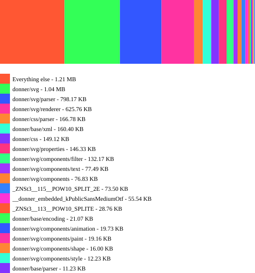

# Donner Build Report {#DonnerBuildReport}

Measurement source: [7d6748ed25dfdd1d0359ea72e1ca09fe19d211d5](https://github.com/jwmcglynn/donner/commit/7d6748ed25dfdd1d0359ea72e1ca09fe19d211d5), version 0.8.0. Source counts, native sizes, configured dependencies, and coverage below use this source. Qualified PR evidence is identified separately where reused.

## Lines of Code

Generated with `tools/cloc.sh` (cloc 2.02), from the clean measurement source. LOC covers C++ and C/C++ Header files under `donner/`; JavaScript, Python, WGSL, and Objective-C++ are outside this count. The comment/code ratio is calculated from raw cloc CSV: 89,256 / 490,185 = 18.21%, avoiding the shell summary’s intermediate truncation.

```text
Lines of source code:      490.1k
Lines of comments:          89.2k
Comments / code:             18.21%
Product lines of code:     230.0k
Test lines of code:        236.6k
```

## Feature LOC

Generated with `python3 tools/feature_loc.py` from the same source. The cloc product bucket excludes `_tests.cc` and `tests/` directories; feature product buckets additionally exclude fuzzers and benchmarks. Their totals use different classifications and are not interchangeable partitions.

File-level attribution by first matching feature bucket. Product LOC excludes `tests/`, fuzzer, and benchmark files; support LOC includes them. Shared files stay in the broad bucket that owns the file.

| Feature | Product LOC | Support LOC | Total LOC | Files | Notes |
| --- | ---: | ---: | ---: | ---: | --- |
| Editor | 67,625 | 83,404 | 151,029 | 357 | ImGui/GLFW editor, async rendering, repro, and headless tooling |
| Composited rendering | 6,227 | 9,870 | 16,097 | 33 | Layer promotion, dual-path verification, and compositor hints |
| Text | 11,252 | 14,583 | 25,835 | 87 | SVG text DOM, layout, shaping, font loading, and font parsers |
| Filters | 7,297 | 3,857 | 11,154 | 74 | SVG filter DOM, filter graph components, and CPU/GPU filter engines |
| Rendering | 32,492 | 43,273 | 75,765 | 187 | Renderer facade, renderer driver, backends, and image comparison helpers |
| SVG document model | 34,510 | 34,841 | 69,351 | 444 | SVG DOM wrappers, parser, properties, ECS components, resources, and tools |
| CSS | 6,037 | 4,977 | 11,014 | 75 | CSS values, parsing, selector matching, and declarations |
| Base/shared | 17,711 | 23,759 | 41,470 | 169 | Core utilities, geometry, XML, parsers, encoding, and element helpers |
| Benchmarks | 0 | 1,703 | 1,703 | 11 | Benchmark harnesses under donner/benchmarks |
| Other | 43,932 | 42,835 | 86,767 | 545 | Files not covered by a more specific feature bucket |
| **Total** | **227,083** | **263,102** | **490,185** | **1,982** |  |

### Editor Breakdown

| Feature | Product LOC | Support LOC | Total LOC | Files | Notes |
| --- | ---: | ---: | ---: | ---: | --- |
| Editor app and shell | 16,400 | 3,499 | 19,899 | 24 | Main entrypoints, top-level app wiring, menus, sidebars, dialogs, and command queue |
| Editor host UI | 4,534 | 3,537 | 8,071 | 19 | GLFW/ImGui host integration, clipboard, profiling wrapper, and window glue |
| Document sync and undo | 2,503 | 4,727 | 7,230 | 15 | SVG document state, source sync, attribute writeback, incremental reparse, and undo |
| Viewport and tools | 4,935 | 8,378 | 13,313 | 34 | Viewport math, pointer gestures, selection, overlays, and interactive tools |
| Async rendering | 6,065 | 7,217 | 13,282 | 15 | Editor render coordination, async worker path, texture cache, and render perf repros |
| Text editor | 10,326 | 10,747 | 21,073 | 23 | Standalone source text editor, text buffer, text patching, and related tests |
| Repro files | 3,420 | 1,992 | 5,412 | 10 | User-visible repro recording and .donner-repro encoding/decoding |
| Editor misc and integration tests | 19,442 | 43,307 | 62,749 | 217 | Editor files not covered by a more specific editor sub-bucket |
| **Total** | **67,625** | **83,404** | **151,029** | **357** |  |

### Rendering Breakdown

| Feature | Product LOC | Support LOC | Total LOC | Files | Notes |
| --- | ---: | ---: | ---: | ---: | --- |
| Renderer API and contracts | 1,411 | 6,727 | 8,138 | 9 | Public renderer facade, backend selection glue, interface contracts, and stroke params |
| Traversal and render context | 5,890 | 2,679 | 8,569 | 12 | RendererDriver traversal, RenderingContext instantiation, utility code, and shared views |
| TinySkia backend | 3,267 | 166 | 3,433 | 4 | TinySkia software renderer backend |
| Geode backend | 16,430 | 17,158 | 33,588 | 76 | Geode GPU backend (Metal/Vulkan/WebGPU), GPU device, encoders, pipelines, shaders, and tests |
| Image and debug utilities | 634 | 1,670 | 2,304 | 11 | Image IO, terminal image preview, and bitmap comparison helpers |
| Wasm bridge | 259 | 0 | 259 | 3 | Renderer wasm bridge entrypoints |
| Renderer test harness | 0 | 14,873 | 14,873 | 51 | resvg suite harness, test backend abstractions, and renderer error-path tests |
| Rendering misc | 4,601 | 0 | 4,601 | 21 | Rendering files not covered by a more specific renderer sub-bucket |
| **Total** | **32,492** | **43,273** | **75,765** | **187** |  |

## Native Binary Size

Current-source Linux aarch64 measurements use Clang 21.1.6 (LLVM commit `a832a5222e489298337fbb5876f8dcaf072c5cca`) and the existing `linux-binary-size` profile: opt, `-Os`, debug information for attribution, function/data sections and linker section collection. The stripped files exclude debug information.

| Target | Non-LTO stripped file bytes | ThinLTO stripped file bytes |
| --- | ---: | ---: |
| `svg_parser_tool` | 5,007,264 | 4,895,480 |
| `donner-svg` | 7,802,528 | 7,416,552 |

These measure the parser and CLI, not the editor application. Parser Bloaty attribution totals 5,007,264 file bytes and 2,612,476 VM bytes; the chart and treemap display file bytes. Chart/treemap labels use 1024-based units (KiB/MiB), even where their generated labels say KB/MB. Exact byte counts in the table are authoritative.

The chart combines omitted groups with the existing “Everything else” bucket; its displayed groups sum to all file bytes. The treemap preserves bytes at intermediate symbol prefixes as explicit `(self)` children. Every parent equals its children, and all leaves sum to the same file-byte total. The generated assets include lossless data corrections and container CSS layout normalization; the repository generators and renderer JavaScript are unchanged. The generated container has a viewport-relative height, a 320px minimum height, and relative positioning for initial layout.



[Interactive parser file-byte treemap](reports/binary-size/binary_size_report.html). HTML validation covers the static tree structure, exact byte totals, and unchanged renderer JavaScript; only generated container CSS and data changed.

ThinLTO reduces stripped file bytes by 2.2% for the parser and 4.9% for the CLI in this matched pair. This is an existing build profile, not a change to product build flags.

Reproduce the native target/profile configuration with:

```sh
bazel build --config=latest_llvm --config=linux-binary-size //donner/svg/parser:svg_parser_tool //donner/svg/parser:svg_parser_tool.stripped //donner/svg/tool:donner-svg.stripped
bazel build --config=latest_llvm --config=linux-binary-size-lto //donner/svg/parser:svg_parser_tool.stripped //donner/svg/tool:donner-svg.stripped
```

Attribution used the stripped parser plus its unstripped debug file and the existing `tools/binary_size_config.bloaty` grouping. Debug-file bytes are not included in the stripped-size table.

## Editor WebAssembly Package

The qualified [Editor WASM run 39800234119, attempt 1](https://github.com/jwmcglynn/donner/actions/runs/39800234119) built synthetic PR commit `195ebf77133902b68bdc8aac658977ff7430f641`. Its Git tree `0420666d0d310cfd1510f8e9ba145be6451d18e5` is identical to the measurement source's tree. The embedded identity and provenance remain the synthetic commit; this is not represented as a new build of the merged commit, and a different embedded commit can change compressed bytes.

| Artifact | Bytes | SHA-256 |
| --- | ---: | --- |
| Raw editor Wasm | 10,637,562 | `fd4f86f3a085b67c5338859e40719b3049c15d8cfa922b3a517b2df504378ef4` |
| Served gzip Wasm | 3,475,312 | `f2d064d516b5ce907abd36da75b3583d84b6e5ddcda41e497b2e08b0a9c8abee` |

Artifact `12437537934` was checked against all 44 site/deployment checksums. Bounded decompression matched the raw Wasm exactly, with valid EOF and no trailing or extra gzip members. The exact `0.8.0` plus synthetic-commit marker occurred once.

## Code Coverage

[Coverage run 39813628374, attempt 1](https://github.com/jwmcglynn/donner/actions/runs/39813628374) measured the exact main commit above with `//donner/...` (proof schema 2, `complete-main`). Build job `119946238138` and upload job `119998109117` succeeded. The workflow used Ubuntu 24.04 x86_64 and `tools/ci/coverage_lane.sh` → `tools/coverage.sh`, with the instrumented `latest_llvm` configuration. This coverage venue is separate from the Linux aarch64 native-size measurements.

| Coverage metric | Numerator / denominator | Percent |
| --- | ---: | ---: |
| Fully covered lines; partials count as misses | 125,616 / 147,340 | 85.2559% |
| Raw LCOV lines with a positive hit | 134,835 / 147,340 | 91.5128% |
| Branches hit | 59,241 / 72,334 | 81.8992% |

The line denominator includes 9,219 partial and 12,505 missed lines. The fully-covered-line metric exceeds 85%; genhtml's 91.5% line-hit headline is a different metric.

The retained LCOV contains 1,187 source records and has SHA-256 `6a9a2c08ee3576e931f4724549a25ba42237248c2fa3dbdc61a0991e3d967daf`, matching the workflow proof. Proof artifact `12447173035` and filtered-report artifact `12447642188` are bound to this run and source.

For source checkout and PR review, [download the coverage HTML ZIP](reports/coverage.zip); it contains `coverage/index.html`. The archive is 10,272,662 bytes, SHA-256 `b88ac6cfaf74c22122d537108605136dd15a13797f7f6f8d7696b47cbd6f5563`. It contains 2,574 regular HTML/style/image members, with no raw logs, command metadata, BEP, or LCOV. HTML was generated from the retained LCOV with genhtml 2.0-1, without rerunning tests. All source paths were already repository-relative.

The [published coverage view](https://jwmcglynn.github.io/donner/reports/coverage/index.html) reflects this snapshot only after documentation promotion; until then it may show an older report.

## Tests

Qualified [CI run 39800234110, attempt 1](https://github.com/jwmcglynn/donner/actions/runs/39800234110) used the same synthetic commit and identical Git tree described above. These are affected-target subsets, not a fresh full-repository test suite. Cached passes are not fresh execution; selected target counts are not inner test-case counts.

| Platform / invocation | Selected targets | Passed, including cache | Executed targets | Skipped targets |
| --- | ---: | ---: | ---: | ---: |
| Linux main group | 115 | 107 | 8 | 8 |
| macOS main group | 111 | 108 | 7 | 3 |

Separate macOS invocations executed 1/1, 6/6, 1/1 and 1/1 selected targets. Browser 4/4 and Geode 6/6 groups passed from cache. These overlapping groups are not summed as unique tests. This is qualified PR evidence, not fresh execution at the merged commit or the later report-only candidate.

Separately, the exact-main instrumented Coverage invocation selected the complete product pattern `//donner/...`. Its proof records 575 `PASSED` label/configuration status records and 165 skipped labels. The proof does not encode a fresh/cache partition or inner test-case counts; those counts are not inferred or added to the overlapping PR groups.

## Public Bazel Library Targets

Current-source query: `kind(library, set(//donner/... //:*)) intersect attr(visibility, public, //...)`.

These are build targets with public visibility, not a recommendation to use internal implementation APIs.

<details><summary>155 public library targets</summary>

```text
//:donner
//donner/base:asyncify_suspend_probe
//donner/base:base
//donner/base:diagnostic_renderer
//donner/base:failure_signal_handler
//donner/base:gtest_timeout_main
//donner/base:memory_attribution
//donner/base:runfiles
//donner/base:test_crash_handler
//donner/benchmarks:css_parser_bench_inputs
//donner/css:css
//donner/editor:async_renderer
//donner/editor:async_svg_document
//donner/editor:attached_numeric_stepper
//donner/editor:attribute_writeback
//donner/editor:canvas_scrollbars
//donner/editor:captured_presentation
//donner/editor:clipboard_interface
//donner/editor:command_queue
//donner/editor:composited_presentation
//donner/editor:composited_rendering_mode
//donner/editor:compositor_debug_panel
//donner/editor:dialog_presenter
//donner/editor:disclosure_chevron
//donner/editor:document_composite_texture
//donner/editor:document_pixel_sampler
//donner/editor:document_presentation_compositor
//donner/editor:document_presenter
//donner/editor:document_save
//donner/editor:document_sync_controller
//donner/editor:drag_coalesce
//donner/editor:editor_app
//donner/editor:editor_build_info
//donner/editor:editor_dock_layout
//donner/editor:editor_input_bridge
//donner/editor:editor_notice_inputs
//donner/editor:editor_parse_options
//donner/editor:editor_sample_catalog
//donner/editor:editor_shell
//donner/editor:editor_shell_layout
//donner/editor:editor_shell_presentation
//donner/editor:editor_splash
//donner/editor:editor_symbol_glyphs
//donner/editor:editor_theme
//donner/editor:embedded_svg_icon
//donner/editor:external_url_launcher
//donner/editor:external_url_launcher_macos
//donner/editor:file_dialog_state
//donner/editor:flash_decorations
//donner/editor:focus_view
//donner/editor:font_preview_cache
//donner/editor:frame_cost_breakdown
//donner/editor:frame_miss_telemetry
//donner/editor:frame_presentation
//donner/editor:gl_texture_cache
//donner/editor:imgui_clipboard
//donner/editor:imgui_headers
//donner/editor:inspector_numeric_input
//donner/editor:keyboard_shortcut_policy
//donner/editor:layer_inspector_diagnostics
//donner/editor:layer_tree_model
//donner/editor:layers_panel
//donner/editor:lock_state
//donner/editor:menu_bar_presenter
//donner/editor:native_dialog_coordinator
//donner/editor:native_file_dialog
//donner/editor:native_file_dialog_macos
//donner/editor:native_menu_macos
//donner/editor:native_window_chrome
//donner/editor:native_window_chrome_macos
//donner/editor:notice
//donner/editor:overlay_renderer
//donner/editor:pan_closed_cursor_svg
//donner/editor:pan_cursor_svg
//donner/editor:path_modify_cursor_svg
//donner/editor:pen_cursor_svg
//donner/editor:pen_tool
//donner/editor:pinch_event_monitor
//donner/editor:pinch_event_monitor_macos
//donner/editor:pinch_zoom_policy
//donner/editor:presentation_pose
//donner/editor:presentation_render_scheduler
//donner/editor:presented_frame_composer
//donner/editor:reference_fanout
//donner/editor:render_coordinator
//donner/editor:render_pane_gesture
//donner/editor:render_pane_presenter
//donner/editor:rope_simulation
//donner/editor:rotate_cursor_set
//donner/editor:rotate_cursor_svg
//donner/editor:runtime_bitmap_upload
//donner/editor:sample_picker_controller
//donner/editor:sample_picker_presenter
//donner/editor:scale_cursor_svg
//donner/editor:select_cursor_svg
//donner/editor:select_tool
//donner/editor:selection_aabb
//donner/editor:selection_transform_handles
//donner/editor:shape_clipboard_commands
//donner/editor:shape_clipboard_payload
//donner/editor:sidebar_presenter
//donner/editor:soft_wrap
//donner/editor:source_diagnostics
//donner/editor:source_diagnostics_panel
//donner/editor:source_edit_intent
//donner/editor:source_selection
//donner/editor:source_structural_move
//donner/editor:source_sync
//donner/editor:stroke_marker_prefabs
//donner/editor:style_source_annotations
//donner/editor:text_buffer
//donner/editor:text_editor
//donner/editor:text_editor_core
//donner/editor:text_format_bar_presenter
//donner/editor:text_inspector_panel
//donner/editor:text_patch
//donner/editor:text_to_outlines
//donner/editor:text_tool
//donner/editor:tool
//donner/editor:tool_icons_svg
//donner/editor:tool_keybinding
//donner/editor:toolbar_icon_set
//donner/editor:tracy_wrapper
//donner/editor:transform_syntax_preserving
//donner/editor:undo_timeline
//donner/editor:viewport_interaction_controller
//donner/editor:viewport_state
//donner/editor:viewport_svg_export
//donner/editor:whole_app_worker_bridge
//donner/editor:whole_app_worker_config
//donner/editor:xml_autocomplete
//donner/editor/gui:editor_metal_layer_macos
//donner/editor/gui:editor_window
//donner/editor/gui:imgui_runtime_renderer
//donner/editor/gui:ui_texture_registration
//donner/editor/gui:ui_texture_registry
//donner/editor/tools:showcase_asset_generator
//donner/editor/wasm:notice_inputs
//donner/editor/wasm/tests:node_modules
//donner/editor/wasm/tests:node_modules/@eslint
//donner/editor/wasm/tests:node_modules/@playwright
//donner/editor/wasm/tests:node_modules/@types
//donner/gpu/shader:program_bindings
//donner/svg:svg
//donner/svg/compositor:compositor
//donner/svg/parser:parser
//donner/svg/renderer:placed_text_geometry
//donner/svg/renderer:render_snapshot
//donner/svg/renderer:renderer
//donner/svg/renderer:renderer_driver
//donner/svg/renderer:renderer_geode
//donner/svg/renderer:renderer_interface
//donner/svg/renderer:renderer_tiny_skia
//donner/svg/renderer/benchmarks:proc_status_parser
//donner/svg/resources:sandboxed_file_resource_loader
```

</details>

## External Dependencies

All three dependency queries use the common `latest_llvm` configuration on Linux aarch64. “Default” means no additional text configuration, not the host-default compiler. Configured transitive build queries include toolchain/sysroot and helper-tool inputs; this is not a runtime-only bill of materials. Vendored components can appear in the generated NOTICE without being separate external repositories. Repository counts and license-package counts therefore differ.

### Default tiny-skia

Query: `deps(//examples:svg_to_png)`; configuration: `default`. Attribution: `//third_party/licenses:notice_default`.

External build repositories: `entt`, `stb`, `sysroot_linux_aarch64`, `tiny-skia-cpp`, `toolchains_llvm`, `zlib`.

| NOTICE package | License identifiers | Upstream |
| --- | --- | --- |
| EnTT | MIT | [upstream](https://github.com/skypjack/entt) |
| Public Sans | OFL-1.1 | [upstream](https://github.com/uswds/public-sans) |
| stb | MIT | [upstream](https://github.com/nothings/stb) |
| tiny-skia-cpp | BSD-3-Clause | [upstream](https://github.com/jwmcglynn/tiny-skia-cpp) |
| libpng | libpng-2.0 | Not supplied by the manifest |
| zlib | Zlib | Not supplied by the manifest |

### tiny-skia with full text

Query: `deps(//examples:svg_to_png)`; configuration: `text-full`. Attribution: `//third_party/licenses:notice_text_full`.

External build repositories: `brotli`, `entt`, `freetype`, `harfbuzz`, `libpng`, `stb`, `sysroot_linux_aarch64`, `tiny-skia-cpp`, `toolchains_llvm`, `woff2`, `zlib`.

| NOTICE package | License identifiers | Upstream |
| --- | --- | --- |
| EnTT | MIT | [upstream](https://github.com/skypjack/entt) |
| Public Sans | OFL-1.1 | [upstream](https://github.com/uswds/public-sans) |
| stb | MIT | [upstream](https://github.com/nothings/stb) |
| tiny-skia-cpp | BSD-3-Clause | [upstream](https://github.com/jwmcglynn/tiny-skia-cpp) |
| libpng | libpng-2.0 | Not supplied by the manifest |
| zlib | Zlib | Not supplied by the manifest |
| brotli | MIT | [upstream](https://github.com/google/brotli) |
| FreeType | FTL | [upstream](https://freetype.org/) |
| HarfBuzz | MIT | [upstream](https://github.com/harfbuzz/harfbuzz) |
| woff2 | MIT | [upstream](https://github.com/google/woff2) |

### Editor: configured Geode/full-text transition

Query: `deps(//donner/editor:editor)`; configuration: `target transition`. Attribution: `//third_party/licenses:notice_release_editor`.

External build repositories: `brotli`, `entt`, `freetype`, `gfont_bebas_neue`, `gfont_bitter`, `gfont_inter`, `gfont_jetbrains_mono`, `gfont_lato`, `gfont_lora`, `gfont_montserrat`, `gfont_open_sans`, `gfont_oswald`, `gfont_pacifico`, `gfont_playfair_display`, `gfont_roboto_mono`, `glfw`, `harfbuzz`, `imgui`, `libpng`, `python_3_12_aarch64-unknown-linux-gnu`, `stb`, `sysroot_linux_aarch64`, `tiny-skia-cpp`, `toolchains_llvm`, `vulkan_headers`, `woff2`, `zlib`.

| NOTICE package | License identifiers | Upstream |
| --- | --- | --- |
| EnTT | MIT | [upstream](https://github.com/skypjack/entt) |
| stb | MIT | [upstream](https://github.com/nothings/stb) |
| tiny-skia-cpp | BSD-3-Clause | [upstream](https://github.com/jwmcglynn/tiny-skia-cpp) |
| brotli | MIT | [upstream](https://github.com/google/brotli) |
| FreeType | FTL | [upstream](https://freetype.org/) |
| HarfBuzz | MIT | [upstream](https://github.com/harfbuzz/harfbuzz) |
| woff2 | MIT | [upstream](https://github.com/google/woff2) |
| Dear ImGui | MIT | [upstream](https://github.com/ocornut/imgui) |
| GLFW | Zlib | [upstream](https://www.glfw.org/) |
| Roboto | Apache-2.0 | [upstream](https://fonts.google.com/specimen/Roboto) |
| Fira Code | OFL-1.1 | [upstream](https://github.com/tonsky/FiraCode) |
| Public Sans | OFL-1.1 | [upstream](https://github.com/uswds/public-sans) |
| Bootstrap Icons | MIT | [upstream](https://github.com/twbs/icons) |
| Curated Google Fonts catalog | OFL-1.1 | [upstream](https://fonts.google.com/) |
| glad | MIT, Apache-2.0 | [upstream](https://github.com/Dav1dde/glad) |
| Vulkan-Headers | Apache-2.0, MIT | [upstream](https://github.com/KhronosGroup/Vulkan-Headers) |
| libpng | libpng-2.0 | Not supplied by the manifest |
| zlib | Zlib | Not supplied by the manifest |
| Noto Sans | OFL-1.1 | [upstream](https://github.com/notofonts/latin-greek-cyrillic) |

The Linux editor NOTICE sidecar reports zero uncovered component labels, but 11 unexempted linker-option entries: `-lGL`, `-lX11`, `-lXcursor`, `-lXi`, `-lXinerama`, `-lXrandr`, `-ldl`, `-lpthread`, `-lrt`. These are recorded limitations, not new exemptions or complete license-closure clearance for a Linux editor distribution.

## Documentation

[API documentation](https://jwmcglynn.github.io/donner/index.html). This link is informational; it does not claim a fresh documentation build at the measurement source.
