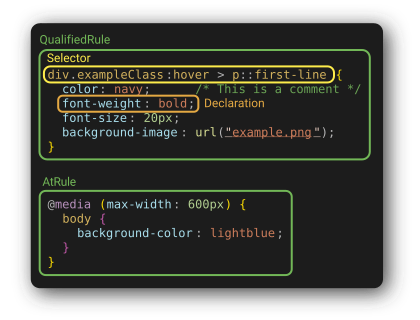
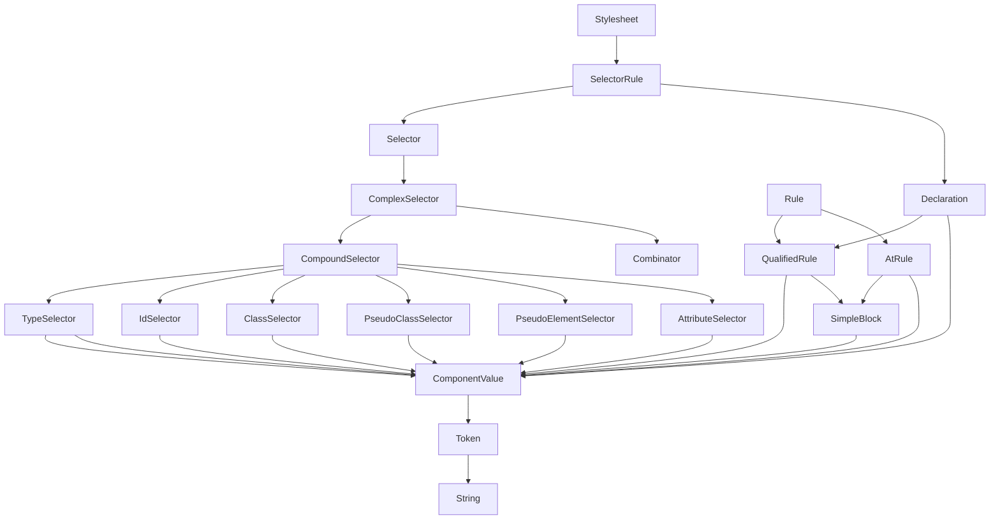
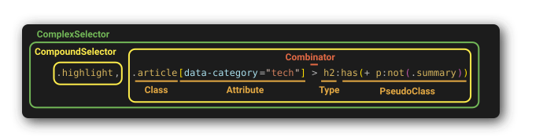
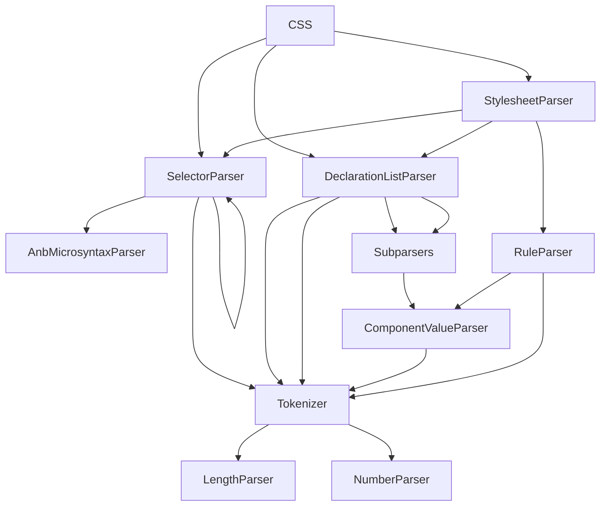

# CSS {#CssArchitecture}

\tableofcontents

Donner implements CSS3 in its own CSS library, \ref donner::css. The library has minimal dependencies and can be integrated into other projects with an adapter that satisfies the \ref donner::ElementLike concept.

\ref donner::css::CSS provides a high-level API for parsing CSS constructs. It is implemented on top of lower-level parser APIs that give finer-grained control over parsing and more detailed error handling.

## SVG Cascade Runtime

The SVG runtime applies parsed CSS through \ref donner::svg::components::StyleSystem. The cascade
uses this pipeline:

1. `StylesheetComponent` owns each parsed sheet, resolved imports, a `RuleIndex` keyed by the
   subject selector, and a `SelectorDependencySummary` used for invalidation.
2. `DocumentLayerOrder` combines the layer streams of applicable sheets and imports in document
   order. It supplies the rank used by \ref donner::css::Specificity.
3. `StyleSystem::applyStylesheetRules` collects indexed candidates and charges each rule-element
   test before matching. `StyleAncestorFilter` can reject a candidate without a selector walk.
   Successful selector matches are counted separately, and their declarations are admitted in
   cascade order.
4. The matched-properties cache shares immutable computed-style records when the matched rules,
   local declarations, parent and root inputs are identical.
5. Custom properties are computed and inherited before declarations containing `var()` are
   substituted and parsed into typed SVG properties.

The unindexed and unfiltered modes are test-only differential paths. Production callers use the
indexed, filtered cascade.

### Custom properties and var substitution

Names beginning with `--` cascade as untyped token sequences. Computed custom-property maps and
their token sequences are immutable and shared; retained allocations are charged to the document
style budget until the last holder releases them.

Donner supports the static-name CSS syntax `var(--name[, fallback])` in stylesheet declarations,
inline style and presentation attributes, including shorthands. Resolution is iterative. It
follows the dependency branch selected by substitution, marks an actual selected cycle
guaranteed-invalid, and permits a dependent declaration to choose its fallback. An invalid or
over-limit expansion publishes no partial token sequence.

Ordinary typed properties that contain `var()` remain pending until the custom-property map is
complete. The substituted component values are then parsed with the property's normal grammar;
failure makes that winning declaration invalid at computed-value time.

### Cascade layers

Stylesheets retain named, dotted, nested and anonymous `@layer` statements and blocks. Layered
`@import` rules participate at their declared position in the document layer stream. Normal
declarations use first-layer-to-last-layer precedence, while important declarations reverse that
order. Unlayered author declarations outrank normal layered declarations, and presentation
attributes remain below author rules. Inline style keeps its existing author-inline precedence.

Layer order is recomputed when stylesheet contents, imports or document order change. The same
frozen order is shared by serial and prepared parallel cascade work.

### Incremental source editing and invalidation

`SVGDocument::applySourceEdit` projects XML edits into stylesheet-local offsets.
`StylesheetComponent::applyTextEdit` reparses and splices a verified rule window; edits that cannot
be mapped or resynchronized use a full stylesheet parse. `SelectorDependencySummary` and the old
and new rule windows identify affected elements. `StyleSystem::computeStylesFor` recomputes that
set, while structural or otherwise unbounded changes request a full style pass.
See \ref StructuredSourceEditing "Structured Source Editing" for the XML edit transaction and
source-provenance model shared by stylesheet edits.

The source editor uses XML regions to locate CSS and applies the CSS tokenizer to every byte of
style elements, style attributes and presentation values. Completion preserves XML completion and
uses the same property metadata and source-derived custom names. See
\ref EditorSourceFocus "Source Focus" for source-to-style mapping and selection behavior.

### Parallel cascade

Large eligible passes use `StyleSystem::PreparedBatch` and `StylePassScheduler`. Workers read a
const registry, own budget shares, warning buffers, ancestor filters and matched-style caches, and
write only preallocated result slots. The document owner publishes parents and commits results in
document order. Unsupported inputs, budget pressure or insufficient work fall back to the serial
path. Native Linux and Apple admission requires 64 KiB of live client-stack headroom above the
scheduler's separate 32 KiB reporting reserve; it does not allocate a fixed 64 KiB stack. Other
platforms remain serial for this path. See \ref Multithreading "Multithreading" for document
access and registry ownership outside the style pass.

## Public API and Ownership

The public `donner/css` representation exposes layer and variable metadata needed by embedders:

- \ref donner::css::Declaration retains component values and variable-reference classification.
- \ref donner::css::SelectorRule carries its sheet-local layer identifier.
- \ref donner::css::Stylesheet exposes imports and the parsed layer table.
- \ref donner::css::Specificity carries origin, importance and document-layer priority.
- `InspectVariableReferences`, `VisitVariableReferences`, `SubstituteVariables` and
  `ResolveVariableDefinitions` operate on borrowed component-value spans. Referenced storage must
  outlive the call.

The core SVG document and element mutation semantics are unchanged. Public source tooling in
`SVGStyleQuery.h` exposes source-backed matched rules, exact stylesheet-range mapping and bounded
custom-property provenance. `FindCustomPropertyDeclarations` charges aggregate work supplied by
the caller, and `VisitAuthoredStylesheetDeclarations` borrows its views only for the callback.
`ElementFactory::TryWrapStyle` wraps an existing embedded stylesheet without mutation.

Rule indexes, invalidation summaries, custom-property maps, cascade budgets, counters and caches
remain internal components. `StyleCascadeMetrics` provides cumulative logical-work counters and
style time for diagnostics and benchmarks.

## Safety and Resource Limits

CSS and SVG text are untrusted input. Parsing, substitution, matching and retention fail closed at
document or value boundaries; a refusal never exposes partial substituted output.

| Resource | Current limit |
| --- | ---: |
| One substituted value | 65,536 component values and 1 MiB source text |
| One stylesheet | 4,096 layers, nested at most 32 deep |
| One document layer order | 16,384 layer nodes |
| One import pass | depth 16, 64 loads and 2 MiB imported CSS text |
| Rule-element candidates admitted per style pass | 1,048,576 |
| Matched declaration applications admitted per style pass | 1,048,576 |
| Aggregate declaration work | 16,777,216 component units and 16 MiB source text |
| Retained complex property data | 64 MiB per style budget, also charged to its document family |

The resource loader remains the trust boundary for external imports. It controls reachable URLs;
secure processing modes and the editor do not provide an external loader. Import cycles, invalid
UTF-8, disallowed media types and exhausted fetch budgets are diagnosed and skipped.

## Performance and Observability

The rule index, ancestor filter, immutable records and matched-properties cache reduce ordinary
work without changing computed results. `StyleCascadeCounters::rulesTested` counts admitted
rule-element candidates; `rulesMatched` counts successful selector matches; and
`declarationsApplied` counts separately admitted declaration applications. Aggregate generated
component and byte work use independent counters. Retained maps, token sequences and complex
properties instead use lifetime byte accounts shared by their holders and document family.

Selective source edits expose the same logical counters as full passes, making differential tests
and benchmarks compare work as well as values. Avoiding constant overhead on ordinary documents
that do not use custom properties or layers remains an accepted optimization area; changes must
preserve imports, inheritance, cache identity, mutation invalidation and every resource limit.

The shipped editor Wasm package is limited to 11,424,000 raw bytes and 3,570,000 gzip bytes by
`//donner/editor/wasm:wasm_geode_package_size_tests`.

## Testing and Validation

The main verification targets are:

- `//donner/css:css_tests` for specificity, declarations, cycles, selected fallbacks and bounded
  substitution.
- `//donner/css/parser:parser_tests` and `//donner/css/parser:stylesheet_parser_fuzzer` for
  stylesheet, import and layer grammar.
- `//donner/svg/components/style:style_system_tests` and `style_cascade_feature_tests` for the SVG
  cascade, inheritance, custom properties, layers and resource accounting.
- `//donner/svg/components/style:style_parallel_tests` and
  `ci_tsan_style_parallel_tests` for serial equivalence, publication order and races.
- `//donner/svg/renderer/tests:style_index_differential_tests` for indexed/unindexed, filtered and
  fresh-cascade equivalence across the style-edit corpora.
- `//donner/benchmarks:css_cascade_perf_tests` for stable cascade counters and performance
  reporting.
- `//donner/editor/wasm:wasm_geode_package_size_tests` for browser payload and structural limits.

Add conformance cases at the lowest layer that owns the guarantee, and add an SVG computed-style
companion when token substitution alone does not prove inheritance or neighboring declarations.

## Current Limitations

The cascade does not implement `env()`, typed `attr()`, dynamic variable names such as
`var(var(...))`, SMIL animation of custom properties, conditional `@import` evaluation, or the
`revert-layer` keyword. Unsupported conditional imports are diagnosed and ignored.

## Stylesheet Imports

CSS `@import` is supported in SVG `<style>` elements. Loading is split between the CSS library and
the SVG document:

- \ref donner::css::parser::StylesheetParser only parses. It retains unconditional imports in
  \ref donner::css::Stylesheet::imports, in source order and with the URL exactly as authored, and
  never resolves or fetches anything.
- The SVG document loads imports when it is first prepared for rendering, through the
  application's \ref donner::svg::ResourceLoaderInterface. Imported rules precede the importing
  sheet's own rules in the cascade, and each imported sheet follows the sheets it imports.

### Grammar

Import keywords are recognized after CSS escape decoding and without regard to ASCII case. The
target is a `<string>`, an unquoted `url()`, or `url(<string>)`; an import may end at EOF without a
semicolon. Following CSS Cascade 5, an import is valid only before every other rule except `@layer`
statements (`@charset` is consumed first). Unknown at-rules and style rules that fail to parse are
dropped and do not end that leading section.

Conditions are decided as follows:

| Import | Behavior |
| --- | --- |
| No condition, or the media query `all` | Loaded |
| Other media query lists | Ignored with a warning, matching how `@media` blocks are ignored |
| `supports(...)` | Ignored with a warning, matching how `@supports` blocks are ignored |
| `layer` or `layer(name)` | Loaded into the anonymous or named cascade layer at the import's position |
| After another rule, malformed, or with an empty target | Ignored with a warning |

Diagnostics use static text and never repeat the target URL.

### Loading and trust boundary

Imports never add a network capability. They are fetched only through the resource loader the
application configured for the document, sharing the external-fetch cache, the per-document fetch
attempt limit and the aggregate resource byte budget used by `<image>`, `@font-face` and external
`<use>` references. The loader decides what a URL may reach; for example,
\ref donner::svg::SandboxedFileResourceLoader rejects paths outside its root, including after `..`
resolution.

- Without a resource loader (the default, and the editor), and in the secure processing modes,
  external imports are diagnosed and ignored without any fetch. `data:` URLs with a `text/css` (or
  absent) media type decode without the loader.
- Top-level import URLs are passed to the loader as document-relative URLs, after dot-segment
  normalization. Imports inside an imported sheet resolve against that sheet's URL, as CSS
  specifies; a relative import inside a `data:` sheet cannot be resolved and is ignored. Relative
  `@font-face` source URLs in an imported sheet also resolve against that sheet's URL. An import
  that resolves to the document itself (such as `@import "."`) is ignored.
- One document-wide pass is bounded to a nesting depth of 16, 64 import loads (counting repeats of
  one URL), 2 MiB of imported CSS text, and one stylesheet's worth of parsed rules and component
  values across all imported sheets. Imports that would re-enter a stylesheet already being loaded
  on the current path are reported as cycles and skipped.
- Imported text must be valid UTF-8, and a target whose type is known to be something other than
  `text/css` (for example an image extension) is rejected.

Imports load when the document is prepared for rendering, so a computed-style query made before
the first render does not yet include imported rules; the first render discards such styles and
recomputes them with the imports in place.

Warnings are reported at the top-level import that led to them, mapped to document source when the
`<style>` text has source provenance. Diagnostics from parsing imported text are not reported,
since their offsets refer to another resource. Rules loaded through `@import` have no document
source, so editor queries that map rules back to source consider only each `<style>` element's own
rules.

## Anatomy of CSS Strings

A CSS Stylesheet is composed of a list of rules, each of which contains a selector and a list of declarations.

There are two main rule types:
| Rule type | Example |
| --- | --- |
| Qualified rule | `div { color: red; }` |
| At-rule | `@media (max-width: 600px) { ... }` |

Qualified rules are the most common and are used to apply styles to elements that match a selector. At-rules are used for media queries, keyframes, and other special constructs.

Within qualified rules, there is a selector and a list of declarations. The selector is used to match elements in the DOM, and the declarations are a list of key-value pairs that apply styles to the matched elements.

### Class structure

- \ref donner::css::Stylesheet "Stylesheet" is the top-level element in a stylesheet, and contains a list of \ref donner::css::SelectorRule "SelectorRule" for each block (e.g. `div { color: red; }`)
- \ref donner::css::SelectorRule "SelectorRule" represents a single CSS rule, such as `div { color: red; }`
- \ref donner::css::Selector "Selector" represents a single CSS selector, such as `div` or `#id`
- \ref donner::css::Declaration "Declaration" represents a single CSS declaration, such as `color: red;`
- \ref donner::css::ComponentValue "ComponentValue" represents a single CSS value, such as `10px` or `#ff0000`
- \ref donner::css::Token "Token" represents a single CSS token, such as `10px` or `color`

### Selectors

Selectors provide many ways to match elements in the DOM.

| Selector                                                        | Example        | Description                                                                  |
| --------------------------------------------------------------- | -------------- | ---------------------------------------------------------------------------- |
| \ref donner::css::TypeSelector "TypeSelector"                   | `div`          | Matches all `div` elements                                                   |
| \ref donner::css::ClassSelector "ClassSelector"                 | `.class`       | Matches all elements with the class `class`                                  |
| \ref donner::css::IdSelector "IdSelector"                       | `#id`          | Matches the element with the ID `id`                                         |
| \ref donner::css::AttributeSelector "AttributeSelector"         | `[attr=value]` | Matches elements with the attribute `attr` set to `value`                    |
| \ref donner::css::PseudoClassSelector "PseudoClassSelector"     | `:first-child` | Matches elements in a special state, such as the first child of their parent |
| \ref donner::css::PseudoElementSelector "PseudoElementSelector" | `::first-line` | Not yet supported, matches special elements in the tree, mostly for text     |

Attribute selectors, pseudo-classes, and combinators match elements based on their state or their relationships with other elements.

Selectors can be chained with combinators to create complex matching rules. For example, `div > p` matches `p` elements that are children of `div` elements.

- (whitespace) - Descendant: Space-separated, finds descendants in the tree, ex: `div img`
- `>` **Child**: Finds direct children in the tree.
- `+` **NextSibling**: Finds the next sibling in the tree.
- `~` **SubsequentSibling**: Finds all subsequent siblings in the tree.
- `||` **Column**: Finds the next column in the tree. This is new in CSS Selectors Level 4 and is not applicable to SVG.

#### Attribute selectors

Attribute selectors are used within square brackets on the selector list, such as `a[href^="https://"]` or `h1[title]`. Different match modes are available, which are specified by \ref donner::css::AttrMatcher "AttrMatcher".

| Matcher | Enum           | Description                                                                                                         |
| ------- | -------------- | ------------------------------------------------------------------------------------------------------------------- |
| `~=`    | Includes       | Interprets the attribute value as a space-separated list of values. Matches if any value in the list is equal       |
| `\|=`   | DashMatch      | Matches if the attribute value either exactly matches, or begins with the value immediately followed by a dash, `-` |
| `^=`    | PrefixMatch    | Matches if the attribute value begins with the matcher value                                                        |
| `$=`    | SuffixMatch    | Matches if the attribute value ends with the matcher value                                                          |
| `*=`    | SubstringMatch | Matches if the attribute value contains the matcher value                                                           |
| `=`     | Eq             | Matches if the attribute value exactly matches the matcher value                                                    |

If no matcher is specified, the attribute is matched if it is set to any value, for example, `a[href]`.

##### Examples

| Selector              | Matches                                                                             |
| --------------------- | ----------------------------------------------------------------------------------- |
| `a[href]`             | All `a` elements with an `href` attribute                                           |
| `a[href^="https://"]` | All `a` elements with an `href` attribute that begins with "https://"               |
| `a[href$=".pdf"]`     | All `a` elements with an `href` attribute that ends with `.pdf`                     |
| `a[href*=".pdf"]`     | All `a` elements with an `href` attribute that contains `.pdf`                      |
| `a[class~="link"]`    | An alternate way of writing `a.link`, included here to illustrate the `~=` matcher. |

#### Pseudo-class selectors

Pseudo-classes match elements in special states, such as being the first child of their parent, or having a child that matches a selector.

| Pseudo-class                   | Description                                                                                                                                                                                                                                     |
| ------------------------------ | ----------------------------------------------------------------------------------------------------------------------------------------------------------------------------------------------------------------------------------------------- |
| `:root`                        | Matches the root element of the document.                                                                                                                                                                                                       |
| `:empty`                       | Matches elements that have no children.                                                                                                                                                                                                         |
| `:first-child`                 | Matches elements that are the first child of their parent.                                                                                                                                                                                      |
| `:last-child`                  | Matches elements that are the last child of their parent.                                                                                                                                                                                       |
| `:only-child`                  | Matches elements that are the only child of their parent.                                                                                                                                                                                       |
| `:nth-child(An+B [of S])`      | Matches elements that are the `An+B`-th child of their parent. `S` is a \ref donner::css::Selector "Selector" that should match child elements to count.                                                                                        |
| `:nth-last-child(An+B [of S])` | Matches elements that are the `An+B`-th child of their parent, counting from the last child. `S` is a \ref donner::css::Selector "Selector" that should match child elements to count.                                                          |
| `:is(S)`                       | Matches elements that match any of the selectors inside the parentheses, where `S` is a \ref donner::css::Selector "Selector" parsed as a forgiving selector list (invalid selectors removed).                                                  |
| `:not(S)`                      | Matches elements that do not match the \ref donner::css::Selector "Selector" inside the parentheses.                                                                                                                                            |
| `:where(S)`                    | Matches elements that match any of the selectors inside the parentheses, where `S` is a \ref donner::css::Selector "Selector" parsed as a forgiving selector list (invalid selectors removed). Same as `:is(S)`, except has a specificity of 0. |
| `:has(S)`                      | Matches elements that have a descendant that matches the selector inside the parentheses, where `S` is a _relative_ forgiving selector list. These may start with a combinator, such as `:has(> .highlighted)`                                  |
| `:nth-of-type(An+B)`           | Matches elements that are the `An+B`-th child of their parent, counting only elements of the same type.                                                                                                                                         |
| `:nth-last-of-type(An+B)`      | Matches elements that are the `An+B`-th child of their parent, counting from the last child and only elements of the same type.                                                                                                                 |
| `:first-of-type`               | Matches elements that are the first child of their parent and are of the same type.                                                                                                                                                             |
| `:last-of-type`                | Matches elements that are the last child of their parent and are of the same type.                                                                                                                                                              |
| `:only-of-type`                | Matches elements that are the only child of their parent and are of the same type.                                                                                                                                                              |
| `:defined`                     | Matches if the element is supported by the runtime. For SVG this would match \ref xml_path and not `
`.                                                                                                                                     |

## High-level CSS Parsing API

- \ref donner::css::CSS::ParseStylesheet "CSS::ParseStylesheet" can parse a `.css` file into a \ref donner::css::Stylesheet "Stylesheet", which contains a list of \ref donner::css::SelectorRule "SelectorRule".

  \snippet custom_css_parser.cc parse_stylesheet

- \ref donner::css::CSS::ParseStyleAttribute "CSS::ParseStyleAttribute" parses `style="..."` attribute values, which are a list of `key: value;` pairs.

  \snippet custom_css_parser.cc parse_style_attribute

- \ref donner::css::CSS::ParseSelector "ParseSelector" parses a CSS selector, and may be used for implementing `querySelector`.

  \snippet custom_css_parser.cc parse_selector

## Low-level CSS Parsing

\ref donner::css::CSS wraps the low-level parsing APIs to parse a stylesheet and selectors:

- \ref donner::css::parser::StylesheetParser
- \ref donner::css::parser::SelectorParser
- \ref donner::css::parser::DeclarationListParser

| Previous                    | Next |
| :-------------------------- | ---: |
| [ECS](EcsArchitecture.html) |      |

