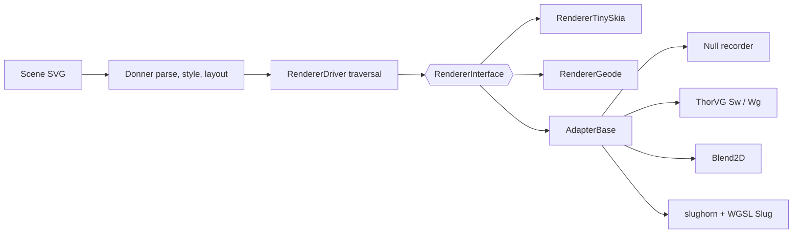

# Design: Renderer Bakeoff Harness

**Status:** In Progress
**Author:** Jeff McGlynn
**Model:** Not recorded
**Created:** 2026-10-14

## Summary

- A benchmark harness that drives third-party 2D renderers through Donner's own
  `RendererInterface`, so every backend receives exactly the same parse, cascade, layout and
  render traversal and the comparison measures the backend rather than each library's front end.
- Two suites. GPU: Geode, ThorVG's WebGPU engine and slughorn (Slug curve and band data drawn by a
  WGSL port of the Slug reference shaders). Software: tiny-skia-cpp, ThorVG's software engine and
  Blend2D.
- Four axes: performance, memory, features and code size, reported as machine-readable JSON plus a
  generated Markdown report.
- The harness is a nested Bazel module at `benchmarks/renderer_bakeoff/`. Its third-party
  dependencies never enter Donner's main module: the directory is in `.bazelignore`, and Donner is
  consumed through `local_path_override` exactly as an external embedder would consume it.

## Goals

- Compare backends at the same layer: Geode against other GPU vector renderers, tiny-skia-cpp
  against other CPU rasterizers.
- Measure cold first frame (including backend resource preparation) separately from steady-state
  frames, at fixed output sizes, with GPU timing that waits for GPU completion and excludes
  readback.
- Measure process memory per backend and scene, including GPU-attributed memory where the platform
  exposes it.
- Classify every `RendererInterface` capability per adapter as native, emulated or unsupported, and
  record per sample which features a backend had to drop.
- Compare speed only on samples that every compared backend renders fully.
- Measure the code-size cost of each backend with identical build flags.
- Keep the harness reproducible from a clean checkout with pinned dependencies and no network
  access at run time.

## Non-Goals

- Choosing a new production dependency. The bakeoff informs Donner's own roadmap; it does not adopt
  any of the compared libraries.
- Treating any library as an SVG conformance oracle. tiny-skia output is the pixel reference only
  because it is Donner's default renderer; differences are reported, not judged.
- Benchmarking the libraries' own SVG or Lottie loaders. An optional loader run may be reported
  separately later but is never mixed into adapter numbers.
- Adding a CI lane. Runs are manual; adding a lane needs a separate decision.
- Exercising retained-mode or partial-redraw optimizations that `RendererInterface` cannot express
  (see Fairness).

## Next Steps

- Land the harness with the null, tiny-skia and Geode baselines and the authored corpus.
- Add the ThorVG software and Blend2D adapters, then the ThorVG WebGPU and slughorn adapters.
- Publish the first measured results under `docs/` with hardware, versions and caveats.

## Implementation Plan

- [x] Make Geode loadable from a non-root module and expose its queue-idle wait to embedders.
- [ ] Harness, corpus and Donner baselines.
  - [x] Nested module, `AdapterBase`, feature accounting, paint resolution, null recorder.
  - [x] Process-per-measurement driver, JSON Lines results, report generator, code-size script.
  - [x] Independently authored corpus plus deterministic stress scenes and Donner's splash files.
  - [x] Unit tests green; smoke run of the null, tiny-skia and Geode backends on macOS Metal.
- [ ] Software adapters: ThorVG `SwCanvas` and Blend2D (JIT on and off, single and multithreaded).
- [ ] GPU adapters: ThorVG `WgCanvas` and slughorn, sharing one pinned wgpu-native build.
- [ ] Results report under `docs/`.

## Background

Donner already has two `RendererInterface` implementations, the tiny-skia software renderer and the
Geode GPU renderer. ThorVG, Blend2D and the Slug ecosystem are the natural comparisons at those two
layers. Comparing whole engines (for example ThorVG's SVG loader against Donner's document stack)
mixes front-end and back-end costs and SVG feature coverage; driving each library as a Donner
backend isolates the rasterization and composition layer that the comparison is about.

## Proposed Architecture

- **Module boundary.** `benchmarks/renderer_bakeoff/` is its own Bazel module with its own
  `MODULE.bazel`, `.bazelrc` and `.bazelversion`. It depends on Donner through
  `local_path_override`, so Donner is a non-root module there, as for any embedder. Third-party
  libraries are fetched by release tag archives or release assets with SHA-256 checksums. The main
  module's `bazel query //...` neither sees nor fetches any of them.
- **AdapterBase.** Each third-party adapter derives from `AdapterBase`, which owns the transform
  stack, resolves fills and strokes into backend-neutral solid or gradient descriptions (the same
  rules as Donner's software renderer), classifies clips (rectangle, single-level clip path, nested
  clip path), and balances push/pop pairs. A backend hook runs only when the adapter's capability
  table says the feature is supported; otherwise the use is counted as dropped. Mask definition
  content of a dropped mask is suppressed so it never paints onto the frame. Nothing is ever handed
  to another renderer: there is no fallback to tiny-skia inside an adapter.
- **Feature census.** The null recorder is an `AdapterBase` with every feature marked native and no
  rasterization. Its frame time is Donner's own traversal cost, and its feature counts are the
  feature census of a scene.
- **Backend registry.** Each backend is an `alwayslink` library that registers a `BackendInfo`
  (suite, library and version where it has one, API, threads, configuration notes, capability
  table, factory).
  `BenchBackend::finishGpuWork()` waits for GPU completion without readback; for Geode it calls
  `RendererGeode::waitForSubmittedWork()`.
- **One measurement per process.** `tools/run_bakeoff.sh` starts a fresh process for every
  (backend, scene, size) so process memory peaks and allocator state belong to one measurement. Each
  process appends one JSON Lines record and writes its snapshot PNG outside the timed region.
- **Report.** `//report:bakeoff_report` reads the run directory, compares each snapshot with the
  tiny-skia snapshot of the same scene and size through Donner's shared pixelmatch comparison, and
  writes `report.md` and `summary.json`.

## Metrics

- **Performance.** `setup_ms` (backend construction, including GPU device creation), `parse_ms`,
  `first_frame_ms` (first draw of a freshly parsed document, including Donner's style and layout and
  the backend's resource preparation, through GPU completion), then warmup frames and a timed series
  summarized as min, median, p95, max, mean and sample standard deviation. Encoding and readback are
  outside every timed region.
- **Memory.** macOS physical footprint (resident set on Linux), its peak, and the graphics-tagged
  footprint the driver attributes to the process, sampled at start, after setup, after the first
  frame and after the timed series.
- **Features.** The per-adapter capability table and, per sample, the features used and dropped. A
  sample is comparable only when every backend in the suite rendered it fully.
- **Pixel difference.** pixelmatch mismatch count against the tiny-skia snapshot, color threshold
  0.1, antialiased pixels excluded by pixelmatch's own detection.
- **Code size.** Each `//code_size:code_size_<backend>` binary is the same minimal program linked
  with one backend, built with `-c opt`, function and data sections, link-time dead-section
  elimination (on macOS also with no exported symbols), LTO off, and then fully stripped with the
  platform `strip` tool. The report lists the stripped size, the delta against the
  null-recorder baseline, the static-archive bytes the backend adds, and the repositories it adds.

## Fairness

- **API layers differ in the GPU suite.** Geode drives Metal (Vulkan on Linux) directly, while
  ThorVG's WebGPU engine and the slughorn renderer run on wgpu-native, which itself translates to
  Metal or Vulkan. Part of any gap is the translation layer. The two wgpu-based backends share one
  pinned wgpu-native build so they are compared on an identical runtime.
- **Immediate-mode traversal.** `RendererInterface` re-emits the frame every draw, so adapters
  rebuild their library's scene each frame. Libraries whose strength is retained scenes with partial
  redraw (ThorVG) are measured on full redraws only.
- **Donner backends keep per-entity caches.** Geode keeps encoded path data resident and tiny-skia
  can replay retained coverage across unchanged frames. These run as shipped; adapters may cache
  only what the library itself can retain across frames.
- **Unsupported features.** A library's missing feature excludes the sample from speed comparison
  instead of letting a cheaper incomplete frame look faster.
- **Host noise.** The 1- and 5-minute load average and the count of concurrently running CI jobs are
  recorded before every measurement. The report marks a row `loaded` when any of its runs started
  with a 1-minute load above half the host's cores or beside a CI job, keeps loaded rows out of the
  summary ratios, and those samples are rerun deliberately; the scripts never retry on their own.
- **Build flags.** The module builds Donner with Donner's own release flags (`-c opt`,
  `-fno-exceptions`, `-fno-rtti`, the same macOS deployment target), so Donner code is measured as
  shipped. Third-party libraries use their own projects' release flags, recorded in their build
  files.

## Security / Privacy

- The harness is a developer tool outside every shipped product and outside the main module's
  build graph. It opens no network connections at run time.
- Inputs are the checked-in corpus, deterministic generated scenes and Donner's splash files, parsed
  with Donner's default parser limits.
- Third-party sources are fetched at build time only from release tag archives or release assets
  pinned by SHA-256, never by commit. A checksum mismatch fails the fetch.
- Results contain generic hardware and toolchain facts only.

## Testing and Validation

- `bazel test //harness:harness_tests`, run manually inside `benchmarks/renderer_bakeoff` (no CI
  lane builds this module), covers statistics, JSON output, deterministic scene generation, the
  adapter base (forwarding, dropping, mask suppression and ordering, balanced layers, nested clip
  classification, filter rejection, linear and radial gradient resolution) and the null recorder's
  census. The no-fallback and dropped-feature accounting described above are properties those
  tests exercise, not invariants enforced by CI.
- The measurement binary fails a run that performs a readback inside the timed region
  (`timed_readbacks`) or produces an empty frame, and the report excludes such runs.
- Each adapter is validated by a smoke run and by its pixel difference against tiny-skia in the
  report.
- The main module's isolation is checked by a fail-closed `bazel query //...` from the repository
  root and an unchanged root `MODULE.bazel`.

## Alternatives Considered

- **Adding the libraries as dev dependencies of the main module.** Rejected: they would enter the
  main module graph and its CI fetches.
- **Comparing the libraries' own SVG loaders.** Rejected as the primary method because it measures
  SVG front ends and feature coverage rather than rasterization.
- **One process for all measurements.** Rejected because process memory peaks and allocator state
  would leak between backends and scenes.

## Open Questions

- The module is not built in CI, so a `RendererInterface` change can break it unnoticed until the
  next manual run. Adding it to an existing lane needs a separate decision.
- Whether a Linux Vulkan lane should be added for the GPU suite after the first macOS results.
- Whether ThorVG should additionally be measured with its NEON paths enabled; the default build
  follows its own `simd=false` default.
