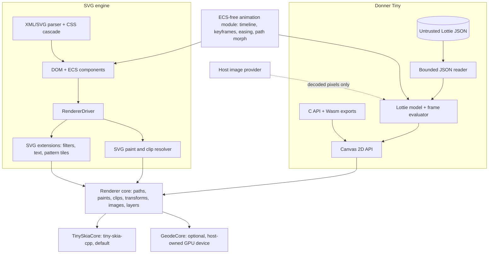
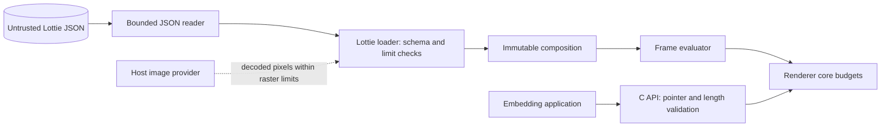

# Design: Donner Tiny Embeddable Vector Runtime

**Status:** Draft
**Author:** Jeff McGlynn
**Model:** Not recorded
**Created:** 2026-10-14
**Tracking:** v1.0 "Embeddable Runtime: Donner Tiny" ([ProjectRoadmap](../ProjectRoadmap.md))

## Summary

Donner Tiny is a small embeddable vector runtime built from Donner's renderer layer instead of its
SVG document stack. It targets the same class of product as ThorVG: embedded UI rendering, icon and
widget drawing inside a host application, and Lottie animation playback, with a binary footprint
in ThorVG's size class.

Donner Tiny does not parse SVG. It has two front ends:

- a **canvas-style 2D API**: immediate-mode paths, paints, gradients, clips, transforms, images,
  and layers, comparable to an HTML canvas 2D context; and
- a **Lottie player** (probable): loads Lottie JSON and renders frames through the same API.

SVG content continues to go through the SVG engine (parser, DOM, CSS cascade, ECS, renderer driver)
in whichever build profile an embedder selects. Keeping SVG out of Donner Tiny means there is
exactly one SVG front end to keep conformant, and the two products divide the space cleanly: Donner
Tiny competes on embedded drawing and (probably) Lottie playback, while the SVG engine keeps the SVG
document niche (styling, DOM, editing, round-trip).

The enabling work is a **renderer core**: an ECS-free, SVG-free drawing interface factored out of
`donner/svg/renderer/RendererInterface.h`. The tiny-skia and Geode backends implement it, the SVG
renderer is rebuilt on top of it, and Donner Tiny is a thin front end over it. The extraction is
incremental: each step keeps the existing renderer test suites green and pixel output unchanged.

## Goals

- A renderer core with no dependency on the ECS (`@entt`, `donner/base/EcsRegistry.h`), SVG
  components, the CSS engine, or the XML/SVG parsers, enforced by Bazel dependency audits.
- `RendererTinySkia` and `RendererGeode` implement the renderer core; the SVG renderer
  (`RendererDriver` and its backends' SVG-specific extensions) draws through it, with no pixel
  changes on the existing golden suites.
- A Donner Tiny runtime with a stable C++ API and a C API usable from language bindings,
  WebAssembly, and embedded targets. Consumers of Donner Tiny do not link the SVG parser, CSS
  engine, or ECS.
- tiny-skia-cpp as the default backend (software, SIMD-accelerated, zero external dependencies);
  Geode as an optional backend for hosts that already own a GPU device.
- One ECS-free animation timeline and interpolation module shared by the SVG animation system and
  the Lottie player.
- A Lottie player (probable) covering a documented, tested subset of Lottie.
- A minimal Donner Tiny build in ThorVG's size class, measured against ThorVG's minimal build by
  the renderer bakeoff harness, with a size budget that CI enforces once a baseline exists.
- Untrusted Lottie input handled under Donner's existing security doctrine: bounded parsing,
  resource limits, fuzzing, and no network or filesystem authority.

## Non-Goals

- Parsing, rendering, or converting SVG in Donner Tiny. An SVG importer would recreate a second
  SVG front end; embedders that need SVG use the SVG engine.
- Replacing or deprecating the SVG engine or its build profiles. The SVG engine's minimal profile
  (today `--config=tiny`) remains a separate, SVG-capable product.
- A retained scene graph with partial-redraw invalidation in the first release. The canvas API is
  immediate mode; damage tracking is future work.
- Text rendering in Donner Tiny's first release, including Lottie text layers. Text needs fonts,
  shaping, and a font security boundary that conflict with the footprint target.
- Lottie expressions (embedded JavaScript), 3D layers and cameras, audio layers, and After Effects
  effects outside the documented subset.
- Fetching anything over the network or from the filesystem on behalf of content.
- Pixel-identical output with ThorVG, lottie-web, or any other Lottie runtime. Conformance is
  judged against Donner's own golden corpus and documented semantics.
- A committed size number before it has been measured.

## Next Steps

- Land the ECS-free geometry target and the renderer-core value types behind dependency audits
  (Milestone 1).
- Move gradient resolution out of the backends into an SVG-side resolver so backends consume
  resolved paint values (Milestone 2); this is the first step that removes registry reads from
  `RendererTinySkia.cc`.
- Decide whether to rename the SVG engine's `tiny` build profile so the Donner Tiny name is
  unambiguous (Milestone 9, independent of the other milestones).

## Implementation Plan

- [ ] Milestone 1: ECS-free foundations
  - [ ] Split an ECS-free geometry target out of `//donner/base` (`Path`, `PathOps`,
        `Transform`, `Box`, `Vector2`, `FillRule`, `MathUtils`, `SmallVector`, and their
        transitive base dependencies such as `BezierUtils`, `Utils`, and `RcString`); today
        `//donner/base` depends on `@entt` for every consumer.
  - [ ] Add `donner/render/core/` with the renderer-core value types (color, paint, gradient,
        stroke style, clip, layer, shared image source, cache key) and the moved
        `RendererSurfaceBudget` and `RendererDrawBudget`, plus the raster dimension and decoded-byte
        limit constants from `ImageLoader.h` and `ImageSampling.h`.
  - [ ] Add `configured_dependency_audit_test` audits for the core, animation, and Lottie
        targets that forbid `@entt` and the `//donner/svg`, `//donner/css`, and
        `//donner/base/xml` packages.
- [ ] Milestone 2: Resolved paints for the existing backends
  - [ ] Add an SVG-side paint resolver that turns `components::ResolvedPaintServer` plus the
        gradient components into core `LinearGradient` and `RadialGradient` values, including
        `objectBoundingBox` units, `gradientTransform`, spread method, and stop fallback.
  - [ ] Switch `RendererTinySkia` and `RendererGeode` to consume resolved gradients; delete their
        direct reads of `GradientComponent`, `LinearGradientComponent`, and
        `RadialGradientComponent`.
  - [ ] Record resolved paint values in `RenderSnapshot`, so recorded commands stop naming even
        the snapshot-owned entities it copies paint servers into today.
- [ ] Milestone 3: Renderer core interface on tiny-skia
  - [ ] Define `render::RendererCore` (frame, transform stack, clips, layers, alpha and luminance
        masks, fill, stroke, image, snapshot).
  - [ ] Extract `render::TinySkiaCore` from `RendererTinySkia`; `RendererTinySkia` forwards its
        path, shape, image, clip, layer, and mask methods to it.
  - [ ] Replace `EntityHandle` cache keys with core geometry keys and explicit invalidation; move
        `TinySkiaPathCacheComponent` and `TinySkiaImageCacheComponent` storage from entities
        into the backend; keep ECS-driven invalidation in the SVG layer.
  - [ ] Add the shared core conformance suite and run it on `TinySkiaCore`.
- [ ] Milestone 4: Renderer core interface on Geode
  - [ ] Extract `render::GeodeCore`; move `GeodePathCacheComponent`-style caches to
        backend-owned storage keyed by geometry keys.
  - [ ] Run the core conformance suite on Geode in the existing GPU lanes.
- [ ] Milestone 5: SVG renderer built on the core
  - [ ] `RendererDriver` issues path, shape, image, clip, layer, and mask work to the core.
  - [ ] Narrow `RendererInterface` to SVG extensions (document entry point, filter layers, text,
        pattern tiles) that compose on top of the core, with a release note for third-party
        implementers.
- [ ] Milestone 6: Donner Tiny canvas runtime
  - [ ] `donner/tiny/` C++ canvas API over `RendererCore`, tiny-skia by default.
  - [ ] C API (`donner_tiny.h`) with ABI versioning, plus a WebAssembly build of it.
  - [ ] Dependency audits proving Donner Tiny excludes the SVG stack, CSS, and ECS.
  - [ ] Optional Geode backend for hosts that supply a GPU device.
- [ ] Milestone 7: Shared animation module
  - [ ] `donner/animation/`: ECS-free timeline, typed keyframe tracks, hold/linear/cubic-Bezier
        easing, spatial (path-following) interpolation, and path morphing.
  - [ ] SVG animation uses it for numeric, path, and transform interpolation and gains
        `calcMode="spline"` through it.
- [ ] Milestone 8: Lottie player (probable)
  - [ ] Bounded JSON reader with resource limits and a fuzzer.
  - [ ] Lottie model, loader, and frame evaluator for the Phase 1 subset.
  - [ ] Golden corpus and per-feature tests; Phase 2 features behind the same gates.
- [ ] Milestone 9: Naming (independent of the other milestones)
  - [ ] Decide the SVG engine profile name (see Naming and build profiles); if renamed, update
        every surface listed there in one change.
- [ ] Milestone 10: Footprint (after Milestone 6 and the bakeoff harness)
  - [ ] Add Donner Tiny products to the renderer bakeoff harness and measure them against
        ThorVG's minimal build with identical feature sets.
  - [ ] Commit a Donner Tiny size budget enforced by `tools/ci/native_linked_size.py`.

## Background

### Why a separate runtime

ThorVG is a format and scene engine: it loads SVG and Lottie into its own scene graph and renders
through software and GPU backends. ThorVG publishes that its core library "can be built with a
binary size as small as approximately 170KB" ([ThorVG README](https://github.com/thorvg/thorvg)).
Its published [Lottie support matrix](https://github.com/thorvg/thorvg/wiki/Lottie-Support) covers
shape layers, trim paths, masks, track mattes, precomps, repeaters, offset paths, text, image
layers, time remapping, a set of layer effects, and a large share of expressions, which it disables
by default behind a build option. LottieFiles' dotLottie player
([dotlottie-rs](https://github.com/LottieFiles/dotlottie-rs)) renders through ThorVG. These are
public context for scope, not targets this design commits to.

A feature-stripped SVG engine that keeps the XML parser, DOM, CSS cascade, and ECS can shrink a
long way (design [0055](0055-binary_size.md) measures it), but it still carries a document stack
that a canvas or Lottie consumer never uses. Donner Tiny removes that stack instead of trimming it.

### The current renderer boundary

`RendererInterface` (`donner/svg/renderer/RendererInterface.h`) is the boundary between
`RendererDriver` and the backends, but it is SVG-shaped and ECS-shaped:

- It includes `donner/base/EcsRegistry_fwd.h`, `RenderingInstanceComponent.h`, `FilterGraph.h`,
  `FilterEffect.h`, `ComputedTextComponent.h`, `ImageResource.h`, and `css/Color.h`, and its Bazel
  target `//donner/svg/renderer:renderer_interface` depends on `//donner/svg/components` and
  `//donner/css:core`.
- `draw(SVGDocument&)` is the entry point.
- `PaintParams` carries `components::ResolvedPaintServer`, whose gradient and pattern alternative
  (`PaintResolvedReference`) is a reference to an entity. Backends resolve it themselves:
  `RendererTinySkia.cc` and `RendererGeode.cc` both include `GradientComponent.h`,
  `LinearGradientComponent.h`, and `RadialGradientComponent.h` and read them from the registry.
- `PathShape::sourceEntity` and `ImageParams::sourceEntity` are `EntityHandle` cache keys.
  `RendererTinySkia` installs `on_update`/`on_destroy` listeners for `ComputedPathComponent` and
  `LoadedImageComponent` (`EnsureCacheInvalidationWired`). Both backends keep per-entity caches in
  components: `TinySkiaPathCacheComponent` and `TinySkiaImageCacheComponent` for tiny-skia,
  `GeodePathCacheComponent` for Geode.
- `ResolvedClip::mask` is a `components::ResolvedMask` (an entity reference plus subtree info),
  `pushFilterLayer` takes a `components::FilterGraph`, `drawText` takes a `Registry&` and a
  `ComputedTextComponent`, and `StrokeParams` includes SVG's `donner/svg/core/Stroke.h` and carries
  SVG's `pathLength`.
- `TextParams` uses `entt::entity` for its text root and span effect owner.

Much of the interface is already generic: the transform stack, isolated layers with opacity and
blend mode, alpha and luminance mask layers, `drawPath`/`drawRect`/`drawEllipse`, image and bitmap
draws, snapshots, and the `RendererSurfaceBudget` and `RendererDrawBudget` resource budgets. The
renderer core is that generic subset, made independent of the SVG types around it.

## Proposed Architecture



### Package layout

- `donner/render/`: renderer core types, `RendererCore`, and `TinySkiaCore`. Depends on the
  ECS-free geometry target and tiny-skia-cpp.
- `donner/render/gpu/`: `GeodeCore`. Depends on the core and `donner/gpu`.
- `donner/animation/`: timeline, keyframe tracks, easing, and path morphing. Depends on the
  ECS-free geometry target.
- `donner/lottie/`: bounded JSON reader, Lottie model, loader, and frame evaluator. Depends on the
  core and the animation module. It is a standalone library: Donner Tiny packages it, and an SVG
  engine host can link it too and render Lottie through the same backend.
- `donner/tiny/`: canvas API, player API, C API, and Wasm exports. Depends on the core, and
  optionally on the Lottie player and Geode.
- `donner/svg/`: the SVG engine, `RendererDriver`, the SVG extensions, and the SVG paint resolver.
  Depends on the core, the GPU core, and the animation module; it does not depend on
  `donner/lottie/` or `donner/tiny/`.

The dependency direction is one-way: nothing under `donner/render/`, `donner/animation/`,
`donner/lottie/`, or `donner/tiny/` depends on `donner/svg/`, `donner/css/`, `donner/base/xml/`, or
`@entt`. The audits in Testing and Validation enforce this.

### Renderer core

The core is a backend-neutral drawing interface whose inputs are fully resolved values. A sketch:

```cpp
namespace donner::render {

struct GeometryKey {          // Opaque cache identity for geometry or images.
  uint64_t id = 0;            // 0 means "no persistent identity".
  uint64_t generation = 0;    // Bumped by the front end when the geometry changes.
};

struct GradientStop { double offset; RGBA8 color; };
struct LinearGradient { Vector2d start, end; SmallVector<GradientStop, 4> stops;
                        SpreadMode spread; Transform2d gradientFromUser; };
struct RadialGradient { Vector2d center; double radius; Vector2d focus; double focusRadius;
                        SmallVector<GradientStop, 4> stops; SpreadMode spread;
                        Transform2d gradientFromUser; };
struct ImageSource {          // Shared ownership: a stored Paint keeps its pixels alive.
  std::shared_ptr<const ImagePixels> pixels;  // Immutable premultiplied RGBA8 and row stride.
  GeometryKey key;            // Cache identity for converted or uploaded forms.
};
struct ImagePaint { ImageSource image; Transform2d imageFromUser; SpreadMode spread;
                    ImageSampling sampling; };
using Paint = std::variant<NoPaint, RGBA8, LinearGradient, RadialGradient, ImagePaint>;

struct FillStyle { Paint paint; FillRule rule = FillRule::NonZero; double opacity = 1.0; };
struct StrokeStyle { Paint paint; double width = 1.0; LineCap cap; LineJoin join;
                     double miterLimit = 4.0; SmallVector<double, 4> dashes;
                     double dashOffset = 0.0; double opacity = 1.0; };

struct DrawGeometry {         // Borrowed for the call unless allowDeferred is set.
  const Path* path = nullptr;
  GeometryKey key;
  bool allowDeferred = false; // Mirrors PathShape::allowDeferredGeometry.
};

struct ClipShape { Path path; FillRule rule; Transform2d clipFromShape; int layer = 0; };
struct ClipSpec {             // Shapes on one layer are unioned; layers are intersected.
  std::optional<Box2d> rect;
  std::vector<ClipShape> shapes;
};

struct LayerParams { double opacity = 1.0; BlendMode blend = BlendMode::Normal;
                     std::optional<Box2d> bounds; };
enum class MaskMode { Alpha, AlphaInverted, Luminance, LuminanceInverted };
enum class LuminanceSpace { SRGB, LinearRGB };

class RendererCore {
public:
  virtual ~RendererCore() = default;
  virtual bool beginFrame(const FrameTarget& target) = 0;  // Size, scale, clear policy.
  virtual void endFrame() = 0;
  virtual void setTransform(const Transform2d& t) = 0;
  virtual void pushTransform(const Transform2d& t) = 0;
  virtual void popTransform() = 0;
  virtual void pushClip(const ClipSpec& clip) = 0;
  virtual void popClip() = 0;
  virtual bool pushLayer(const LayerParams& layer) = 0;
  virtual void popLayer() = 0;
  virtual bool pushMask(MaskMode mode, LuminanceSpace space,
                        const std::optional<Box2d>& bounds) = 0;
  virtual void transitionMaskToContent() = 0;
  virtual void popMask() = 0;
  virtual void fillPath(const DrawGeometry& geometry, const FillStyle& style) = 0;
  virtual void strokePath(const DrawGeometry& geometry, const StrokeStyle& style) = 0;
  virtual void drawImage(const ImageSource& image, const Box2d& target, ImageSampling s) = 0;
  virtual void releaseCached(uint64_t id) = 0;  // Geometry or image entry for this id.
  [[nodiscard]] virtual RendererBitmap takeSnapshot() const = 0;
  [[nodiscard]] virtual RendererSurfaceBudget& surfaceBudget() = 0;
  [[nodiscard]] virtual RendererDrawBudget& drawBudget() = 0;
};

}  // namespace donner::render
```

Design rules for the core:

- **Resolved inputs only.** Units, `objectBoundingBox` mapping, `currentColor`, paint fallback,
  `pathLength` dash scaling, `paint-order`, and `context-fill`/`context-stroke` are resolved by the
  SVG layer before a core call. The core never sees an entity, a CSS value, or a reference.
- **SVG clip semantics fit in one push.** `ClipSpec` carries what `ResolvedClip` carries today:
  an optional rectangle and a list of shapes, each with its own clip rule and transform, unioned
  within a layer and intersected across layers. The SVG resolver folds `clipPathUnitsTransform`
  into each shape's transform. A clip that references a mask (`ResolvedClip::mask`) is lowered by
  the SVG layer to a core mask.
- **Explicit cache identity.** `GeometryKey` replaces `EntityHandle` as the cache key. Ids are
  unique per core instance, not per front end: the core hands out id namespaces, and the SVG layer
  derives an id from its registry's namespace plus the entity, so two documents drawn by one core
  never collide. The SVG layer bumps the generation where it currently relies on
  `ComputedPathComponent`/`LoadedImageComponent` listeners; the canvas API derives it from retained
  path objects. Geometry that is a distinct variant of the same entity, such as a
  `vector-effect: non-scaling-stroke` centerline already transformed by `PathShape::hostFromLocal`,
  gets a distinct id that the SVG layer derives from the entity and that transform. A zero key
  disables caching; the conformance suite checks that a zero key and a nonzero key render the
  same pixels.
- **Cache retention is bounded.** Geometry and images share the key and retention rules. A key's
  cache entry holds one generation: drawing a newer generation replaces the older entry.
  `RendererCore::releaseCached(id)` drops an entry when the front end destroys its source (an erased
  entity, a destroyed retained path or image, an unloaded composition), and the backend additionally
  evicts least-recently-used entries past a fixed byte budget, so animated geometry that bumps its
  generation every frame cannot accumulate. Removal is retirement, not immediate destruction: a
  GPU backend parks released, replaced, and evicted entries until every submission that may
  reference them has completed, following the deferred release Geode already applies to
  resident-path slabs and pooled buffers (`GeodeResidentPathComponent.h`, `GeodeBufferPool.h`); the
  software backend frees them at the next frame boundary. Live and retired allocations remain
  charged to the same fixed byte budget until actual destruction. If in-flight retirements leave
  insufficient budget, reject the new allocation/frame with the existing resource-exhaustion
  result; eviction does not create capacity until completion. Never block under document access
  or reuse storage still referenced by a submission. `//donner/render/tests:render_cache_tests`
  must hold completions during repeated generation churn and assert the combined live-and-retired
  footprint stays within budget, then verify recovery after completion.
- **Borrowing stays opt-in.** As with `PathShape` today, a key alone does not permit deferral: a
  backend may retain the geometry past the call only when `allowDeferred` is set and the key is
  nonzero, and the front end guarantees that geometry stays alive and unchanged until the deferred
  draws flush. Images need no such rule: `ImageSource` shares ownership of immutable pixels, so a
  stored `Paint` or a deferred draw keeps them alive. This replaces the SVG renderer's
  `ImageResource` copies and the entity-keyed `TinySkiaImageCacheComponent` with one image
  contract.
- **Budgets live in the core.** `RendererSurfaceBudget` and `RendererDrawBudget` move to the core
  unchanged, so every front end, including untrusted Lottie, gets the same per-frame admission
  limits. `RendererFilterPreparationBudget` and `RendererTextMaterializationBudget` stay with the
  SVG extensions that use them.
- **Static-initializer cost is measured.** The repository already builds with `-fno-exceptions`
  and `-fno-rtti`. The geometry headers (`Path.h`, `Transform.h`, `Box.h`, `Vector2.h`) include
  `<ostream>` for their `operator<<` overloads; if the footprint measurement attributes iostream
  cost to a minimal Donner Tiny link, those operators move into separate headers. This is a
  measured target, not an enforced rule.
- **Double-precision geometry by default.** The core uses Donner's existing double-precision
  `Path` and `Transform2d` so the SVG engine is unaffected. Whether Donner Tiny wants a float
  geometry variant for size or speed is an open question, answered by measurement.

What stays outside the core, as SVG extensions layered on it:

- **Filters.** `pushFilterLayer(const components::FilterGraph&, ...)` remains an SVG extension.
  The tiny-skia filter executor (`FilterGraphExecutor`) and Geode's filter engine render into core
  layers. A small set of core effects (for example Gaussian blur and drop shadow) may later be
  promoted for Lottie layer effects.
- **Text.** `drawText(Registry&, const ComputedTextComponent&, const TextParams&)` remains an SVG
  extension. A later core addition could accept positioned glyph outlines as paths.
- **Pattern tiles.** `beginPatternTile`/`endPatternTile` stay on the SVG side initially. They can
  later be expressed as "render into an offscreen core layer, then paint with `ImagePaint`".
- **Document entry and compositor integration.** `draw(SVGDocument&)`, texture snapshots used by
  the compositor, and readback statistics stay on `RendererInterface`.

### Incremental extraction

The extraction never forks the renderer. Each milestone leaves one code path, and the SVG output
is unchanged at every step:

1. **Foundations.** Add the ECS-free geometry target and the core value types with dependency
   audits. Nothing consumes them yet, so there is no behavior change.
2. **Resolved paints.** Move gradient resolution (currently `resolveGradientCoords` and
   `resolveGradientTransform` in `RendererTinySkia.cc`, and the equivalent code in
   `RendererGeode.cc`) into one SVG-side resolver that produces core gradient values. Both backends
   consume the resolved values. This step changes the most visible behavior surface, so it is gated
   on the full golden suites for both backends, with the resvg `paint-servers/linearGradient` and
   `paint-servers/radialGradient` categories (including focal-point and spread-method cases) as
   the explicit acceptance set; it also removes a source of tiny-skia/Geode
   divergence, because both backends share one resolution.
3. **Core on tiny-skia.** `TinySkiaCore` owns the pixmap, the clip and layer stacks, and the
   tiny-skia painting code. `RendererTinySkia` keeps implementing `RendererInterface` and forwards
   generic operations to its `TinySkiaCore`. Cache invalidation moves from registry listeners in
   the backend to generation bumps issued by the SVG layer, and the tiny-skia cache components move
   into backend-owned storage.
4. **Core on Geode.** The same split for `RendererGeode`. Geode's per-entity component caches move
   to backend-owned maps keyed by `GeometryKey`, which also lets Geode serve Donner Tiny.
5. **SVG renderer on the core.** `RendererDriver` calls the core directly for generic operations.
   `RendererInterface` shrinks to the SVG extensions. `MockRendererInterface` and
   `RenderSnapshotRecorder` split accordingly.

`RendererInterface` is a public target, and third-party backends may implement it. Milestones 2
through 4 keep it source-compatible: new resolved-paint fields are added alongside the existing
ones, `PathShape` and `ImageParams` keep `sourceEntity`, and the forwarding layer inside each
backend derives the `GeometryKey` from it. Backends switch over internally. Milestone 5 is the one
intentional break: it removes the generic methods that move to the core and ships with a release
note describing how a custom backend implements `RendererCore` instead. Whether to also ship an
adapter from the old interface is an open question.

A step that changes a golden is a bug in that step, not a golden update. The exception is a
documented, intentional fix found during extraction (for example a gradient-resolution divergence
between backends), which lands as its own change with its own evidence.

### Donner Tiny canvas API

The C++ API is a thin, immediate-mode wrapper over `RendererCore`:

```cpp
namespace donner::tiny {

class Canvas {
public:
  static std::unique_ptr<Canvas> CreateSoftware(int width, int height, const Limits& limits = {});
  Status beginFrame();               // Resets per-frame budgets.
  Status endFrame();                 // Commits an admitted frame, or discards a refused one.
  Status save();                     // Transform, clip, and layer state.
  Status restore();
  Status transform(const Transform2d& t);
  Status clip(const PathRef& path, FillRule rule = FillRule::NonZero);
  Status fill(const PathRef& path, const Paint& paint, FillRule rule = FillRule::NonZero);
  Status stroke(const PathRef& path, const Paint& paint, const Stroke& stroke);
  Status drawImage(const ImageRef& image, const Box2d& target);
  Status beginLayer(double opacity, BlendMode blend);
  Status endLayer();
  Status frameStatus() const;        // Sticky: first refusal or misuse in the current frame.
  PixelView pixels() const UTILS_LIFETIME_BOUND;  // Premultiplied RGBA8, row stride exposed.
};

}  // namespace donner::tiny
```

Drawing happens between `beginFrame()` and `endFrame()`, which map to the core's frame calls, so
each presented frame (including GPU frames that never read pixels back) gets its own draw and
surface budgets. Every call returns a `Status` (the C API returns the same codes), and the first
refusal or misuse in a frame also latches in `frameStatus()`, so hosts that ignore per-call
results still see it at `endFrame()`. Draw calls outside a frame return an error. `save`/`restore`
and layers must balance within one frame; `endFrame` unwinds any that do not and reports it.

Frames are transactional. Each frame renders into a staging target (the software backend's back
buffer, or a GPU frame that is not yet presented); `endFrame()` publishes it only when every call
in the frame was admitted. A refusal latches, later draws in that frame become no-ops, and
`endFrame()` discards the staging target, so the published pixels stay those of the last admitted
frame. The software canvas pays one extra frame buffer for this guarantee.

`PixelView` borrows the canvas's pixel storage: it is valid until the canvas is destroyed or the
next drawing call, `beginFrame()`, `endFrame()`, or other publication/storage swap, including an
empty frame that publishes a cleared staging buffer. `UTILS_LIFETIME_BOUND` flags a view that outlives a
temporary canvas. Hosts that need to keep pixels copy them out.

`PathRef` is either a transient `Path` or a retained path object that carries a stable
`GeometryKey`, so hosts that redraw the same icon every frame get cache reuse. `ImageRef` is the
same for images: a retained image object wraps an `ImageSource` with a stable key. A GPU canvas is
created from a host-supplied device through the Geode backend when it is compiled in.

The C API mirrors it with opaque handles, explicit create and destroy, status-code returns, and
caller-owned pixel buffers: `donner_tiny_canvas_create`, `donner_tiny_path_*`,
`donner_tiny_canvas_fill`, `donner_tiny_lottie_load`, `donner_tiny_lottie_render_frame`, and so on.
Every pointer and length pair is validated, dimensions are checked before allocation, and the
header compiles as C: no C++ type crosses the boundary. The header exposes
`donner_tiny_abi_version()`, and the policy is that the C ABI is append-only within a major
version. The WebAssembly build exports the C API and follows the
standalone renderer Wasm rules in the [threat model](../threat-model.md).

### Shared animation module

Today SVG interpolation lives in `donner/svg/components/animation/AnimationSystem.cc` and works on
strings: `interpolateAnimateValue`, `interpolateTransformValue`, and `interpolatePaths` parse,
blend, and re-serialize values, and spline `calcMode` is deferred. Lottie needs the same concepts
on typed values: keyframes with hold, linear, and cubic-Bezier easing, spatial tangents for
position paths, and shape morphing between compatible paths.

`donner/animation/` provides those as ECS-free value types:

- `Timeline`: frame rate, in and out points, time stretch, and offset composition for nested
  timelines (Lottie precomps; SVG's document time).
- `KeyframeTrack<T>` for scalars, vectors, colors, and paths, with `Easing` = hold, linear, or
  cubic Bezier (the same function as SVG `keySplines` and CSS `cubic-bezier()`).
- `SpatialPath` for position keyframes with in and out tangents.
- `MorphPath`: interpolation between structurally compatible `Path` values, generalizing
  `arePathsCompatible`/`interpolatePaths`.

The SVG animation system keeps its SMIL timing model, sandwich composition, and ECS integration;
it delegates value interpolation to this module. The Lottie player uses the module directly. One
easing and interpolation implementation means one set of numeric edge cases to test and fuzz.

### Lottie player (probable)

The Lottie player is probable, not committed: it lands if the renderer core and canvas runtime
meet their footprint and quality gates. The player is ECS-free and does not import Lottie into the
SVG DOM. It ships with Donner Tiny and is also usable by SVG engine hosts, which satisfies the
roadmap's Lottie item under SVG Animation; what it shares with the SVG animation system is the
timeline and interpolation module below the player. The model follows the
[Lottie specification](https://lottie.github.io/) published by the Lottie Animation Community.

The loader parses JSON into an immutable composition model (layers, shapes, keyframe tracks,
assets). A player evaluates the model at a frame time and issues canvas calls. A loaded
composition is immutable and may be shared across threads; each player instance holds its own
mutable playback state.

- **Phase 1:** shape layers; groups; rectangle, ellipse, path, and polystar shapes; solid fills;
  strokes with dashes; linear and radial gradient fills and strokes; layer and group transforms
  (anchor, position including split dimensions, scale, rotation, skew, opacity); parenting; null
  and solid layers; trim paths; layer in and out points.
- **Phase 2:** precomps with time stretch and offset; masks (add, subtract, intersect, opacity);
  track mattes (alpha, inverted alpha, luminance, inverted luminance); image layers through the
  host image provider; markers for segment playback.
- **Later:** repeaters, merge paths, offset paths and mask expansion, rounded corners, time
  remapping, theming slots, the `.lottie` container, and a small set of layer effects.
- **Out of scope:** expressions (embedded JavaScript), text layers, 3D layers and cameras, and audio
  layers.

Expressions are out of scope because they require a script engine, which conflicts with both the
footprint target and the security model. Unsupported features are reported through a load
diagnostic that names the feature, and the player skips that element and renders the rest
instead of approximating it.

Images in Lottie assets resolve only through an embedder-installed image provider. The runtime
never fetches a URL or opens a path named by content. Embedded base64 image data is handed to the
provider as bytes; with no provider installed, image layers render nothing. The provider returns
decoded pixels, which pass the same dimension and byte limits as Donner's raster input. Those
limits live under `//donner/svg` today (`ImageLoader.h`, `ImageSampling.h`), so Milestone 1 moves
the constants into the core.

### Backends

- **tiny-skia (default).** `TinySkiaCore` over `third_party/tiny-skia-cpp`: software
  rasterization with SIMD paths for x86-64 (AVX2+FMA) and ARM64 (NEON), a scalar fallback, and no
  external dependencies. This is the backend for embedded targets and the size target.
- **Geode (optional).** `GeodeCore` for hosts that already own a WebGPU, Metal, or Vulkan device
  and want GPU rendering. It is never required, and a minimal Donner Tiny build does not link it;
  `//donner/svg/renderer:geode_excludes_tiny_skia_audit` is the existing model for keeping
  backend closures separate.

### Naming and build profiles

Two things are currently called "tiny": the SVG engine's `tiny` profile and this runtime. The
roadmap already separates them in prose ("SVG engine build profiles" with `tiny`, `standard`, and
`full`, versus "Embeddable Runtime: Donner Tiny"), but the build surface still uses the bare name:

- `.bazelrc` defines `--config=tiny` (filters and text off) and documents it as `donner-tiny`,
  next to `donner-max` for `--config=text-full`;
- `tools/cmake/gen_cmakelists.py` generates a `tiny` CMake configuration;
- `build_defs/rules.bzl` has a `tiny` entry in `_VARIANT_SPECS` that generates `{name}_tiny` test
  wrappers for every test that opts into it; and
- current-state docs such as `docs/faq.md` refer to `--config=tiny`.

This design recommends renaming the SVG engine profile to `svg-minimal` across all of those surfaces
in one change, with `--config=tiny` forwarding to it for one release, so "tiny" in a build command
never means the SVG engine. `standard` remains the default build, and the closest existing
configuration to the roadmap's `full` profile is `--config=text-full`; this design does not add new
profiles. The rename is an open question for the project owner. Until it is decided, docs say "the
SVG engine's `tiny` profile" and "Donner Tiny" explicitly.

Donner Tiny itself is selected by depending on `//donner/tiny` targets, not by a global
configuration flag; build flags under `//donner/tiny` select optional pieces (Lottie, Geode).

### Footprint

The target is ThorVG's size class: a minimal Donner Tiny build (canvas API plus `TinySkiaCore`)
compared against ThorVG's minimal build with the same feature set, and a Lottie-enabled build
compared against ThorVG built with its Lottie loader. ThorVG's ~170 KB figure is ThorVG's
published claim for its core library; this design does not claim a Donner number until it is
measured.

Measurement uses the renderer bakeoff harness proposed in design 0066, which is in review alongside
this design and is planned as a nested Bazel module under `benchmarks/renderer_bakeoff/`. Donner
Tiny adds products to it, built with matched optimization settings for both libraries. Linked size
is read the way `tools/ci/native_linked_size.py` reads it (allocated program bytes, read-only and
writable, excluding debug and dynamic-linking metadata), and WebAssembly is reported raw and
gzip-compressed as in `tools/binary_size.sh`. Levers available from design
[0055](0055-binary_size.md) and the existing toolchain: ThinLTO, identical-code folding, `-Oz`,
dead-section elimination, and per-module attribution with bloaty. Once measured, Donner Tiny gets a
committed budget enforced by the same linked-size check that design
[0064](0064-gpu_release_matrix.md) uses for shipped products.

## Security / Privacy

Lottie JSON is untrusted input from the same class of sources as SVG: downloaded assets, user
uploads, and third-party animation libraries. Canvas API calls come from the embedding application
and are trusted for intent but still bounded for resources, because hosts often forward
content-derived geometry. Donner Tiny follows the [threat model](../threat-model.md): bounded
parsing, explicit host capabilities, sticky refusal, and recovery without partial state.



### Trust boundaries

- **No ambient authority.** Donner Tiny performs no network access and no filesystem access on
  behalf of content. Image assets go through the host image provider, mirroring
  `ResourceLoaderInterface` for documents: no provider means no images.
- **C and Wasm boundary.** Every pointer and length pair is validated; sizes use checked
  arithmetic; handle misuse (double destroy, use after destroy, cross-canvas handles) returns an
  error instead of corrupting memory where the handle table can detect it.

### Resource limits

The loader enforces independent limits, all configurable downward by the embedder. Initial
defaults are proposals to be calibrated against a real-world corpus before release:

| Limit                               | Proposed default                                  |
| ----------------------------------- | ------------------------------------------------- |
| Input bytes                         | 16 MiB (matches the SVG parser's input cap)       |
| JSON nesting depth                  | 128                                               |
| JSON values (total)                 | 4 Mi                                              |
| String bytes (single value)         | 1 MiB (embedded images go through the provider)   |
| Layers (total, across precomps)     | 16 Ki                                             |
| Keyframes per property / total      | 16 Ki / 1 Mi                                      |
| Path vertices per shape / per frame | 64 Ki / 4 Mi                                      |
| Precomp nesting depth               | 16, with cycle detection on asset references      |
| Image assets / decoded bytes        | Existing raster limits, shared aggregate budget   |
| Frame rate and duration             | Finite, positive, bounded; non-finite numbers are |
|                                     | rejected at load                                  |

Per-frame work is bounded by the core's `RendererDrawBudget` (draw calls, path commands, gradient
stops, image draws and bytes) and `RendererSurfaceBudget` (layer, mask, and matte surfaces), so a
small file that expands into heavy work through precomp reuse, repeaters, or nested mattes is
refused at render time as well as at load. A refusal is an expected error: it must not abort or
expose a half-loaded composition, and the previous frame must remain valid.

### Fuzzing and negative tests

Donner Tiny adds `donner_cc_fuzzer` targets for the JSON reader, the Lottie loader, frame
evaluation at fuzzer-chosen times, and the C API call sequence, with seed corpora checked in next
to them. Exact-limit and one-past-limit tests cover every row of the limits table, as the threat
model's validation requirements already demand for parser budgets.

## Testing and Validation

Every invariant this design claims names the CI target that enforces it or is listed as a gap.
New target names are proposals.

Existing targets that guard the extraction:

- **SVG pixel output is unchanged by each extraction step:**
  `//donner/svg/renderer/tests:resvg_test_suite`, `:renderer_tests`, `:renderer_regression_tests`,
  `:renderer_geode_golden_tests`, and `:renderer_geode_tests`.
- **Driver call sequences change only where intended:**
  `//donner/svg/renderer/tests:renderer_driver_tests` (through `MockRendererInterface`).
- **Recorded snapshots replay identically:** `//donner/svg/renderer/tests:renderer_snapshot_tests`.
- **Rendering through the public API is unchanged:**
  `//donner/svg/renderer/tests:renderer_public_api_tests`. This is a behavioral test; it does not
  check `RendererInterface` source compatibility (see Known gaps).
- **Snapshots hold no live registry references:** the
  `liveRegistryReferenceCountForTesting` checks in
  `//donner/svg/renderer/tests:renderer_snapshot_tests`.
- **SVG animation output is unchanged by the shared animation module:**
  `//donner/svg/renderer/tests:renderer_animation_tests`.
- **Hostile SVG input stays memory-safe through the refactor:** the corpus regression tests of
  `//donner/svg/renderer/tests:svg_document_render_fuzzer` and `:svg_document_raster_fuzzer`.

New targets (names are proposals):

- **The core, animation, and Lottie libraries have no ECS, CSS, XML, or SVG dependency:**
  `//donner/render:core_dependency_audit`, `//donner/animation:animation_dependency_audit`, and
  `//donner/lottie:lottie_dependency_audit`, each a `configured_dependency_audit_test` with `@entt`
  (the whole repository), `//donner/svg`, `//donner/css`, and `//donner/base/xml` in
  `forbidden_packages`, so an alias such as `@entt//:entt` cannot slip past an exact-label match.
  Each audit counts as enforcement only after a deliberate red run. These must be configured audits:
  `forbidden_transitive_dep_test` queries the unconfigured graph, where every `select` branch is
  present.
- **Donner Tiny excludes the SVG stack, CSS, and ECS:** `//donner/tiny:tiny_dependency_audit`, the
  same configured audit anchored on the shipped Donner Tiny products.
- **A minimal Donner Tiny build does not link Geode:** `//donner/tiny:tiny_excludes_geode_audit`, a
  configured audit of the minimal product in its default configuration (Geode selected off).
- **Lottie image assets never reach a loader on their own:**
  `//donner/lottie/tests:lottie_loader_tests` checks that image layers with no provider render
  nothing and that the provider receives only embedded bytes, never a URL or path to open.
- **Both backends implement core semantics within shared golden tolerances, and a zero geometry
  key renders the same pixels as a nonzero one, and two front ends drawing through one core never
  share a cache entry:** `//donner/render/tests:core_conformance_tests`,
  run per backend through `donner_multi_transitioned_test`.
- **Geometry and image caches stay within their byte budget under generation churn and release
  entries for destroyed sources, and GPU entries released or evicted before submission or while
  earlier submissions are in flight are retired only after those submissions complete:**
  `//donner/render/tests:render_cache_tests`, run per backend.
- **Canvas frames reset budgets, reject draws outside a frame with an error status, unwind
  unbalanced state, and leave the last admitted frame published when a frame is refused:**
  `//donner/tiny/tests:canvas_tests`.
- **The shared animation module matches its documented interpolation and easing:**
  `//donner/animation:animation_tests`.
- **Lottie limits admit exactly at and refuse one past each limit, and a refused load or frame
  leaves the player and its last frame unchanged:** `//donner/lottie/tests:lottie_limits_tests`.
- **Unsupported Lottie features produce a named diagnostic and are skipped:**
  `//donner/lottie/tests:lottie_loader_tests`.
- **The JSON reader, loader, and frame evaluator are memory-safe on hostile input:**
  `//donner/lottie:json_reader_fuzzer`, `:lottie_loader_fuzzer`, and `:lottie_frame_fuzzer`; each
  `donner_cc_fuzzer` target also yields a corpus regression test that runs in CI.
- **Lottie features render as documented:** `//donner/lottie/tests:lottie_golden_tests` over an
  in-repo corpus, on both backends.
- **The C API validates handles, pointers, and lengths:** `//donner/tiny/tests:c_api_tests` and
  `//donner/tiny:c_api_fuzzer`.
- **`donner_tiny.h` is a C header:** `//donner/tiny/tests:c_header_compile_test`, a C translation
  unit that includes the header and calls every entry point.
- **The WebAssembly build loads and renders:** a Donner Tiny Wasm render test modeled on
  `//donner/svg/renderer/wasm:render_test`.
- **Donner Tiny stays within its size budget:** a Donner Tiny product budget checked by
  `tools/ci/native_linked_size.py`, added once a baseline is measured. Until then this is a gap.

The core conformance suite is new and backend-neutral: it draws through `RendererCore` only (fills,
strokes, joins and caps, dashes, gradients with every spread mode, clip nesting and mixed clip rules
within one clip, layers with each blend mode, all four mask modes, both luminance spaces for the
luminance modes, image sampling, zero versus nonzero geometry keys). It compares each backend
against shared goldens by calling the canonical `bitmap_golden_compare` API directly
(`CompareBitmapToGolden`), and compares zero-key and nonzero-key renders with
`CompareBitmapToBitmap` and `PixelmatchIdentityParams`; it adds no local tolerance wrapper. It
replaces nothing; the SVG suites keep guarding SVG semantics, and the core suite pins what Donner
Tiny can rely on independent of SVG.

The Lottie golden corpus is authored in-repo or drawn from permissively licensed sources with
recorded provenance, one small file per feature plus a few composite animations, rendered at fixed
frame times and compared with `CompareBitmapToGolden`.

Known gaps:

- The ThorVG comparison (size, render time, memory, output quality) runs in the bakeoff harness,
  which is a benchmark, not a CI gate. Size is gated by the linked-size budget; speed and quality
  relative to ThorVG are reported, not enforced.
- Nightly performance regressions are advisory today, so "no performance regression" from the
  extraction is reviewed evidence rather than a failing CI target. Follow-up: decide whether the
  extraction milestones get a temporary blocking perf comparison.
- `RendererInterface` source compatibility for third-party backends has no CI check; the
  compatibility policy in Incremental extraction is enforced by review.
- The append-only C ABI policy has no ABI-diff check yet. Follow-up: add one before the first
  release that promises ABI stability.
- Sharing one loaded composition across threads is a documented contract without a CI target.
  A shared-composition test under `--config=tsan` is planned, but no CI lane runs that
  configuration today.
- Whether iostream reaches a minimal Donner Tiny link is measured by the footprint work, not
  enforced.
- Lottie conformance has no external test suite in the repository comparable to the resvg suite;
  coverage is bounded by the in-repo corpus.

## Alternatives Considered

- **A Donner Tiny that keeps the SVG stack (a smaller `--config=tiny`).** Keeps one product but
  carries the parser, DOM, CSS, and ECS. It can shrink but not reach a renderer-only footprint, and
  it does nothing for Lottie.
- **An SVG importer in Donner Tiny (NanoSVG-style flattening).** Attractive for icons, but it is a
  second SVG front end with its own conformance gaps, which is exactly what this design avoids.
  Hosts that need SVG icons can rasterize them offline with the SVG engine or link the SVG engine.
- **Lottie through the SVG DOM (translate Lottie into SVG elements and animate them).** Reuses the
  animation system, but Lottie semantics (mattes, trim paths, precomp time remapping) map poorly
  onto SMIL and the cost of the DOM defeats the footprint goal. The shared animation module keeps
  the reuse without the DOM.
- **Wrapping `RendererInterface` as is.** Fastest to start, but every Donner Tiny build would link
  the ECS and SVG components through the interface's headers.
- **A third-party JSON library.** Mature parsers exist, but the zero-dependency goal, the need for
  limits enforced inside the parser (not after building a full DOM), and fuzzing ownership favor a
  small bounded pull reader in-tree.

## Open Questions

- Should Donner Tiny's geometry use float to save size and bandwidth, or stay on the shared
  double-precision `Path`? Decide from bakeoff measurements; a float variant would need its own
  conformance coverage.
- Where does Lottie stop being probable? Proposed gate: the canvas runtime meets its size budget
  and the Phase 1 corpus renders correctly on tiny-skia.
- Do the extraction milestones need a temporary blocking performance comparison, given that the
  nightly perf lane is advisory?
- Should the `.lottie` container (zip with a manifest) be supported in-tree using the existing
  zlib dependency, or left to hosts that unpack it and pass JSON and images separately?
- Should Lottie layer effects (blur, drop shadow) reuse the SVG filter executors through a small
  core effect interface, or stay out to protect the footprint?
- Rename the SVG engine's `tiny` profile to `svg-minimal`? The recommendation and the affected
  surfaces are in Naming and build profiles.
- When `RendererInterface` narrows in Milestone 5, should Donner ship an adapter that runs an
  old-style third-party backend on top of the core, or only a migration note?
- Is `donner/render/` the right home for the core, given the existing `donner/svg/renderer/` and
  `donner/gpu/` packages, or should the core live under `donner/svg/renderer/core/` until the SVG
  renderer has fully moved onto it?

## Future Work

- [ ] Retained scene and damage tracking for partial redraws in long-running UIs.
- [ ] Text in Donner Tiny through positioned glyph outlines, with an explicit font trust model.
- [ ] Threaded frame rendering for the Lottie player, reusing the worker pool design in
      [0061](0061-multithreaded_rendering.md).
- [ ] Language bindings over the C API.
