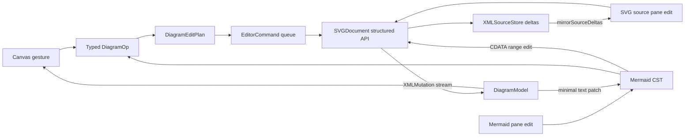
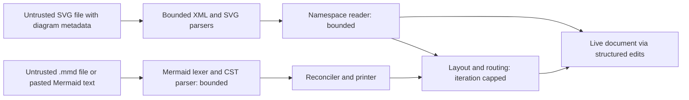

# Design: Structured Diagramming and Mermaid-Compatible Mode

**Status:** Draft. No implementation exists; this doc proposes the file format, editing model,
Mermaid view, layout and routing engines, and their trust boundaries.
**Author:** Jeff McGlynn
**Created:** 2026-10-14

## Summary

Donner's editor already keeps a live canvas and the SVG source text as two synchronized views of one
document, with canvas edits written back as minimal byte-level source deltas. This design adds
professional structured diagramming on top of that model: shape libraries (flowchart, UML, BPMN,
entity-relationship, cloud architecture), connectors with attachment points, waypoints and
obstacle-avoiding orthogonal routing, auto-layout, and templates. It also adds a
Mermaid-compatible mode in which Mermaid text is a third synchronized view next to the canvas and
the SVG source.

The central decision is that a diagram is sugar over ordinary SVG. Every diagram node is a real
`<g>` containing real `<rect>`, `<path>` and `<text>` children, and every connector is a real
`<path>` with real markers. A versioned Donner XML namespace adds metadata on top of those elements:
node types, ports, constraints, endpoint references and routing hints. A diagram file is always
valid SVG that renders fully in any viewer. Stripping the namespace loses only diagram semantics,
never appearance.

Diagram operations (move a node, reconnect an edge, relabel, relayout) are typed operations that
compile to the structured edits Donner already ships, so the canvas, the SVG source and the Mermaid
text stay in sync without a full document reparse.

## Goals

- **Seamless downgrade.** A diagram document is valid, fully rendered SVG in any conforming viewer.
  Removing every attribute and element in the diagram namespace leaves the rendered pixels
  unchanged.
- **Lossless preservation.** Donner round-trips diagram metadata it understands and metadata it
  does not understand (for example from a newer namespace version) byte-for-byte through load,
  canvas edits and save.
- **Structured diagram editing.** Users place stencil shapes, connect them through named ports,
  drag nodes while connectors re-route, add waypoints, relabel, and apply templates. Every
  operation is one undoable step.
- **Three synchronized views.** In Mermaid mode, edits in any of canvas, SVG source or Mermaid text
  update the other two incrementally, preserving the author's formatting and comments in both text
  views.
- **Native Mermaid support for a defined subset.** A C++ Mermaid parser covers flowcharts first,
  then sequence, class, state and entity-relationship diagrams. No mermaid.js and no JavaScript
  runtime are involved.
- **Layout and routing.** Layered auto-layout for flowcharts and orthogonal obstacle-avoiding
  connector routing, both incremental and both respecting user-pinned positions and waypoints.
- **CSS-based styling.** Diagram families are styled with real CSS classes in a document `<style>`
  element, so restyling a family is a single CSS edit that any SVG viewer honors.
- **Bounded, hostile-input-safe parsing.** The Mermaid parser and the namespace reader enforce
  explicit resource limits and are fuzzed, including a Mermaid round-trip fuzzer.

## Non-Goals

- Executing Mermaid's JavaScript, loading mermaid.js, or matching Mermaid's pixel output. Donner
  computes its own layout; compatibility means accepting and preserving Mermaid text, not rendering
  identically to the Mermaid reference implementation.
- Full Mermaid grammar coverage. Diagram types outside the milestones (Gantt, pie, journey, git
  graph, mindmap, timeline, quadrant, Sankey, C4 and others) are preserved as text with a
  diagnostic, not rendered.
- Mermaid directives that fetch resources or run code: `click` callbacks, script hooks, external
  icon or image fetches, and `%%{init}%%` options beyond a small allowlisted styling subset.
- Importing or exporting proprietary diagram file formats from other structured diagramming tools.
  Interchange happens through SVG and `.mmd` files.
- Real-time collaboration. Multiplayer editing is tracked by the project roadmap; this design only
  ensures diagram metadata is compatible with element-level reconciliation.
- A general constraint solver (alignment, distribution and equal-spacing constraints beyond pins).
  Those are future work.
- Any new trigger for a full document reparse. Every diagram path uses incremental edits.

## Next Steps

- Review and settle the namespace URI, prefix and schema in
  [Diagram Namespace](#diagram-namespace), then land milestone 1 (recognize the namespace,
  preserve it, and fix the edit-path asymmetries listed there) with its round-trip tests.
- Prototype the flowchart Mermaid concrete syntax tree and its round-trip fuzzer in isolation
  before any editor integration, since that parser is the largest new trust boundary.

## Implementation Plan

- [ ] Milestone 1: Namespace recognition and preservation
  - [ ] Recognize the diagram namespace URI in `SVGParser.cc` so its `xmlns` declaration,
        attributes and elements no longer emit "unsupported namespace" warnings, while staying out
        of the SVG semantic projection.
  - [ ] Make `SVGElement::setAttributeFromXMLMutation` skip diagram-namespace attributes the same
        way the parser does (no generic attribute storage, no full style recompute).
  - [ ] Make an `xmlns` declaration of a non-SVG namespace whose prefix is unused in the subtree
        skip the root re-projection in `SVGDocument::applyAttributeXMLMutation`.
  - [ ] Add `donner/diagram` with a read-only `DiagramModel` reader over `xml::XMLNode`.
  - [ ] Add byte-exact load, edit and save round-trip tests for known and unknown diagram content.
- [ ] Milestone 2: Node and connector editing
  - [ ] Typed diagram operations compiled to `EditorCommand` sequences.
  - [ ] Inverse-command undo entries so diagram undo never restores a full source snapshot.
  - [ ] Port model, connector attach and detach, divergence detection and the repair command.
- [ ] Milestone 3: Orthogonal connector routing with waypoints and incremental re-routing.
- [ ] Milestone 4: Layered auto-layout with pins and incremental relayout.
- [ ] Milestone 5: Stencil libraries (flowchart, UML, BPMN, ERD, cloud architecture) and CSS
      family themes.
- [ ] Milestone 6: Mermaid flowchart, bidirectional
  - [ ] Concrete syntax tree parser with byte ranges and trivia, plus fuzzers.
  - [ ] Text to diagram reconciliation with stable identity.
  - [ ] Diagram to text minimal patching.
  - [ ] Mermaid pane in the editor and `.mmd` import and export.
- [ ] Milestone 7: More Mermaid diagram types: sequence, class, state, entity-relationship (one
      sub-milestone each, each with its own corpus and fuzzer seeds).
- [ ] Milestone 8: Templates (diagram fragments inserted with structured inserts).

## User Stories

- As an engineer, I draw a cloud architecture diagram from a stencil library, attach connectors to
  service ports, and drag services around while connectors re-route around other shapes.
- As a documentation author, I paste a Mermaid flowchart, tidy the layout by hand on the canvas,
  and keep editing the Mermaid text afterwards without losing my manual positions.
- As a reviewer, I open the saved SVG in a browser, a code-review diff view, or another vector
  editor, and it renders exactly as it did in Donner.
- As a designer, I restyle every "decision" node in a flowchart by editing one CSS rule.

## Background

### What ships today

- **Structured editing API.** `SVGDocument::setElementAttribute`, `removeElementAttribute`,
  `insertElement`, `removeElement` and `setElementTextContent` (`donner/svg/SVGDocument.h`) mutate
  source-backed documents through the XML document and return an `xml::ApplySourceEditResult`
  carrying the chosen `ReparseScope`, the committed `XMLSourceDelta`s, the emitted `XMLMutation`s
  and any diagnostic (`donner/base/xml/XMLDocument.h`). `SVGDocument::applyXMLMutations` projects
  those mutations back into SVG semantics.
- **Reverse serialization.** `XMLSourceStore::replace` (`donner/base/xml/XMLSourceStore.h`) edits
  the source bytes, repositions anchors, and returns an `XMLSourceDelta`.
  `DocumentSyncController::mirrorSourceDeltas` (`donner/editor/DocumentSyncController.h`) replays
  DOM-originated deltas into the source pane with change suppression. See
  [Structured Source Editing](../structured_source_editing.md).
- **Incremental source edits.** `XMLDocument::applySourceEdit` classifies an edit as
  `AttributeValue`, `OpeningTag`, `TextNode`, `ElementSubtree` or `Document` scope. Edits inside a
  text node, CDATA section or comment classify as `TextNode` (`GetTextNodeEdit` in
  `donner/base/xml/XMLDocument.cc`).
- **Editor write seams.** Canvas and tool writes enter through `EditorApp::applyMutation` as
  `EditorCommand`s (`donner/editor/EditorCommand.h`), which `AsyncSVGDocument` applies through the
  structured API and accumulates into `lastFlushResult_.sourceDeltas`
  (`donner/editor/AsyncSVGDocument.cc`). See [Editor Architecture](../editor_architecture.md).

### Full-reparse paths to stay away from

Several existing editor paths replace the whole document, and diagram features must not route
through them:

- `EditorCommand::Kind::ReplaceDocument`, and `CutShapes` / `PasteShapes`, which reparse
  serialized bytes into a fresh document (`AsyncSVGDocument.cc`).
- `UndoSnapshot::Kind::DocumentSource` undo entries, which restore by queuing a
  `ReplaceDocumentCommand` (`EditorApp.cc`).
- The source-sync fallback to a queued `ReplaceDocument` when a source-pane edit cannot be handled
  incrementally.

Templates and stencil drops therefore use `InsertElement`, and diagram undo uses inverse structured
commands (milestone 2), never a source snapshot.

### How unknown namespaced content is preserved today

Verified against the current parser and DOM:

- The XML tree keeps every element and attribute regardless of namespace. Source-backed documents
  keep the original bytes in `XMLSourceStore`, so untouched regions serialize byte-for-byte.
- `ParseXmlNsAttribute` (`donner/svg/parser/SVGParser.cc`) accepts the SVG and XLink namespace
  URIs and emits an "Unexpected namespace" warning for any other `xmlns` declaration, but keeps the
  declaration.
- `ParseAttributeList` skips attributes whose prefix resolves to a non-SVG namespace (with an
  "Ignored attribute ... with an unsupported namespace" warning when warnings are enabled). The
  attribute stays on the `XMLNode`; it is simply not projected into SVG semantics.
- Foreign-namespace elements are retained as unknown, non-rendering elements rather than detached
  (`createElement` and `resolveSvgNamespace` in `SVGParser.cc`), so the shared XML tree stays
  complete.
- `XMLNode::serializeToString` (`donner/base/xml/XMLNode.cc`) emits every attribute and child,
  including prefixed ones, for programmatically created nodes.

Two edit-path behaviors need fixing in milestone 1:

- `SVGElement::setAttributeFromXMLMutation` (`donner/svg/SVGElement.cc`) only treats unprefixed
  names as presentation attributes; any other name, including a diagram-namespace attribute, is
  stored as a generic attribute and calls `markNeedsFullStyleRecompute`. That is asymmetric with
  the parse path and would make every metadata write (for example a waypoint drag) pay for a style
  recompute.
- `SVGDocument::applyAttributeXMLMutation` re-projects the whole subtree when any `xmlns`
  attribute changes. Adding the diagram namespace declaration to the root `<svg>` would re-project
  the entire document. A declaration of a non-SVG URI whose prefix is unused below the element
  cannot change any element's SVG namespace membership, so it can skip the re-projection.

### Precedent

The editor already stores editor-only state as unprefixed `data-donner-*` attributes
(`data-donner-locked` in `EditorApp.cc`, `data-donner-text-box-*` in `SelectionAabb.cc`). Diagram
metadata is richer, versioned and meant to be read by other tools, so it gets a real XML namespace
instead (see [Alternatives Considered](#alternatives-considered)).

## Diagram Namespace

### URI, prefix and versioning

- Namespace URI: `https://jwmcglynn.github.io/donner/ns/diagram/1`. The URI lives under the
  project's documentation site. It is an opaque identifier: Donner never dereferences it, and
  neither should other tools.
- Recommended prefix: `dgm`. The prefix is not significant; readers resolve the URI, so
  `xmlns:d="https://jwmcglynn.github.io/donner/ns/diagram/1"` works identically.
- The trailing `/1` is the major version. A breaking schema change gets a new URI (`/2`), so an
  older reader treats a newer document as plain SVG instead of misreading it. Minor, additive
  revisions are recorded in `dgm:version="1.N"` on the diagram root and never change the URI.
- A reader that sees attributes or elements it does not recognize within the namespace preserves
  them and treats the affected node or connector as read-only for diagram operations. Its SVG
  geometry stays editable as ordinary SVG.

### Design rules

1. **Never duplicate what SVG already says.** Appearance, geometry, and label text live in SVG.
   Metadata records only what SVG cannot express: semantic type, identity, ports, references,
   constraints, pins and routing hints. Less duplication means less divergence.
2. **Metadata rides on the element it describes.** A node's metadata is on its `<g>`; a connector's
   metadata is on its `<path>`. Diagram-wide data lives in one `dgm:diagram` element inside the
   document's `<metadata>`.
3. **References use diagram keys, not SVG ids.** `dgm:key` is unique within one diagram. SVG `id`
   attributes remain free for the author and for CSS and `url(#...)` references.

### Elements and attributes

| Name                    | On                      | Meaning                                                                  |
| ----------------------- | ----------------------- | ------------------------------------------------------------------------ |
| `dgm:diagram`           | element in `<metadata>` | Diagram root: `key`, `version`, `family`, `layout`, `direction`.         |
| `dgm:mermaid`           | child of `dgm:diagram`  | Mermaid source text in a CDATA section (Mermaid mode only).              |
| `dgm:node`              | attribute on `<g>`      | Stencil type, for example `flowchart.decision` or `aws.lambda`.          |
| `dgm:key`               | node `<g>`, connector   | Stable identity within the diagram; Mermaid node ids map here.           |
| `dgm:diagram-ref`       | node `<g>`, connector   | Key of the owning `dgm:diagram`, when a document holds several diagrams. |
| `dgm:ports`             | node `<g>`              | Named ports as fractions of the node box: `n:0.5,0 e:1,0.5`.             |
| `dgm:pin`               | node `<g>`              | `pinned` keeps the user position during auto-layout; absent means auto.  |
| `dgm:label-ref`         | node `<g>`, connector   | Optional SVG id of the `<text>` holding the label, when not the default. |
| `dgm:connector`         | attribute on `<path>`   | Connector kind: `orthogonal`, `straight` or `curved`.                    |
| `dgm:from`, `dgm:to`    | connector `<path>`      | Endpoint as `nodeKey` or `nodeKey#port`.                                 |
| `dgm:waypoints`         | connector `<path>`      | User-pinned waypoints in user units: `120,40 120,200`.                   |
| `dgm:route-fingerprint` | connector `<path>`      | Hash of the `d` attribute Donner last wrote, for divergence detection.   |
| `dgm:constraints`       | node `<g>`              | Reserved for future layout constraints; preserved if present.            |

The label of a node is the text content of its first `<text>` descendant unless `dgm:label-ref`
names another element. The node's box is the SVG bounding box of the `<g>`, so ports stay correct
when another tool resizes the shape.

### Example

```xml
<svg xmlns="http://www.w3.org/2000/svg"
     xmlns:dgm="https://jwmcglynn.github.io/donner/ns/diagram/1"
     viewBox="0 0 400 300">
  <metadata>
    <dgm:diagram dgm:key="main" dgm:version="1.0" dgm:family="flowchart"
                 dgm:layout="layered" dgm:direction="TB"/>
  </metadata>
  <defs>
    <marker id="dgm-arrow" viewBox="0 0 10 10" refX="10" refY="5"
            markerWidth="8" markerHeight="8" orient="auto-start-reverse">
      <path d="M0,0 L10,5 L0,10 z"/>
    </marker>
  </defs>
  <style>
    .dgm-flowchart-process rect { fill: #e8f0fe; stroke: #1a73e8; }
    .dgm-flowchart-decision path { fill: #fef7e0; stroke: #f9ab00; }
    .dgm-connector { fill: none; stroke: #5f6368; marker-end: url(#dgm-arrow); }
  </style>
  <g class="dgm-flowchart-process" dgm:node="flowchart.process" dgm:key="A"
     dgm:ports="n:0.5,0 s:0.5,1" transform="translate(140,20)">
    <rect width="120" height="48" rx="6"/>
    <text x="60" y="29" text-anchor="middle">Start</text>
  </g>
  <g class="dgm-flowchart-decision" dgm:node="flowchart.decision" dgm:key="B"
     dgm:ports="n:0.5,0 s:0.5,1 e:1,0.5" dgm:pin="pinned" transform="translate(140,120)">
    <path d="M60,0 L120,40 L60,80 L0,40 z"/>
    <text x="60" y="45" text-anchor="middle">Valid?</text>
  </g>
  <path class="dgm-connector" dgm:connector="orthogonal" dgm:key="A-B"
        dgm:from="A#s" dgm:to="B#n" dgm:route-fingerprint="9c1f3a2e"
        d="M200,68 L200,120"/>
</svg>
```

A browser renders the two shapes, their labels and the arrow. Donner additionally knows that `B` is
a pinned decision node and that the arrow is attached from `A`'s south port to `B`'s north port.

### Reconciliation when another tool edits the file

Another SVG editor can move shapes, edit paths or delete elements without updating the metadata.
The policy is: **SVG geometry is authoritative for what renders; metadata is authoritative for
intent; Donner never silently rewrites either on load.**

On load and after every source-pane edit that touches diagram elements, the reader checks each
connector:

- **Consistent.** Both endpoints resolve, the path's first and last points lie on the referenced
  ports within a tolerance, and the fingerprint matches `d`. Nothing to do.
- **Node moved, connector untouched.** The fingerprint matches `d` but an endpoint no longer lies
  on its port. The route is Donner's own output, so re-routing destroys no user work. Donner marks
  the connector stale and re-routes it as part of the first diagram operation that touches either
  endpoint, or when the user runs "Repair diagram". It does not modify the document merely because
  it was opened.
- **Path edited elsewhere.** The fingerprint does not match `d`. The path is a user edit. Donner
  keeps `d` exactly, shows the connector as detached, and offers two explicit actions: adopt the
  edited path as manual waypoints, or discard it and re-route. Neither happens automatically.
- **Dangling reference.** `dgm:from` or `dgm:to` names a key that no longer exists. The path keeps
  rendering as a plain path, the references are preserved, and a diagnostic is shown. Recreating a
  node with that key reattaches it.
- **Duplicate keys.** The first element in document order owns the key; later duplicates are
  reported and read-only until renamed.

A node whose metadata no longer matches its children (for example a decision node whose path was
replaced with a circle) keeps its SVG and type. Stencil-specific operations that depend on the
original shape are disabled for that node with a diagnostic. Removing metadata never deletes SVG,
and SVG edits never delete metadata except through an explicit diagram operation.

## Proposed Architecture

### Components

- **`donner/diagram` (new library, no editor dependency).**
  - `DiagramModel`: a read-only index built from the `xml::XMLNode` tree: diagrams, nodes,
    connectors, ports, keys and diagnostics. It reads attributes through `XMLNode::getAttribute` and
    source ranges through `XMLNode::getAttributeSourceLocation`, never by scanning source text.
    It updates incrementally from the `XMLMutation` stream of each `ApplySourceEditResult`.
  - `DiagramOp`: typed operations (`MoveNode`, `ResizeNode`, `Connect`, `Reconnect`,
    `SetWaypoints`, `Relabel`, `AddNode`, `RemoveNode`, `ApplyTemplate`, `Relayout`,
    `RepairConnector`). Each op compiles against the model into a `DiagramEditPlan`: an ordered
    list of structured edits plus their inverses.
  - `layout/`: layered layout and orthogonal router, pure functions over a geometry snapshot.
  - `mermaid/`: lexer, concrete syntax tree, reconciler and printer.
- **Editor integration (`donner/editor`).** A diagram tool and inspector submit `DiagramEditPlan`s
  as `EditorCommand` sequences through `EditorApp::applyMutation`, recorded as one undo entry whose
  undo replays the inverse plan. A Mermaid pane is a third text view managed alongside
  `DocumentSyncController`.

### Data flow among the three views



- **Canvas to everything.** A gesture becomes a `DiagramOp`, which compiles into `SetAttribute`,
  `RemoveAttribute`, `InsertElement` and `DeleteElement` commands. Their source deltas mirror into
  the SVG pane through the existing path. The resulting `XMLMutation`s update `DiagramModel`, which
  asks the Mermaid printer for a minimal patch to the Mermaid text when the change is expressible
  in Mermaid.
- **SVG source to everything.** A source-pane edit goes through `applySourceEdit` as today. Its
  mutations update `DiagramModel`; expressible changes (such as a relabel by editing `<text>`
  content) patch the Mermaid text, and everything is re-checked for divergence.
- **Mermaid text to everything.** A Mermaid edit reparses the affected statements, the reconciler
  diffs the new syntax tree against the model, and emits a `DiagramOp` batch. The same edit is
  written into the `dgm:mermaid` CDATA section as a source edit whose range lies inside that
  section's value, which classifies as `ReparseScope::TextNode`.

All three directions are echo-suppressed the same way `mirrorSourceDeltas` already suppresses
DOM-originated source changes: each sync records the source version it produced, and a view never
re-applies a change it originated.

### Typed operations emit ordinary structured edits

Examples of how operations compile:

- `MoveNode(B, dx, dy)`: `SetAttribute(transform)` on the node `<g>`, then for each attached
  connector `SetAttribute(d)` and `SetAttribute(dgm:route-fingerprint)` from the incremental
  router. If the node was auto-positioned, also `SetAttribute(dgm:pin, "pinned")`.
- `Relabel(B, "Valid input?")`: `setElementTextContent` on the label `<text>`; in Mermaid mode, a
  patch replacing only the label token in the Mermaid text.
- `Reconnect(A-B, to = C#n)`: `SetAttribute(dgm:to)`, `SetAttribute(d)`,
  `SetAttribute(dgm:route-fingerprint)`.
- `AddNode(stencil)`: one `InsertElement` of a fully built detached `<g>` subtree, serialized by
  `XMLDocument::insertNode`.

Each plan is applied as a group that the undo timeline records as one entry with the inverse plan.
`CommandQueue` coalescing (repeated `SetAttribute` of the same element and attribute collapses to
the latest value) keeps a 60 fps node drag to one attribute write per element per frame. No plan
contains `ReplaceDocument`, `CutShapes` or `PasteShapes`, and the reparse-free invariant is tested
(see [Testing and Validation](#testing-and-validation)).

Mermaid CDATA patches need a command that edits a byte range inside an element's text value. Today
`setElementTextContent` replaces the whole value. Milestone 6 either adds an `EditNodeText`
command that maps onto `XMLDocument::applySourceEdit` with a range inside the CDATA value, or uses
whole-value replacement (still formatting-preserving, just a larger delta). See
[Open Questions](#open-questions).

### Hard rules

- **No full document reparse.** Diagram code never issues `ReplaceDocument`, never restores a
  `DocumentSource` undo snapshot, and never relies on the source-sync fallback. A diagram case that
  the incremental paths cannot express is fixed by extending the incremental path.
- **No hand-rolled XML scanning.** The namespace reader uses the parsed `XMLNode` tree and its
  source-location accessors. New markup is produced only by building detached nodes and inserting
  them with `insertElement`, or by setting attribute and text values through the structured API,
  which handles escaping. The Mermaid lexer scans Mermaid text, which is a different language; it
  never scans SVG source.

## Mermaid-Compatible Mode

### Where the Mermaid source lives

```xml
<metadata>
  <dgm:diagram dgm:key="main" dgm:version="1.0" dgm:family="flowchart">
    <dgm:mermaid dgm:dialect="flowchart"><![CDATA[
flowchart TD
  %% Entry point
  A[Start] --> B{Valid?}
  B -- yes --> C[Process]
  B -- no --> A
]]></dgm:mermaid>
  </dgm:diagram>
</metadata>
```

- The text lives in one CDATA section so Mermaid operators such as `-->` and `<-->` need no XML
  escaping. A literal `]]>` in Mermaid text is written by splitting the CDATA section
  (`]]]]><![CDATA[>`); the reader concatenates adjacent CDATA and text children.
- The Mermaid text is the source of truth for structure (which nodes and edges exist, labels,
  shapes, subgraphs, `classDef`). The SVG elements are its rendering plus everything Mermaid cannot
  express: manual positions (`dgm:pin` and the node's `transform`), waypoints, port choices, and
  styling beyond `classDef`. The Mermaid text therefore stays valid and portable.
- **Import `.mmd`:** create a document with the CDATA section, run the reconciler against an empty
  model, and lay out. **Export `.mmd`:** write the CDATA content byte-for-byte.

### Concrete syntax tree

The parser builds a concrete syntax tree, not an abstract one: every token keeps its byte range,
and whitespace, line breaks and `%%` comments are retained as trivia attached to tokens. Printing an
unmodified tree reproduces the input exactly. This is what makes minimal diagram-to-text patches
possible, analogous to how `XMLSourceStore` preserves SVG formatting.

### Text to diagram

1. A Mermaid edit reparses the smallest enclosing statement range (the edited lines, widened to the
   enclosing subgraph when a `subgraph`/`end` boundary changes). The flowchart grammar is line
   oriented, so this is cheap.
2. The reconciler diffs old and new statements by identity:
   - Nodes match by Mermaid id (`A`, `B`), stored in `dgm:key`. Renaming an id in the text is a
     remove plus add unless the edit is a pure rename of every occurrence, which the reconciler
     detects and maps to a key rename that preserves position and pins.
   - Edges match by explicit edge id when present (recent Mermaid releases accept an id prefix on
     an edge; the subset accepts that syntax when the pinned grammar reference does) and otherwise
     by `(from, to, occurrence index)`, stored in the connector's `dgm:key`.
3. Only the differences become `DiagramOp`s. Adding one node inserts one `<g>`, places it with
   incremental layout, and leaves pinned nodes untouched.

### Diagram to text

Canvas edits patch the Mermaid text minimally, preserving formatting and comments:

| Canvas edit               | Mermaid patch                                                        |
| ------------------------- | -------------------------------------------------------------------- |
| Relabel node              | Replace the label token text only, keeping bracket shape.            |
| Change node stencil shape | Replace the bracket pair (`[ ]` to `{ }`) when a Mermaid shape maps. |
| Add node or edge          | Append one statement after the last one in its scope, same indent.   |
| Remove edge               | Remove its statement, or split an edge chain `A --> B --> C`.        |
| Reconnect edge            | Replace the endpoint token.                                          |
| Move node, add waypoint   | No Mermaid change; stored only in the namespace.                     |
| Style beyond `classDef`   | No Mermaid change; stored as CSS in the document.                    |

### Features outside the subset

- An unsupported statement inside a supported diagram (for example `click`, `linkStyle` variants
  not yet implemented, or an unknown keyword) becomes an opaque statement node holding its exact
  bytes. It round-trips unchanged, shows a diagnostic in the Mermaid pane, and contributes nothing
  to the diagram.
- An unsupported diagram type (`gantt`, `pie`, and so on) keeps its text untouched. The editor
  shows a diagnostic in editor chrome, not as document content, and the SVG keeps whatever it last
  rendered. Nothing is ever dropped.
- Lexically invalid Mermaid (a half-typed line) keeps the last valid model, marks the error range
  in the pane, and resumes reconciliation once the text parses, mirroring how SVG source editing
  keeps the last valid DOM.

### Supported subset, by milestone

- **Flowchart:** `flowchart`/`graph` with directions, node shapes (rectangle, rounded, stadium,
  subroutine, cylinder, circle, rhombus, hexagon, parallelograms, trapezoids), edge types (solid,
  dotted, thick, with and without arrowheads, labeled), chains, `&` fan-out, `subgraph`, `classDef`,
  `class`, `:::` shorthand, and `style` limited to fill, stroke, stroke-width and color.
- **Sequence, class, state, entity-relationship:** each a separate sub-milestone with its own
  statement grammar, stencil mapping and layout strategy (sequence diagrams use a dedicated
  lifeline layout rather than layered layout).

The subset is specified against one pinned version of the Mermaid syntax documentation, recorded in
the parser's test corpus, so "compatible" has a fixed meaning.

## Layout and Routing

### Auto-layout

- **Layered (Sugiyama-style) layout** for flowcharts first: cycle breaking by depth-first feedback
  edges, layer assignment by longest path, crossing reduction by barycenter sweeps, and coordinate
  assignment that aligns long edges. Direction comes from `dgm:direction` or the Mermaid header.
- **Pinned versus auto positions.** A node with `dgm:pin="pinned"` keeps its position; layout
  treats it as fixed and arranges auto nodes around it. Dragging a node pins it; "Unpin" removes
  the attribute.
- **Incremental relayout.** Adding or removing a node relayouts only its connected component and
  seeds crossing reduction with the previous order, so unchanged regions stay put. A full relayout
  happens only on explicit user request and still respects pins.
- **Determinism.** Layout and routing are bounded by iteration and expansion counts, never wall
  clock time, so results are reproducible across machines and in tests.

### Connector routing

- **Orthogonal obstacle-avoiding routing:** an orthogonal visibility graph over node boxes (padded
  by a margin), searched with A* using a cost that penalizes length, bends and crossings.
- **Waypoints** are hard constraints: the route passes through each user waypoint in order.
- **Ports** fix the exit direction; an unported endpoint picks the side facing the other endpoint.
- **Incremental re-routing.** Moving a node re-routes only connectors attached to it plus
  connectors whose current route intersects its old or new box.
- Straight and curved connector kinds skip obstacle avoidance.

All of this is native C++ with no new third-party dependency (see
[Alternatives Considered](#alternatives-considered)).

## Styling

- Every stencil assigns CSS classes: a family class (`dgm-flowchart`), a type class
  (`dgm-flowchart-decision`), and optionally Mermaid `classDef` classes.
- Family themes live in one `<style>` element per diagram. Restyling every decision node is one
  rule edit in that element, made through `setElementTextContent` or the source pane. Donner
  already reparses `<style>` content on text edits, and every SVG viewer honors the result.
- Mermaid `classDef warn fill:#f96,stroke:#333` maps to a rule for a namespaced class
  (`.dgm-mm-warn`) in the diagram's `<style>`; `class A warn` and `A:::warn` add that class to
  node `A`. Direct per-node overrides use ordinary SVG presentation attributes on the node's
  children, which stay out of the Mermaid text.

## Relationship to Multiplayer Editing

The project roadmap plans multiplayer editing with element-level reconciliation. Because diagram
metadata rides on the elements it describes, it needs no separate synchronization channel: moving
a node is attribute edits on that node and its connectors, exactly what element-level
reconciliation already merges. Cross-element invariants (a connector references a node another
peer just deleted) resolve through the same divergence policy as a foreign-tool edit: the connector
keeps rendering, the reference is preserved, and a diagnostic is shown. The Mermaid CDATA section
is a single text node; concurrent Mermaid text edits need text-level merging, which is an open
question for the multiplayer design.

## Security / Privacy

### Trust boundaries



Document authors are untrusted, per the [Donner Threat Model](../threat-model.md). Two new parsers
cross that boundary: the namespace reader (attribute values such as `dgm:ports`, `dgm:waypoints`
and endpoint references) and the Mermaid parser. Layout and routing consume their output and are a
resource-exhaustion surface.

### Defensive measures

- **Resource limits,** all configurable downward by embedders, each refusing cleanly with a
  diagnostic when exceeded:
  - nodes and connectors per diagram, and diagrams per document;
  - ports per node and waypoints per connector;
  - Mermaid input bytes, statements, label bytes, identifier bytes and subgraph nesting depth;
  - layout crossing-reduction sweeps, router A* expansions per connector, and total routing work
    per operation.
- **Refusal is atomic.** A limit hit during plan compilation produces no edits. A limit hit while
  parsing Mermaid keeps the last valid model. This follows the threat model's refusal rule: never a
  partly applied edit.
- **Checked arithmetic** for all coordinate and fraction parsing; non-finite numbers are rejected.
- **No external loading.** The Mermaid subset has no directive that fetches a URL, loads an icon or
  image, or includes another file. `click` and other interaction statements are preserved as opaque
  text and never acted on.
- **No script.** No JavaScript runtime exists in this path. Labels are plain text written through
  `setElementTextContent`; Mermaid label markup (HTML in labels) is treated as literal text.
- **Escaping is structural.** Untrusted strings reach SVG only through the structured API, which
  escapes attribute and text values (`EscapeAttributeValue`), so a hostile label cannot inject
  markup. The Mermaid printer is the only Mermaid writer and quotes labels that contain Mermaid
  syntax characters.
- **Reference graphs are acyclic by construction.** Connectors reference nodes, never other
  connectors, so endpoint resolution cannot recurse.
- **Privacy.** No telemetry, no network, and no data beyond the document itself.

### Fuzzing

- `mermaid_parser_fuzzer`: arbitrary bytes into the lexer and parser; asserts no crash and that the
  unmodified tree prints back byte-identically.
- `mermaid_roundtrip_fuzzer`: text to syntax tree to diagram model to printed text; asserts the
  printed text parses and describes the same node and edge set.
- `diagram_namespace_fuzzer`: structured SVG documents with random diagram metadata through the
  reader; asserts no crash, bounded work, and that save output re-parses (the same oracle as the
  existing `//donner/editor/tests:viewport_svg_export_roundtrip_fuzzer`).
- `diagram_op_fuzzer`: random operation sequences against random diagrams; asserts every resulting
  source re-parses and that undoing every operation restores the original bytes.

Corpora are checked in and run under `bazel test //...` like the existing fuzzers described in
[Fuzzing](../fuzzing.md).

## Testing and Validation

Every invariant below names its enforcing CI target. Targets marked _planned_ are created by the
milestone that introduces the behavior; until then the invariant is a gap, not a guarantee.

| Invariant                                                  | Enforcing target                                        |
| ---------------------------------------------------------- | ------------------------------------------------------- |
| Unknown and known diagram content round-trips byte-exactly | _planned_ `//donner/diagram:namespace_roundtrip_tests`  |
| Stripping the namespace leaves rendered pixels unchanged   | _planned_ `//donner/diagram:downgrade_render_tests`     |
| Diagram attribute writes do not trigger style recompute    | _planned_ addition to `//donner/svg/tests:svg_tests`    |
| Diagram ops never issue `ReplaceDocument` or source undo   | _planned_ `//donner/editor/tests:diagram_tool_tests`    |
| Every diagram op is undone exactly by its inverse plan     | _planned_ `diagram_op_fuzzer`                           |
| Canvas, SVG pane and Mermaid pane converge after each edit | _planned_ addition to `structured_editing_stress_tests` |
| Source deltas mirror into the SVG pane                     | `//donner/editor/tests:document_sync_controller_tests`  |
| Anchors and deltas stay correct under diagram edits        | `//donner/base/xml:xml_source_store_tests`              |
| Unmodified Mermaid prints byte-identically                 | _planned_ `mermaid_parser_fuzzer`                       |
| Mermaid round trip stays parseable and equivalent          | _planned_ `mermaid_roundtrip_fuzzer`                    |
| Unsupported Mermaid text is preserved, never dropped       | _planned_ `//donner/diagram/mermaid:mermaid_tests`      |
| Layout and routing respect pins, waypoints and caps        | _planned_ `//donner/diagram/layout:layout_tests`        |
| Layout and routing are deterministic                       | _planned_ `//donner/diagram/layout:layout_tests`        |
| Divergence is detected and never auto-repaired on load     | _planned_ `//donner/diagram:reconcile_tests`            |
| Exact-limit and one-past-limit refusals are atomic         | _planned_ `//donner/diagram:limits_tests`               |

Additional validation:

- Golden renders of each stencil library through the existing renderer test harness.
- A conformance corpus of Mermaid flowchart samples, each asserted to parse, round-trip
  byte-identically when unmodified, and lay out without limit refusals.
- Downgrade check: `downgrade_render_tests` renders each saved sample twice, as saved and with the
  namespace stripped, and requires identical pixels, demonstrating that rendering never depends on
  diagram semantics. A check in an independent external SVG renderer is a gap to add later.

Known gaps: there is no CI target today that asserts "no full reparse" across the whole editor;
the planned `diagram_tool_tests` covers only diagram paths. A repository-wide guard is listed in
[Open Questions](#open-questions).

## Alternatives Considered

- **`data-donner-*` attributes instead of a namespace.** Simple and already used for editor-only
  state, but unversioned, collides with author data attributes, and is not a clean contract for
  other tools. Rejected for diagram semantics; editor-only UI state may continue to use it.
- **A sidecar file or a single JSON blob in `<metadata>`.** Keeps SVG untouched but separates
  metadata from the elements it describes, so element-level edits (by other tools or by multiplayer
  peers) silently desynchronize it. Rejected.
- **Embedding mermaid.js or another JavaScript layout engine.** Gives Mermaid's exact layout, but
  requires a JavaScript runtime in the native editor and widens the attack surface. Rejected.
- **Graphviz or a JVM-based layout engine.** Mature layered layout, but a large new dependency
  surface and binary size cost for a feature that needs a subset of the algorithms. Rejected in
  favor of native implementations scoped to Donner's needs.
- **Storing Mermaid as an XML comment.** Comments cannot contain `--`, which Mermaid uses
  constantly. Rejected in favor of CDATA.

## Open Questions

- **Namespace URI host.** The URI uses the project documentation site. Should the project register
  a dedicated domain first so the identifier never depends on a hosting provider? Changing it later
  means a new URI and a migration.
- **Byte-range text command.** Add an `EditNodeText` command for minimal CDATA patches, or accept
  whole-value replacement through `setElementTextContent`? The former gives smaller deltas and
  better multiplayer merging.
- **Undo for multi-command plans.** `UndoTimeline` groups transform snapshots today. Inverse-plan
  entries are new; confirm they compose with existing transform entries in one gesture.
- **Repository-wide reparse guard.** Should a test or lint fail whenever any editor path issues
  `ReplaceDocument` outside file load, so the no-reparse rule is enforced beyond diagram code?
- **Multiple diagrams per document.** The schema supports it through `dgm:diagram-ref`. Should the
  first release limit documents to one diagram to simplify the UI?
- **Mermaid version pin.** Which Mermaid syntax revision is the reference for the subset, and how
  often is it revisited?
- **Concurrent Mermaid text edits.** How does the multiplayer design merge concurrent edits to the
  single CDATA text node?
