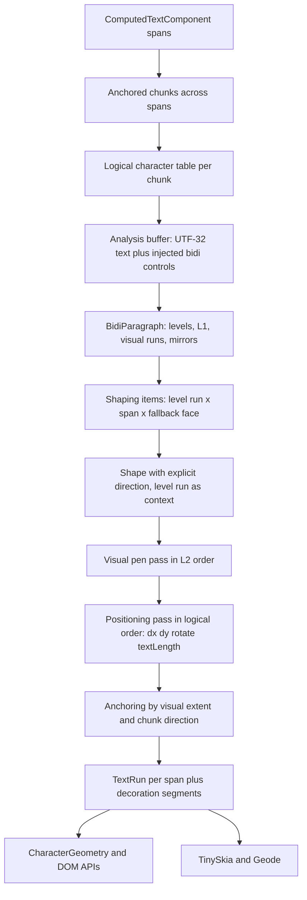

# Design: Bidirectional Text Layout

**Status:** Draft
**Author:** Claude Opus 5.5
**Created:** 2026-10-27
**Tracking:** [#1171](https://github.com/jwmcglynn/donner/issues/1171)

## Summary

Donner renders right-to-left scripts, but it does not run the Unicode Bidirectional Algorithm
(UAX #9). A text chunk is shaped with one direction that HarfBuzz guesses from its content, the
`direction` and `unicode-bidi` properties are parsed as unsupported presentation attributes and
ignored, and the simple text tier lays every chunk out left to right. Mixed-direction text
therefore renders in the wrong visual order, `direction="rtl"` does not move the anchor edge, and
`unicode-bidi` overrides and isolates have no effect.

This design adds CSS bidi layout to SVG text: typed `direction` and `unicode-bidi` properties,
UAX #9 paragraph analysis per anchored text chunk with embeddings and isolates injected from the
span tree, explicit per-run shaping direction, visual reordering, and SVG character positioning
that keeps every attribute value and DOM index attached to its logical character. It uses
SheenBidi 3.0.0 from the Bazel Central Registry, in both text tiers.

It is the detailed design for the bidirectional-text part of Milestone 12 of
[0062-svg_parity_completion](0062-svg_parity_completion.md) and the F11 row of
[0021-resvg_feature_gaps](0021-resvg_feature_gaps.md). It builds on the per-cluster font fallback
and context shaping in [0008-css_fonts](0008-css_fonts.md) and replaces that change's direction
heuristics with resolved bidi levels. The text stack it changes is described in
[0010-text_rendering](0010-text_rendering.md) and
[text/0052-5-text_backend_refactor](text/0052-5-text_backend_refactor.md).

## Goals

- Resolve `direction` (`ltr`, `rtl`) and `unicode-bidi` (`normal`, `embed`, `isolate`,
  `bidi-override`, `isolate-override`, `plaintext`) through the typed property cascade, with
  presentation attributes, CSS declarations, and inheritance that match CSS Writing Modes 3.
- Run UAX #9 conformantly: paragraph embedding level, explicit embeddings, overrides and isolates
  from the span tree, weak and neutral resolution, bracket pairs, line rules L1 and L2, and
  mirroring (L4).
- Apply SVG 2 positioning on top of the visual order: `x`, `y`, `dx`, `dy`, and `rotate` values
  stay attached to logical characters, glyphs are reordered only within an anchored chunk, and
  `text-anchor` aligns the chunk by its visual extent using the chunk's direction.
- Shape each bidi run with an explicit HarfBuzz direction, keeping Arabic joining across `tspan`
  boundaries and across the fallback faces of
  [0008-css_fonts](0008-css_fonts.md).
- Give both text tiers the same visual order, anchoring, and DOM geometry. The simple tier mirrors
  paired characters itself; it still does not join Arabic.
- Keep logical DOM indices exact: `getStartPositionOfChar`, `getEndPositionOfChar`,
  `getExtentOfChar`, `getRotationOfChar`, `getSubStringLength`, and `getCharNumAtPosition` report
  each logical character's own visual geometry, and the editor caret and selection use it.
- Draw text decorations once per visually contiguous segment of a span.
- Leave every left-to-right document pixel-identical and keep the editor Wasm package under a
  maintainer-approved ceiling.
- Remove the bidi resvg exceptions listed in [Testing and Validation](#testing-and-validation),
  pass the Unicode 17 bidi conformance files, and fuzz the analysis boundary.

## Non-Goals

- Visual caret movement (arrow keys that move by visual position) and split carets at direction
  boundaries in the editor. The editor keeps logical caret movement; only caret placement and
  selection highlighting change.
- Bidi in the editor's source text pane.
- Defining a new meaning for `direction="rtl"` in vertical writing modes beyond CSS Writing Modes.
  The `text/direction/rtl-with-vertical-writing-mode` row is a reference-classification question,
  see [Open Questions](#open-questions).
- Arabic joining or other complex shaping in the simple text tier.
- `selectSubString`, which remains a stub.
- New line breaking. `inline-size` wrapping keeps its current break opportunities; this design only
  reorders each wrapped line.
- A self-maintained Unicode property table or UAX #9 implementation.

## Next Steps

- Operator decisions on the [Open Questions](#open-questions), in particular the library choice,
  the editor package ceiling, and the vertical `rtl` classification.
- Land the pixel-neutral layout restructuring (Milestone 1) after
  [#2098](https://github.com/jwmcglynn/donner/pull/2098) merges, since it rewrites the same shaping
  path.

## Implementation Plan

Each milestone is one or two atomic pull requests. Sizes are rough line counts including tests.

- [ ] Milestone 1: Logical character table and visual pen pass, no behavior change (large, about
      1,200 lines)
  - [ ] Build the per-chunk logical character table (SVG 2 `result` array) spanning all spans of an
        anchored chunk, with logical index, UTF-16 index, span, byte range, and resolved position
        values.
  - [ ] Split layout into a visual pen pass over shaping items and a positioning pass that applies
        `dx`, `dy`, `rotate`, `textLength`, and anchoring from the table.
  - [ ] Replace sequential `(runIndex, glyphIndex)` chunk boundaries with chunk ids on the logical
        table.
  - [ ] Compute decoration segments per span in the engine and have TinySkia and Geode draw those
        segments instead of first-to-last glyph bars.
  - [ ] Prove pixel identity: `text_engine_tests`, `text_engine_scripted_tests`,
        `text_span_positioning_tests`, `renderer_tests`, `renderer_geode_golden_tests`, and
        `resvg_test_suite` in default, `text_full`, and Geode lanes, with no golden or threshold
        change.
- [ ] Milestone 2: SheenBidi, `direction`, and paragraph analysis (large, about 1,000 lines plus
      pinned test data)
  - [ ] Add `bazel_dep(name = "sheenbidi", version = "3.0.0")`, its `license()` and notice
        variants, the CMake external dependency, and the BCR dependency-closure inventory.
  - [ ] Add `BidiParagraph`, a Donner-owned adapter over SheenBidi (UTF-32 input, levels, visual
        runs, mirrors) with the left-to-right fast path.
  - [ ] Add the typed inherited `direction` property and carry it into `TextSpan`.
  - [ ] Resolve each chunk's paragraph, shape level runs with explicit direction, and remove the
        guessed-direction and digit heuristics from `ChunkShaper`.
  - [ ] Add `bidi_conformance_tests` over pinned Unicode 17 `BidiTest.txt` and
        `BidiCharacterTest.txt`, `bidi_paragraph_tests`, and `bidi_paragraph_fuzzer`.
  - [ ] Remove the skips for `text/text/bidi-reordering`, `text/letter-spacing/mixed-scripts`, and
        classify `text/direction/rtl` (see [Testing and Validation](#testing-and-validation)).
  - [ ] Measure the editor Geode package and renderer module sizes against their ceilings.
- [ ] Milestone 3: `unicode-bidi` and cross-span shaping (medium, about 600 lines)
  - [ ] Add the typed non-inherited `unicode-bidi` property and per-span open and close markers.
  - [ ] Inject CSS bidi controls into the analysis buffer, closing and reopening them at chunk
        boundaries.
  - [ ] Shape items with the level run as HarfBuzz context so joining continues across `tspan`
        boundaries.
  - [ ] Remove the skips for `text/unicode-bidi/bidi-override` and `text/tspan/bidi-reordering`.
- [ ] Milestone 4: DOM geometry and editor (medium, about 500 lines)
  - [ ] Report start and end edges in each character's resolved direction.
  - [ ] Build editor selection highlights from visually contiguous character cells.
  - [ ] Add an editor-control MCP repro for caret placement and selection in mixed-direction text,
        then the `text_tool_tests` regression.
- [ ] Milestone 5: Vertical, textPath, and wrapped-line interplay (medium, about 600 lines)
  - [ ] Treat `text-orientation: upright` as strong left-to-right for bidi.
  - [ ] Reverse right-to-left runs along the vertical inline axis.
  - [ ] Reorder per wrapped line under `inline-size`.
  - [ ] Verify textPath chunks and anchoring with direction.
  - [ ] Reduce the `text/writing-mode/mixed-languages-with-tb-and-underline` difference to the
        vertical underline that [#1172](https://github.com/jwmcglynn/donner/issues/1172) owns.
- [ ] Milestone 6: Documentation (small)
  - [ ] Update [0021-resvg_feature_gaps](0021-resvg_feature_gaps.md) F11,
        [0010-text_rendering](0010-text_rendering.md), and
        [text/0052-3-rtl_and_complex_scripts](text/0052-3-rtl_and_complex_scripts.md), and turn
        this design into an implemented summary with developer documentation.

## Background

### Current behavior

The layout entry point is `TextEngine::layout` in `donner/svg/text/TextEngine.cc`. It walks the
flattened spans of `ComputedTextComponent` in order. For each span it splits the text into chunk
ranges at every character that has an absolute `x` or `y` (`findChunkRanges`), shapes each chunk,
and walks the shaped glyphs with a pen, applying the logical character's `x`, `y`, `dx`, `dy`, and
`rotate` when it first meets a glyph of that character. Text anchoring later shifts each chunk by
its pen length; `start` is always a no-op.

With [#2098](https://github.com/jwmcglynn/donner/pull/2098), `ChunkShaper` shapes each chunk with
the span's primary face and, when that produces `.notdef`, splits it into per-face items shaped with
`TextBackend::shapeRunInContext`. HarfBuzz detects one direction and script for the whole chunk,
and three rules approximate bidi inside it: an item with no script of its own takes the chunk's
direction, an item containing digits runs left to right, and items are reversed when the primary
shaping came out right to left. Those rules are the gap this design closes; the
[#2098](https://github.com/jwmcglynn/donner/pull/2098) body itself records that "without a bidi
algorithm a chunk keeps one base direction".

Other relevant facts:

- `TextRun` is one per span, and every `TextGlyph` carries an absolute position. A span's glyphs do
  not need to be visually contiguous for painting; they do for decorations, which TinySkia and
  Geode draw from the first to the last glyph of the run.
- `CharacterGeometry` is stored in logical order. `startPosition` is the first glyph's pen origin
  and `endPosition` is the last glyph's pen plus advance, so a right-to-left character reports its
  left edge as its start.
- `TextBackendSimple` has no notion of direction or mirroring.
- `direction` and `unicode-bidi` appear in `PropertyRegistry.cc` only in the list of recognized
  presentation attributes that have no typed property.
- The simple tier is the default and the only tier available to Bazel Central Registry consumers,
  because HarfBuzz and WOFF2 are dev-only dependencies of the Donner module. The standalone
  renderer Wasm module is built without text; the editor Wasm package uses the full tier.

### Spec contract

**CSS Writing Modes.** [CSS Writing Modes 3](https://www.w3.org/TR/css-writing-modes-3/) and
[Level 4](https://www.w3.org/TR/css-writing-modes-4/) define the two properties and how they feed
UAX #9:

- `direction` is inherited and sets the inline base direction. `unicode-bidi` is not inherited.
- For each bidi paragraph, the paragraph embedding level comes from the containing block's
  `direction`, not from rules P2 and P3, unless the block has `unicode-bidi: plaintext`.
- An inline element's `unicode-bidi` is translated into bidi control characters around its
  content: `embed` to LRE or RLE and PDF, `isolate` to LRI or RLI and PDI, `bidi-override` to LRO
  or RLO and PDF, `isolate-override` to LRI LRO or RLI RLO and PDF PDI, and `plaintext` to FSI and
  PDI. `normal` adds nothing. On the root of the paragraph, `bidi-override` and `isolate-override`
  override the whole paragraph.
- `text-orientation: upright` makes the used `direction` `ltr` and treats every character as strong
  left to right for bidi.

**UAX #9.** [UAX #9](https://www.unicode.org/reports/tr9/) for Unicode 17.0.0 resolves embedding
levels (rules X1 to X10 with a maximum depth of 125, W1 to W7, N0 to N2, I1 and I2), resets
trailing whitespace on each line (L1), reverses runs from the highest level to the lowest odd
level (L2), and mirrors characters with the Bidi_Mirrored property at odd levels (L4).

**SVG 2.** [SVG 2 Text](https://www.w3.org/TR/SVG2/text.html) adds:

- Each absolute `x` or `y` value, each `textPath`, and each line start begins a new anchored chunk
  (layout algorithm, "Resolve character positioning"), and "Ligature substitution and
  bidi-reordering only occur within a text chunk" (11.1.1).
- Positioning values are assigned per addressable character in logical order; descendant values
  override ancestor values. `x` and `y` count Unicode code points, while DOM text methods count
  UTF-16 code units.
- "Relationship with bidirectionality" (11.2.2) describes reordering the characters into a
  left-to-right string with their `x`, `y`, `dx`, `dy`, and `rotate` values, then laying the glyphs
  out with left-to-right rules.
- The anchoring step uses the chunk's extent `a` (leftmost) and `b` (rightmost) and the direction of
  the element containing the chunk's first character: `start` with `ltr` or `end` with `rtl`
  aligns `a`; `start` with `rtl` or `end` with `ltr` aligns `b`; `middle` aligns the center.
- "Vertical and bidirectional text layout rules also apply to text on a path."

### Reference behavior

The vendored resvg corpus records per-renderer results in
`third_party/resvg-test-suite/results.csv` (0 unknown, 1 passed, 2 failed). The resvg layout at
[v0.49.0](https://github.com/linebender/resvg/blob/v0.49.0/crates/usvg/src/text/layout.rs) runs
UAX #9 per shaped string with a fixed left-to-right paragraph level, shapes each visual run with
its direction, applies `dx` while walking clusters in visual order, and ignores direction when
anchoring. It therefore fails its own `direction/rtl` and `unicode-bidi/bidi-override` rows, which
Chrome, Firefox, and Safari pass; the reference PNGs for those rows show the browser behavior, not
resvg's. The table in [Testing and Validation](#testing-and-validation) lists the results per row.

## Requirements and Constraints

- Untrusted input: text content, control characters, nesting depth, and property values come from
  hostile documents.
- Wasm size: the editor Geode package has a 3,540,000 byte compressed ceiling and measures
  3,523,487 bytes with [#2098](https://github.com/jwmcglynn/donner/pull/2098), leaving 16,513
  bytes. The standalone renderer module has an 872,000 byte ceiling at 871,295 bytes, leaving 705
  bytes. It links no text engine, but it does link the property registry.
- Dependencies are pinned to release versions with integrity hashes; `MODULE.bazel.lock` is not
  committed. No Rust dependency is allowed (the Lint lane enforces it).
- Layout logic stays in `TextEngine`, shared by both backends.
- No exceptions; explicit error returns and bounded resources.

## Proposed Architecture

### Data flow



### Units of work

| Unit              | Boundary                                                  | Owner           |
| ----------------- | --------------------------------------------------------- | --------------- |
| Anchored chunk    | Absolute `x` or `y`, `textPath` start, wrapped line start | `TextEngine`    |
| Bidi paragraph    | One anchored chunk                                        | `BidiParagraph` |
| Level run         | Maximal logical range at one resolved level               | `BidiParagraph` |
| Shaping item      | Level run split at span boundaries and fallback faces     | `ChunkShaper`   |
| Visual item order | L2 over level runs, per chunk or wrapped line             | `BidiParagraph` |

**Decision: a bidi paragraph is one anchored chunk.** Evidence: SVG 2 11.1.1 confines bidi
reordering and ligatures to a text chunk; the existing engine already shapes per chunk; resvg runs
UAX #9 per chunk; and anchoring by extent is only well defined when one chunk's glyphs cannot
interleave with another's. A chunk can span several spans, so the paragraph is built across spans,
which is new: today each span is shaped alone.

### Properties

- `direction`: typed enum `Direction { Ltr, Rtl }`, inherited, initial `ltr`, presentation attribute
  and CSS declaration.
- `unicode-bidi`: typed enum `UnicodeBidi { Normal, Embed, Isolate, BidiOverride, IsolateOverride, Plaintext }`, not inherited, initial `normal`.
- `TextSpan` gains the resolved `direction` and the span's bidi open and close markers: the ordered
  list of ancestor elements whose `unicode-bidi` is not `normal` and that open at this span's start
  or close at its end, each with that element's `direction`. `ComputedTextComponent` already
  flattens the tree, so the markers are recorded during flattening.
- The `<text>` element's own `direction` sets the paragraph level; its `unicode-bidi` is honored only
  for `bidi-override`, `isolate-override`, and `plaintext`, as for a CSS block container.
- Invalid values follow the existing invalid-at-computed-value behavior.

The property parsers land in the standalone renderer module, which has 705 bytes of compressed
headroom. They reuse the existing keyword-table parsing helpers, and Milestone 2 measures the module
before publication.

### BidiParagraph adapter

`donner/svg/text/BidiParagraph.{h,cc}` owns every SheenBidi call. No SheenBidi type crosses its
interface.

```cpp
/// Resolved bidi structure of one anchored chunk.
class BidiParagraph {
public:
  struct Run {
    uint32_t logicalStart;  //!< First logical character index in the chunk.
    uint32_t logicalEnd;    //!< One past the last logical character index.
    uint8_t level;          //!< Resolved embedding level; odd is right to left.
  };

  /// Analyze one chunk. Returns an error when a resource budget is exceeded.
  static ParseResult<BidiParagraph> Analyze(std::span<const char32_t> codepoints,
                                            std::span<const BidiControl> controls,
                                            BaseDirection base, const TextLayoutResourceBudget&);

  std::span<const uint8_t> levels() const;   //!< One level per logical character.
  std::span<const Run> visualRuns() const;   //!< Runs in left-to-right visual order (L2).
  char32_t mirrored(uint32_t logicalIndex) const;  //!< L4 mirror, or the character itself.
};
```

- **Input.** The adapter builds a UTF-32 analysis buffer from Donner's own `decodeUtf8` output, so
  the analysis and the layout agree on every malformed sequence; it never passes UTF-8 to SheenBidi.
  `BidiControl` entries are the injected CSS controls with the logical position before which they
  appear. Injected controls occupy buffer slots but never logical characters; the adapter drops them
  from `levels()` and `visualRuns()`.
- **Base level.** `ltr` and `rtl` map to explicit levels 0 and 1; `plaintext` on the root maps to
  P2 and P3.
- **Chunk boundaries.** A `unicode-bidi` element that spans a chunk boundary is closed at the end of
  one chunk's buffer and reopened at the start of the next, so each chunk is a well-formed
  paragraph.
- **Lines.** A chunk is one line except under `inline-size`, where each wrapped line is passed to
  the line API separately so L1 and L2 apply per line.
- **Fast path.** When the base level is 0, no injected control exists, and no character has bidi
  class R, AL, AN, or an explicit formatting class, every level is 0 and the visual order is
  logical. The adapter returns that result without creating SheenBidi objects. This keeps
  left-to-right text pixel-identical and cheap; `bidi_paragraph_tests` compares the fast path with
  the full analysis over generated left-to-right inputs.
- **Lifetime.** All SheenBidi objects are released on every return path through a small owning
  wrapper; nothing is cached across calls.

### Shaping

- Items are the intersection of level runs, span boundaries, and the fallback face items of
  `ChunkShaper`. Bidi runs split first, then fallback: `ChunkShaper` shapes each level run with the
  primary face and itemizes fallback faces within it.
- **Full tier.** Each item is shaped with `HB_DIRECTION_RTL` for odd levels and `HB_DIRECTION_LTR`
  for even levels, script and language guessed per item, and the item's level run as pre- and
  post-context. The context is built from the chunk's source text across spans, without injected
  controls, so Arabic joins across a `tspan` boundary (the `text/tspan/bidi-reordering` reference
  shows a word joined across one) while ligatures never form across items. HarfBuzz mirrors
  characters in right-to-left buffers; the existing
  `FallbackItemsInRightToLeftChunkMirrorNeutralsInVisualOrder` test already proves the shipped
  HarfBuzz configuration does this. Vertical shaping keeps the existing orientation rules.
- **Simple tier.** Items are shaped left to right as today. For odd-level items the engine
  substitutes `BidiParagraph::mirrored` before glyph lookup and reverses the item's glyph clusters
  so they are in visual order.
- **Removed heuristics.** The digit, neutral, and reversal rules of `ChunkShaper` and
  `shapeRunInContext` are deleted in the same change that adds resolved levels. Their tests stay as
  regression guards: digits after an Arabic word keep left-to-right order (UAX #9 W2 and I2), and
  neutral parentheses mirror (L4).
- `forceLogicalOrder`, which nothing passes as true, is removed with the heuristics.

### Visual pen pass and positioning

The layout follows the SVG 2 algorithm's split between CSS layout and positioning, implemented per
chunk:

1. **Visual pen pass.** Walk shaping items in L2 order. Glyphs of a right-to-left item are already
   in visual order. Each glyph gets a pen position; letter spacing, word spacing, cross-item
   kerning, and font metrics apply as today. Cross-span kerning applies only between glyphs that
   are adjacent both logically and visually in the same level run.
2. **Relative positioning.** `dx` and `dy` move the pen when the walk reaches the first glyph of the
   character they belong to, so each value moves its character and everything visually after it in
   the chunk. This is the 11.2.2 model and resvg's, and it is today's behavior for left-to-right
   text. `rotate` is per logical character. The SVG 2 algorithm text instead accumulates shifts in
   logical order; the two agree for left-to-right text and differ for `dx` inside right-to-left
   runs. This choice is an open question checked against browsers before Milestone 2 lands.
3. **`textLength`.** Applies to the owner's glyphs in visual order, distributing space between the
   owner's visually adjacent clusters. The existing Arabic `textLength` rows stay compared.
4. **Anchoring.** Each chunk is aligned by its pen extent: the minimum and maximum inline pen
   positions over its glyphs, including `dx`. With `direction` taken from the element of the chunk's
   first logical character, `start` with `ltr` aligns the minimum to the anchor, `start` with `rtl`
   aligns the maximum, `end` mirrors those, and `middle` centers. For left-to-right chunks this is
   exactly today's `start` no-op and pen-length shift.

The positioning values are looked up through the logical character table, never by glyph order, so
reordering cannot detach a value from its character. Chunk splitting (`findChunkRanges`) moves from
span scope to chunk scope.

### Run and decoration geometry

`TextRun` stays one per span, and glyphs keep absolute positions, so renderer painting is unchanged.
The engine adds `TextRun::decorationSegments`: maximal sets of the span's rendered glyphs that are
visually contiguous on one baseline, as inline start and end pen positions. TinySkia and Geode draw
those segments instead of the first-to-last bar and stop computing segment extents themselves. This
is the narrow precursor of the shared decoration geometry planned in Milestone 11 of
[0062-svg_parity_completion](0062-svg_parity_completion.md); that milestone extends the same field.
Paint-server object bounding boxes keep using the union of the span's glyph cells.

### DOM geometry and the editor

- `CharacterGeometry` gains the character's resolved level. `startPosition` is the edge where the
  character begins in its own direction: the left pen edge for even levels and the right edge for
  odd levels. `endPosition` is the opposite edge. This matches the SVG 2 anchoring step, whose
  `min(pos, pos + advance)` presumes a signed advance for right-to-left characters.
- `getSubStringLength`, `getExtentOfChar`, `getRotationOfChar`, and `getNumberOfChars` keep their
  logical definitions. `getCharNumAtPosition` already hit-tests cells and needs no ordering
  assumption.
- Index units do not change: DOM methods count UTF-16 code units and positioning lists count code
  points.
- The editor's `TextTool::caretIndexAtPoint` places the caret before a character at its start edge
  and after it at its end edge, so the corrected edges make caret placement right in
  right-to-left runs without changing that code. The selection highlight currently takes the
  minimum and maximum over the selected characters of a line; it changes to one quad per visually
  contiguous group of selected cells, since a logical selection can be visually discontiguous.

### Vertical text, textPath, and wrapping

- In vertical modes, right-to-left level runs are set sideways by the existing orientation rules and
  ordered against the inline axis, so they read correctly when the page is turned, as the
  `text/writing-mode/mixed-languages-with-tb-and-underline` reference shows.
- `text-orientation: upright` forces left-to-right levels for the chunk.
- `direction: rtl` in a vertical mode follows CSS: inline base direction bottom to top, which only
  changes anchoring. SVG WG [issue 618](https://github.com/w3c/svgwg/issues/618) leaves this open and
  every renderer in `results.csv` records the row as unknown.
- A `textPath` starts a chunk, so it is its own paragraph. Glyphs are reordered in pen space before
  path placement, and anchoring with direction shifts the chunk along the path as for straight
  text.
- Under `inline-size`, lines are broken in logical order as today, then each line is reordered.

### Performance

Analysis is linear in the chunk length. The fast path covers left-to-right text without creating
SheenBidi objects. The existing `ComputedTextGeometryComponent` cache already skips layout for
unchanged text, so paragraph analysis is not cached separately. A benchmark over a long mixed
Arabic and Latin paragraph and over many short chunks is added with Milestone 2.

## Security / Privacy

All text, control characters, nesting, and property values are untrusted.

- **Budgets.** `TextLayoutResourceBudget`, planned in
  [0062-svg_parity_completion](0062-svg_parity_completion.md), lands with Milestone 2 and limits one
  text subtree to 1,000,000 code points and 65,536 visual runs. Injected controls count against the
  code point budget. The explicit depth limit is UAX #9's 125; deeper nesting is resolved by the
  algorithm's overflow counters, never by recursion. Exceeding a budget returns the existing
  text-preparation resource error.
- **Decoding.** One decoder (`decodeUtf8`) feeds both analysis and layout. Malformed sequences
  become U+FFFD at the same logical index in both.
- **Allocation.** SheenBidi allocates linear storage per paragraph through its allocator; budget
  preflight bounds the input before any SheenBidi call.
- **Fuzzing.** `//donner/svg/text:bidi_paragraph_fuzzer` feeds arbitrary code points, random control
  injection trees, and random base directions to `BidiParagraph::Analyze`, and asserts that levels
  are at most 126, that the visual run list is a permutation of the logical range, and that every
  mirror is a valid code point. The document-level `svg_document_render_fuzzer` gains dictionary
  entries for `direction`, `unicode-bidi`, and bidi control characters.
- **Invariant targets.** Every guarantee in this document is enforced by a named target:

| Invariant                                                | Target                                                                                  |
| -------------------------------------------------------- | --------------------------------------------------------------------------------------- |
| UAX #9 levels and order match Unicode 17                 | `//donner/svg/text:bidi_conformance_tests`                                              |
| Fast path equals full analysis                           | `//donner/svg/text:bidi_paragraph_tests`                                                |
| Visual runs are a permutation; no crash on hostile input | `//donner/svg/text:bidi_paragraph_fuzzer`                                               |
| Left-to-right documents are pixel-identical              | existing goldens in `renderer_tests`, `renderer_geode_golden_tests`, `resvg_test_suite` |
| Positioning values stay with logical characters          | `//donner/svg/renderer/tests:text_engine_tests`                                         |
| Budget exhaustion fails closed                           | `//donner/svg/renderer/tests:text_engine_scripted_tests`                                |
| DOM edges follow resolved direction                      | `//donner/svg/tests:svg_tests`                                                          |

## Testing and Validation

### resvg rows

Every row whose skip reason mentions bidi, right-to-left layout, or `BiDi`, plus every row whose
SVG contains right-to-left text, was enumerated from `resvg_test_suite.cc` and the corpus. The
"Browsers" column is Chrome, Firefox, and Safari from `results.csv`.

| Row                                                       | Current         | Browsers         | resvg   | Expected after this design                             |
| --------------------------------------------------------- | --------------- | ---------------- | ------- | ------------------------------------------------------ |
| `text/text/bidi-reordering`                               | Skip            | pass, pass, pass | pass    | Compare (Milestone 2)                                  |
| `text/letter-spacing/mixed-scripts`                       | Skip            | fail, fail, fail | pass    | Compare (Milestone 2)                                  |
| `text/direction/rtl`                                      | Skip            | pass, pass, pass | fail    | Bidi order and right-edge anchoring match; see note    |
| `text/unicode-bidi/bidi-override`                         | Skip            | pass, pass, pass | fail    | Compare (Milestone 3)                                  |
| `text/tspan/bidi-reordering`                              | Skip            | pass, fail, fail | pass    | Compare (Milestone 3)                                  |
| `text/writing-mode/mixed-languages-with-tb-and-underline` | Skip, full text | pass, pass, fail | pass    | Remaining difference is the vertical underline (#1172) |
| `text/direction/rtl-with-vertical-writing-mode`           | Skip            | unknown          | unknown | `UndefinedBehavior`, pending operator decision         |

Note on `text/direction/rtl`: the SVG asks for "Noto Sans Arabic", which is not in the vendored font
set, and the reference glyphs are drawn in a sans Arabic face, while Donner falls back to Amiri. Bidi
fixes the order and anchor edge, but the glyph shapes cannot match. The row needs a reference
qualification (a reviewed project-owned golden or a `Harness mismatch` skip naming the missing
face), not a threshold.

Rows that already compare and must not regress, rerun with `--gtest_also_run_disabled_tests` in the
default and `text_full` lanes on every milestone: `text/font-kerning/arabic-script`,
`text/letter-spacing/on-Arabic`, `text/text-anchor/on-tspan-with-arabic`,
`text/text/fill-rule=evenodd`, `text/text/rotate-on-Arabic`,
`text/text/x-and-y-with-multiple-values-and-arabic-text`,
`text/textLength/arabic-with-lengthAdjust`, `text/textLength/arabic`,
`text/writing-mode/arabic-with-rl`, `text/writing-mode/mixed-languages-with-tb`, and the
undefined-behavior rows `text/writing-mode/tb-with-rotate` and `tb-with-rotate-and-underline`.

Three skips are labeled "BiDi-adjacent" but contain no right-to-left text:
`text/text/ligatures-handling-in-mixed-fonts-1`, `-2`, and `real-text-height`. Bidi does not unlock
them; their reasons should be corrected under
[#1176](https://github.com/jwmcglynn/donner/issues/1176).

Geode does not compare `text/*` rows, so renderer parity is covered by the independently authored
regressions below.

### UAX #9 conformance

- `//donner/svg/text:bidi_conformance_tests` runs `BidiParagraph` in raw mode (no injected
  controls) over `BidiCharacterTest.txt` (91,707 cases) and over `BidiTest.txt` (490,846 class sequences,
  each expanded per paragraph direction, using a representative code point per bidi class), checking levels and
  visual order.
- The data files are fetched from the versioned `https://www.unicode.org/Public/17.0.0/ucd/` path as
  dev-only `http_file` repositories with `sha256` pins (`BidiTest.txt` 7,959,988 bytes,
  `BidiCharacterTest.txt` 6,880,771 bytes). They are byte-identical to the copies in the SheenBidi
  3.0.0 archive, which its own conformance runner uses. The test is sharded so each case stays under
  10 seconds.

### Independently authored regressions

All use self-contained SVG and pixelmatch identity through `bitmap_golden_compare`, or layout-level
matchers; none load vendored resvg fixtures.

- `text_engine_tests`: logical-to-visual order and per-character positions for an LTR paragraph with
  an embedded RTL run, an RTL paragraph with an embedded LTR run and digits, brackets resolved by
  N0, `dx` and `rotate` on characters inside an RTL run, `x` and `y` lists that split a mixed run
  into chunks, `text-anchor` start, middle, and end under both directions, each `unicode-bidi`
  value on nested `tspan` elements, a `unicode-bidi` element crossing a chunk boundary, and the same
  expectations in both text tiers where shaping does not matter.
- `text_engine_scripted_tests`: budget exhaustion for code points and runs with small injected
  budgets, depth beyond 125, and malformed UTF-8 inside right-to-left runs.
- `renderer_regression_tests`: an underlined span split by an RTL run draws two decoration
  segments, on TinySkia, full text, and Geode.
- `svg_tests` (`SVGTextElement_tests.cc`): `getStartPositionOfChar` and `getEndPositionOfChar` for
  characters in RTL runs, `getCharNumAtPosition` at visual positions, and a supplementary character
  inside an RTL run for UTF-16 indexing.
- `text_tool_tests`: caret placement at both edges of an RTL character and a selection highlight
  that is visually discontiguous, after an editor-control MCP repro.
- `properties_tests`: grammar, inheritance, presentation attributes, and invalid values for
  `direction` and `unicode-bidi`.

Every regression lands red first on its own commit.

## Dependencies

### Library choice

| Option              | License        | Wasm footprint (measured)                                                                      | Bazel Central Registry             | Conformance                                                               | Notes                                                                                                                                             |
| ------------------- | -------------- | ---------------------------------------------------------------------------------------------- | ---------------------------------- | ------------------------------------------------------------------------- | ------------------------------------------------------------------------------------------------------------------------------------------------- |
| SheenBidi 3.0.0     | Apache-2.0     | +7,903 B gzip (levels, line runs); +8,150 B with mirror locator; +17,693 B with script locator | `sheenbidi` 3.0.0                  | Unicode 17.0.0; ships and runs `BidiTest.txt` and `BidiCharacterTest.txt` | C, standard library only, UTF-8/16/32 input, custom allocator                                                                                     |
| FriBidi 1.0.16      | LGPL-2.1       | +9,251 B gzip                                                                                  | `fribidi` 1.0.16 (upstream 1.0.17) | Runs both conformance files                                               | UTF-32 API; static linking into Donner binaries and Wasm carries LGPL relinking obligations                                                       |
| ICU `ubidi`         | Unicode-3.0    | not measured                                                                                   | `icu` 78.2                         | Reference-grade                                                           | BCR packaging compiles the whole common library and locates `icudt` data through runfiles at run time, unsuitable for Wasm and embedded consumers |
| Self-written UAX #9 | Donner         | unknown                                                                                        | n/a                                | Must be built and maintained                                              | Needs generated property tables and per-Unicode-version upkeep                                                                                    |
| Rust `unicode-bidi` | MIT/Apache-2.0 | n/a                                                                                            | n/a                                | Used by resvg                                                             | Rejected: the Lint lane forbids Rust dependencies                                                                                                 |

Footprints are the growth of a size-optimized Emscripten module (the `wasm-size` flags, `emmalloc`)
of a one-function probe over an empty probe, gzip level 9: empty 1,027 bytes; SheenBidi levels and
runs 8,930; with mirror locator 9,177; with script locator 18,720; FriBidi with mirroring 10,278.
The probes were built once with remote execution and discarded.

**Decision: SheenBidi 3.0.0 through the Bazel Central Registry**, without its script locator,
because HarfBuzz already guesses script per item and the locator doubles the footprint. It is the
smallest measured option, its license matches Donner's distribution, its release archive and BCR
overlay are pinned by version and integrity (`sha256-hsVgFANHObo5okwj6wAyOwv29zc1T2ZXhgFfyoQq94Y=`,
verified against the release tarball), and its Unicode version matches HarfBuzz 14.2.1, which
updated to Unicode 17.0.0. The BCR module builds the library in unity mode with the experimental
text API off. This confirms the choice in
[0062-svg_parity_completion](0062-svg_parity_completion.md) with measurements.

**Decision: both text tiers get bidi.** The simple tier is the default and the only tier that Bazel
Central Registry consumers can build, and unpointed Hebrew, which needs only ordering and
mirroring, renders correctly in it once bidi exists. Neither gated Wasm artifact links the simple tier, so the cost
lands only in native builds with text enabled. `sheenbidi` is therefore a regular, not dev-only,
`bazel_dep`, linked only by `//donner/svg/text:text_engine`.

### Size budget

The editor Geode package has 16,513 bytes of compressed headroom after
[#2098](https://github.com/jwmcglynn/donner/pull/2098). SheenBidi's measured share is about 8,200
bytes; the adapter, the restructured layout, and the properties add Donner code of a few kilobytes.
The total probably fits, but with little margin left. Milestone 2 measures the real package and asks
for a ceiling decision before publication if it does not fit.

### Integration checklist

- `MODULE.bazel` `bazel_dep`; no lockfile.
- `third_party/licenses`: `license()` for SheenBidi and the default, `text_full`, and editor notice
  variants; `tools/generate_build_report.py` variants.
- `tools/cmake/external_deps.json` and `gen_cmakelists.py --check`.
- `tools/bcr_dependency_closure_tests.py` and the supply-chain policy tests.

## Rollout Plan

There is no flag. Milestone 1 is pixel-neutral. Milestone 2 changes output only for chunks that
contain right-to-left characters or `direction="rtl"`, which the fast path guarantees. Each milestone
reverts independently: reverting Milestone 2 removes the dependency, adapter, `direction` property,
and conformance data together.

## Alternatives Considered

- **Paragraph per `<text>` element with chunks cut afterward.** Matches a literal reading of the SVG
  2 algorithm's first step but lets one chunk's glyphs interleave with another's, which breaks
  per-chunk anchoring, and contradicts 11.1.1. Rejected.
- **Keep HarfBuzz direction guessing plus heuristics.** Cannot express embeddings, isolates,
  overrides, paragraph direction, or bracket pairs. Rejected, as in
  [0062-svg_parity_completion](0062-svg_parity_completion.md).
- **Full-tier-only bidi.** Saves the library (about 26 KB raw in the size-optimized Wasm probe) in
  simple-tier builds but leaves the default
  tier and every Bazel Central Registry consumer with wrong order, and splits layout behavior
  between tiers. Rejected.
- **A new `TextLayoutResult` replacing `TextRun` for renderers first.** Not required for bidi, since
  glyphs are absolutely positioned; only decorations need visual contiguity. Deferred to the
  decoration milestone of [0062-svg_parity_completion](0062-svg_parity_completion.md).
- **Inject controls into the HarfBuzz buffer.** HarfBuzz would emit default-ignorable glyphs for
  them that must then be filtered from cluster mapping. Rejected in favor of a separate analysis
  buffer.

## Open Questions

1. **Library and dependency scope.** Approve SheenBidi 3.0.0 from the Bazel Central Registry as a
   regular (not dev-only) dependency of the text engine in both tiers?
2. **Editor package ceiling.** If Milestone 2 does not fit in the remaining 16,513 bytes, may the
   ceiling rise by the measured amount, or should bidi be held to the current ceiling?
3. **Standalone renderer ceiling.** The two property parsers land in a module with 705 bytes of
   headroom. Same question for that ceiling.
4. **Vertical `rtl`.** Classify `text/direction/rtl-with-vertical-writing-mode` as
   `UndefinedBehavior` citing SVG WG issue 618 (recommended), or match a chosen browser?
5. **`text/direction/rtl` reference.** Its reference face is not vendored. Accept a reviewed
   project-owned golden rendered with the vendored Arabic face, or keep it skipped as a harness
   mismatch?
6. **`dx` inside right-to-left runs.** The design follows SVG 2 11.2.2 and resvg (values move the
   visual pen). If current browsers implement the logical accumulation of the layout algorithm
   instead, should Donner follow the browsers? An independently authored browser comparison decides
   this before Milestone 2 lands; the choice is local to the positioning pass.
7. **Anchoring extent.** The design anchors by pen extent, which keeps left-to-right output
   unchanged. The SVG 2 algorithm text uses the extent of character positions including `dx`, which
   can move a `start`-anchored left-to-right chunk when a negative `dx` places a character before
   the anchor. Keep the pen-extent rule?

## Future Work

- [ ] Visual caret movement and split carets in the editor.
- [ ] Shared decoration geometry for vertical text and textPath, with
      [0062-svg_parity_completion](0062-svg_parity_completion.md) Milestone 11.
- [ ] `unicode-range` and cmap-based coverage, which would also shorten fallback inside long
      right-to-left runs.
