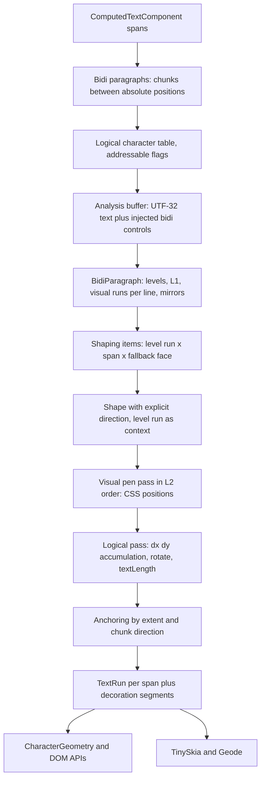

# Design: Bidirectional Text Layout

**Status:** Draft
**Author:** Claude Opus 5.5
**Created:** 2026-10-27
**Tracking:** [#1171](https://github.com/jwmcglynn/donner/issues/1171)

## Summary

Donner renders right-to-left scripts, but it does not run the Unicode Bidirectional Algorithm
(UAX #9). A text chunk is shaped with one direction that HarfBuzz guesses from its content, the
`direction` and `unicode-bidi` properties are parsed as unsupported presentation attributes and
ignored, and the simple text tier lays every chunk out left to right. Mixed-direction text
therefore renders in the wrong visual order, `direction="rtl"` does not move the anchor edge, and
`unicode-bidi` overrides and isolates have no effect.

This design adds CSS bidi layout to SVG text: typed `direction` and `unicode-bidi` properties,
UAX #9 analysis per anchored text chunk with embeddings and isolates injected from the span tree,
explicit per-run shaping direction, visual reordering, and SVG character positioning that keeps
every attribute value and DOM index attached to its logical character. It uses SheenBidi 3.0.0 from
the Bazel Central Registry, in both text tiers.

It is the detailed design for the bidirectional-text part of Milestone 12 of
[0062-svg_parity_completion](0062-svg_parity_completion.md), whose plan it amends (see
[Amendments to 0062](#amendments-to-0062)), and for the F11 row of
[0021-resvg_feature_gaps](0021-resvg_feature_gaps.md). It builds on the per-cluster font fallback
and context shaping of the unmerged [#2098](https://github.com/jwmcglynn/donner/pull/2098), which
updates [0008-css_fonts](0008-css_fonts.md), and replaces that change's direction heuristics with
resolved bidi levels. The text stack it changes is described in
[0010-text_rendering](0010-text_rendering.md) and
[text/0052-5-text_backend_refactor](text/0052-5-text_backend_refactor.md).

## Goals

- Resolve `direction` (`ltr`, `rtl`) and `unicode-bidi` (`normal`, `embed`, `isolate`,
  `bidi-override`, `isolate-override`, `plaintext`) through the typed property cascade, with
  presentation attributes, CSS declarations, and inheritance that match CSS Writing Modes 3.
- Run UAX #9 conformantly: paragraph embedding level, explicit embeddings, overrides and isolates
  from the span tree, weak and neutral resolution, bracket pairs, line rules L1 and L2, and
  mirroring (L4).
- Apply SVG 2 positioning on top of the visual order: `x`, `y`, `dx`, `dy`, and `rotate` values
  stay attached to logical characters, relative shifts accumulate in logical order, glyphs are
  reordered only within an anchored chunk, and `text-anchor` aligns the chunk's extent using its
  direction.
- Shape each bidi run with an explicit HarfBuzz direction, keeping Arabic joining across `tspan`
  boundaries and across the fallback faces of #2098.
- Give both text tiers the same visual order, anchoring, and DOM geometry. The simple tier mirrors
  paired characters itself; it still does not join Arabic.
- Keep logical DOM indices exact: `getStartPositionOfChar`, `getEndPositionOfChar`,
  `getExtentOfChar`, `getRotationOfChar`, `getSubStringLength`, and `getCharNumAtPosition` report
  each logical character's own visual geometry, and the editor caret and selection use it.
- Treat bidi control characters in source text as non-addressable, as SVG 2 requires.
- Draw text decorations once per visually consecutive segment of a span.
- Leave left-to-right documents pixel-identical, except where the SVG 2 anchoring extent differs
  from today's measurement, which a dedicated pull request lists row by row.
- Keep the editor Wasm package under maintainer-approved compressed and raw ceilings.
- Remove the bidi resvg exceptions listed in [Testing and Validation](#testing-and-validation),
  pass the Unicode 17 bidi conformance files, and fuzz the analysis boundary.

## Non-Goals

- Visual caret movement (arrow keys that move by visual position) and split carets at direction
  boundaries in the editor. The editor keeps logical caret movement; caret placement, caret
  drawing, and selection highlighting change.
- Bidi in the editor's source text pane.
- A meaning for `direction="rtl"` in vertical writing modes beyond CSS Writing Modes. The
  `text/direction/rtl-with-vertical-writing-mode` row is classified as undefined behavior.
- Arabic joining or other complex shaping in the simple text tier.
- `selectSubString`, which remains a stub.
- New line breaking. `inline-size` wrapping keeps its current break opportunities.
- A self-maintained Unicode property table or UAX #9 implementation.

## Next Steps

- Maintainer decisions on the [Open Questions](#open-questions): dependency scope and the Wasm
  ceilings.
- This design depends on [#2098](https://github.com/jwmcglynn/donner/pull/2098), whose code it
  describes and replaces. The design itself is published as an ordinary pull request against `main`;
  Milestone 1 starts after #2098 merges.

## Implementation Plan

Each milestone is one or two atomic pull requests. Sizes are rough line counts including tests.
Every behavior change lands with a regression test committed red first. Milestone 1 preserves
today's behavior exactly; every change of semantics belongs to a later milestone.

- [ ] Milestone 1: Logical character table and visual pen pass, no behavior change (large, about
      1,200 lines)
  - [ ] Build the per-chunk logical character table (the SVG 2 `result` array) spanning all spans of
        an anchored chunk: logical index, UTF-16 index, span, byte range, addressable and middle
        flags, and resolved position values.
  - [ ] Split layout into a visual pen pass over shaping items and a positioning pass that applies
        `dx`, `dy`, `rotate`, and `textLength` from the table. Inside a chunk that HarfBuzz shapes
        right to left, `dx` and `dy` keep today's accumulation in shaped glyph order across all
        of the chunk's items, not per item.
  - [ ] Replace sequential `(runIndex, glyphIndex)` chunk boundaries with chunk ids on the table.
  - [ ] Compute decoration segments per span in the engine with today's renderer rules, in run
        storage order; TinySkia and Geode draw them.
  - [ ] Keep today's `textLength` carry, including the trailing gap of
        [#2095](https://github.com/jwmcglynn/donner/pull/2095), unchanged.
  - [ ] Add `text_span_positioning_tests` cases that pin today's behavior:
    - an `ltr` `middle`-anchored chunk followed by a `y`-only chunk;
    - `dx` followed by a `y`-only chunk under `start` and under `middle`, including
      `<text x="10"><tspan dx="5">a</tspan><tspan y="20">b</tspan></text>`, which puts `b` at
      15 plus the advance of `a`;
    - `dy` followed by an `x`-only chunk;
    - a partial `textLength` owner followed by a `y`-only chunk under `start` and under `middle`;
    - a `y`-only chunk inside a `textLength` owner that began earlier, such as
      `<text textLength="300"><tspan>abc</tspan><tspan y="50">def</tspan></text>`, under `start`
      and under `middle`;
    - a right-to-left shaped chunk containing a left-to-right digit item, with `dx` on its first
      Arabic character, which pins glyph-order accumulation across items.
  - [ ] Measure the editor package against every gate, including the 46,000 byte function body
        and 12,880,000 byte total raw limits, since the restructured layout adds code before
        SheenBidi does.
  - [ ] Prove pixel identity: `text_engine_tests`, `text_engine_scripted_tests`,
        `text_span_positioning_tests`, `renderer_tests`, `renderer_geode_golden_tests`, and
        `resvg_test_suite` in the default, `text_full`, and Geode lanes, with no golden, budget, or
        skip change. Anchoring keeps today's measurement in this milestone.
- [ ] Milestone 1b: SVG 2 anchoring extent only (small, about 200 lines)
  - [ ] Anchor by the SVG 2 extent with today's effective anchor point, defined in
        [Anchoring](#anchoring).
  - [ ] Run `text_engine_tests`, `text_span_positioning_tests`, `renderer_tests`, the Geode goldens,
        and every compared `text/*` row with the old and new rule, and list each case whose output
        changes in the pull request, with an independently authored regression for each cause.
        The pull request is accepted only if every listed change is one of the intended
        differences in [Anchoring](#anchoring) and no row gains a budget, golden, or skip.
- [ ] Milestone 2: SheenBidi, `direction`, and paragraph analysis (large, about 1,000 lines plus
      pinned test data)
  - [ ] Add `bazel_dep(name = "sheenbidi", version = "3.0.0")`, its `license()` and notice
        variants, the CMake external dependency, and the BCR dependency-closure inventory.
  - [ ] Add `BidiParagraph`, a Donner-owned adapter over SheenBidi, with the left-to-right fast
        path.
  - [ ] Add the typed inherited `direction` property and carry it into `TextSpan`.
  - [ ] Resolve each paragraph, shape level runs with explicit direction, and remove the
        guessed-direction, digit, reversal, and single-codepoint rules of #2098.
  - [ ] Accumulate `dx` and `dy` in logical order inside right-to-left runs, red first with
        `<text x="10" dx="0 10">` over two Hebrew letters.
  - [ ] Make the `textLength` carry direction-aware, red first with a partial `rtl` owner.
  - [ ] Split decoration groups at bidi discontinuities of the visual order.
  - [ ] Recheck `text/text-anchor/on-tspan-with-arabic` against its reference (see
        [resvg rows](#resvg-rows)).
  - [ ] Make source bidi control characters non-addressable.
  - [ ] Add `bidi_conformance_tests`, `bidi_paragraph_tests`, and `bidi_paragraph_fuzzer` with its
        Fuzz workflow soak step.
  - [ ] Remove the skips for `text/text/bidi-reordering` and `text/letter-spacing/mixed-scripts`,
        requalify `text/direction/rtl`, and reclassify
        `text/direction/rtl-with-vertical-writing-mode` as `UndefinedBehavior`.
  - [ ] Measure the editor Geode package (compressed, raw, data segments) and the standalone
        renderer module against their ceilings before publication.
- [ ] Milestone 3: `unicode-bidi` and cross-span shaping (medium, about 600 lines)
  - [ ] Add the typed non-inherited `unicode-bidi` property and per-span open and close markers.
  - [ ] Inject CSS bidi controls into the analysis buffer, closing and reopening them at paragraph
        boundaries.
  - [ ] Shape items with the level run as HarfBuzz context so joining continues across `tspan`
        boundaries, and prove the context is pixel-neutral for left-to-right scripts.
  - [ ] Remove the skips for `text/unicode-bidi/bidi-override` and `text/tspan/bidi-reordering`.
- [ ] Milestone 4: DOM geometry and editor (medium, about 500 lines)
  - [ ] Report start and end edges in each character's resolved direction.
  - [ ] Add an editor-control MCP repro for caret placement, caret drawing, and selection in
        mixed-direction text, then the `text_tool_tests` regression.
  - [ ] Draw the point-text caret at column 0 from `getStartPositionOfChar(0)` and the box-text
        caret from character edges instead of summed logical widths.
  - [ ] Build selection highlights from visually consecutive character cells.
- [ ] Milestone 5: Vertical, textPath, and wrapped-line interplay (medium, about 600 lines)
  - [ ] Treat `text-orientation: upright` boxes as strong left-to-right for bidi.
  - [ ] Order right-to-left runs against the vertical inline axis.
  - [ ] Analyze `inline-size` text as one paragraph and reorder each wrapped line.
  - [ ] Verify textPath chunks and anchoring with direction.
  - [ ] Reduce the `text/writing-mode/mixed-languages-with-tb-and-underline` difference to the
        vertical underline that [#1172](https://github.com/jwmcglynn/donner/issues/1172) owns.
- [ ] Milestone 6: Documentation (small)
  - [ ] Apply the [Amendments to 0062](#amendments-to-0062) to
        [0062-svg_parity_completion](0062-svg_parity_completion.md) Milestone 12.
  - [ ] Update [0021-resvg_feature_gaps](0021-resvg_feature_gaps.md) F11,
        [0010-text_rendering](0010-text_rendering.md), and
        [text/0052-3-rtl_and_complex_scripts](text/0052-3-rtl_and_complex_scripts.md), and turn
        this design into an implemented summary with developer documentation.

## Background

### Current behavior

The layout entry point is `TextEngine::layout` in `donner/svg/text/TextEngine.cc`. It walks the
flattened spans of `ComputedTextComponent` in order. For each span it splits the text into chunk
ranges at every character that has an absolute `x` or `y` (`findChunkRanges`), shapes each chunk,
and walks the shaped glyphs with a pen, applying a logical character's `x`, `y`, `dx`, `dy`, and
`rotate` when it first meets a glyph of that character. `applyTextAnchor` skips `start` chunks and
shifts `middle` and `end` chunks by the distance from the first glyph's `xPosition` (offset
included) to the last glyph's `xPosition` plus x advance, ignoring direction. Inside a chunk that
HarfBuzz shapes right to left, glyphs arrive in visual order, so `dx` and `dy` accumulate in visual
order there (`PositionForGroup` and the pen updates in `applyHorizontalPosition`). `textLength`
runs before anchoring: `ApplyTextLengthOwnerPlan` carries an owner's trailing advance into the
following items until one has an absolute inline position (`absoluteReset` comes from `x` in
horizontal text), so the carry crosses chunk boundaries that have only `y`.

With [#2098](https://github.com/jwmcglynn/donner/pull/2098), `ChunkShaper` shapes each chunk with
the span's primary face and, when that produces `.notdef`, splits it into per-face items shaped with
`TextBackend::shapeRunInContext`. HarfBuzz detects one direction and script for the whole chunk,
and rules approximate bidi inside it: an item with no script of its own takes the chunk's
direction, an item containing digits runs left to right, items are reversed when the primary
shaping came out right to left, and `ShapingDirection` shapes a single horizontal codepoint without
context left to right whatever its script, so per-character coordinates on right-to-left text keep
logical placement. The #2098 description itself records that "without a bidi algorithm a chunk
keeps one base direction".

Other relevant facts:

- `TextRun` is one per span, and every `TextGlyph` carries an absolute position. A span's glyphs do
  not need to be visually consecutive for painting; they do for decorations, which TinySkia and
  Geode draw from the first to the last glyph of the run, split per glyph when glyphs are rotated
  or sit on different baselines.
- `CharacterGeometry` is stored in logical order. `startPosition` is the first glyph's
  `xPosition` and `yPosition` (offset included) and `endPosition` is the last glyph's position plus
  advance, so a right-to-left character reports its left edge as its start.
- `TextBackendSimple` has no notion of direction or mirroring.
- `direction` and `unicode-bidi` appear in `PropertyRegistry.cc` only in the list of recognized
  presentation attributes that have no typed property.
- Bidi control characters in source text are addressable today and consume positioning values.
- The simple tier is the default and the only tier available to Bazel Central Registry consumers,
  because HarfBuzz and WOFF2 are dev-only dependencies of the Donner module. The standalone
  renderer Wasm module is built without text; the editor Wasm package uses the full tier.

### Spec contract

**CSS Writing Modes.** [CSS Writing Modes 3](https://www.w3.org/TR/css-writing-modes-3/) and
[Level 4](https://www.w3.org/TR/css-writing-modes-4/) define the two properties and how they feed
UAX #9:

- `direction` is inherited and sets the inline base direction. `unicode-bidi` is not inherited.
- The paragraph embedding level comes from the containing block's `direction`, not from rules P2
  and P3, unless the block has `unicode-bidi: plaintext` (section 2.4.1).
- An inline element's `unicode-bidi` is translated into control characters around its content
  (section 2.2 table):

| `unicode-bidi`     | Start, `ltr`              | Start, `rtl`              | End                       |
| ------------------ | ------------------------- | ------------------------- | ------------------------- |
| `normal`           | none                      | none                      | none                      |
| `embed`            | LRE (U+202A)              | RLE (U+202B)              | PDF (U+202C)              |
| `isolate`          | LRI (U+2066)              | RLI (U+2067)              | PDI (U+2069)              |
| `bidi-override`    | LRO (U+202D)              | RLO (U+202E)              | PDF (U+202C)              |
| `isolate-override` | FSI, LRO (U+2068, U+202D) | FSI, RLO (U+2068, U+202E) | PDF, PDI (U+202C, U+2069) |
| `plaintext`        | FSI (U+2068)              | FSI (U+2068)              | PDI (U+2069)              |

- On the paragraph's root, `bidi-override` and `isolate-override` override the whole paragraph.
- `text-orientation: upright` in a vertical writing mode makes the used `direction` `ltr` and treats
  the box's characters as strong left to right for bidi (section 5.1). It applies per box. Current
  browsers do not implement this treatment and no resvg row depends on it.

**UAX #9.** [UAX #9 revision 51](https://www.unicode.org/reports/tr9/tr9-51.html), for Unicode
17.0.0, resolves embedding levels (X1 to X10 with a maximum depth of 125, W1 to W7, N0 to N2, I1
and I2), resets trailing whitespace on each line (L1), reverses runs from the highest level to the
lowest odd level (L2), and mirrors characters with the Bidi_Mirrored property at odd levels (L4).
Unicode 18.0.0 and UAX #9 revision 52 are published; SheenBidi 3.0.0 and HarfBuzz 14.2.1 both
implement Unicode 17, and Donner stays on 17 until both move.

**SVG 2.** [SVG 2 Text](https://www.w3.org/TR/SVG2/text.html) adds:

- Each absolute `x` or `y` value, each `textPath`, and each line start begins a new anchored chunk
  ("Resolve character positioning" and "Set flags and assign initial positions"), and "Ligature
  substitution and bidi-reordering only occur within a text chunk" (11.1.1).
- A bidi control character is not addressable ("Set flags and assign initial positions"): it takes
  no positioning value and draws nothing.
- Positioning values are assigned per addressable character in logical order; descendant values
  override ancestor values. `x` and `y` count code points, while DOM text methods count UTF-16
  code units.
- "Adjust positions: dx, dy" accumulates `dx` and `dy` over the result array in logical order and
  adds the running shift to each character's CSS position.
- "Apply 'textLength' attribute" measures the node's extent `a` to `b` and distributes the
  difference; "Apply anchoring" measures each anchored chunk's extent `a` (leftmost) and `b`
  (rightmost) over `min(pos, pos + advance)` and `max(pos, pos + advance)` and shifts by the
  direction of the element containing the chunk's first character: `start` with `ltr` or `end` with
  `rtl` aligns `a`, `start` with `rtl` or `end` with `ltr` aligns `b`, `middle` aligns the center.
- "Vertical and bidirectional text layout rules also apply to text on a path."

### Reference behavior

The vendored corpus records per-renderer results in `third_party/resvg-test-suite/results.csv`
(0 unknown, 1 passed, 2 failed).

- **resvg** at
  [v0.49.0](https://github.com/linebender/resvg/blob/v0.49.0/crates/usvg/src/text/layout.rs) runs
  UAX #9 per shaped string with a fixed left-to-right paragraph level and shapes each visual run
  with its direction. `resolve_relative_shifts` accumulates `dx` and `dy` in logical order ("`dx`
  and `dy` shift a character and all the characters after it in logical order") and applies each
  cluster's shift to its visually placed glyphs. Anchoring measures the chunk's extent including
  those shifts but ignores `direction`. resvg therefore fails its own `direction/rtl` and
  `unicode-bidi/bidi-override` rows, which Chrome, Firefox, and Safari pass; the reference PNGs for
  those rows show the browser result.
- **Blink** builds one inline paragraph per `<text>` and wraps each SVG text chunk in a directional
  isolate of the text element's direction (`InlineItemsBuilder::EnterSvgTextChunk` and
  `ExitAndEnterSvgTextChunk`, which close and reopen open bidi contexts at chunk boundaries). Its
  `SvgTextLayoutAlgorithm` follows the SVG 2 steps: `AdjustPositionsDxDy` accumulates over the
  logical result array, resetting at absolute `x` or `y` and at a `textPath` start;
  `ResolveTextLength` distributes spacing over the node's characters in visual order and carries
  the final shift to the end of the chunk; `ApplyAnchoring` uses the extent and direction rule
  above, with each character's position at its left edge.

## Requirements and Constraints

- Untrusted input: text content, control characters, nesting depth, and property values come from
  hostile documents.
- Editor Geode package: compressed ceiling 3,540,000 bytes, measured 3,523,487 with #2098 (16,513
  bytes headroom); raw ceiling 10,800,000 bytes, measured 10,771,745 (28,255 bytes headroom); also
  capped at 64 data segments, 46,000 bytes per function body, and 12,880,000 total raw bytes.
  SheenBidi with mirroring alone adds about 26,098 raw bytes in the size probe below, so the raw
  ceiling is likely the binding limit.
- Standalone renderer module: 872,000 byte compressed ceiling at 871,295 bytes (705 bytes headroom).
  It links no text engine but does link the property registry.
- Dependencies are pinned to release versions with integrity hashes; `MODULE.bazel.lock` is not
  committed. No Rust dependency is allowed (the Lint lane enforces it).
- Layout logic stays in `TextEngine`, shared by both backends.
- No exceptions; explicit error returns and bounded resources.

## Proposed Architecture

### Data flow



### Units of work

| Unit              | Boundary                                                      | Owner           |
| ----------------- | ------------------------------------------------------------- | --------------- |
| Anchored chunk    | Absolute `x` or `y`, `textPath` start, wrapped line start     | `TextEngine`    |
| Bidi paragraph    | Anchored chunk, except that wrapped lines share one paragraph | `BidiParagraph` |
| Line              | The chunk, or one wrapped line under `inline-size`            | `BidiParagraph` |
| Level run         | Maximal logical range at one resolved level                   | `BidiParagraph` |
| Shaping item      | Level run split at span boundaries, then at fallback faces    | `ChunkShaper`   |
| Visual item order | L2 over level runs, per line                                  | `BidiParagraph` |

**Decision: a bidi paragraph is the text between absolute-position chunk boundaries.** Without
`inline-size` that is one anchored chunk; under `inline-size`, where SVG 2 ignores descendant
absolute positions, it is the whole `<text>` broken into lines in logical order. Evidence: SVG 2
11.1.1 confines bidi reordering and ligatures to a text chunk; resvg analyzes per chunk; Blink's
chunk isolates give every chunk the same internal levels as a paragraph with the text element's
direction, which is this design's base level; and per-chunk anchoring is only well defined when one
chunk's glyphs cannot interleave with another's. A paragraph can span several spans, so it is built
across spans, which is new: today each span is shaped alone.

**Paragraph boundaries** are therefore absolute `x` or `y` values and `textPath` starts; wrapped
line starts are line boundaries inside one paragraph.

**Current text position.** The layout uses one positioning model, the SVG 2 and Blink pipeline.
The pen pass produces shift-free CSS positions, and a chunk without an absolute `x` (for example
one started by `y` only) starts its pen pass at the shift-free current text position: the pen end
of the previous chunk in the paragraph direction. Step 2 then adds the running `dx` and `dy` shift
to every character exactly once; because an absolute `y` does not reset the x shift, the shift
carries into the `y`-only chunk. Step 3 adds the `textLength` carry exactly once; because the carry
continues until an absolute inline position, it also crosses the `y`-only boundary. Anchoring comes
last. For `<text x="10"><tspan dx="5">a</tspan><tspan y="20">b</tspan></text>`, `b` has CSS
position 10 plus the advance of `a` and running shift 5, so it lands at 15 plus that advance.

Today's code reaches the same positions by a different route: the pen itself adds each character's
`dx` as it walks, so the next chunk starts at CSS position plus running shift, and
`ApplyTextLengthOwnerPlan` moves following items after layout, which is step 3. Each term enters
once in both formulations, so the restructuring is behavior-preserving. In an `ltr` element the pen
runs rightward from the current text position; in an `rtl` element (Milestone 2) the pen of a chunk
runs leftward from its anchor point, so the next chunk continues to the left. Blink stops the
`textLength` carry at the end of the chunk; adopting that would be a separate later change with its
own red-first test, not part of this design. Blink differs for unpositioned `rtl` chunks: its
anchoring uses the first logical character's left edge as the anchor point, so it is not a pixel
oracle there. After a `textPath`, the current text position stays the existing end-of-path position.
`text/text/x-and-y-with-multiple-values-and-arabic-text` exercises the `ltr` case and stays
unchanged.

### Properties

- `direction`: typed enum `Direction { Ltr, Rtl }`, inherited, initial `ltr`, presentation attribute
  and CSS declaration.
- `unicode-bidi`: typed enum
  `UnicodeBidi { Normal, Embed, Isolate, BidiOverride, IsolateOverride, Plaintext }`, not inherited,
  initial `normal`.
- `TextSpan` gains the resolved `direction` and the span's bidi open and close markers: the ordered
  list of ancestor elements whose `unicode-bidi` is not `normal` and that open at this span's start
  or close at its end, each with that element's `direction`. `ComputedTextComponent` already
  flattens the tree, so the markers are recorded during flattening.
- The `<text>` element's own `direction` sets the paragraph level; its `unicode-bidi` is honored
  only for `bidi-override`, `isolate-override`, and `plaintext`, as for a CSS block container.
- Invalid values follow the existing invalid-at-computed-value behavior.

The property parsers would land in the standalone renderer module, which has 705 bytes of
compressed headroom. Milestone 2 measures them; the alternative is to compile the two typed
properties only when text is enabled (see [Open Questions](#open-questions)).

### BidiParagraph adapter

`donner/svg/text/BidiParagraph.{h,cc}` owns every SheenBidi call. No SheenBidi type crosses its
interface.

```cpp
/// Resolved bidi structure of one paragraph.
class BidiParagraph {
public:
  struct Run {
    uint32_t logicalStart;  //!< First logical character index in the paragraph.
    uint32_t logicalEnd;    //!< One past the last logical character index.
    uint8_t level;          //!< Resolved embedding level; odd is right to left.
  };

  /// Analyze one paragraph. Returns an error when a resource budget is exceeded.
  static ParseResult<BidiParagraph> Analyze(std::span<const char32_t> codepoints,
                                            std::span<const BidiControl> controls,
                                            BaseDirection base, TextLayoutResourceBudget& budget);

  std::span<const uint8_t> levels() const;  //!< One level per logical character.
  /// Runs of the line [lineStart, lineEnd) in left-to-right visual order (L1, L2).
  std::vector<Run> visualRuns(uint32_t lineStart, uint32_t lineEnd) const;
  char32_t mirrored(uint32_t logicalIndex) const;  //!< L4 mirror, or the character itself.
};
```

- **Input.** The adapter builds a UTF-32 analysis buffer from Donner's own `decodeUtf8` output, so
  the analysis and the layout agree on every malformed sequence; it never passes UTF-8 to SheenBidi.
  Source bidi controls, the Unicode Bidi_Control set (ALM U+061C, LRM U+200E, RLM U+200F, LRE to RLO
  U+202A to U+202E, and LRI to PDI U+2066 to U+2069), stay in the buffer, so they still affect
  levels, but are non-addressable in the character table. `BidiControl` entries are the injected CSS
  controls with the logical position before which they appear; injected controls occupy buffer slots
  but never logical characters.
- **Base level.** `ltr` and `rtl` map to explicit levels 0 and 1; `plaintext` on the root maps to
  P2 and P3.
- **Paragraph boundaries.** A `unicode-bidi` element that spans a paragraph boundary is closed at
  the end of one paragraph's buffer and reopened at the start of the next, as Blink does at chunk
  boundaries.
- **Fast path.** When the base level is 0, no injected control exists, and no character has bidi
  class R, AL, AN, or an explicit formatting class, every level is 0 and the visual order is
  logical. The adapter returns that result without creating SheenBidi objects; the character
  table still applies the addressability filter, since LRM is class L and passes the fast-path
  test. A fast-path line
  counts as one visual run against the run budget, so budgets do not depend on the path taken.
  `bidi_paragraph_tests` compares the fast path with the full analysis over generated inputs.
- **Lifetime.** All SheenBidi objects are released on every return path through a small owning
  wrapper; nothing is cached across calls.

### Shaping

- Items are the intersection of level runs, span boundaries, and the fallback face items of
  `ChunkShaper`. Bidi runs split first; `ChunkShaper` then shapes each level run with the primary
  face and itemizes fallback faces within it.
- **Full tier.** Each item is shaped with `HB_DIRECTION_RTL` for odd levels and `HB_DIRECTION_LTR`
  for even levels, script and language guessed per item, and the item's level run as pre- and
  post-context. The context is built from the paragraph's source text across spans, without
  injected controls, so Arabic joins across a `tspan` boundary (the `text/tspan/bidi-reordering`
  reference shows a word joined across one) while ligatures never form across items, as the
  `text/text/ligatures-handling-in-mixed-fonts-*` rows require. HarfBuzz mirrors characters in
  right-to-left buffers; #2098's `FallbackItemsInRightToLeftChunkMirrorNeutralsInVisualOrder`
  already proves the shipped HarfBuzz configuration does this. Vertical shaping keeps the existing
  orientation rules.
- **Context neutrality.** Cross-span context only changes shaping where a font's lookups consult
  neighboring characters across the span boundary. Milestone 3 proves left-to-right output is
  unchanged with layout-level tests: a Devanagari syllable whose spans split a conjunct, a Latin
  `fi` pair split across spans, and the existing golden suites.
- **Simple tier.** Items are shaped left to right as today. For odd-level items the engine
  substitutes `BidiParagraph::mirrored` before glyph lookup, reverses the item's glyph clusters into
  visual order, and then applies kern-table kerning to the visually adjacent pairs. Characters that
  are Bidi_Mirrored but have no mirroring pair (for example some mathematical operators) stay
  unmirrored, since the simple tier has no glyph-level `rtlm` substitution.
- **Removed heuristics.** The digit, neutral, reversal, and single-codepoint direction rules of
  #2098 are deleted in the same change that adds resolved levels. A single-character item is shaped
  with its own level's direction, which gives the same single glyph. #2098's tests stay as
  regression guards: digits after an Arabic word keep left-to-right order (UAX #9 W2 and I2),
  neutral parentheses mirror (L4), and `text/text/x-and-y-with-multiple-values-and-arabic-text`,
  compared under its golden override and 400 pixel budget, does not change.
- `forceLogicalOrder`, which nothing passes as true, is removed with the heuristics.

### Visual pen pass and positioning

The layout follows the SVG 2 split between CSS layout and positioning:

1. **Visual pen pass (CSS positions).** Walk shaping items of each line in L2 order. Glyphs of a
   right-to-left item are already in visual order. Each glyph gets a pen position; letter spacing,
   word spacing, kerning, and font metrics apply as today. Cross-span kerning applies only between
   glyphs adjacent both logically and visually in one level run. Each character's CSS position is
   its left edge and its advance is its cell width.
2. **Relative shifts in logical order (Milestone 2).** Walk the character table in logical order,
   accumulating `dx` and `dy` into a running shift, and add each character's shift to its glyphs.
   The shift resets per axis: the x shift at an absolute `x`, the y shift at an absolute `y`, and
   both at a `textPath` start. The SVG 2 step itself does not reset; the per-axis reset is Blink's
   fix for SVG WG [issue 846](https://github.com/w3c/svgwg/issues/846) and matches today's pen
   behavior, so `<tspan dy="10">a</tspan><tspan x="50">b</tspan>` keeps `b` 10 units down, as it is
   today. Logical accumulation is resvg's `resolve_relative_shifts` and Blink's
   `AdjustPositionsDxDy`. For left-to-right text it equals today's pen behavior; inside
   right-to-left shaped chunks it differs from today, which accumulates in glyph order, so Milestone
   1 keeps glyph order there and Milestone 2 switches with a red-first test. `rotate` is per logical
   character.
3. **`textLength`.** Per owner node, measure the extent of its addressable characters and
   distribute the difference between its visually adjacent characters. **Decision:** the behavior
   is direction-aware. The owner's start edge in the inline direction stays fixed (the left edge for
   `ltr`, the right edge for `rtl`), the end edge moves by delta, and the final shift carries to the
   following characters in the inline direction. `spacingAndGlyphs` scales about the same
   start edge. A `textLength` owner that covers only part of an `rtl` chunk thus leaves the content
   before it in place and pushes later content further left. The carry keeps today's extent: it
   continues until an absolute inline position, across `y`-only chunk boundaries. Blink's literal
   alternative keeps the left edge fixed and carries rightward in every direction, which shifts an
   `rtl` owner's preceding content when the owner is partial; anchoring hides the difference only
   for whole chunks. Milestone 1 keeps today's carry, including
   [#2095](https://github.com/jwmcglynn/donner/pull/2095)'s trailing gap, exactly; the
   direction-aware carry needs `direction`, so it lands in Milestone 2 with a red-first
   `text_engine_tests` case for a partial `rtl` owner. The existing Arabic `textLength` rows stay
   compared.
4. **Anchoring.** See below.

Values are looked up through the character table, never by glyph order, so reordering cannot detach
a value from its character. Chunk splitting (`findChunkRanges`) moves from span scope to chunk
scope.

### Anchoring

This section describes Milestone 1b. Milestone 1 keeps today's rule: `start` chunks never move,
and `middle` and `end` measure from the first glyph's `xPosition` (offset included) to the last
glyph's `xPosition` plus x advance.

For each anchored chunk, let `a` be the minimum of each addressable typographic character's left
edge and `b` the maximum of its right edge, after relative shifts and `textLength`. A character's
left edge is its first glyph's `xPosition`, offset included, as today. Its extent is its x advance
plus letter and word spacing, except the spacing of the character at the chunk's visual end edge
(the last cluster in visual order, as in resvg), which is excluded, as today; Blink includes it. Let
`P` be the anchor point, defined as today's effective anchor: the pre-anchor `xPosition` of the
chunk's first glyph in run storage order, after all relative shifts and all `textLength`
displacement (including an owner that began before the chunk and spans into it), with the glyph's
x offset included. For an `rtl` paragraph in Milestone 2, `P` is the corresponding right edge where
the leftward pen pass began, after the same shifts. With the `direction` and `text-anchor` of the
element containing the chunk's first logical character, `start` with `ltr` or `end` with `rtl`
moves `a` to `P`, `start` with `rtl` or `end` with `ltr` moves `b` to `P`, and `middle` moves
`(a + b) / 2` to `P`. Vertical modes use the same rule on the vertical axis, measured between pen
positions as #2098 does.

This is the SVG 2 rule as Blink implements it and, apart from direction and trailing spacing, as
resvg does. Milestone 1b runs before `direction` exists, so every chunk is `ltr` there. Today's rule
and the new one share `P`, so they agree exactly when two equalities hold: the minimum left edge
`a` equals the first stored glyph's `xPosition` (`P`), and the maximum right edge `b` equals the
last stored glyph's `xPosition` plus x advance. Every intended difference is a way to break one of
them:

- **A character left of `P`.** A later character's left edge lies left of the first glyph, through
  a negative `dx`, negative letter or word spacing, or `textLength` compression. `start` chunks then
  move by `P - a` (today they never move), and `middle` and `end` measure a wider extent.
- **A trailing zero-advance glyph.** The last stored glyph has zero x advance: a combining mark, a
  default-ignorable such as ZWJ or a variation selector, or zero-size text. Today `b` is that
  glyph's `xPosition`; the new `b` is the right edge of the last typographic character, which is at
  least as far right.
- **An inner character past the end.** A shift moves an inner character's right edge past the last
  glyph's right edge, or the last glyph's right edge left of an inner character's, through `dx`,
  negative spacing, or `textLength` compression. `middle` and `end` then measure a different `b`.

Spacing is not a difference: today's `b` uses the last glyph's x advance without its spacing, and
the new rule excludes the spacing at the visual end edge, which in `ltr` is the same glyph. Without
these mechanisms both rules compute the same `a`, `b`, and `P`.

A static scan of the corpus for negative `dx` or for `dx` combined with `middle` or `end` anchors
finds two compared rows, and neither is a clear difference: in
`text/writing-mode/tb-with-dx-on-second-tspan` the `dx="-50"` is cross-axis in vertical text, so it
does not move the inline extent; in `text/textPath/tspan-with-relative-position` the `dx="-5"` is
on the second span's first character, not the chunk's, and anchoring is scoped to the path, so the
outcome depends on whether that character lands before the chunk's first. Milestone 1b also checks
the spacing rule explicitly against `text/letter-spacing/non-ASCII-character` (`middle`) and
`text/text-anchor/end-with-letter-spacing` (`end`), both compared today. The scan is a guide, not
evidence; the run under both rules is.

Within a `textPath`, anchoring is scoped to the path's characters, as in Blink. Wrapped
`inline-size` text skips anchoring and `textLength` today (`applyFinalAdjustments` returns early);
Milestone 1b leaves that path alone, and Milestone 5 only starts each wrapped line at its start edge
in the paragraph direction.

### Run and decoration geometry

`TextRun` stays one per span, and glyphs keep absolute positions, so renderer painting is unchanged.
The engine adds `TextRun::decorationSegments`, computed after `placeDeferredTextPaths` and
`ApplyPostTextPathTranslations`. In Milestone 1 the segments reproduce today's renderer rules
exactly:

- A rendered glyph is one whose glyph index is not 0 and whose x advance is positive; other glyphs
  contribute nothing. Vertical glyphs, whose x advance is 0, therefore get no decoration, as today;
  vertical decorations belong to [#1172](https://github.com/jwmcglynn/donner/issues/1172).
- When any glyph of the run is rotated (checked over all glyphs), or any rendered glyph's baseline
  differs by more than 1e-6 from the first rendered glyph's, every rendered glyph gets its own bar,
  starting at its `xPosition` (offset included) and clamped to the `xPosition` of the next rendered
  glyph in run storage order (visual within a chunk); a bar whose clamped width is not positive is
  skipped, and rotated bars carry the glyph's rotation.
- Otherwise the run gets one bar from its first rendered glyph's `xPosition` to its last rendered
  glyph's `xPosition` plus x advance, in run storage order and across chunk boundaries, gap
  included: `<text x="10 60" text-decoration="underline">ab</text>` draws one bar from 10 to past
  60, as today.

Milestone 2 changes the rules to visual order: the shared-baseline bar splits into one segment
per group of glyphs that are consecutive in the line's visual order, and any clamp in visual order
rather than storage order belongs there too. If glyph storage ever became logical, "next rendered
glyph" would have to be taken in visual order explicitly, or the clamp could produce negative
widths. `ClearUnpaintedSpanGlyphs` in `PlacedTextGeometry.cc` clears a
span's glyphs for effect passes; it clears `decorationSegments` with them, so a cleared run draws
no decoration, as today's `!run.glyphs.empty()` gate ensures.

TinySkia and Geode draw those segments instead of computing extents themselves. This is the narrow
precursor of the shared decoration geometry planned in Milestone 11 of
[0062-svg_parity_completion](0062-svg_parity_completion.md), which extends the same field.
Paint-server object bounding boxes keep using the union of the span's glyph cells.

### DOM geometry and the editor

- `CharacterGeometry` gains the character's resolved level. `startPosition` is the edge where the
  character begins in its own direction: the left edge for even levels and the right edge for odd
  levels. `endPosition` is the opposite edge.
- Non-addressable characters, including source bidi controls, are excluded from DOM character
  counts and indices, as SVG 2 defines the DOM methods over addressable characters. The editor's
  mapping from DOM index to its content buffer skips them the same way.
- `getSubStringLength`, `getExtentOfChar`, `getRotationOfChar`, and `getNumberOfChars` keep their
  logical definitions. `getCharNumAtPosition` already hit-tests cells.
- Index units do not change: DOM methods count UTF-16 code units and positioning lists count code
  points.
- `TextTool::caretIndexAtPoint` places the caret before a character at its start edge and after it
  at its end edge, so the corrected edges fix caret hit-testing without changing that code.
- Caret drawing changes: point text draws the caret at column 0 at `originText_.x`, which is wrong
  for a right-to-left first character, and box text sums cached logical widths
  (`TextTool::editingChrome`). Both switch to the start or end edge of the adjacent character.
- The selection highlight takes the minimum and maximum over the selected characters of a line; it
  changes to one quad per visually consecutive group of selected cells, since a logical selection
  can be visually discontiguous.

### Vertical text, textPath, and wrapping

- In vertical modes, right-to-left level runs are set sideways by the existing orientation rules and
  ordered against the inline axis, so they read correctly when the page is turned, as the
  `text/writing-mode/mixed-languages-with-tb-and-underline` reference shows.
- `text-orientation: upright` boxes are treated as strong left-to-right, per box, following CSS
  rather than current browsers.
- `direction: rtl` in a vertical mode follows CSS: inline base direction bottom to top, which only
  changes anchoring. SVG WG [issue 618](https://github.com/w3c/svgwg/issues/618) leaves it open, the
  resvg row's title marks it undefined behavior, and `results.csv` records every renderer as
  unknown. The row is therefore classified `UndefinedBehavior`.
- A `textPath` starts a chunk, so it is its own paragraph. Glyphs are reordered in pen space before
  path placement, and anchoring with direction shifts the chunk along the path.
- Under `inline-size`, the whole `<text>` is one paragraph, lines are broken in logical order as
  today, each line gets L1 and L2 separately, and each line starts at its start edge in the
  paragraph direction. Wrapped text keeps skipping `text-anchor` and `textLength`, as today.

### Performance

Analysis is linear in paragraph length. The fast path covers left-to-right text without creating
SheenBidi objects. The existing `ComputedTextGeometryComponent` cache already skips layout for
unchanged text, so paragraph analysis is not cached separately. A benchmark over a long mixed
Arabic and Latin paragraph and over many short chunks lands with Milestone 2.

### Amendments to 0062

[0062-svg_parity_completion](0062-svg_parity_completion.md) Milestone 12 and its Dependencies and
Performance sections change as follows; Milestone 6 edits that document:

- **Seam.** 0062 replaces `TextRun` with a `TextLayoutResult` of visual runs before bidi lands. This
  design keeps `TextRun` per span, because glyphs are absolutely positioned, and adds the logical
  character table and decoration segments instead. The broader `TextLayoutResult` stays with 0062's
  decoration milestone.
- **Script runs.** 0062 uses SheenBidi for script location too. This design does not: HarfBuzz
  already guesses script per item, and the script locator doubles SheenBidi's footprint.
- **Caching.** 0062 caches bidi analysis separately. This design relies on the existing geometry
  cache.
- **Dependency packaging.** 0062 pins the release archive and compiles only the sources Donner
  calls. This design uses the Bazel Central Registry module, which is the same release archive by
  integrity and compiles SheenBidi in its unity mode; unused entry points are removed by the linker.
- **Fuzzer.** 0062 plans `//donner/svg/text:text_layout_fuzzer` over the whole text layout. This
  design adds the narrower `//donner/svg/text:bidi_paragraph_fuzzer` for the analysis boundary;
  the layout-wide fuzzer stays with 0062.
- **Budget.** 0062's `TextLayoutResourceBudget` also limits placed glyphs to 1,000,000. This design
  adopts all three limits (code points, visual runs, placed glyphs) when it lands the budget.
- **Ordering.** 0062 lands bidi last in its text milestones; this design depends only on #2098.

## Security / Privacy

All text, control characters, nesting, and property values are untrusted.

- **Budgets.** `TextLayoutResourceBudget`, planned in
  [0062-svg_parity_completion](0062-svg_parity_completion.md), lands with Milestone 2 and limits one
  text subtree to 1,000,000 code points, 65,536 visual runs, and 1,000,000 placed glyphs. Injected
  controls count against the code point budget; fast-path lines count as one run each. The explicit
  depth limit is UAX #9's 125; deeper nesting is resolved by the algorithm's overflow counters,
  never by recursion. Exceeding a budget returns the existing text-preparation resource error.
- **Decoding.** One decoder (`decodeUtf8`) feeds both analysis and layout. Malformed sequences
  become U+FFFD at the same logical index in both.
- **Allocation.** SheenBidi allocates linear storage per paragraph; budget preflight bounds the
  input before any SheenBidi call.
- **Fuzzing.** `//donner/svg/text:bidi_paragraph_fuzzer` feeds arbitrary code points, random control
  injection trees, random line splits, and random base directions to `BidiParagraph`, and asserts
  that levels are at most 126, that each line's runs are a permutation of the line, and that every
  mirror is a valid code point. It gets a soak step in the Fuzz workflow, which the Lint lane
  requires. The document-level `svg_document_render_fuzzer` gains dictionary entries for
  `direction`, `unicode-bidi`, and bidi control characters.
- **Invariant targets.**

| Invariant                                                 | Target                                                                                  |
| --------------------------------------------------------- | --------------------------------------------------------------------------------------- |
| UAX #9 levels and order match Unicode 17                  | `//donner/svg/text:bidi_conformance_tests`                                              |
| Fast path equals full analysis                            | `//donner/svg/text:bidi_paragraph_tests`                                                |
| Runs are a permutation; no crash on hostile input         | `//donner/svg/text:bidi_paragraph_fuzzer`                                               |
| Left-to-right documents are pixel-identical (Milestone 1) | existing goldens in `renderer_tests`, `renderer_geode_golden_tests`, `resvg_test_suite` |
| Positioning values stay with logical characters           | `//donner/svg/renderer/tests:text_engine_tests`                                         |
| Budget exhaustion fails closed                            | `//donner/svg/renderer/tests:text_engine_scripted_tests`                                |
| DOM edges and indices follow direction and addressability | `//donner/svg/tests:svg_tests`                                                          |

## Testing and Validation

### resvg rows

Every row whose skip reason mentions bidi, right-to-left layout, or `BiDi`, plus every row whose
SVG contains right-to-left text, was enumerated from `resvg_test_suite.cc` and the corpus. The
"Browsers" column is Chrome, Firefox, and Safari from `results.csv`. Rows that need Arabic shaping
stay `onlyTextFull()` or `requireFeature(RendererBackendFeature::TextFull)`; the simple tier is
covered by layout-level tests.

| Row                                                       | Current         | Browsers         | resvg   | Expected after this design                                 |
| --------------------------------------------------------- | --------------- | ---------------- | ------- | ---------------------------------------------------------- |
| `text/text/bidi-reordering`                               | Skip            | pass, pass, pass | pass    | Compare, full text (Milestone 2)                           |
| `text/letter-spacing/mixed-scripts`                       | Skip            | fail, fail, fail | pass    | Compare, full text (Milestone 2)                           |
| `text/direction/rtl`                                      | Skip            | pass, pass, pass | fail    | Order and anchor edge match; reference face not vendored   |
| `text/unicode-bidi/bidi-override`                         | Skip            | pass, pass, pass | fail    | Compare, full text (Milestone 3)                           |
| `text/tspan/bidi-reordering`                              | Skip            | pass, fail, fail | pass    | Compare, full text (Milestone 3)                           |
| `text/writing-mode/mixed-languages-with-tb`               | Skip, full text | pass, pass, fail | pass    | Unchanged by bidi; remains the vertical origin gap (#1172) |
| `text/writing-mode/mixed-languages-with-tb-and-underline` | Skip, full text | pass, pass, fail | pass    | Remaining difference is the vertical underline (#1172)     |
| `text/direction/rtl-with-vertical-writing-mode`           | Skip            | unknown          | unknown | `UndefinedBehavior` (SVG WG issue 618)                     |

`text/direction/rtl` asks for "Noto Sans Arabic", which is not in the vendored font set; the
reference glyphs are drawn in a sans Arabic face while Donner falls back to Amiri. Bidi fixes the
order and the right-edge anchor, but the glyph shapes cannot match. The plan is a reviewed
project-owned golden rendered with the vendored face, after a layout-level test pins the order and
anchor; if a project golden is unwanted, the row stays skipped as a harness mismatch.

Rows that already compare and must not regress, rerun with `--gtest_also_run_disabled_tests` in the
default and `text_full` lanes on every milestone: `text/font-kerning/arabic-script`,
`text/letter-spacing/on-Arabic`, `text/text-anchor/on-tspan-with-arabic`,
`text/text/fill-rule=evenodd`, `text/text/rotate-on-Arabic`,
`text/text/x-and-y-with-multiple-values-and-arabic-text` (golden override, 400 pixel budget),
`text/textLength/arabic-with-lengthAdjust`, `text/textLength/arabic`, and
`text/writing-mode/arabic-with-rl`. The `UndefinedBehavior` rows `text/writing-mode/tb-with-rotate`
and `tb-with-rotate-and-underline` render without comparing; they are rerun only to catch crashes.

`text/text-anchor/on-tspan-with-arabic` is the one listed row that Milestone 2 could plausibly move.
After default whitespace handling (`TextSystem.cc`: `emitTextChunks` collects the spans and
`NormalizePendingSpaces` collapses and trims their spaces), the `middle`-anchored second chunk holds
the Arabic word of the second `tspan` followed by one collapsed space from the `<text>` element's
own text, which is the only collapsed whitespace that survives (the leading and trailing runs are
stripped, and the first chunk's word abuts its `tspan`). In Milestone 2 that chunk is one `ltr`
paragraph: the word is a level 1 run and the trailing space resets to level 0 under L1, so the space
stays to the right of the word, as today, where the word and the space are shaped as separate spans
in that order. The extent still includes the space's advance, so the middle anchor does not move.
The prediction is therefore no change; Milestone 2 reruns the row against its reference, and if it
moves, the row leaves this list and the change is examined against the reference before acceptance.

Three skips are labeled "BiDi-adjacent" but contain no right-to-left text:
`text/text/ligatures-handling-in-mixed-fonts-1`, `-2`, and `real-text-height`. Bidi does not unlock
them; their reasons belong to [#1176](https://github.com/jwmcglynn/donner/issues/1176).

Geode does not compare `text/*` rows, so renderer parity is covered by the regressions below.

### UAX #9 conformance

- `//donner/svg/text:bidi_conformance_tests` runs `BidiParagraph` in raw mode (no injected
  controls) over `BidiCharacterTest.txt` (91,707 cases) and `BidiTest.txt` (490,846 class
  sequences, each expanded per listed paragraph direction with a representative code point per bidi
  class), checking levels and visual order.
- The data files come from the versioned `https://www.unicode.org/Public/17.0.0/ucd/` path as
  dev-only `http_file` repositories with `sha256` pins (`BidiTest.txt` 7,959,988 bytes,
  `BidiCharacterTest.txt` 6,880,771 bytes). They are byte-identical to the copies in the SheenBidi
  3.0.0 archive, which its own conformance runner uses. The test is sharded so each case stays under
  10 seconds.

### Independently authored regressions

All use self-contained SVG and pixelmatch identity through `bitmap_golden_compare`, or layout-level
matchers; none load vendored resvg fixtures. Layout-level cases run in both text tiers where shaping
does not matter; shaped cases are full-text only.

- `text_engine_tests`: logical-to-visual order and per-character positions for an LTR paragraph with
  an embedded RTL run, an RTL paragraph with an embedded LTR run and digits, brackets resolved by
  N0, `dx` and `rotate` on characters inside an RTL run (logical accumulation), `x` and `y` lists
  that split a mixed run into chunks, a `y`-only chunk after an `rtl` chunk (current text position),
  `text-anchor` start, middle, and end under both directions, `textLength` on a whole and a partial
  `rtl` chunk, each `unicode-bidi` value on nested `tspan` elements, a `unicode-bidi` element
  crossing a chunk boundary, and source bidi controls taking no positioning values.
- `bidi_paragraph_tests`: the span-marker-to-control translation for every `unicode-bidi` value and
  direction, and `levels()` for `isolate-override` against `isolate` plus `bidi-override`. In an
  `rtl` paragraph, an `rtl` override over content whose first strong character is L resolves to
  level 3 with FSI and 5 with RLI; in an `ltr` paragraph, an `ltr` override over R-first content
  resolves to 2 with FSI and 4 with LRI. The visual order is identical in both cases, so only
  `levels()` and depth overflow can tell them apart; an optional case nests to depth 124 so that the
  extra level overflows with one control and not the other.
- `text_engine_scripted_tests`: budget exhaustion for code points and runs with small injected
  budgets, depth beyond 125, and malformed UTF-8 inside right-to-left runs.
- `renderer_regression_tests`: an underlined span split by an RTL run draws two decoration
  segments, on TinySkia, full text, and Geode.
- `svg_tests` (`SVGTextElement_tests.cc`): `getStartPositionOfChar` and `getEndPositionOfChar` for
  characters in RTL runs, `getCharNumAtPosition` at visual positions, a supplementary character
  inside an RTL run for UTF-16 indexing, and `getNumberOfChars` excluding source bidi controls.
- `text_tool_tests`: caret hit-testing and drawing at both edges of an RTL character, column 0 in an
  RTL first character, and a visually discontiguous selection highlight, after an editor-control
  MCP repro.
- `properties_tests`: grammar, inheritance, presentation attributes, and invalid values for
  `direction` and `unicode-bidi`.

## Dependencies

### Library choice

| Option              | License        | Wasm growth, gzip (raw)                                                                                 | Bazel Central Registry             | Conformance                                                               | Notes                                                                                                                                             |
| ------------------- | -------------- | ------------------------------------------------------------------------------------------------------- | ---------------------------------- | ------------------------------------------------------------------------- | ------------------------------------------------------------------------------------------------------------------------------------------------- |
| SheenBidi 3.0.0     | Apache-2.0     | 7,903 (25,589) levels and runs; 8,150 (26,098) with mirror locator; 17,693 (70,370) with script locator | `sheenbidi` 3.0.0                  | Unicode 17.0.0; ships and runs `BidiTest.txt` and `BidiCharacterTest.txt` | C, standard library only, UTF-8/16/32 input, custom allocator                                                                                     |
| FriBidi 1.0.16      | LGPL-2.1       | 9,251 (41,752)                                                                                          | `fribidi` 1.0.16 (upstream 1.0.17) | Runs both conformance files                                               | UTF-32 API; static linking into Donner binaries and Wasm carries LGPL relinking obligations                                                       |
| ICU `ubidi`         | Unicode-3.0    | not measured                                                                                            | `icu` 78.2                         | Reference-grade                                                           | BCR packaging compiles the whole common library and locates `icudt` data through runfiles at run time, unsuitable for Wasm and embedded consumers |
| Self-written UAX #9 | Donner         | unknown                                                                                                 | n/a                                | Must be built and maintained                                              | Needs generated property tables and per-Unicode-version upkeep                                                                                    |
| Rust `unicode-bidi` | MIT/Apache-2.0 | n/a                                                                                                     | n/a                                | Used by resvg                                                             | Rejected: the Lint lane forbids Rust dependencies                                                                                                 |

**Size probe.** Each figure is the growth of a one-function Emscripten module over an empty one
exporting the same function. The probe is a `cc_binary` exporting `_probe`, `_malloc`, and `_free`
with these link options, wrapped in `wasm_cc_binary` and built with `--config=wasm-size` against
temporary dev-only `bazel_dep`s on the BCR modules:

```text
-sMODULARIZE=1 -sEXPORT_ES6=1 -sENVIRONMENT=web -sALLOW_MEMORY_GROWTH=1
-sMALLOC=emmalloc -sUSE_PTHREADS=0 --no-entry
```

The SheenBidi probe creates an algorithm, paragraph, and line from UTF-8 input and reads levels and
runs; variants add the mirror and script locators. The FriBidi probe converts UTF-8, resolves types,
brackets, and levels, reorders a line, and mirrors. Sizes are the `.wasm` file raw and gzip level 9,
as the package size test measures them: empty 1,974 (1,027); SheenBidi 27,563 (8,930), 28,072
(9,177), 72,344 (18,720); FriBidi 43,726 (10,278). The probes were built once with remote execution
and discarded.

**Decision: SheenBidi 3.0.0 through the Bazel Central Registry**, without its script locator. It is
the smallest measured option; its Apache-2.0 license is compatible with Donner's ISC license; its
release archive and BCR overlay are pinned by version and integrity
(`sha256-hsVgFANHObo5okwj6wAyOwv29zc1T2ZXhgFfyoQq94Y=`, verified against the release tarball); and
its Unicode version matches HarfBuzz 14.2.1. The BCR module builds the library in unity mode with
the experimental text API off. This confirms the library choice of
[0062-svg_parity_completion](0062-svg_parity_completion.md) with measurements.

**Decision: both text tiers get bidi.** The simple tier is the default and the only tier that Bazel
Central Registry consumers can build, and unpointed Hebrew, which needs only ordering and
mirroring, renders correctly in it once bidi exists. Neither gated Wasm artifact links the simple
tier, so the simple-tier code lands only in native builds; SheenBidi itself also lands in the
full-tier editor package, which the size budget below covers. `sheenbidi` is therefore a regular,
not dev-only, `bazel_dep`, linked only by `//donner/svg/text:text_engine`.

### Size budget

After #2098 the editor Geode package has 16,513 compressed and 28,255 raw bytes of headroom.
SheenBidi with mirroring measures about 8,150 compressed and 26,098 raw bytes before any Donner
code, so the adapter, the restructured layout, and the properties likely exceed the raw ceiling.
Milestone 1 measures the restructured layout alone against every gate (compressed, raw, function
body, total raw, and data segments); Milestone 2 measures the real package again and asks for a
ceiling decision before publication.

### Integration checklist

- `MODULE.bazel` `bazel_dep`; no lockfile.
- `third_party/licenses`: `license()` for SheenBidi and the default, `text_full`, and editor notice
  variants; `tools/generate_build_report.py` variants.
- `tools/cmake/external_deps.json` and `gen_cmakelists.py --check`.
- `tools/bcr_dependency_closure_tests.py` and the supply-chain policy tests.
- The Fuzz workflow soak step for `bidi_paragraph_fuzzer`.

## Rollout Plan

There is no flag. Milestone 1 preserves today's behavior exactly, pixels included. Milestone 1b
changes only the cases it lists.
Milestone 2 changes output only for paragraphs that contain right-to-left characters, bidi controls,
or `direction="rtl"`, which the fast path guarantees. Each milestone reverts independently:
reverting Milestone 2 removes the dependency, adapter, `direction` property, and conformance data
together.

## Alternatives Considered

- **Paragraph per `<text>` element plus chunk isolates (Blink).** Gives the same levels inside each
  chunk as this design and orders unpositioned chunks by the paragraph direction, which the current
  text position rule reproduces. It needs whole-element analysis and the CSS inline layout that
  Blink already has; Donner lays out per chunk. Not chosen, but kept as the oracle for chunk
  placement.
- **Paragraph per `<text>` element with chunks cut afterward.** Lets one chunk's glyphs interleave
  with another's, which breaks per-chunk anchoring, and contradicts 11.1.1. Rejected.
- **`dx` applied in visual pen order.** Matches a literal reading of 11.2.2, but neither the SVG 2
  algorithm, resvg, nor Blink does it. Rejected.
- **Keep today's anchoring measurement.** Ignores direction and diverges from SVG 2, resvg, and
  Blink when a shift moves a character outside the first-to-last span. Rejected; Milestone 1b lists
  the effect.
- **Keep HarfBuzz direction guessing plus heuristics.** Cannot express embeddings, isolates,
  overrides, paragraph direction, or bracket pairs. Rejected, as in
  [0062-svg_parity_completion](0062-svg_parity_completion.md).
- **Full-tier-only bidi.** Saves the library in simple-tier builds but leaves the default tier and
  every Bazel Central Registry consumer with wrong order, and splits layout behavior between tiers.
  Rejected.
- **Inject controls into the HarfBuzz buffer.** HarfBuzz would emit default-ignorable glyphs for
  them that must then be filtered from cluster mapping. Rejected in favor of a separate analysis
  buffer.

## Open Questions

1. **Dependency scope.** Approve SheenBidi 3.0.0 from the Bazel Central Registry as a regular (not
   dev-only) dependency of the text engine in both tiers?
2. **Editor package ceilings.** Milestone 2 likely exceeds the 28,255 raw bytes of headroom and may
   exceed the 16,513 compressed bytes. May both ceilings rise by the measured amounts, or should
   bidi first find offsetting savings?
3. **Standalone renderer ceiling.** The two property parsers would land in a module with 705 bytes
   of headroom. Raise that ceiling by the measured amount, or compile the typed `direction` and
   `unicode-bidi` properties only when text is enabled, so text-off builds keep treating them as
   recognized but unsupported?
4. **`text/direction/rtl` reference.** The plan is a reviewed project-owned golden rendered with the
   vendored Arabic face. Is a project golden acceptable here, or should the row stay skipped as a
   harness mismatch?

## Future Work

- [ ] Visual caret movement and split carets in the editor.
- [ ] Shared decoration geometry for vertical text and textPath, with
      [0062-svg_parity_completion](0062-svg_parity_completion.md) Milestone 11.
- [ ] Unicode 18 once SheenBidi and HarfBuzz both support it.
- [ ] `unicode-range` and cmap-based coverage, which would also shorten fallback inside long
      right-to-left runs.
