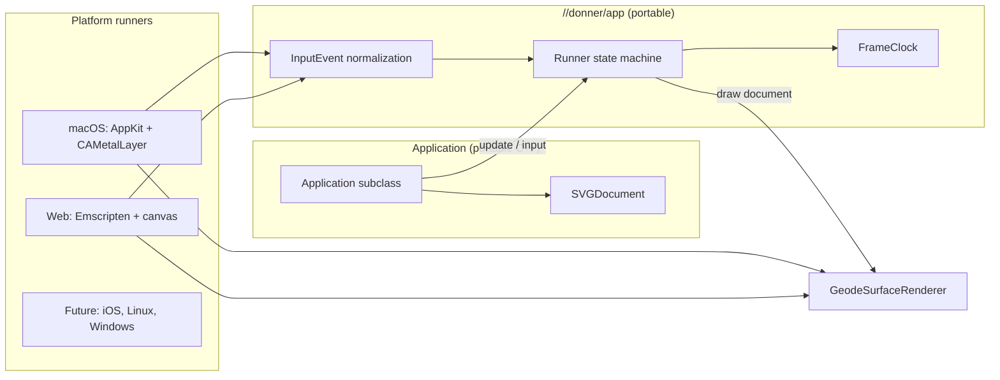

# Design: Donner App Framework

**Status:** Draft
**Author:** Claude Opus 5.5
**Created:** 2026-11-01

## Summary

Donner App lets an application, typically a game, be written once against Donner and built for
every supported platform from the same source. The application implements one C++ interface,
`donner::app::Application`, and declares one Bazel target with the `donner_app` macro. Donner
supplies the platform layer: the window or canvas, the frame loop, input, display scaling, asset
packaging and Geode presentation. `bazel build //game:hello` produces the native application;
`bazel build //game:hello_web` produces a static web site that runs the same code through
WebAssembly and WebGPU, including on phones.

Today an application that wants this must write its own AppKit view, its own Emscripten shell,
its own input handling and its own Emscripten build configuration, and must know which Donner
build flags to set for each platform. Donner App moves all of that into Donner.

This builds on `donner::svg::GeodeSurfaceRenderer`, which presents Geode frames to a host-owned
Metal layer or browser canvas, and on the maintainer decision that Geode may be embedded by
applications.

## Goals

- **Write once:** an application's code has no platform conditionals. The same `Application`
  subclass runs on macOS and in the browser, and later on iOS, Linux, Windows and consoles.
- **One target per application:** `donner_app(name, srcs, deps, assets)` declares the native
  application (`name`) and the web site (`name_web`). Platform build settings (Wasm platform,
  Geode, the browser backend, Emscripten link options) are applied by the macro through Bazel
  transitions. The application's `.bazelrc` needs no platform configuration.
- **GPU-resident presentation:** every platform presents through Geode into the platform's surface
  (`CAMetalLayer`, `<canvas>`), with no CPU readback in the frame path.
- **Display-correct by default:** the framework reports viewport size in device pixels and the
  display scale, tracks resizes and scale changes (Retina, phone DPR), and presents at full device
  resolution.
- **Unified input:** pointer (mouse and touch, with identifiers and phases), keyboard (physical key
  codes) and lifecycle events (focus, pause, resume) arrive through one event type, in viewport
  pixels.
- **Assets travel with the app:** files listed in `assets` are available at runtime under one
  asset root on every platform (bundled resources on macOS, the virtual filesystem on the web).
- **Downstream-first:** everything works from a separate Bazel module that depends on Donner, and
  a consumer-module test in Donner's CI keeps it that way.

## Non-Goals

- A scene graph, physics, audio, or gameplay systems. Applications own their simulation and draw
  an `SVGDocument`; those systems can be built on top later.
- iOS, Linux, Windows and console runners in the first milestones. The interface is designed so
  they slot in; they are tracked as later milestones.
- App Store packaging, code signing, notarization or deployment of web builds.
- A CPU (tiny-skia) presentation path. Donner App presents with Geode only.
- Multi-window applications. One application has one surface.

## Next Steps

- Land `GeodeSurfaceRenderer` (Metal layer) and its browser canvas factory.
- Land the browser backend downstream-load fix, so a downstream module can build WebAssembly
  Geode at all.
- Implement the platform-independent core (`Application`, `AppContext`, input types, fixed-step
  clock) with unit tests.

## Implementation Plan

- [ ] Milestone 1: Prerequisites
  - [ ] `GeodeSurfaceRenderer` for Metal layers and browser canvases.
  - [ ] The browser GPU backend loads from a downstream module.
  - [ ] Emscripten becomes a non-development dependency of Donner, so `donner_app` can declare
        web targets in a consumer module; confirm the default (tiny-skia) consumer closure and BCR
        preflight are unaffected because the toolchain is fetched only when a Wasm target builds.
- [ ] Milestone 2: Core library `//donner/app`
  - [ ] `Application`, `AppConfig`, `AppContext`, `InputEvent`, `FrameClock` (fixed-step update with
        a bounded catch-up, independent of the display rate).
  - [ ] Unit tests for the clock, input normalization and the runner state machine, using a fake
        platform.
- [ ] Milestone 3: macOS runner
  - [ ] AppKit application, a layer-backed view with a `CAMetalLayer`, `GeodeSurfaceRenderer`,
        display-linked frames, backing-scale and resize tracking, mouse/trackpad and keyboard input.
  - [ ] Asset root from the bundle's resources; plain-executable development mode under
        `bazel run`.
  - [ ] Smoke mode (`DONNER_APP_SMOKE_FRAMES=N`) that presents N frames and exits, for automated
        presentation checks.
- [ ] Milestone 4: Web runner
  - [ ] Emscripten entry point with ASYNCIFY device creation, `requestAnimationFrame` loop, canvas
        sizing from CSS size and `devicePixelRatio`, touch, mouse and keyboard input,
        `visibilitychange` pause and resume.
  - [ ] HTML template with a WebGPU capability message, served as `index.html`.
  - [ ] Assets embedded or preloaded under the asset root.
- [ ] Milestone 5: `donner_app` macro and transitions
  - [ ] `name` (native), `name_web` (site directory) and `name_web_serve` (local development
        server with the required headers).
  - [ ] Transitions that select the Wasm platform, Geode, the browser backend and the project's
        text tier for `name_web`, and Geode for `name`.
- [ ] Milestone 6: Example and CI
  - [ ] `examples/app_hello`: a small interactive document built for macOS and the web.
  - [ ] Consumer-module test that builds `donner_app` targets from outside the repository.
  - [ ] Browser smoke test of the web example in the existing Playwright lane.
- [ ] Milestone 7: More platforms
  - [ ] iOS runner (UIKit, `CAMetalLayer`, touch, safe-area insets, lifecycle).
  - [ ] Linux runner once Vulkan window presentation has a public entry point.

## User Stories

- As a game developer, I write my game against `donner::app::Application` and get a macOS build
  and a phone-playable web build without writing platform code.
- As a game developer, I add `assets = glob(["assets/**"])` and load files by relative path on
  every platform.
- As a Donner maintainer, I can verify every platform runner with an automated smoke run rather
  than manual testing.

## Background

- `donner::svg::GeodeSurfaceRenderer` presents Geode frames to a host-owned surface and reports
  resize and loss conditions through `FrameStatus`.
- Geode's browser backend runs WebGPU from WebAssembly. Device creation is asynchronous in the
  browser; the standalone Geode Wasm module already uses ASYNCIFY for it.
- Comparable engines (Unity, Godot) separate the application from per-platform players. A
  developer writes scripts against one API and selects a build target; the player supplies the
  window, loop, input and packaging. Donner App adopts that split for C++ applications that draw
  SVG documents.

## Requirements and Constraints

- Geode only; no CPU readback in the frame path.
- The core library compiles on every platform Donner supports; platform runners are selected by
  the target platform, never by application code.
- Web builds must run in Safari on iOS 26 and later and in current Chrome, over HTTPS.
- Wasm binary size matters on phones: the macro builds `name_web` size-optimized.

## Proposed Architecture



### Application interface

```cpp
namespace donner::app {

struct AppConfig {
  std::string title = "Donner App";
  /// Initial window size in points on desktop platforms. Mobile and web fill the screen.
  Vector2i preferredSizePoints = Vector2i(402, 874);
  /// Simulation step. update() is called at this rate regardless of the display rate.
  double fixedStepSeconds = 1.0 / 60.0;
};

class Application {
public:
  virtual ~Application() = default;
  virtual AppConfig config() const { return {}; }
  /// Called once with the asset root available. Return false to exit with an error.
  virtual bool start(AppContext& context) = 0;
  /// Called at the fixed step.
  virtual void update(AppContext& context, double dt) = 0;
  /// The viewport changed; sizes are in device pixels.
  virtual void viewportChanged(AppContext& context, const Viewport& viewport) {}
  virtual void input(AppContext& context, const InputEvent& event) {}
  /// Document to present this frame, drawn at the viewport's pixel size.
  virtual svg::SVGDocument& document() = 0;
};

}  // namespace donner::app

DONNER_APP_MAIN(MyGame);  // Defines the platform entry point for MyGame.
```

`AppContext` exposes the asset root, the platform name, monotonic time, the current `Viewport`
(pixel size and display scale) and `requestExit()`. `InputEvent` is a variant of `PointerEvent`
(identifier, phase, position in viewport pixels, pointer kind), `KeyEvent` (physical key code,
down or up, repeat) and `LifecycleEvent` (paused, resumed).

### Runners

Each runner owns its platform object, creates a `GeodeSurfaceRenderer` for it, converts platform
events to `InputEvent`, drives the `FrameClock`, and on every display frame calls `update` as many
times as the clock requires, resizes the presenter when the viewport changes or `draw` returns
`ResizeNeeded`, and presents `document()`. A device loss is reported to the application and ends
the loop with a visible error; recovery is a later improvement.

### Bazel surface

```py
load("@donner//donner/app:defs.bzl", "donner_app")

donner_app(
    name = "hello",
    srcs = ["Hello.cc"],
    assets = glob(["assets/**"]),
    deps = ["@donner//donner/svg"],
)
```

`hello` builds the native application for the host. `hello_web` builds a directory containing
`index.html`, the JavaScript loader and the Wasm module. The macro wraps the targets in
transitions that set the platform and Donner's renderer flags, so the developer runs plain
`bazel build`.

## Security / Privacy

- Web builds load only their own bundled files from the virtual filesystem; there is no network
  access in the framework. Applications that load SVG from untrusted sources keep using Donner's
  parser limits and sandboxed resource loader.
- Input events are converted from platform events with bounded sizes; touch identifiers and
  coordinates are validated before reaching the application.
- No secrets or credentials are involved. Web builds require HTTPS for WebGPU; serving is the
  developer's responsibility.

## Testing and Validation

- Core: unit tests for the frame clock (fixed-step accumulation, catch-up bound, pause), input
  normalization and the runner state machine against a fake platform.
- macOS: smoke run of the example that presents a fixed number of frames in a real window and
  exits with status, run on a Metal host.
- Web: Playwright smoke test of the example's site in Chromium on a GPU-backed adapter, checking
  presentation and a synthesized tap.
- Downstream: a consumer-module test that builds `donner_app` native and web targets from outside
  the repository, extending the existing consumer-load checks.
