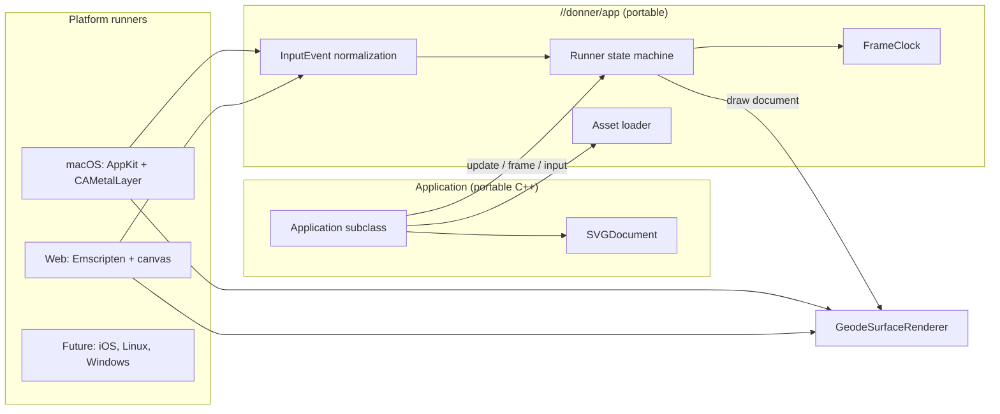

# Design: Donner App Framework

**Status:** Draft
**Author:** Claude Opus 5.5
**Created:** 2026-11-01

## Summary

Donner App lets an application, typically a game, be written once against Donner and built for
every supported platform from the same source. The application implements one C++ interface,
`donner::app::Application`, and declares one Bazel target with the `donner_app` macro. Donner
supplies the platform layer: the window or canvas, the frame loop, input, display scaling, asset
packaging and Geode presentation. `bazel build //game:hello` produces the native application;
`bazel build //game:hello_web` produces a static web site that runs the same code through
WebAssembly and WebGPU, including on phones.

Today an application that wants this must write its own AppKit view, its own Emscripten shell,
its own input handling and its own Emscripten build configuration, and must know which Donner
build flags to set for each platform. Donner App moves all of that into Donner.

Donner App depends on three changes that are open as pull requests:

- [#2221](https://github.com/jwmcglynn/donner/pull/2221): `donner::svg::GeodeSurfaceRenderer`,
  which presents Geode frames to a host-owned `CAMetalLayer`. Its description records the
  maintainer decision that applications may embed Geode.
- A pull request stacked on #2221 that adds browser canvas presentation
  (`GeodeSurfaceRenderer::CreateForCanvas`).
- [#2222](https://github.com/jwmcglynn/donner/pull/2222): lets a downstream module load the browser
  GPU backend, which every WebAssembly Geode build needs.

## Goals

- **Write once:** an application's code has no platform conditionals. The same `Application`
  subclass runs on macOS and in the browser, and later on iOS, Linux, Windows and consoles.
- **One target per application:** `donner_app(name, srcs, deps, assets)` declares the native
  application (`name`) and the web site (`name_web`). The macro applies the platform build settings
  (Wasm platform, Geode, the browser backend, compile and link options) through Bazel transitions,
  so the application's `.bazelrc` needs only what every Donner consumer already sets (C++20).
- **GPU-resident presentation:** every platform presents through Geode into the platform's surface
  (`CAMetalLayer`, `<canvas>`), with no CPU readback in the frame path, enforced by counters in
  the smoke tests.
- **Display-correct by default:** the framework reports the viewport in device pixels with the
  display scale, tracks resizes and scale changes, and presents at full device resolution.
- **Unified input:** pointer (mouse and touch, with identifiers and phases), keyboard (physical key
  codes) and lifecycle events (visibility, pause, resume) arrive through one event type, in
  viewport pixels.
- **Assets travel with the app:** files listed in `assets` are readable at runtime through one
  asset loader on every platform, and Donner's own packaged resources (the fallback font) are
  installed automatically.
- **Downstream-first:** everything works from a separate Bazel module that depends on Donner, and
  a consumer-module test in Donner's CI keeps it that way.

## Non-Goals

- A scene graph, physics, audio, or gameplay systems. Applications own their simulation and draw
  an `SVGDocument`; those systems can be built on top later.
- Text and IME input. Keyboard input is physical keys only.
- iOS, Linux, Windows and console runners in the first milestones. The interface is designed so
  they slot in; they are tracked as later milestones. The iOS target is the simulator or unsigned
  development runs; signing is out of scope.
- App Store packaging, code signing, notarization, or deployment of web builds.
- A CPU (tiny-skia) presentation path. Donner App presents with Geode only.
- Multi-window applications. One application has one surface.

## Next Steps

- Land #2221, the canvas presentation pull request and #2222.
- Decide how the `donner_app` macro reaches Emscripten (see Alternatives Considered), with BCR
  preflight evidence.
- Implement the platform-independent core (`Application`, `AppContext`, input types, frame clock)
  with unit tests.

## Implementation Plan

- [ ] Milestone 1: Prerequisites
  - [ ] `GeodeSurfaceRenderer` for Metal layers (#2221) and browser canvases (stacked pull request).
  - [ ] The browser GPU backend loads from a downstream module (#2222).
  - [ ] Choose how `donner_app` reaches Emscripten. Prove with BCR preflight that the default
        (tiny-skia) consumer closure builds and fetches no Emscripten toolchain, and, whichever
        option is chosen, that the root-only `emsdk` patches are unnecessary for consumers or
        upstreamed (the Closure Java-runtime patch matters for `--closure=1` size builds).
- [ ] Milestone 2: Core library `//donner/app`
  - [ ] `Application`, `AppConfig`, `AppContext`, `Viewport`, `InputEvent`, `FrameClock`
        (fixed-step updates with a bounded catch-up, plus an interpolation factor per displayed
        frame).
  - [ ] An asset loader interface with a directory-backed implementation over the sandboxed file
        loader and an in-memory implementation.
  - [ ] Unit tests for the clock, input normalization, the asset loaders and the runner state
        machine, against a fake platform.
- [ ] Milestone 3: macOS runner
  - [ ] AppKit application, a layer-backed view with a `CAMetalLayer`, `GeodeSurfaceRenderer`,
        display-linked frames, backing-scale and resize tracking, mouse, trackpad and keyboard
        input, and window occlusion as pause and resume.
  - [ ] Assets copied into a declared directory next to the executable (`<exe>.assets`, the
        existing packaged-resource lookup), and into `Contents/Resources/donner-assets` for an
        unsigned `.app` produced by a small Starlark bundling rule.
  - [ ] Smoke mode (`DONNER_APP_SMOKE_FRAMES=N`) that presents N frames, asserts zero frame-path
        readbacks and CPU bitmap uploads through Geode's counters (read through a test hook that
        keeps GPU types out of public headers), and exits with status.
- [ ] Milestone 4: Web runner
  - [ ] Single-threaded Emscripten entry point: ASYNCIFY only for device creation in `main()`,
        then a `requestAnimationFrame` loop whose callback never suspends. Canvas sizing from CSS
        size and `devicePixelRatio`, touch, mouse and keyboard input, `visibilitychange` pause and
        resume.
  - [ ] Move the browser packaged-resource bridge (`donner/editor/wasm/PackagedResourceBridge.cc`)
        and its loader (`packaged-resource-loader.js`) out of `donner/editor` into a shared library,
        changing them in place rather than copying them, with the frame wake supplied by the runner
        instead of the editor's worker.
  - [ ] Assets packaged as a content-addressed bundle fetched at startup through that transport,
        and served to the application by the in-memory asset loader, so builds keep
        `-sFILESYSTEM=0`. The loader checks the page manifest against resources registered in the
        module at compile time, so the macro generates that registration for the application's
        assets and an asset change relinks the module.
  - [ ] Enforce that frame callbacks never suspend: link the web module with Asyncify
        instrumentation limited to the device-creation path (`ASYNCIFY_ONLY`), so an attempt to
        suspend from any other call path traps. The browser smoke test then fails on such a trap,
        which makes it the CI target for this guarantee in optimized builds. A debug-build
        assertion that no unwind starts inside the frame callback is diagnostic tooling only.
  - [ ] HTML template with a WebGPU capability message, served as `index.html`.
- [ ] Milestone 5: `donner_app` macro and transitions
  - [ ] `name` (native), `name_web` (site directory) and `name_web_serve` (local development
        server).
  - [ ] Transitions modeled on the editor and Geode browser-test transitions.
- [ ] Milestone 6: Example and CI
  - [ ] `examples/app_hello`: a small interactive document built for macOS and the web.
  - [ ] Consumer-module test that builds `donner_app` native and web targets from outside the
        repository.
  - [ ] Browser smoke test of the web example in the existing Playwright lane, asserting
        presentation, a synthesized tap and zero frame-path readbacks.
- [ ] Milestone 7: More platforms
  - [ ] iOS runner (UIKit, `CAMetalLayer`, touch, safe-area insets, lifecycle).
  - [ ] Linux runner once Vulkan window presentation has a public entry point.
  - [ ] Presenter recreation after device loss.

## User Stories

- As a game developer, I write my game against `donner::app::Application` and get a macOS build
  and a phone-playable web build without writing platform code.
- As a game developer, I add `assets = glob(["assets/**"])` and load files by relative path on
  every platform.
- As a Donner maintainer, I can verify every platform runner with an automated smoke run rather
  than manual testing.

## Background

- `GeodeSurfaceRenderer` (#2221 and the stacked canvas change) presents Geode frames to a
  host-owned surface and reports resize and loss conditions through `FrameStatus`.
- Geode's browser backend runs WebGPU from WebAssembly. Device creation is asynchronous in the
  browser; the standalone Geode Wasm module already uses ASYNCIFY for it.
- Existing machinery the framework builds on: `packaged_resource_bundle` and the native
  `<exe>.assets` / `Contents/Resources/donner-assets` lookup, `web_package(asset_trees=...)`,
  `serve_http`, the browser packaged-resource fetch path, and the editor and Geode browser-test
  transitions (`donner/editor/wasm/editor_wasm_transition.bzl`,
  `donner/svg/renderer/wasm/geode_browser_test_transition.bzl`,
  `donner/gpu/browser/pthreads_transition.bzl`).
- Comparable engines (Unity, Godot) separate the application from per-platform players. A
  developer writes scripts against one API and selects a build target; the player supplies the
  window, loop, input and packaging. Donner App adopts that split for C++ applications that draw
  SVG documents.

## Requirements and Constraints

- Geode only; no CPU readback in the frame path.
- The core library compiles on every platform Donner supports; platform runners are selected by
  the target platform, never by application code.
- Web builds run in Safari on iOS 26 and later and in current Chrome, from a secure context. The
  single-threaded runner needs no cross-origin isolation headers, so generic static hosting works.
- Wasm binary size matters on phones: `name_web` builds size-optimized (`-c opt`, `-Oz`,
  `-sFILESYSTEM=0`). ASYNCIFY's size cost is measured in Milestone 4 and reported against the
  standalone Geode module.
- Assets are never exposed through runfiles symlinks: the sandboxed file loader and the packaged
  resource provider reject symlinks, so assets are copied into declared artifacts.

## Proposed Architecture



### Application interface

```cpp
namespace donner::app {

struct AppConfig {
  std::string title = "Donner App";
  /// Initial window size in points on desktop platforms. The default is a portrait phone screen
  /// (402x874 points), so a mobile-first application previews at its target shape on desktop.
  /// Mobile and web fill the screen.
  Vector2i preferredSizePoints = Vector2i(402, 874);
  /// Simulation step. update() runs at this rate regardless of the display rate.
  double fixedStepSeconds = 1.0 / 60.0;
};

class Application {
public:
  virtual ~Application() = default;
  virtual AppConfig config() const { return {}; }
  /// Called once, after the asset loader is ready. Return false to exit with an error.
  virtual bool start(AppContext& context) = 0;
  /// Called at the fixed step.
  virtual void update(AppContext& context, double dt) = 0;
  /// Called once per displayed frame before drawing. alpha in [0, 1) is how far the display time
  /// is between the last two updates, for interpolating motion on high-refresh displays.
  virtual void frame(AppContext& context, double alpha) {}
  /// The viewport changed; sizes are in device pixels.
  virtual void viewportChanged(AppContext& context, const Viewport& viewport) {}
  virtual void input(AppContext& context, const InputEvent& event) {}
  /// Document to present this frame, drawn at the viewport's pixel size.
  virtual svg::SVGDocument& document() = 0;
};

}  // namespace donner::app

DONNER_APP_MAIN(MyGame);  // Defines the platform entry point for MyGame.
```

`AppContext` exposes the asset loader (read a file by relative path, and a
`ResourceLoaderInterface` for documents that reference other files), the platform name, monotonic
time, the current `Viewport` (pixel size and display scale) and `requestExit()`. `InputEvent` is a
variant of `PointerEvent` (identifier, phase, position in viewport pixels, pointer kind),
`KeyEvent` (physical key code, down or up, repeat) and `LifecycleEvent` (hidden, visible, paused,
resumed).

### Threading

All `Application` callbacks run on one thread: the main thread on macOS, and the browser's main
thread in the single-threaded web runner. The web runner suspends through ASYNCIFY only inside
`main()`, while the GPU device is requested. Frame callbacks never suspend: Asyncify
instrumentation is limited to the device-creation path, so a suspension attempt anywhere else
traps and fails the browser smoke test. A re-entry guard skips a frame if one is somehow still
running. A threaded web runner (for example the editor's
proxy-to-pthread model) is a possible later option; it would follow the GPU ownership rules in
AGENTS.md and require cross-origin isolation headers.

### Runners

Each runner owns its platform object, creates a `GeodeSurfaceRenderer` for it, converts platform
events to `InputEvent`, and drives the `FrameClock`. On every display frame it calls `update` as
many times as the clock requires, calls `frame`, resizes the presenter when the viewport changes
or `draw` returns `ResizeNeeded`, and presents `document()`. When the surface is hidden (window
occluded, tab hidden) the runner stops drawing and delivers `LifecycleEvent`s. In the first
milestones a device loss is reported to the application and ends the loop with a visible error;
recreating the presenter after loss, which mobile browsers make routine, is Milestone 7.

### Assets

`assets` are packaged with Donner's packaged-resource machinery rather than a new mechanism:

- Native: copied into a declared `<exe>.assets` directory (and `Contents/Resources/donner-assets`
  inside an `.app`), the lookup Donner already uses. The directory-backed asset loader reads them
  through the sandboxed file loader.
- Web: a content-addressed bundle that the page fetches through the existing browser
  packaged-resource transport and installs into memory before `start()`. The in-memory asset
  loader serves reads, so the module keeps `-sFILESYSTEM=0`.
- Both: Donner's own packaged resources, such as the fallback font, are added to the bundle, so
  text renders without extra setup.

### Bazel surface

```py
load("@donner//donner/app:defs.bzl", "donner_app")

donner_app(
    name = "hello",
    srcs = ["Hello.cc"],
    assets = glob(["assets/**"]),
    deps = ["@donner//donner/svg"],
)
```

`hello` builds the native application for the host. `hello_web` builds a directory containing
`index.html`, the JavaScript loader, the Wasm module and the asset bundle; `hello_web_serve`
serves it locally.

The transitions follow the editor and Geode browser-test transitions. For `name_web` they set:
the Wasm platform (through `wasm_cc_binary`), `renderer_backend=geode`, `enable_geode=true`,
`browser_backend=true`, `disable_perf_opt_transition=true`, `-fconstexpr-steps=10000000`,
`-c opt`, `-Oz` and the size-related link options. For `name` they set Geode and the macOS
minimum version Donner's Metal backend needs; until a Linux runner exists, `name` is incompatible
with Linux hosts and is skipped there. Setting labels are written with `Label(...)` so they
resolve to `@donner` from a consumer module. The text tier comes from the consumer's
`donner.configure` (`DONNER_CONFIG`) unless the macro's optional `text` attribute overrides it;
the transitions never silently change the configured tier.

## Alternatives Considered

- **How the macro reaches Emscripten.**
  - Donner takes a non-development `emsdk` dependency. This is simplest for applications, but it
    enters every consumer's module resolution, can raise shared dependency versions, and does not
    carry Donner's root-only `emsdk` patches.
  - A separate `donner_app` Bazel module in this repository that depends on Donner and `emsdk`.
    This leaves the core Donner module and its BCR consumers unchanged. It has the same patch
    problem, since it is not the root module either, and it needs the release and BCR workflows to
    publish a second module root.
  - The consumer declares `emsdk` and passes the Wasm rule to the macro. This is flexible but
    leaks toolchain wiring into every application, contrary to the write-once goal.

  The leaning is the separate module, to be confirmed with BCR preflight evidence in Milestone 1.
- **`donner.configure` alone, without transitions.** This would make the native and web targets
  of one application need different command-line configurations, which defeats one-target
  builds.
- **A CPU presentation path for devices without WebGPU.** Rejected: Geode-only presentation keeps
  one renderer and the GPU-residency invariant. The page shows a capability message instead.

## Open Questions

- Whether to adopt JSPI instead of ASYNCIFY once it ships in target browsers, to reduce size.
- How to restore application state after a device loss, beyond recreating the presenter.
- Whether the iOS runner should share the macOS view code through a common Metal-layer host.

## Security / Privacy

- Web builds read only their own bundled assets; the framework performs no other network access.
  Applications that load SVG from untrusted sources keep Donner's parser limits and the sandboxed
  resource loader.
- Input events are converted from platform events with bounded sizes; touch identifiers and
  coordinates are validated before reaching the application.
- The asset bundle is content-addressed and verified on installation by the existing
  packaged-resource transport.
- No secrets or credentials are involved.

## Testing and Validation

- Core: unit tests for the frame clock (fixed-step accumulation, catch-up bound, interpolation
  factor, pause), input normalization, the asset loaders and the runner state machine against a
  fake platform.
- macOS: smoke run of the example that presents a fixed number of frames in a real window, asserts
  zero frame-path readbacks through Geode's counters, and exits with status, on a Metal host.
- Web: Playwright smoke test of the example's site in Chromium on a GPU-backed adapter, asserting
  presentation, a synthesized tap and zero frame-path readbacks.
- Downstream: a consumer-module test that builds `donner_app` native and web targets from outside
  the repository, extending the existing consumer-load checks.
- GPU residency: the readback and upload counter assertions above are the CI targets that fail if
  a CPU readback or bitmap upload enters the frame path.
