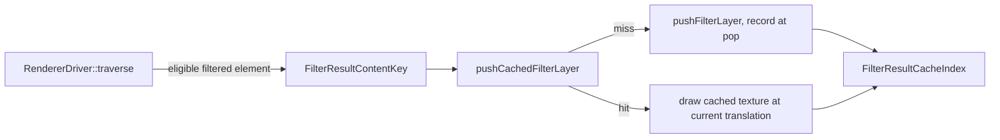

# Design: Cached Filter Results for Instanced Sprites

**Status:** Draft
**Author:** Jeff McGlynn
**Model:** Withheld
**Created:** 2026-11-02

## Summary

A game that draws sprites from an external sprite sheet through `<use href="sheet.svg#sprite-N">`
moves every occurrence by translation each frame, and retargets an occurrence with `setHref` when
its animation frame changes. Background sprites carry a filter inside the sprite group, such as a
`feGaussianBlur` of a few pixels or a glow that merges a blur under the source, and each sprite is
drawn many times per frame at different positions. Today every occurrence renders its filter on
every frame: Geode captures the filtered content, suspends the frame to run the filter graph, and
composites the result, once per occurrence per frame.

This design renders each distinct filtered result once into a texture and draws that texture at
every occurrence's position, rendering again only when an input that shapes the result changes.
The cache lives in the renderer: the driver identifies what a filter layer's content was derived
from, and Geode keeps the results. TinySkia keeps the uncached path.

## Goals

- A sprite's filter runs once across N frames and M occurrences when only translations change.
- The filter runs again after any change to what it renders: a DOM mutation of the sheet, a
  change to a filter primitive, a host style change that reaches the sprite, a `setHref`
  retarget, a change to the non-translation part of the device transform (scale, rotation,
  device scale), device loss, or eviction.
- Cached frames match uncached frames: exactly for integer motion, and within a documented
  tolerance for fractional motion.
- A continuously changing scale, such as a swap animation from 1.0x to 1.25x, falls back to the
  uncached path without recording a result per frame.
- Cached results are bounded by a share of the frame surface budget, with LRU eviction, and never
  refuse a frame's own surfaces.

## Non-Goals

- Caching filters outside external-use instances. A same-document `<use>` or a plain filtered
  element has no retained-style signal that its content is unchanged; it keeps today's path.
- Filters whose result depends on what is behind them or on content loaded independently of the
  document: `BackgroundImage` style inputs, `feImage`, and filters reading host context.
- Lighting and `feTurbulence` graphs, which resolve positions against the pixel raster rather
  than the content, so their results are not translation invariant.
- Text, images, nested external documents, patterns, masks and markers inside the cached subtree.
- TinySkia caching. It falls back to the uncached path; the interface default does so for every
  backend that does not override it.
- Changes to the compositor.

## Next Steps

- Land the region-sized filter surfaces and the sub-document filter preparation below this
  branch; the cache records a result only when the capture holds the whole filter region.
- Review and publish.

## Implementation Plan

- [x] Milestone 1: Content identity
  - [x] Expose a process-unique epoch for an occurrence's retained styles
    (`ExternalUseStyleRetention::RetainedStyleEpoch`).
  - [x] Build `FilterResultContentKey` in the driver for eligible filtered elements of a retained
    external-use instance.
- [x] Milestone 2: Renderer interface
  - [x] `RendererInterface::pushCachedFilterLayer` and `setFilterResultCacheEnabled`, defaulting to
    the uncached path.
  - [x] `FilterResultCacheIndex`: lookup, two-touch admission, pending results, LRU bounds with a
    thrash guard.
- [x] Milestone 3: Geode cache
  - [x] Record executed results into pixel-aligned textures; draw hits translated.
  - [x] Charge cached bytes to each frame's surface budget; drop on device loss or disable.
- [x] Milestone 4: Validation
  - [x] Counter, invalidation and pixel tests green on Geode.
  - [x] Wall-clock comparison on the game-like scenes (see Performance).

## Background

`ExternalUseStyleRetention` keeps each referenced subtree styled for the occurrence that draws
it, keyed by the root, the host's computed style for the `<use>`, and its fill and stroke. A
draw with the same inputs reuses the subtree's computed state. A restyle that reaches the subtree
for any reason (changed inputs, a style-dirty element, eviction, or a restore because another
occurrence reads outside its own subtree) ends the retention. This is the signal the cache uses
for "the sprite's styles did not change".

In the driver, an element's filter is pushed innermost: `paint -> filter -> clip-path -> mask ->
opacity`. The element's own clip, mask and opacity, and the `<use>` element's layers, are applied
outside the filter layer, so they apply to a cached result at draw time exactly as they apply to
a freshly filtered one.

## Proposed Architecture

### Cache key

The key has a content part built by the driver and a placement part added by the backend.

Content (`FilterResultContentKey`):

- The sheet document (weak reference, so a destroyed document matches nothing), its mutation
  revision (every DOM mutation changes it, including a new `stdDeviation`), and its font resource
  revision.
- The occurrence's retained style epoch. A new snapshot of the occurrence's inputs (changed
  inputs, eviction or a restore of the retained subtree) gets a new epoch; epochs are
  process-wide and never reused, so a restored and re-retained subtree, or a document at a reused
  address, cannot alias an old entry. A style-dirty element inside the current subtree is restyled
  without ending its epoch, which is why the key also carries the mutation revision.
- The instance root and the filtered element, and the viewport the `<use>` establishes for a
  referenced `<symbol>` or `<svg>`.
- The filter region, primitive viewport and user-to-pixel scale of the prepared graph.

Placement (`FilterResultPlacement`):

- The linear part `{a, b, c, d}` of the device transform, compared exactly. Translations multiply
  exactly through the transform chain, so a moving sprite keeps an identical linear part.
- For results that keep sharp edges, the bucket of the translation's sub-pixel fraction (see
  Translation below).

The filter graph itself is not hashed: it is derived from the document and the occurrence's
styles, both covered by the content key, and from the element's bounding box, which is content.

### Eligibility

The driver builds a key only when all of these hold; otherwise the layer is pushed as today:

- The traversal is an external-use instance whose occurrence styles are retained, in a document
  without animation elements or animated values.
- The element has exactly one filter stage, is not a shadow-tree instance, and its graph is
  translation invariant: no `feImage`, `feTurbulence`, or lighting primitive, and no capture that
  must stay viewport aligned.
- Its subtree holds only groups, basic shapes, paths, gradients and stops, clip paths, filters
  and filter primitives, and descriptive elements; no instance in it uses a pattern paint, mask,
  marker or text span; nested filters are translation invariant too.

Geode additionally uses the cache only for a top-level layer: no other filter capture, mask,
pattern tile or rejected filter is open, the frame is recording normally, and the layer would not
take the transformed local-raster path (skew, or rotation with an anisotropic blur).

### Translation

A cached result is valid for any translation. What changes with the translation's fraction of a
pixel is how the content's edges were rasterized. Two placements are used:

- A result whose final primitive is a Gaussian blur of at least one device pixel in each axis,
  with no primitive subregion of its own and whose three-deviation reach from the element's
  bounding box stays inside the filter region, is resampled bilinearly at the exact new offset. A
  blur the region or a subregion clips has a hard edge, so it is treated like the next case. Its detail is already low-passed, so bilinear
  resampling moves each channel by a few levels at most, and the result lands exactly where the
  uncached one would.
- Any other result, such as a glow that keeps the sharp source over its halo, is kept per
  quarter-pixel bucket of the translation's fraction and drawn on the pixel grid at the rounded
  integer delta. Edges stay crisp; their position differs from an uncached render by less than a
  quarter pixel, and up to sixteen buckets of a sprite fill in as it moves.

Snapping every result to the pixel grid would be simpler but visibly jitters slow-moving blurred
sprites by up to half a pixel; bilinear resampling of sharp results would soften their edges.

### Recording and drawing

On a miss that admission accepts, the layer is pushed normally and marked for recording. At pop,
after the graph executes and before the composite samples the output, Geode copies the
pixel-aligned device rectangle around the filter region (rounded out) from the output into a cache
texture, on the frame encoder in recorded order. The result is pending: later draws in the same
frame reuse it, and it becomes durable only once the frame's work is submitted. If the frame is
abandoned or its submission fails, its pending results are dropped, since their copies may never
have run. It records nothing when that
rectangle reaches past the captured raster, which would leave the copy missing content another
placement would show, and nothing when the graph was declined, since a later frame with more
budget would filter it. The miss frame's own composite is unchanged.

On a hit, Geode draws the cached texture at the recorded rectangle moved by the translation
delta, through the active encoder with the current clip state. The driver then skips the
element's paint and subtree, recording their draws as painted for font coverage, and pops the
element's clip, mask, opacity and viewport layers and any subtree markers ending there.

### Admission and scale animation

Admission is two-touch: a content records a result only on its second miss at the same linear
transform within 120 frames of the renderer's own frame count, and each content remembers up to
four recent linear transforms. A continuously changing scale never repeats and records nothing,
the final scale records once it holds, and a few static scales of one content each record.
Contents whose keys never repeat, such as an occurrence whose inputs change every draw, record
nothing. An insertion that would evict a result used in this frame or the previous one is
refused, so more contents than the cache holds keep what it holds and render the rest uncached
instead of evicting each other every frame.

### Budget and eviction

The index holds at most 64 results and at most a quarter of the frame surface budget's byte
limit (64 MiB at the default limit). Held results are outside the per-frame charge, so they never
refuse a filter or another surface in a frame; a result is recorded only while the frame's budget
still has room for four times its bytes, and recording reserves nothing from it. Evicted textures may
still be sampled by the frame's recorded commands, so they return to the texture pool only after
the frame is submitted, or are retained when its submission is uncertain. A lost device drops
every result; disabling the cache drops them immediately.

### Composition with occurrence state

Only the filtered content is cached. Occurrence opacity, `mix-blend-mode` and isolation, clip
paths, masks, and viewport clips are applied outside the filter layer, so a cached result is
composited through them like an uncached one. A filter inside a mask, pattern tile or another
filter's capture does not use the cache.

## Performance

`//donner/svg/renderer/tests:external_use_sprite_tests_wallclock` with `--config=geode -c opt`,
median frame time over 120 frames on an Apple GPU, cache disabled versus enabled. One run, with
the host's load average between 44 and 56 from other jobs, so absolute times are noisy; the
ratio is the signal.

| Scene | Uncached | Cached |
| --- | --- | --- |
| 100 inner-glow blurred background sprites of 5 kinds, drifting, plus 3 vector sprites, 800x1750 | 40.5 ms | 3.5 ms |
| 80 glowing pieces of 3 kinds falling with swap scaling, plus 4 lit bevels, 1206x2622 | 23.9 ms | 4.6 ms |

## Security / Privacy

The cache holds pixels derived from documents the renderer already draws; it adds no input
surface. Resource use is bounded by the entry limit and by a share of the existing frame
surface budget, so a document cannot grow it without bound. Keys compare a weak document identity
and a process-unique epoch, so results never cross documents or outlive a document's identity.

## Testing and Validation

- `//donner/svg/renderer/tests:filter_result_cache_index_tests`: lookup, LRU and byte-limit
  eviction, expiry, pending results, the thrash guard, and two-touch admission with several
  static scales.
- `//donner/svg/renderer/tests:external_use_filter_cache_tests` (tiny and geode variants):
  - the filter runs twice (the two-touch admission) across eight frames of five occurrences
    moving by integer and fractional steps, and every other draw reuses the result;
  - a disabled cache runs it for every occurrence;
  - a sprite mutation, a `stdDeviation` change, a scale, rotation or device-scale change, a
    `setHref` retarget, a `currentColor` change on the host, a `<use>` width and height change on
    a symbol, a sheet `<style>` change, a gradient stop change, and a style retention eviction
    each run the filter again and match a renderer with the cache disabled that drew the same
    frames, exactly;
  - more distinct sprites than the cache holds do not evict each other, stale sprites are evicted
    for new ones, and an evicted sprite runs again;
  - a continuously changing scale records nothing, and the held scale records once;
  - cached frames match uncached frames exactly for integer motion, and within pixelmatch 0.02
    for fractional motion of a blur that fades inside its region; a bucketed result (a glow, or a
    blur clipped by the default region) moved within its bucket equals the uncached render at
    the recorded translation moved by whole pixels exactly, and differs from the render at the
    actual translation only within 0.1 over at most 64 edge pixels.
- `//donner/svg/renderer/tests:renderer_geode_tests` cases: a result recorded in a frame that is
  abandoned before submission is not reused, and under a tight surface budget a caching frame
  draws every filter an uncached frame draws.
- `//donner/svg/renderer/tests:external_use_sprite_tests_wallclock` (manual, perf): blurred
  background sprites and a grid of glowing pieces with swap scaling, cached versus uncached.
- Correctness tests assert counts and pixels only, never timing.

## Open Questions

- Whether same-document `<use>` instances should get an equivalent content signal.

## Future Work

- [ ] TinySkia result cache over its retained raster structures.
- [ ] Cache sharp results without sub-pixel buckets by re-rasterizing only edges, if bucket
  warm-up proves costly.
