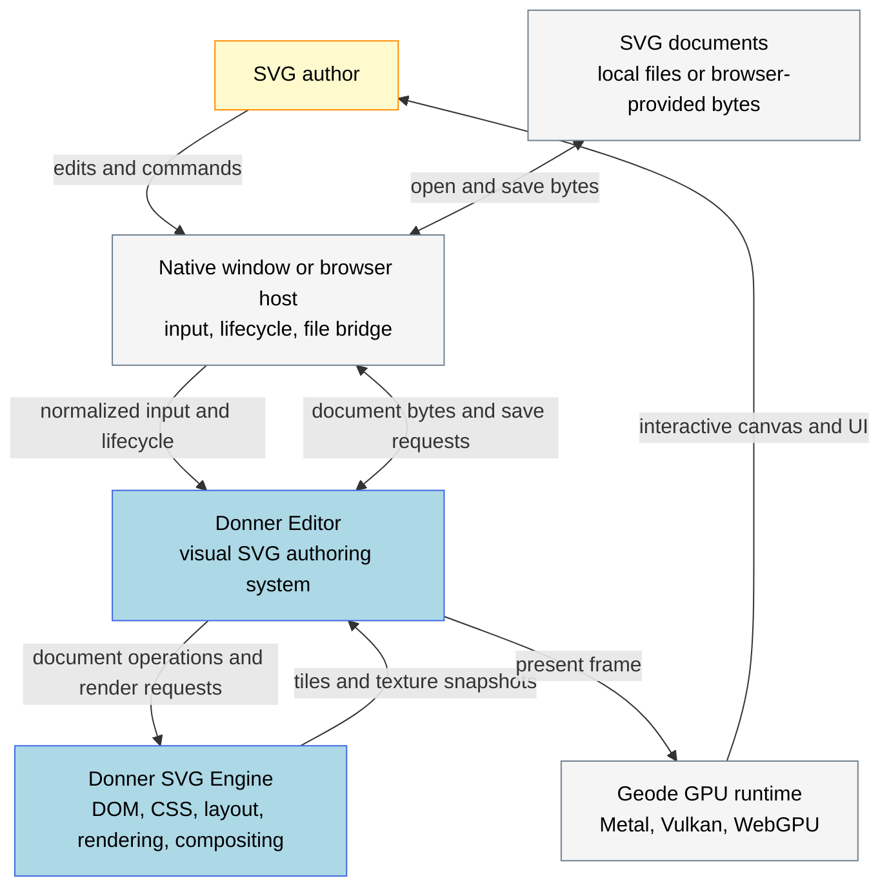
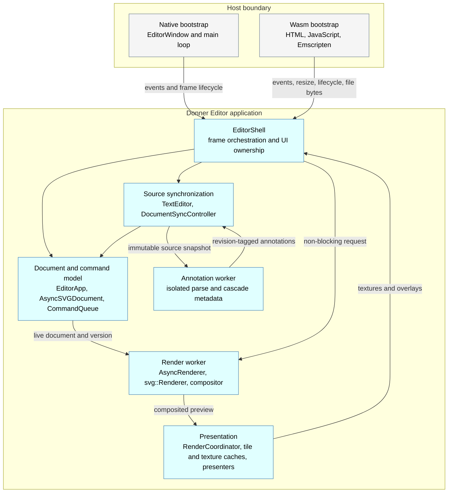
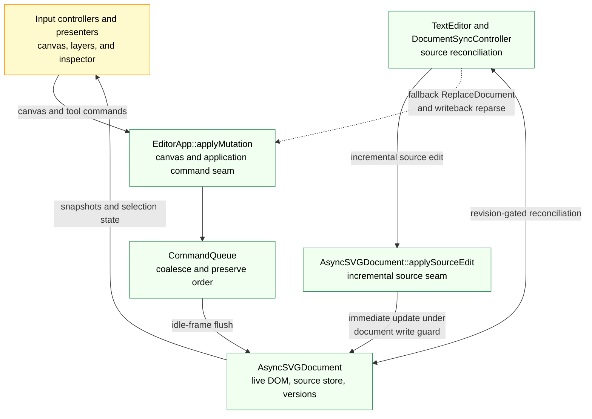
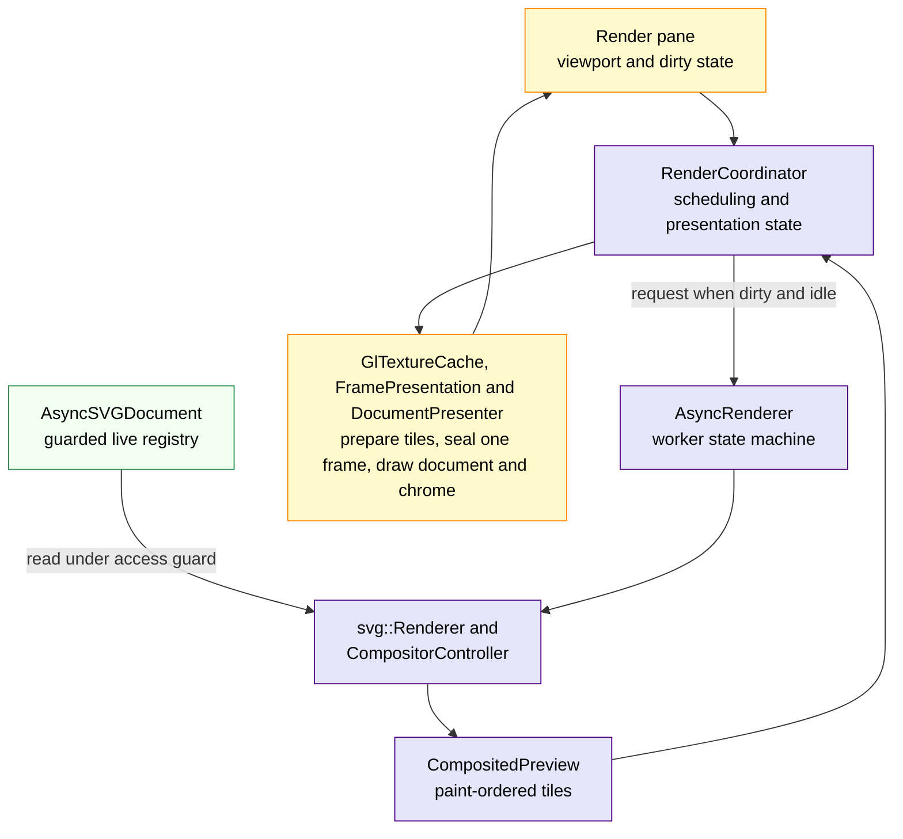
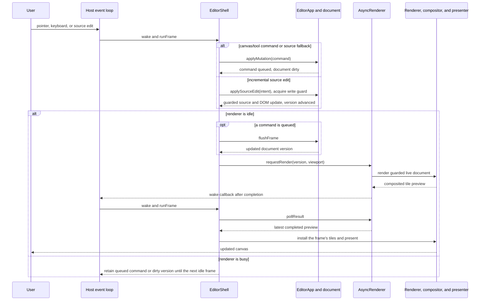

# Editor Architecture {#EditorArchitecture}

\tableofcontents

## Overview

`//donner/editor` is Donner's in-tree SVG editor. The native GLFW host and the
WebAssembly browser host share one Dear ImGui application that presents a document
as synchronized interactive canvas and XML source views. Native and Wasm release
targets use the Geode GPU backend and the full text tier. The full tier uses the
length-aware FreeType path for validated document-provided fonts, while HarfBuzz
provides OpenType shaping. `//donner/editor/tests:editor_embedded_font_render_tests`
compares an untrusted embedded font against the same trusted reference, and
`//donner/editor/wasm:editor_wasm_transition_tests` pins the browser product to this tier.

Two properties shape the whole design:

- **Rendering runs on a background worker thread.** Canvas, tool, and application commands queue
  without waiting for a render and apply when the worker is idle; finished renders are polled back
  as composited tiles. Incremental source-pane edits and in-canvas text editing are the
  exceptions: they apply immediately under the document's exclusive write guard and can briefly
  block the UI thread until an in-flight render releases that guard.
- **The frame loop is event-driven, not free-running.** On the desktop, `main()` blocks in
  `waitEvents`/`waitEventsTimeout` until input arrives, another thread posts a wake (for example
  render completion), or a timed UI task is due; while GPU completion or retirement work is
  outstanding, the wait is capped at 100 ms. In the browser, `main()` runs on an application
  thread whose vsync-aligned frame driver runs a full frame only when the editor requested one,
  browser input is pending, or a timer is due, and otherwise only services idle GPU work.

Guarantees callers can rely on:

- **Two guarded write seams.** Canvas, tool, and application commands enter through
  `EditorApp::applyMutation(EditorCommand)` and its command queue. Incremental source-pane edits
  enter through `AsyncSVGDocument::applySourceEdit()` so the XML source store and live SVG
  projection change together. Tools may configure detached elements while constructing a command,
  but never mutate an element already attached to the live document.
- **Edits cannot race the renderer.** Queued commands are flushed only while the async renderer
  reports `!isBusy()`, except that an in-canvas text session flushes its own edits immediately.
  Structured source edits and those text edits acquire the SVG document's concurrent-DOM write
  guard. A render in flight therefore either defers a queued flush or makes the edit wait until
  guarded access is available. That blocking handoff is a known contention point, not an
  asynchronous queue.
- **The interactive editor renders in-process.** The process-isolation prototype
  has been removed, so the GUI editor can no longer route through it; a
  replacement sandbox is planned for v1.0.

## C4 Architecture Views

These views use the C4 progression from system context to containers and components. The
boundaries are logical ownership boundaries; most containers compile into one native or Wasm
application.

### Level 1: System context

An SVG author interacts with Donner Editor through either a desktop window or a browser tab. The
editor reads and writes SVG documents through its host, delegates SVG semantics and rendering to
the Donner engine, and presents pixels through the host graphics runtime.

The browser host serves static package bytes and passes browser capabilities into the Wasm
bootstrap. It is not a server-side editing service, and the editor does not require a network
service for document processing.

### Level 2: Application containers

The UI thread owns `EditorShell`, the command queue, and all ImGui state. The render worker owns
renderer and compositor execution. The annotation worker parses an immutable source copy and
cannot return live DOM handles.

### Level 3: Editor components and data flow

The component boundaries enforce two invariants: attached-DOM writes use one of the two guarded
seams above, and a command-queue mutation is not flushed while a render result is in flight or
waiting to be polled, except during an in-canvas text session, whose immediate flush waits on the
document write guard instead.

### Dynamic view: one edit-to-pixel cycle

Completion signals wake the event-driven host loop, so a result can be presented without a
free-running redraw loop. Cancellation replaces stale in-flight requests at compositor safe
points.

## Architecture Snapshot

### Boot and frame loop

- **`main()`** (`donner/editor/main.cc`) parses argv (a positional SVG path,
  `--save-repro <path>`), constructs `gui::EditorWindow` (GLFW + Geode GPU runtime +
  ImGui, `donner/editor/gui/EditorWindow.h`) and `EditorShell`, then runs the
  event-driven loop: wait for events (desktop only) -> `window.pollIdleGpu()` ->
  `shell.prepareFrame()` -> `window.beginFrame()` -> `shell.runFrame()` ->
  `window.endFrame()`. The desktop timeout is the earlier of
  `EditorShell::nextIdleWakeSeconds()`, so throttled UI work still wakes the loop, and a 100 ms
  poll while GPU work is outstanding. The browser build installs a frame driver instead of this
  loop.
- **`EditorShell`** (`donner/editor/EditorShell.h`) is the stateful frontend that
  owns nearly all of the long-lived orchestration state: `EditorApp`, the tools,
  `TextEditor`, its purpose-specific `GlTextureCache` instances, `RenderCoordinator`,
  `DocumentSyncController`,
  the viewport/input controllers, and the presenters.
- **`EditorShell::runFrame()`** each frame: (1) retire aged presentation textures, poll the
  preview lane, then poll the latest async render through
  `RenderCoordinator::pollRenderResult`, which prepares its tiles and rejects a result that
  cannot keep the current object poses; (2) if `!isBusy()`, flush queued edits
  (`EditorApp::flushFrame`) and refresh selection bounds; (3) sync parse-error markers and apply
  pending canvas-to-source writebacks through `DocumentSyncController`; (4) compute the adaptive
  UI profile, pane layout and DockSpace, handle shortcuts, and render the menu bar (the native
  menu on macOS) or compact command bar, plus dialogs; (5) render the panes, sealing this
  frame's `FramePresentation`; (6) if `!isBusy()`, request the next render through
  `RenderCoordinator::maybeRequestRender` and advance visible previews; (7) collect a
  `FrameCostBreakdown` and emit frame-miss/resource telemetry. Inspector and tool actions may
  also flush mid-frame while the renderer is idle. Queued canvas-text characters are coalesced
  into one batch, so one UI frame performs one text-content synchronization rather than one
  synchronization per queued codepoint.

The welcome catalog renders the visible sample cards one at a time on the render worker's
low-priority preview lane, which also renders font-family previews. Document renders take
priority and cancel an active preview, and no preview starts while the renderer is busy. A
dedicated texture cache uploads the returned bitmaps for `SamplePickerPresenter`; ImGui only lays
out cards and blits the resulting textures. Keeping this cache separate from Layers previews
prevents the live-row retention sweep from evicting samples.

### The document write seams

Attached live-DOM writes enter through two explicit, guarded paths:

- **Canvas, tool, and application commands** call `EditorApp::applyMutation(EditorCommand)`. The
  method pushes onto the document's command queue and marks the document dirty; nothing is applied
  immediately. Tools can build and configure detached elements as command payloads, but do not call
  mutation methods on attached live elements.
- **Incremental source-pane edits** flow from `DocumentSyncController` through the source-sync
  helpers to `AsyncSVGDocument::applySourceEdit()`. That path updates XML source bytes and the SVG
  semantic projection together under `SVGDocument`'s concurrent-DOM write guard, then advances the
  frame version. Because source dispatch is immediate rather than queued, it can block the UI thread
  while an in-flight render holds the document guard. If an edit cannot be handled incrementally,
  source sync falls back to a queued `ReplaceDocument` command through
  `EditorApp::applyMutation()`.

- **`AsyncSVGDocument`** (`donner/editor/AsyncSVGDocument.h`) wraps `svg::SVGDocument`, queues
  command-based writes in a UI-thread-only per-frame `CommandQueue`, and exposes the guarded
  incremental-source seam. `flushFrame()` drains and applies the queue, normally once per frame,
  also after idle-gated inspector and tool actions, and immediately during an in-canvas text
  session (including before a save), and bumps a `frameVersion` counter; full document
  replacements bump a separate `documentGeneration`. Both are atomics the render worker can
  poll. `applySourceEdit()` routes incremental XML-source edits
  through `donner/base/xml` for structured editing.
- **`CommandQueue`** (`donner/editor/CommandQueue.h`) is UI-thread-only and
  coalesces on flush: `ReplaceDocument` is exclusive and drops earlier commands, and
  `CutShapes` and `PasteShapes` are exclusive the same way; repeated `SetTransform` on the
  same entity collapse to the latest (a 60 fps drag flushes as a single `setTransform`);
  repeated `SetAttribute` on the same element and attribute collapses to the latest value until
  a `RemoveAttribute` of that attribute; structural `Insert`/`Delete` never coalesce; commands
  are never reordered across entities. When a command is built, `pendingStyleAttribute()` lets a
  new style edit start from the latest queued style for that element, so consecutive edits
  compose.
- **`setDocumentMaybeStructural`** builds an entity remap against the current
  document; when the new tree matches by tag + id, the replacement is tagged
  `Structural` and the remap rides the next render request so the compositor
  preserves cached layer bitmaps instead of resetting them.
- **Undo/redo** goes through `UndoTimeline`; restored transforms are re-applied as
  commands. Canvas-to-source writebacks (transform, element removal) are queued on
  `EditorApp` and drained each frame by `DocumentSyncController`.

### Async rendering and threading

- **`AsyncRenderer`** (`donner/editor/AsyncRenderer.h`) runs a dedicated worker
  thread that has exclusive use of the `svg::Renderer` owned by `RenderWorkerBundle` and
  owns a `CompositorController`, which it recreates when the composited rendering mode changes
  and destroys while compositing is off. Its foreground state is a variant over
  `Idle`/`Rendering`/`Cancelling`/`Done`/`Shutdown`, beside a one-slot low-priority preview
  lane and a compositor warmup after the first frame. `isBusy()` is true while a render is in
  flight, a finished result awaits polling, or the warmup holds the document; preview work
  never sets it. The UI thread must not mutate the document or touch the renderer while it is
  true. UI work deferred by that gate waits for the renderer's wake: render completion and
  cancellation always wake, and `isBusyWithIdleWake()` also registers a wake for speculative
  warmup. Requesting a frame on every busy frame instead redraws at display rate for the whole
  render; in the browser those frames hold the GPU owner thread that the render is waiting on.
  `requestRender()` is non-blocking and cancels+replaces an in-flight request, and
  `cancelInFlight()` cancels without a replacement; cancellation is delivered through a
  `svg::compositor::CancellationToken` polled at compositor safe points. While idle, the worker
  runs owner-thread GPU maintenance.
- **Threading model.** The worker shares the _live_ registry rather than deep-copying
  (`SVGDocument` is a value facade over a shared `DocumentState` that owns the registry). On
  the first render request the document is flipped to `svg::ThreadingMode::ConcurrentDom` for
  the editor's lifetime; the worker takes a `DocumentWriteAccess` guard across the render and
  releases it before touching its own mutex to avoid lock-order inversion.
  UI-thread DOM access takes its own guard: a read guard, or a write guard where a read
  computes lazy state. This is the editor-side
  application of the DOM lifetime ownership model (see \ref Multithreading).
- **Source-edit contention.** The source-pane structured-edit path requests a blocking
  `DocumentWriteAccess` from the UI thread even when the renderer is busy. This is race-safe, but a
  long render can delay source typing until the worker releases its guard. Moving this path onto an
  idle-frame queue is a future responsiveness improvement, not a current invariant.
- **`RenderCoordinator`** (`donner/editor/RenderCoordinator.h`) owns the
  renderer-side orchestration: the `RenderWorkerBundle` (renderer + `AsyncRenderer`,
  destroyed in reverse order so the worker joins before the renderer it references),
  the composited presentation, the selection-bounds cache, and render scheduling
  with pinch-zoom / canvas-size / raster-viewport debouncing, plus the scheduling policy
  (`PresentationRenderScheduler`), the sealed per-frame `FramePresentation`, overview infill,
  eyedropper pixel capture, and paced retries when there is nothing to present.

### Compositor and presentation

A render produces a `RenderResult` whose `CompositedPreview` is a paint-order list
of `CompositedTile`s. Each tile carries document-unit geometry and a drag translation
so tiles slide in real time without re-rasterizing. It may include a CPU
`RendererBitmap` or backend `RendererTextureSnapshot`; a metadata-only tile can reuse
a cached texture when its identity matches. `GlTextureCache` retains stable tile ids
and generations and installs a tile set only when every payload is ready. On Geode
builds, native and browser, document tiles arrive only as GPU texture snapshots, which
the cache retains and registers with the UI texture registry; CPU bitmaps go through
the GPU runtime only for thumbnails and previews. Each UI frame seals one
`FramePresentation` that binds the tile set, the captured selection geometry, and the
object poses. `DocumentPresenter` installs it, and the host draws the checkerboard,
document tiles, and `OverlayRenderer` selection chrome straight into the window
framebuffer before the ImGui pass. Non-Geode builds, which no shipped product uses, keep
tiles in GL textures and compose tiles and chrome into one intermediate texture
(`DocumentPresentationCompositor`) that the render pane draws as one image.
`RenderPanePresenter` draws only that image and the diagnostic overlays.
`svg::Renderer` resolves at build time to tiny-skia (software) or Geode (GPU); the
shipped `editor` target uses Geode. Editor code compiled
for Geode is guarded by `DONNER_EDITOR_WGPU`, a macro that keeps its historical name; it
selects the Donner GPU runtime, not the retired wgpu adapter.

The editor settles a presentable surface's format before its UI and renderer pipelines
are created. Geode presents through Metal on macOS, Vulkan on Linux, and WebGPU in Wasm.
Native windows provide a Metal layer or GLFW Vulkan surface, and the Wasm host supplies a
transferred canvas. The editor's UI and framebuffer contexts share the selected physical
owner. Explicit offscreen render targets serve headless and replay paths. See the
[GPU runtime reference](gpu_runtime.md) for context ownership, backend selection and how
the editor behaves when the GPU fails.

During an active transform, `SelectTool` exposes gesture-owned bounds and transform
state. `OverlayRenderer` builds combined bounds and handles directly from that
snapshot instead of traversing selected geometry every pointer frame. A presented
tile carrying a live entity matches an active drag only when the entity identities
are equal; the boolean drag-target marker is used only for entity-less legacy tiles.

Dragging a shape inside a masked group keeps the translation-only fast path on Geode. The
compositor caches three unmasked pieces of the group, the content painted before the dragged
subtree, the subtree itself, and the content painted after it, and each held frame rebuilds the
group's tile under its mask with the dragged piece shifted. Text, shapes with markers,
patterns or their own mask, content drawn again through `<use>` or `feImage`, and other cases
where separate pieces would not composite like one render keep the full render. The first frame
that does not use the pieces renders the group from source, so a release settles crisp.
`//donner/svg/compositor:compositor_geode_splash_tests` covers it on the splash.

The composited-tile presentation is the subject of its own design work; this doc
describes the editor's consumption of it.

### Panes, tools, and presenters

- **Panes** are immediate-mode borderless ImGui windows; layout math lives in
  `EditorShellLayout`. The **render pane** (`EditorShell::renderRenderPane`) handles
  pointer input, and `RenderPanePresenter` draws its diagnostic overlays; the
  **source pane** is `TextEditor`
  (headless core split into `TextEditorCore`); **Layers** (`LayersPanel`) renders
  the user-facing document tree; **Inspector** (`SidebarPresenter`) renders XML,
  CSS, and transform state from a snapshot refreshed only while the worker is
  idle; `CompositorDebugPanel` (View > Compositor Debug Info) is the separate
  compositor diagnostics view; the **menu bar** (`MenuBarPresenter`) returns a semantic
  `MenuBarActions` struct the shell acts on; **dialogs** (Open/Save/About/Licenses) are
  `DialogPresenter`, and on macOS Open and Save use native panels.
- **Tools** implement the `Tool` interface (`onMouseDown`/`onMouseMove`/`onMouseUp` in
  document-space coordinates). They submit attached-document changes through
  `EditorApp::applyMutation`; a tool may configure a detached element before placing it in an
  `InsertElement` command, but never mutates an attached live element directly. `SelectTool`
  handles select / marquee / move / resize / rotate (emitting `SetTransform` commands); `PenTool`
  draws and directly edits paths (Bezier anchors, corner and smooth points, handle editing, and
  continuing or closing a path); `TextTool` places and edits text; the eyedropper samples
  document pixels. Input is dispatched inside the render pane, mapping ImGui mouse state through
  `ViewportState::screenToDocument` to the active tool.
- **Source-to-canvas and canvas-to-source sync** is handled by `DocumentSyncController` and documented in
  \ref StructuredSourceEditing.
- **Source style annotations** are computed from an immutable source copy on a
  separate worker. The worker owns an isolated parsed document and returns cascade
  metadata plus deduplicated `AttributeWritebackTarget` locators, never live
  `SVGElement` handles. `EditorShell` applies a result only when both document
  generation and source version still match, then resolves all locators in one
  read-guarded document traversal.
- **Source reveal layout** preserves the document point under the render-pane center.
  `ViewportState` selects a pane-bounded raster only when its pixel area is smaller
  than the full-document raster, unless the editor's 8192-pixel canvas cap requires bounds.

### Animation Preview {#EditorArchAnimationPreview}

The **Edit | Preview** control in the dock header above Layers (a floating panel in the compact
layout) switches the canvas between editing and playing the document's declarative animations.
Preview drives the document through the same public API an embedder uses (see
\ref GettingStartedAnimation):

- **Clock.** `EditorShell` reads a monotonic host clock, quantizes it to 60 Hz ticks, and passes
  the elapsed time to `SVGDocument::setTime()` through `AsyncSVGDocument`. It advances only after
  the previous animation frame has been presented, and not while the async renderer is busy.
- **Start and stop.** Entering and leaving Preview both call `SVGDocument::restartAnimations()`, so
  playback starts at time zero and Edit restores the authored state without changing the SVG source
  or undo history. Escape also returns to Edit. Preview cannot start while a drag, Pen draft,
  pending click, or the sample picker is active.
- **Input.** While Preview is on, editing tools, undo/redo, clipboard and selection commands are
  disabled; viewport navigation stays available. Each rendered frame captures bounded hit geometry,
  so pointer events are hit-tested against the frame on screen and delivered with
  `SVGDocument::dispatchMouseEvent()` to `begin`/`end` event triggers.

The **Animation** sample in the sample catalog exercises hover, press, click and motion timing.

### Adaptive UI profile

`ComputeEditorAdaptiveUiLayout` in `EditorShellLayout` is the pure policy boundary
between desktop and `CompactTouch` chrome. It receives logical window dimensions
and a platform touch preference, then returns top-bar, tool-size, sheet-placement,
and feature-subset decisions. Native constrained windows use the compact profile;
the WebAssembly shell prefers it when the browser reports touch points or a coarse pointer.

Compact mode gives the render pane the full DockSpace and presents one Layers or
Inspector sheet over it. Portrait uses a bottom sheet; landscape uses a right
sheet clamped to a useful reading width. Desktop and compact layouts have distinct
DockSpace ids. The shell rebinds only the Render window when switching profiles,
leaving the desktop dock tree, source visibility, and sidebar width intact.

Touch adaptation is deliberately above the document and renderer layers. Compact
commands call the same `EditorApp`, tool, and presenter seams as desktop commands.
The shell increases hit tolerance without increasing selection-handle artwork and
uses 44 logical pixel command, row, and field targets. The Wasm bootstrap translates
one captured touch pointer into the ordinary ImGui mouse stream for taps and direct
drags. Browser code remains responsible for resize, virtual-keyboard, lifecycle, and
future multi-touch gesture integration.

## Code-level landmarks

| Responsibility           | Primary code                                                                                 | Focused verification                                                                                                  |
| :----------------------- | :------------------------------------------------------------------------------------------- | :-------------------------------------------------------------------------------------------------------------------- |
| Host and frame lifecycle | `donner/editor/main.cc`, `gui/EditorWindow.h`, `wasm/editor-bootstrap.js`                    | `EditorWindow_tests.cc`, `FrameCallbackAdmission_tests.cc`, browser smoke and lifecycle tests                         |
| UI orchestration         | `EditorShell.h`, `EditorShell.cc`                                                            | `EditorDockLayout_tests.cc`, presenter and frame-budget tests                                                         |
| Document write seams     | `EditorApp.h`, `CommandQueue.h`, `AsyncSVGDocument.h`, `SourceSync.h`                        | `EditorApp_tests.cc`, `CommandQueue_tests.cc`, `AsyncSVGDocument_tests.cc`, `EditorSync_tests.cc`                     |
| Source synchronization   | `DocumentSyncController.h`, `TextEditorCore.h`                                               | `DocumentSyncController_tests.cc`, `EditorSync_tests.cc`                                                              |
| Background annotations   | `StyleSourceAnnotations.h`                                                                   | `StyleSourceAnnotations_tests.cc`                                                                                     |
| Render scheduling        | `RenderCoordinator.h`, `AsyncRenderer.h`                                                     | `RenderCoordinator_tests.cc`, `AsyncRenderer_tests.cc`                                                                |
| Composited presentation  | `CompositedPresentation.h`, `FramePresentation.h`, `DocumentPresenter.h`, `GlTextureCache.h` | `CompositedPresentation_tests.cc`, `FramePresentation_tests.cc`, `GlTextureCache_tests.cc`, browser compositing tests |
| Interaction tools        | `Tool.h`, `SelectTool.h`, `PenTool.h`, `TextTool.h`                                          | tool, gesture, click, and drag-coalescing tests                                                                       |

## API Surface

The editor is an application, not a reusable library API, but the load-bearing
entry points are:

- `EditorApp::applyMutation(EditorCommand)` - queued canvas, tool, and application commands.
- `AsyncSVGDocument::applySourceEdit(XMLEditIntent)` - guarded incremental source-pane edits.
- `EditorApp::loadFromString(std::string_view)` / `AsyncSVGDocument::flushFrame()`
  / `currentFrameVersion()` - document lifecycle used by the frame loop.
- `EditorShell::runFrame()` / `nextIdleWakeSeconds()` - the per-frame tick.
- `ComputeEditorAdaptiveUiLayout()` - pure desktop/compact profile selection and
  sheet geometry.
- `AsyncRenderer::requestRender()` / `pollResult()` / `isBusy()` - the render
  handoff; plus the replay-only test hooks documented in
  \ref DeterministicReplayTesting.

## Security and Safety {#EditorArchSecurity}

- **In-process rendering.** The interactive editor parses and renders untrusted SVG
  in-process on the worker thread. The former process-isolation prototype has
  been removed, so there are no standalone sandbox parser/renderer binaries. A
  production replacement sandbox remains in the v1.0 scope.
- **Save-path invariants** (`donner/editor/DocumentSave.h`): existing destinations
  are opened `O_NOFOLLOW` (no symlink following), missing ones created
  `O_CREAT | O_EXCL`, with no pre-`stat` (avoiding a TOCTOU window). Save writes the
  XML source-store bytes verbatim and only after `hasSourceStore()` passes.
- **Concurrent DOM access** is guarded: the worker holds `DocumentWriteAccess` for
  the render; UI-thread reads take a read-access guard. Unguarded or invalid access in
  `ConcurrentDom` mode trips release assertions, which abort in every build type.
- **Source annotation isolation** is revision-gated. Background parsing uses a
  separate registry; registry-backed element handles are cleared before the result
  crosses threads, and stale document/source revisions are discarded.
- **Dynamic strings** are rendered with `ImGui::TextUnformatted(...)` rather than as
  format strings; this is an enforced-by-convention practice in the editor code, not
  a separate lint rule.
- **Adaptive chrome adds no authority.** Compact commands reuse existing mutation,
  file-dialog, and render seams. The profile itself performs no network, storage,
  clipboard, or document access.
- **`stb_image`** is not used anywhere under `donner/editor/`; image decoding runs
  behind `svg::Renderer` on the worker.
- **Profiling.** Tracy instrumentation compiles to no-ops unless `ENABLE_TRACY` is
  defined (native builds enable it; RE, CI and Wasm builds do not).

## Testing and Observability

Native tests live under `donner/editor/tests/` and browser suites under
`donner/editor/wasm/tests/`. By area:

- **Orchestration / document:** `EditorApp_tests.cc`, `EditorSync_tests.cc`,
  `CommandQueue_tests.cc`, `AsyncSVGDocument_tests.cc`,
  `DocumentSyncController_tests.cc`, `UndoTimeline_tests.cc`.
- **Async rendering / compositor:** `AsyncRenderer_tests.cc`,
  `RenderCoordinator_tests.cc`, `CompositedPresentation_tests.cc`,
  `FramePresentation_tests.cc`, `PresentationRenderScheduler_tests.cc`,
  `GlTextureCache_tests.cc`, `EditorLayerStress_tests.cc`, the
  `AsyncRendererFilterGroup*` / `FilterDragRepro*` correctness and perf suites, and
  `//donner/svg/compositor:compositor_geode_splash_tests` for the masked-group drag.
- **Tools / interaction:** `SelectTool_tests.cc`, `PenTool_tests.cc`, `TextTool_tests.cc`,
  `RenderPaneClick_tests.cc`, `RenderPaneGesture_tests.cc`, `DragCoalesce_tests.cc`,
  `ViewportInteractionController_tests.cc`.
- **Presenters / UI:** `EditorShell_tests.cc`, `SidebarPresenter_tests.cc`,
  `RenderPanePresenter_tests.cc`, `DocumentPresenter_tests.cc`,
  `OverlayRenderer_tests.cc`, `LayerInspectorDiagnostics_tests.cc`,
  `EditorShellLayout_tests.cc`, `EditorDockLayout_tests.cc`, and
  `LayersPanel_tests.cc`.
- **Persistence / replay:** `DocumentSave_tests.cc`, `RnrReplay_tests.cc`,
  `GlRnrReplay_tests.cc` (see \ref DeterministicReplayTesting).
- **Host and GPU:** `EditorWindow_tests.cc`, `FrameCallbackAdmission_tests.cc`,
  `UiTextureRegistry_tests.cc`, and the browser presentation, surface-recovery, GPU-residency,
  and smoke suites.
- **Fuzz / telemetry:** `EditorStateMachine_fuzzer.cc`,
  `FrameMissTelemetry_tests.cc`.

Per-frame `FrameCostBreakdown` and compositor freshness diagnostics are surfaced for
both the live Compositor Debug Info panel and the replay/readback harnesses.

## Limitations and Future Extensions

- The GUI editor renders untrusted input in-process until the v1.0 sandbox redesign
  lands.
- `PenTool` covers path drawing and direct point editing, and the Inspector applies
  boolean path operations; further path-editing work is tracked separately.
- Compact touch mode intentionally omits source editing, paint controls, the
  contextual text format bar, canvas scrollbars, and compositor diagnostics, and its
  sheets show swatches instead of raster Layers thumbnails. It is a canvas-first editing
  subset, not a compressed copy of every desktop panel.
- The editor is an application binary, not a stable embedding API; the entry points
  above are internal contracts, not a supported external interface.
