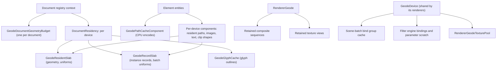

# Geode Frame Cost and Residency {#GeodePerformance}

\tableofcontents

This page is for developers changing the Geode renderer (`donner/svg/renderer/RendererGeode.cc`
and `donner/svg/renderer/geode/`). It states what a frame of an unchanged document may cost, the
tests that hold the renderer to it, and every kind of state the renderer keeps across frames to
get there: what keeps it current, when it goes away, and what it is charged to. It closes with the
draws that still pay per frame and the limits of the retained state, with numbers.

The \ref GpuRuntime describes the runtime underneath, and \ref EmbeddingGeodeTexturePool the
texture pool a host can trim. [Design 0030](design_docs/0030-geode_performance.md) summarizes the
work that built this.

## Overview {#GeodePerformanceOverview}

Geode is a dynamic renderer: an interactive host draws the same document frame after frame and
edits it in between. Geometry, uniforms, instance records, image textures and bind groups stay on
the GPU from the frame that made them, and an edit rewrites only the state it changes. A frame
whose document, viewport and renderer did not change since the previous frame re-encodes no path,
creates no texture, writes no GPU buffer and creates at most six bind groups, within the caps and
budgets this page states: a draw past a cap or refused by a budget pays per frame (see
[the per-frame list](#GeodePerformanceArena)). The counter corpus enforces this for every scene of
the render corpus at its 512-pixel clamp, and again with its long edge at twice its natural long
edge, at most 2048 pixels.

Three rules apply to every piece of state kept for this:

- **Invalidation.** An edit that changes what a draw paints reaches the next frame of a renderer
  that already holds state for the document. Each cache states what makes it stale, and a test
  edits the document and compares a warm renderer with a fresh one. Open warm-frame gaps remain,
  one on the Geode side (a marker's context paint) and several outside it, listed under
  [known limits](#GeodePerformanceLimits).
- **Lifetime.** State goes with its owner (an element, a document, a device, a renderer), and is
  never released while a recorded but unsubmitted frame can still read it.
- **Accounting.** Retained bytes are charged to a budget, or are bounded by a structural cap that
  this page states. A refused charge falls back to the per-frame path and renders the same pixels.

## The Steady-State Contract {#GeodePerformanceContract}

### What an unchanged frame may do {#GeodePerformanceUnchangedFrame}

`RendererGeode::lastFrameTimings()` returns the last frame's `geode::GeodeCounters`
(`geode/GeodeCounters.h`), counted by the runtime device, so filter and texture-encoder work is
included. On an unchanged frame of a scene within the stated caps and budgets, which is what the
counter corpus checks:

| Counter            | Steady state | Meaning                                                        |
| ------------------ | ------------ | -------------------------------------------------------------- |
| `pathEncodes`      | 0            | The encode caches serve every path, clip shape and text shape. |
| `textureCreates`   | 0            | Render targets and scratch textures come back from the pool.   |
| `bufferWrites`     | 0            | Resident geometry, uniforms and records are not written again. |
| `bindgroupCreates` | at most 6    | Bind groups are cached per slot, per batch and per composite.  |

An unchanged frame still records its draws, render passes and submission. It renders every
pattern tile again (one render pass plus the tile's resident content draws, none of which moves a
gated counter), runs every filter pass (uploading and binding nothing new), and expands text
strokes on the CPU again (`strokeOutlineFlattens`, which no gate checks). Snapshot readback is an
explicit capture outside the frame: it allocates a buffer and a bind group, reported separately by
`RendererGeode::consumeReadbackStats()`.

"Unchanged" means the same renderer and device, the same target size and the same document with
no edit in between. A document drawn by a renderer on another device builds its own state there.

### The counter corpus {#GeodePerformanceCorpus}

`//donner/svg/renderer/geode:geode_counter_corpus_tests`
(`geode/tests/GeodeCounterCorpus_tests.cc`) holds every scene of the render corpus to the steady
state. The target selects the Geode backend itself, so it needs no `--config`.

- **Scenes.** Every staged `.svg` directly under the roots in `kCorpusRoots` (the repository root,
  `donner/svg/renderer/testdata` and `donner/svg/renderer/benchmarks/testdata`) is one
  parameterized case, `Corpus/GeodeCounterCorpusTest.SecondFrameIsSteadyState/<stem>`, where
  `<stem>` is the file stem with every character other than a letter or digit replaced by `_`
  (`SceneNamesAreUnique` rejects two files that fold to one name). Each root must contribute a
  minimum number of scenes (`EveryCorpusRootIsPopulated`), so a dropped `data` dependency fails
  instead of shrinking the gate.
- **Measurement.** Each scene is parsed with sandboxed resource loading and the hermetic test
  fonts, its canvas clamped to `kMaxCanvasEdge` (512) pixels per edge, and drawn twice by one
  renderer on one shared headless device. The second frame's counters are sampled before any
  snapshot and compared with `kSteadyState`. The first frame's snapshot must contain visible
  pixels, unless the scene is listed in `kDeliberatelyInert` with a reason, so a scene that stops
  rendering cannot pass on zero counters.
- **Reading it.** Bazel hides passing output; run with `--test_output=all` to see one
  `[counter-corpus]` line per scene with its second-frame `pathEncodes`, `textureCreates`,
  `bufferWrites`, `bindgroupCreates` and `drawCalls`, the first frame's `drawCalls` and the visible
  pixel count.
- **The ledger.** `kKnownViolations` lists the scenes allowed to miss the steady state, and it is
  empty: every corpus scene meets it. The gate fails in both directions. A scene not listed fails
  on any counter above `kSteadyState`. A listed scene must still break every counter in its
  `violated` mask, so fixing a counter fails the suite until the entry drops it, and may not exceed
  the measured `ceiling` recorded for it. `KnownViolationsAreWellFormed` rejects an entry for a
  scene not in the corpus, an empty mask, a missing reason or tracking note, and a ceiling that
  contradicts its mask. A listed scene that improves to half its ceiling or less prints a `NOTICE`
  line asking for the entry to be re-measured.
- **Above natural size.** What the texture pool keeps depends on texture size, so a scene can meet
  the steady state at the clamp and miss it on a larger canvas. A second pass,
  `Corpus/GeodeCounterCorpusAboveNaturalSizeTest.SecondFrameIsSteadyState/<stem>`, renders every
  scene with its long edge at twice its natural long edge, at most `kMaxAboveNaturalCanvasEdge`
  (2048) pixels, aspect kept (`aboveNaturalCanvasSize`), so a scene wider than 1024 pixels is
  measured at 2048, which for an oversized scene is below its natural size. Each scene starts from
  an empty texture pool at its starting budget, so its counters depend on no earlier scene. The
  pass has its own ledger, `kKnownViolationsAboveNaturalSize`, with the same rules, also empty, and
  `kDeliberatelyInert` names the pass a blank scene is blank in. Run with `--test_output=all`, the
  pass prints one `[counter-corpus-above-natural WxH]` line per scene. Neither pass may run a
  filter on a [reduced raster](#GeodePerformanceDevice).
- **Large canvas.** Twice a small scene's natural size is still a small canvas, so a third pass,
  `Corpus/GeodeCounterCorpusLargeCanvasTest.RendersVisiblePixels/<stem>`, draws one frame of every
  scene with its long edge at `kMaxAboveNaturalCanvasEdge` (2048) pixels (`largeCanvasSize`) and
  requires visible pixels, unless `kDeliberatelyInert` names the scene for this pass. It gates no
  counters; it catches content a budget drops only on a large canvas.
- **Order independence.** All scenes share one device, so `SceneCountersAreOrderIndependent`
  renders a pattern scene, runs unrelated scenes on the same device, renders it again and requires
  identical counters.

To extend the gate, add an SVG directly under `donner/svg/renderer/testdata`, whose `testdata`
filegroup globs `*.svg`, so the scene registers on the next build. A scene in the repository root
or in `donner/svg/renderer/benchmarks/testdata` also needs a `data` edit: the root's logos come
through `//:logo_svgs`, and the benchmarks root through an explicit file label on
`geode_counter_corpus_tests_impl`. A new
scene that misses the steady state is fixed, not listed. If it has to be listed, write the entry
as `std::to_array<KnownViolation>({...})` with the measured second-frame counters as its ceiling, a
one-line reason and what has to change for it to go. Never raise `kSteadyState`.

### Targeted counter tests {#GeodePerformanceTargetedTests}

`//donner/svg/renderer/geode:geode_perf_tests` (`geode/tests/GeodePerf_tests.cc`) asserts
first-frame ceilings and unchanged-frame counters on small self-contained scenes, one per draw
class. Each case first checks a premise (the scene paints, or the feature under test is reached),
then asserts the counters of an unchanged frame. Examples are
`MarkerInstances_SecondFrameIsSteadyState`, `TurnedMarkerInstances_SecondFrameIsSteadyState`,
`ClippedDraws_UnchangedFrameEncodesWritesAndCreatesNothing`,
`ClipPolygonSoloDraws_UnchangedFrameWritesAndCreatesNothing`,
`LayerComposites_UnchangedFrameWritesAndCreatesNothing`,
`GeodePerfSiblingSurfacesTest.UnchangedFrameCreatesNothing` (24 sibling layers, masks or clip
paths at 640 to 2048 pixels), `MaskComposites_UnchangedFrameWritesAndCreatesNothing`,
`DecodedImages_UnchangedFrameWritesAndCreatesNothing`,
`PatternFills_UnchangedFrameWritesAndCreatesNothing` and
`UnchangedFilterPassesUploadAndBindNothing`; painted text is covered by
`PaintedTextUnchangedFrameEncodesWritesAndCreatesNothing` in `geode_glyph_instancing_tests`. A
change that makes a draw class resident adds a case here that fails before the change.

## Where Retained State Lives {#GeodePerformanceOwnership}

- **Per document, per device.** The document's registry context holds one
  `GeodeDocumentGeometryBudget` and a `DocumentResidency` with, for each device that draws the
  document, a geometry slab, a record slab and a glyph cache (`DocumentDeviceResidency` in
  `RendererGeode.cc`). Each device keeps its own: one device never reuses, resets or releases
  another's state.
- **Per element.** CPU encodes live on the element in `GeodePathCacheComponent`, which every
  device shares. GPU residence lives on the element in components that keep one entry per device
  (`geode::GeodePerDevice`): `GeodeResidentPathComponent`, `GeodeResidentImageComponent`,
  `GeodeTextInstanceResidencyComponent`, `GeodeTextShapeResidencyComponent` and
  `GeodeClipPathCacheComponent`. They are listed in `DocumentPerDeviceComponents`, which drops a
  gone device's entries from every entity the next time the document's residence is looked up.
- **Per renderer.** The retained composite sequences and the retained texture views belong to the
  `RendererGeode`, not the document, so they serve every document and every snapshot the renderer
  draws.
- **Per device.** The scene-batch bind group cache, the filter engine's cached bindings and
  parameter scratch, and the texture pool are shared by every renderer on the device.

## Resident State Reference {#GeodePerformanceResidentState}

### Budgets {#GeodePerformanceBudgets}

`GeodeDocumentGeometryBudget` (`geode/GeodeResourceBudget.h`) has two charges per document:

- **Cache bytes**, at most 64 MiB (`kMaximumCacheBytes`): CPU encodes, path copies, CPU mirrors of
  uniforms, records and paint blocks, and per-occurrence bookkeeping. Once it refuses a request it
  refuses every later request that would grow the total; a replacement that does not grow it is
  still accepted. From then on new encodes draw from per-frame encodes while cached ones keep
  serving.
- **Resident bytes**, at most 64 MiB (`kMaximumResidentBytes`): slab chunks, kept gradient stop
  ramps and kept image textures. Each request is judged on the bytes charged at that moment, so a
  refusal does not refuse later requests.

`GeodeFrameGeometryBudget` separately bounds what one frame encodes (64 Ki draws, 4 Mi items and
256 MiB of encoded bytes); a frame past it refuses further geometry.

### Encoded paths {#GeodePerformanceEncodedPaths}

`GeodePathEncoder::encode` produces an `EncodedPath` (`geode/GeodePathEncoder.h`): canonical
quadratic curves, compact per-band references into them for the horizontal and vertical rays,
dense band grids, and a convex bounding polygon of at most `kMaxBoundingVertices` (8) vertices.
The vertex stage generates the polygon's triangle fan from `vertex_index`, so no vertex buffer is
bound. Resident draws hold their own uniforms (a slot's uniform, a clip shape's mask uniform, a
repeat's clip uniform, a composite's uniform buffer); per-frame draws bump-allocate theirs from
per-encoder arenas. Nothing uses a uniform ring or dynamic offsets.

### Encode cache {#GeodePerformanceEncodeCache}

`GeodePathCacheComponent` (`geode/GeodePathCacheComponent.h`) keeps an element's
`GeodePathEncoder` output across frames.

- **Fill variants.** Up to `kGeodeFillVariantCount` (2) encodes, one per device-derived tolerance
  bucket (`FillCubicToleranceFor`). A draw uses a variant only on an exact bucket match; a path
  without curves encodes once for every scale.
- **Stroke variants.** Up to `kGeodeStrokeVariantCount` (8) outlines, each a `Path::strokeToFill`
  result and its encode, keyed by the stroke style (width, cap, join, miter limit, dash array, dash
  offset and `pathLength`), the device-derived flattening tolerance (exact match) and, for
  `non-scaling-stroke`, the host transform of the centerline. One style keeps at most
  `kStrokeVariantsPerStyle` (2) outlines, so zooming through scale buckets replaces that style's
  own least recently used outline.
- **Invalidation.** `RendererGeode::Impl::onComputedPathChanged`, connected to `on_update` and
  `on_destroy` of `ComputedPathComponent`, removes both this component and
  `GeodeResidentPathComponent`. `ShapeSystem` keeps the existing `ComputedPathComponent` when the
  rebuilt path compares equal (`emplaceComputedPathIfChanged`), so the signal fires only for a real
  geometry change. Edits of every stroke key component are covered by `RendererGeodeStrokeKeyTest`.
- **Lifetime.** A new bucket or key takes an empty variant or replaces the least recently used one
  that no open frame on the device may still read (`cacheVariantInUse`: the current frame, or an
  outer frame an offscreen pass runs inside). When every candidate may still be read, the draw
  uses a per-frame encode or outline and the cache is unchanged.
- **Accounting.** Each variant charges its retained bytes (encode capacities, and for a stroke the
  outline, the dash key and the variant itself) to the cache budget; a replacement takes over the
  replaced variant's charge.

### Resident slots {#GeodePerformanceResidentSlots}

`GeodeResidentPathComponent` (`geode/GeodeResidentPathComponent.h`) holds, per device, the GPU
residence of each encode: two solid fill slots and two gradient fill slots (one per fill variant),
and for each of the eight stroke variants a solid and a gradient stroke slot, allocated on first
use. A `GeodeResidentSlot` is a range of the document's `GeodeResidentSlab` holding the encode's
band, curve and grid regions, a 256-byte-aligned 448-byte uniform and, for solid slots, a gradient
paint block, plus a cached bind group and a primary instance record slot. A
`GeodeResidentGradientSlot` holds the same regions with the 704-byte gradient uniform.

- **Invalidation.** The slot uploads again when the encode it holds changes identity or size
  (`encodedKey` and `encodedFingerprint`). The uniform, record and paint block are rebuilt every
  draw and written only when their bytes differ from the CPU mirror. The bind group is rebuilt when
  the slot's buffer, the pattern tile view or the clip-mask view it binds changes. A slot owned by
  another device uploads again (a defensive check: every device keeps its own slots).
- **One draw per frame.** A buffer write reaches the queue before the draws of the same
  submission execute, and a frame is normally one submission, so a slot's uniform can carry one
  draw per frame. The first draw of a frame claims it
  (`lastResidentFrame`); later draws of the slot in the frame are repeats (see below).
- **Lifetime.** Slots go with the component (a geometry change, or the element's destruction), with
  the device's entry, or with the document. `GeodeResidentSlot::reset` returns the range through
  the slab's deferred free and parks the bind group in the slab, both released at the slab's next
  frame boundary, so a draw recorded earlier in an open frame never loses them.
- **Accounting.** `GeodeResidentSlab` allocates 1 MiB chunks first and doubles after, with a
  first-fit free list for freed ranges. Each chunk is charged to the resident budget when it is
  created and released only when the slab is destroyed, so the charge is the slab's high-water
  capacity. The CPU mirrors of the uniform, record and paint block are charged to the cache budget
  (`cpuMirrorReservation`).

### Ordered batching and the record slab {#GeodePerformanceBatching}

Consecutive eligible resident draws, of different entities and different paints, join one
instanced draw in painter order. Each instance reads a 256-byte record (`SlugFillInstance`)
holding its transform, paint, fill rule and any rectangular clip. `kEnableSceneBatching` in
`RendererGeode.cc` turns ordered batching on, and the corpus gates only that configuration.

- Records live in the document's `GeodeRecordSlab` per device (256 KiB first chunk, doubling,
  charged to the resident budget). A slot keeps its primary record across frames and across
  geometry re-uploads; it is written only when its bytes change.
- A batch uniform is frame-constant (identity transform, target size, antialias). The record slab
  keeps up to `kMaxBatchUniforms` (8) of them per device, each a persistent buffer keyed by its
  bytes, so an unchanged frame writes none.
- A batch flushes at every state it cannot carry: clip, layer, filter and mask push and pop,
  pattern tiles, images, text that cannot join it, and the end of the frame. A draw under a path
  clip mask or an open mask pass never joins a batch; a draw under a clip polygon joins one only
  as a repeat (below).
- Batch bind groups are cached on the device (see [device-level caches](#GeodePerformanceDevice)).

### Repeat records {#GeodePerformanceRepeats}

A slot drawn a second or later time in one frame (each placement of a marker's content, a `<use>`
source drawn again, a pattern's content drawn into a second tile) cannot reuse the uniform its
first draw claimed. A solid repeat takes a persistent record of its own over the slot's resident
geometry and joins ordered batches (`RendererGeode::Impl::tryAppendRepeatDraw`).

- `GeodeResidentSlot::repeatRecords` holds the records; the `i`th repeat of the frame writes record
  `i`, and only when its bytes change, so an unchanged frame writes none and an edit that moves or
  repaints a repeat rewrites just the records it changes
  (`MarkerPlacementsFollowEveryEditThatMovesOrRepaintsThem`).
- Repeat detection keys on the slot, so each stroke variant counts its own repeats.
- **Lifetime.** Records survive `GeodeResidentSlot::reset`; they go with the residence component,
  the device's entry or the document (`MarkerRepeatRecordsAreKeptAcrossFramesAndGoWithTheDocument`,
  `MarkerRepeatRecordsGoWithTheDeviceThatKeptThem`).
- **Accounting.** At most `kMaxRepeatOccurrencesPerSlot` (4096) per slot, each a 256-byte record in
  the record slab plus `GeodeOccurrenceRecords::kProjectedBytesPerOccurrence` of CPU bookkeeping on
  the cache budget, under 3 MiB per slot (`MarkerRepeatRecordsStopAtTheSlotLimit`). Only solid fill
  and solid stroke slots hold repeat records: two fill slots and eight stroke slots per path and
  device.
- **Temporary records.** A repeat past the cap, one whose occurrence the budget refuses, or one in
  an offscreen pass inside an open frame that already wrote the records
  (`OffscreenPassLeavesTheOuterFramesRepeatRecordsAlone`) takes a record that lives for one frame
  in the record slab, written every frame. Under a clip polygon such a repeat cannot keep a clip
  uniform either and draws through the per-frame arena.

### Clip uniforms for repeats under a clip polygon {#GeodePerformanceClipUniforms}

A rectangle clip under a transform that does not keep it axis-aligned (a turned marker's viewport,
a rotated nested `<svg>`) reaches the shader as a clip polygon, which only the batch-level uniform
carries. A solo resident draw carries the polygon in its slot's uniform. A repeat under a polygon
also keeps a batch uniform of its own on its occurrence (`GeodeClipUniform`, written by
`GeoEncoder::publishOccurrenceClipUniform` only when its bytes change), and the batch it opens
binds that uniform. A batch never spans a clip change, and a pending first draw under a polygon is
flushed as a solo draw rather than joined.

- **Invalidation.** Every draw rebuilds the uniform from the encoder's clip state and compares it
  with the kept copy (`ClipPolygonDrawsFollowEveryEditOfThePolygon`).
- **Lifetime.** A clip uniform is a range of the repeated slot's geometry slab, released with the
  occurrence's records or when that slab is replaced, through the slab's deferred free
  (`TurnedMarkerClipUniformsAreChargedAndGoWithTheDocument`,
  `TurnedMarkerClipUniformsGoWithTheContentAndTheDevice`).
- **Accounting.** 512 bytes of the slab per uniform (448 rounded to the 256-byte alignment), and a
  448-byte CPU copy plus the `GeodeClipUniform` record on the cache budget; at most one per repeat
  occurrence. A refused uniform sends the repeat to the per-frame arena
  (`TurnedMarkerRepeatsFallBackWhenTheDocumentRefusesClipUniforms`).

### Gradient stop ramps {#GeodePerformanceRamps}

Up to 16 stops (`GeoEncoder::kMaxSceneGradientStops`) travel inline in a gradient's parameters. A
gradient with more reads a stop-ramp texture (`GeodeGradientRamp`). A resident gradient slot keeps
its ramp and the bind group naming it across frames, replacing both only when the stops or the
geometry change (`ManyStopGradient_OneRampThenZeroWrites`). The first slot that keeps a ramp
charges its texture and stop key to the resident budget once (`reserveRampBytes`); the charge goes
when the last holder lets go, which for a slot is at the frame boundary after it drops the ramp.

### Resident images {#GeodePerformanceImages}

An image drawn from its element's `LoadedImageComponent` keeps a premultiplied RGBA8 texture per
device (`GeodeResidentImageComponent`, `geode/GeodeResidentImageComponent.h`), and the blit of a
kept texture draws through a retained composite entry (below).

- **Invalidation.** The kept texture is keyed by the component's revision, the image size and the
  device, compared before every draw, so new pixels upload once
  (`ImageEditsReachTheNextFrameOfAWarmRenderer`). `onLoadedImageChanged`, connected to `on_update`
  and `on_destroy` of `LoadedImageComponent`, removes the component.
- **Lifetime.** A dropped or replaced texture waits in the document's slab until its next frame
  boundary, then goes to its device's handle retirement, which reports it to the texture pool's
  destroy listeners before releasing it, so every renderer drops the views and bind groups built
  on it (`ImageTexturesGoWithTheirElementDeviceAndDocument`).
- **Accounting.** Width x height x 4 bytes on the resident budget (`reserveImageBytes`, reported by
  `imageBytes()`). A refused image uploads a texture for each frame that draws it
  (`KeptImageTexturesStayWithinTheDocumentResidentLimit`). A replaced texture stays charged until
  it is released, so near the limit the first frame after an edit can refuse the new texture. The
  host record per image and device is not charged.

### Glyph cache and glyph occurrence records {#GeodePerformanceGlyphs}

`GeodeGlyphCache` (`geode/GeodeGlyphResidency.h`) keeps each glyph outline once per glyph identity
(font, glyph, scale, stretch, rotation and tolerance) per document and device, with its encode and
resident slot. Solid-filled glyph occurrences draw from those outlines through per-occurrence
records (`GeodeTextInstanceResidencyComponent`, one `GeodeOccurrenceRecords` per element and
device) and join ordered batches.

- **Lifetime.** At its first touch in each frame the cache evicts the least recently used entries
  until it fits its entry cap (the renderer's glyph cap,
  `RendererTextMaterializationBudget::maximumGlyphs()`, 64 Ki glyphs by default, which
  `RendererGeode::setMaximumGlyphs` changes) and `kDefaultMaxRetainedBytes` (8 MiB),
  never an entry an open frame used. A text element drawn twice in one frame, or by an offscreen
  pass inside a frame that drew it, takes one-frame records for the second draw, written every
  frame.
- **Accounting.** Entry bytes (outline, encode and `kEntryOverheadBytes`) and occurrence
  bookkeeping go on the cache budget; GPU geometry and records go through the slabs.

### Text shape cache {#GeodePerformanceTextShapes}

Every other shape a text element paints (a placed glyph outline filled with a gradient or a
pattern, or with a solid along a text path; a joined glyph stroke outline; a decoration line and
its stroke) is kept on the element by a `GeodeTextShapeCache` per device, with its encode and a
solid and a gradient resident slot, and draws through the resident fill paths.

- **Invalidation.** Shape `i` is the element's `i`th such draw, reused only when the path about to
  be painted, its fill rule and the encode tolerance are bitwise identical to what it holds;
  anything else replaces it with fresh residence
  (`TextPaintEditsReachTheNextFrameOfAWarmRenderer`).
- **Lifetime.** Shapes past the last one a draw reaches are dropped at the end of that draw; the
  rest go with the element, the device or the document
  (`TextShapesGoWithTheirElementDeviceAndDocument`). An element that is detached or not drawn
  keeps its shapes until it is destroyed or drawn again. A shape is replaced or dropped only by a
  draw that no unsubmitted frame on the device has made; a second draw of the element in a frame
  draws from per-frame encodes.
- **Accounting.** At most `kDefaultMaximumShapes` (4096) per element and device. Each kept shape
  charges `sizeof(Shape)` (at most 2 KiB, a `static_assert`) plus its path and encode capacities,
  and the owner vector its capacity, to the cache budget. A draw past the cap, or one the budget
  refuses, encodes for the frame and leaves its ordinal empty
  (`TextShapesPastTheCapDrawFromPerFrameEncodes`).

### Clip geometry cache {#GeodePerformanceClipGeometry}

`GeodeClipPathCacheComponent` (`RendererGeode.cc`) sits on the entity whose
`ComputedClipPathsComponent` produced a clip (`ResolvedClip::sourceEntity`). Per clip shape it
keeps one encode at one device-derived tolerance and a copy of the path, and per device a resident
slot with the shape's geometry, its mask uniform and its mask bind group
(`GeoEncoder::fillPathIntoMaskResident`). A clip group unions its coverage through a unit square
kept like a shape.

- **Invalidation.** Each draw compares the shape's path and tolerance with those of its encode and
  encodes again on any difference (`ClipShapeCacheFollowsTheDeviceScale`); a clip with a different
  shape count drops every shape. The fill rule and transforms reach the GPU through the mask
  uniform, compared every draw (`ClipEditsReachTheNextFrameOfAWarmRenderer`). The component is
  removed whenever the entity's computed clip paths are constructed, updated or destroyed
  (`onComputedClipPathsChanged`, `ClipGeometryCacheGoesWithItsClip`).
- **What drops it.** `RenderingContext` clears every `ComputedClipPathsComponent` in the document
  whenever it recomputes the document's computed components (any dirty entity) or invalidates the
  render tree, so the first frame after such an edit encodes and uploads every clip shape of the
  document again. The compositor's transform-only fast path for a dragged layer skips that
  recompute, so a drag keeps the clip caches.
- **Lifetime.** A shape encoded again resets its slot, whose old range and bind group stay parked
  in the slab until no frame that may have recorded them is open. A slot an open frame already
  drew takes the arena for a second fill.
- **Accounting.** Per shape and device the encode and the path copy go on the cache budget, the
  geometry and the 256-byte-aligned uniform region on the resident budget, and the 224-byte CPU
  copy of the uniform on the cache budget. A refused shape fills from a per-frame encode or the
  arena (`ClipGeometryPastTheDocumentBudgetStillRenders`). The host records, at most 576 bytes per
  shape and 576 bytes per shape and device (`static_assert`s), are not charged.

### Retained texture views {#GeodePerformanceViews}

`RetainedTextureViews` keeps a view of each pattern tile texture and each clip-mask texture
(`patternTileViews`, `clipMaskViews`), keyed by the texture's slot and generation, so the cached
bind group of a resident pattern fill, a clipped draw or a clipped composite can keep naming it.
The pool hands each texture size out in the order the previous frame took it, so an unchanged
frame looks up the same views.

- **Lifetime.** A view is dropped at the start of the second frame of its renderer that does not
  use its texture (`PatternTileViewsStayBoundedBetweenFrames`,
  `ClipMaskViewsStayBoundedBetweenFrames`), as soon as the pool or the device's handle retirement
  reports its texture destroyed, and when a frame ends without submitting
  (`TileAndClipMaskViewsGoWithTheirTextures`). Before a clip-mask view goes, every retained
  composite whose bind group names it releases its views and bind group.
- **Accounting.** A view owns no memory; the textures are in the pool's budget. A resident slot's
  bind group that names a dropped view is not released with it: the slot replaces it at its next
  draw, which finds a different view, or releases it with the slot (see
  [known limits](#GeodePerformanceLimits)).

### Retained composite sequences {#GeodePerformanceComposites}

Full-target quad draws keep a uniform buffer and a bind group across frames
(`GeodeTextureEncoder::RetainedQuadBinding`) in four `RetainedCompositeSequence`s of the renderer:
isolated-layer composites, filter-result composites, blits of kept image textures, and `<mask>`
composites. Each frame claims entries in draw order, so an unchanged frame finds every entry built
for the textures and uniform it draws with.

- **Invalidation.** The bind group is reused only with the textures, clip-mask view, sampler,
  layout and device it was built from, textures matched by runtime identity (slot and generation),
  so it never binds a destroyed texture or one whose slot now holds another
  (`RetainedQuadBindingRebuildsWhenAnyBoundInputChanges`). The uniform is written only when its
  224 bytes change. Edits match a fresh renderer (`CompositeEditsMatchAFreshRenderer`,
  `MaskCompositeEditsMatchAFreshRenderer`).
- **Lifetime.** Entries a frame did not reach are dropped after it submits; each keeps its uniform
  buffer, with no view or bind group, as a spare binding for the next entry a frame claims
  (`RetainedCompositesKeepTheirBuffersAcrossFramesWithoutThem`). Entries release their views and
  bind group before the pool destroys any texture they view, whichever renderer causes it
  (`RetainedCompositesReleaseViewsBeforeThePoolDestroysTheirTextures`), and a frame that ends
  without submitting releases every entry's views
  (`RetainedCompositesReleaseViewsWhenAFrameIsAbandoned`). `RendererGeode::trimTexturePool` with
  `RendererGeodeTexturePoolTrim::All` releases every entry and every spare of that renderer (at the
  end of the frame if one is recording); `LayerCompositeEntriesFollowTheLastFrame` counts the
  entries, while the spares' release follows from `RetainedCompositeSequence::clear` and no test
  counts them. A trim by another renderer releases only the views and bind groups of entries whose
  textures it destroys. Everything else goes with the renderer.
- **Accounting.** See [known limits](#GeodePerformanceLimits): the sequences are bounded by
  `RetainedCompositeSequence::kMaxEntries` and charged to no budget.

A composite of a texture not kept across frames (an image without a source entity, a refused
image, a composite past the cap) allocates its uniform and bind group for that frame only.

### Device-level caches {#GeodePerformanceDevice}

- **Scene-batch bind groups.** `GeodeDevice::findSceneBatchBindGroup` and
  `storeSceneBatchBindGroup` cache batch bind groups keyed by the identities, offsets and sizes of
  the batch's uniform, geometry chunk and record range. The cache holds
  `kSceneBatchBindGroupCacheCap` (256) groups for the whole device, across documents and
  renderers, and evicts the least recently used; an evicted group is destroyed at the next frame
  boundary.
- **Filter engine.** `GeodeFilterEngine` caches the texture views and bind groups its passes bind,
  keyed by the identities of the resources they name, and writes a pass's parameters to the
  scratch slot they had the frame before, skipping an upload of identical bytes. Its
  `beginFrame`, run from a renderer's frame start only when no frame on the device is open,
  destroys the cached views and bind groups no execution used since the previous call. The scratch
  is counted by `retainedBufferBytes()`, which filter admission bounds.
- **Texture pool.** `RendererGeodeTexturePool` reuses layer, filter, mask, clip-mask and pattern
  tile textures by exact size, format, usage and sample count, handing each bucket's textures out
  in the order the previous frame took them. Its budget follows the largest recent working set
  between a 64 MiB floor and a 256 MiB native or 96 MiB WebAssembly ceiling. A returned texture
  joins its bucket while the bucket holds fewer than `kMaxPoolEntriesPerKey` (16) free textures,
  whatever their size, and past that while the bucket stays within a quarter of the current
  budget; evicting to fit the budget can leave a bucket with fewer.
- **Surfaces reused within a frame.** A texture whose last reader is already recorded in the
  renderer's open frame can serve a later acquisition of the same descriptor in that frame
  (`releaseTextureWithinFrame`): every command that writes it next is recorded after that reader.
  An isolated layer's surface and a `<mask>`'s two surfaces are released this way once their
  composite is recorded, a clip's masks once the clip pops, and a filter's intermediates once its
  execution is recorded, so a frame of sibling layers, masks, clips or filters takes turns with a
  few surfaces instead of holding one per use. They stay out of the shared pool, which another
  renderer could take from and submit first, until the frame submits, and stay charged to the
  frame's surface budget while they wait. A texture with `CopyDst` usage, such as a blend layer's
  backdrop snapshot, waits for the frame's submission instead, because a queue upload into the
  next holder of that descriptor would run ahead of the recorded reader.
- **Surface budget.** `RendererSurfaceBudget` admits at most 256 surfaces and 256 MiB of them at
  once in a frame. Because siblings take turns, it bounds the surfaces live at the same time, not
  the layers, masks and clips a frame draws. A reservation it refuses latches for the rest of the
  frame: every later isolated layer draws its content without its opacity or blend, every later
  `<mask>` draws the mask's own shapes and then its content, unmasked, into the target below it,
  and every later path clip draws nothing. At 2048x2048 the
  byte limit holds 16 canvas-sized surfaces, so only surfaces held at once, such as layers nested
  that deep, reach it.
- **Filters past the frame's limits run on a reduced raster.** A filter graph normally runs on a
  capture of the visible part of its filter region at device resolution. When it does not fit
  there (its intermediate memory estimate is past `kMaximumFilterIntermediateBytes`, 256 MiB, its
  work is past the per-graph or per-frame work limit, or its surfaces are past what the frame's
  surface budget can still hold), the element is captured on a raster reduced by 2, 4, 8 or 16
  along each axis, the smallest of those factors at which the same graph fits the same limits, and
  the graph runs in that raster's pixels. Every resolution-dependent parameter (blur deviation,
  offsets, morphology radius, displacement scale, light positions and surface scale, noise
  frequency) then takes the value it has on a canvas reduced by the same factor. The raster's
  pixels are the reduced canvas's pixels that cover the capture, and each device pixel shows the
  raster pixel that covers its center, so the element looks as it does on the reduced canvas,
  enlarged (`FilterPastTheSurfaceBudgetRunsOnAReducedRaster`,
  `InsetFilterRegionRunsOnTheReducedCanvasGrid`,
  `FilterPastThePerGraphWorkLimitRunsOnAReducedRaster`, `FilterOnA2048CanvasRunsOnAReducedRaster`,
  `FilterOnA3840x2160CanvasRunsOnAReducedRaster`; `FiltersPastTheFrameWorkLimitRunOnReducedRasters`
  covers the frame's work limit). No
  limit is raised: the reduced plan is admitted against the same budgets, so its memory is bounded
  by them, and the factor depends only on the graph, the canvas and what the frame already holds.
  The capture's input margin is sized at full resolution, so near the viewport's edge it can
  reach about one reduced pixel further than the reduced canvas's own margin would. Three kinds of
  graph are not reduced, because the reduced canvas would draw them differently: a graph whose
  transform takes the transformed blur path (a skewed blur, or a rotated blur that is not
  circular), one that reads `BackgroundImage` or `BackgroundAlpha`, and one with an `feImage` of a
  document fragment, which the driver rasterizes at full resolution
  (`FiltersAReducedRasterCannotReproduceAreNotReduced`); past the limits they are left out as
  before. A memory refusal that submitting the frame's work so far would lift is retried at full
  resolution first, unless the plan does not fit the surface budget even with nothing else held
  (`FilterLargerThanTheSurfaceBudgetReducesWithoutAChunk`). A graph that does not fit even at 16 is
  left out, and `filterBudgetRejected` reports it (`FilterPastTheCoarsestReducedRasterIsLeftOut`). A
  reduced filter's unchanged frame costs what the same filter's does at full resolution
  (`ReducedFilterReachesTheSteadyState`). The frame's work limit counts every filter in draw order,
  so once one filter runs reduced, a later filter that used to fit in the remaining work may run
  reduced too; the outcome depends only on the document. `resourceStats()` sets
  `filterReducedRasterSupported` and reports how many filters ran reduced (`filterReducedRasters`)
  and the largest factor (`filterRasterReduction`). A
  turbulence and displacement graph, whose estimate is 116 bytes per pixel, runs reduced by 2 on a
  2048x2048 canvas and by 4 on a 3840x2160 one. This is how such a graph renders on a large canvas:
  at lower resolution, even where splitting it into tiles would let it run at full resolution
  ([#2675](https://github.com/jwmcglynn/donner/issues/2675)).

## Which Draws Keep Residency {#GeodePerformanceDrawPaths}

Per-element state is reached through the source entity a draw carries (`PathShape::sourceEntity`,
`ResolvedClip::sourceEntity`, the image's source entity, the text root). Only draws of the live
document carry one:

- **Live draws keep residency:** `RendererGeode::draw(SVGDocument&)` of a single-threaded
  document, the interruptible draw (`RendererDriver::drawInterruptibly`, which takes the
  document's write access and draws it live whatever its threading mode), and the compositor's
  layer rasterization, which drives `RendererDriver` directly.
- **A render snapshot replay keeps no per-entity state.** `RenderSnapshotRecorder` clears every
  entity handle at capture, and a snapshot outlives its document, so replay never reads or writes
  the live document. A replayed frame encodes and uploads its geometry, clip shapes and images
  every frame (`SnapshotReplayKeepsNoClipStateOnTheDocument`,
  `ConcurrentDomReplayKeepsNoClipUniformOnTheDocument`,
  `ReplayedImageSnapshotLeavesTheDocumentUntouched`). Renderer-owned and device-owned state still
  serves it (`SnapshotReplayKeepsMaskCompositeBindings`).
- **A concurrent-DOM document drawn through `RendererGeode::draw` replays a snapshot:**
  `RendererDriver::draw` captures one and replays it. The one exception is a capture that exceeds
  its font payload limit: the driver then draws the document live under its write access, which
  keeps residency.
- **Draws without a source entity**, such as editor overlay paths, use the per-frame paths.

## Command Buffers and Submission {#GeodePerformanceSubmission}

A frame records through one runtime command encoder at a time. When the active `GeoEncoder`
finishes (`RendererGeode::Impl::retireActiveEncoder`: at layer, filter, mask and pattern-tile
boundaries and at the end of the frame), and before a filter executes, the renderer closes the
runtime encoder into a command buffer of the frame and opens a fresh one. A filter execution
appends command buffers of its own, closing one every `kMaxPassesPerCommandBuffer` (64) passes
(`GeodeFilterEngine`), so a pathological graph cannot build one unbounded command buffer.

`RendererGeode::endFrame` submits all of the frame's command buffers together, in recording order,
with two exceptions. A frame that already holds `kMaxFrameCommandBuffersPerSubmission` (16)
command buffers splits before the next one (`splitFrameSubmission`): it submits what it holds and,
on Vulkan, waits for the queue to go idle before recording continues. A memory-limited filter
budget that must free retained bytes before admitting another filter splits the frame the same way
(`submitFilterBudgetChunk`). Snapshot readback is an explicit capture with its own submission,
outside the frame's.

## Frame Boundaries and Deferred Releases {#GeodePerformanceFrameBoundaries}

What a draw releases mid-frame (a freed slab range or record, a replaced bind group, a dropped
stop ramp or image texture) may still be named by a recorded draw of a frame that has not
submitted. The slabs therefore park it and take it back at their `beginFrame`, and every renderer
on a device skips that step while an older frame on the device is open
(`GeodeDevice::oldestOpenFrameGeneration`), so an offscreen pass never recycles what its enclosing
frame recorded.

A slab's `beginFrame` runs at two points:

- **At a resident lookup.** `RendererGeode::Impl::residentSlab` and `recordSlab` run it at the
  first lookup of each frame.
- **At the start of a live document frame.** `RendererGeode::draw` of a document that is not in
  concurrent-DOM mode names the document (`frameDocument`), and the frame start runs
  `settleDocumentResidency`, which takes back what the document's geometry and record slabs for
  this device released, whether or not the frame draws anything that looks them up
  (`ImageTexturesGoWhenTheDocumentHasNothingElseToDraw`). It creates nothing and skips a frame
  that opened inside another frame on the device.

Three cases still wait for the next resident lookup or for the document's destruction: a
concurrent-DOM document drawn through `RendererGeode::draw` (its frames replay a snapshot and must
not touch the document, and the font-limit fallback above is not settled either;
`ConcurrentDomReplayLeavesTheDocumentsResidenceAlone`), frames driven through `RendererDriver`
directly (the interruptible draw and compositor rasterization settle at their first resident
draw), and a document that is not drawn again. A destroyed slab hands its buffers and parked bind
groups to its device's handle retirement, which releases them on that device's thread.

## What Still Pays Per Frame {#GeodePerformanceArena}

The draws below write at least one buffer every frame, even when nothing changed. The corpus
requires `bufferWrites == 0` on every scene's unchanged frame, so none of them occurs there; that
says nothing about documents outside the corpus.

### One-frame instance records {#GeodePerformanceOneFrameRecords}

These draws keep their resident geometry but take an instance record that lives for one frame in
the document's record slab, allocated and written every frame (`allocateTempRecordSlot`, written
through `ensureResidentSceneRecord`):

- A solid repeat past `kMaxRepeatOccurrencesPerSlot`, one whose occurrence the cache budget
  refuses, and one in an offscreen pass inside an open frame that already wrote the slot's repeat
  records (`nextRepeatRecord`).
- The glyph occurrences of a text element drawn a second time in one frame, or by an offscreen pass
  inside a frame that drew it (`beginTextRecords`, `nextTextRecord`), and a glyph occurrence
  whose persistent record the budget or the record slab refuses (`appendOccurrence` fails, then
  `nextTextRecord` takes a temporary slot).

### Per-frame arena {#GeodePerformanceArenaDraws}

These draws upload their geometry or uniform through the per-encoder arenas and build their bind
group every frame:

- **Draws inside an open mask pass.** The resident fill paths send them to the arena. The renderer
  opens a mask pass only to fill clip shapes into a clip mask
  (`RendererGeode::Impl::fillClipLayerMask` and `unionClipMask`), so no ordinary fill, stroke or
  text draw reaches this today.
- **Gradient repeats.** A gradient's parameters live in the slot's single paint block, so the
  second and later draws of a gradient slot in a frame draw through the arena with their own
  uniform. Pattern-painted repeats do the same: a pattern draw keeps no repeat records.
- **Repeats under a path clip mask.** A repeat's batch binds no clip mask, so
  `tryAppendRepeatDraw` refuses it, and the draw takes the arena with the same mask and clip flag.
- **Repeats without a persistent record under a clip polygon.** Past the record cap, refused by
  the budget, or in an offscreen pass inside a frame that wrote the records. Without a polygon such
  a repeat takes a one-frame record instead (above).
- **A clip shape filled twice in one frame**, and any slot a frame on the device already drew,
  for its second draw.
- **Draws without a source entity**, including every draw of a snapshot replay, and clips without
  one, such as the rectangle a transformed `<mask>` region is clipped by.
- **Draws whose encode or residence a budget or cap refused.**
- **Glyph runs painted with a gradient of more than 16 stops.** They keep their encodes but draw
  through the arena, so the run's glyphs share one stop-ramp lookup
  (`GradientTextRunLooksUpItsStopRampOnce`).
- **Scene batches past the batch uniform cache.** A document's record slab keeps at most eight
  distinct batch uniforms per device and never drops one while the slab lives, so batches into a
  ninth distinct target size or antialias setting write their uniform through the arena.

## Known Limits {#GeodePerformanceLimits}

- **A warm renderer keeps a marker's old context paint** after the context element's stroke changes
  from one pattern to another: the next frame differs from a fresh render
  ([#2617](https://github.com/jwmcglynn/donner/issues/2617), open, cause not traced). This is the
  one known exception on the Geode side to the invalidation rule above. Other open warm-frame gaps
  are outside Geode: switching a path's `marker-start`, `marker-mid` or `marker-end` to another
  marker after the first render keeps the old marker's placements on every backend
  ([#2620](https://github.com/jwmcglynn/donner/issues/2620)); and when the compositor draws the
  frame, on both backends, an element with a compositor layer is not redrawn after an edit of the
  content of a pattern it paints with ([#2491](https://github.com/jwmcglynn/donner/issues/2491)),
  nor is a `<use>` copy inside a pattern or marker after its target moves when the painted element
  precedes the target's layer ([#2498](https://github.com/jwmcglynn/donner/issues/2498)). On the
  DOM side, a
  runtime `setAttribute` of a pattern's `x`, `y`, `width` or `height`
  ([#2616](https://github.com/jwmcglynn/donner/issues/2616)) and of other element-specific typed
  attributes outside filter elements ([#2621](https://github.com/jwmcglynn/donner/issues/2621))
  does not change the document, so no renderer sees the edit; the typed setters work.
- **A resident slot's bind group can outlive the view it names.** A pattern tile or clip-mask view
  dropped by the renderer stays referenced by a slot's cached bind group until the slot's next draw
  replaces it or the slot goes, and the group and the view's backend object stay until then. The
  runtime refuses any use of a view whose texture is gone, so no such use is reachable
  ([#2632](https://github.com/jwmcglynn/donner/issues/2632)).
- **Caps turn into per-frame writes.** Past `kMaxRepeatOccurrencesPerSlot` (4096) repeats of one
  slot, past `kDefaultMaximumShapes` (4096) text shapes of one element, past 256 kept-texture blits
  or composites of one kind in a frame, past eight batch uniforms of one document, and past either
  document budget, draws keep rendering the same pixels but write buffers every frame (see
  [what still pays per frame](#GeodePerformanceArena)).

- **Retained composite sequences are uncharged.** Each of the four sequences of a renderer keeps
  at most `kMaxEntries` (256, `RendererSurfaceBudget::kMaximumSurfaces`) entries claimed per frame,
  and its entries and spare bindings together never exceed 256. On the GPU that is at most 256
  uniform buffers of 224 bytes per sequence (56 KiB), 224 KiB for a renderer, plus the runtime
  objects behind at most 256 bind groups and three texture views per entry (source, `<mask>` and
  blend backdrop). On the host, the
  entry vector and the spare vector each hold up to 256 elements of at most 512 bytes
  (`kMaxEntryHostBytes`, a `static_assert` on `Entry`; a spare binding is part of an entry), so
  with the standard libraries' doubling growth a sequence can keep up to 256 KiB of vector
  capacity, and a renderer 1 MiB, about twice the bound of the entries alone. The vectors keep
  their capacity when a trim clears them. None of this is charged to a budget. Composites past the
  cap in one frame allocate their uniform and bind group for that frame only
  (`LayerCompositeRetainedStateIsCappedAcrossFrameSplits`,
  `ImageBlitEntriesStayCappedAndFollowTheLastFrame`).
- **The scene-batch bind group cache holds 256 groups per device**, shared by every document and
  renderer on it. A frame, or a set of frames that alternate on the device, needing more distinct
  batch bind groups than that rebuilds bind groups every frame. Each placement under its own clip
  polygon is a batch of its own and needs its own group.
- **Batch uniforms**: eight per document and device, never released while the document's record
  slab lives (see [the arena list](#GeodePerformanceArena)).
- **Resident bytes are charged by slab capacity.** A slab's chunks stay charged until the slab is
  destroyed with its document or device, so the resident charge is a high-water mark; freed
  ranges are reused, never returned.
- **Repeat records** cost under 3 MiB per slot and, by the slot arrays, under about 30 MiB per path
  and device, all charged.
- **Pattern tiles render every frame.** Each tile costs one render pass and its content draws on
  every frame, unchanged or not.
- **Text strokes are expanded on the CPU every frame**, then compared with the kept shape; only
  the encode and upload are skipped.
- **The texture pool keys by exact size**, so a viewport that changes size every frame (a resize,
  a zoom) creates a texture for every size it has not kept.
- **Surfaces a frame holds at once still count against the pool's per-size limit.** A frame that
  holds more canvas-sized surfaces of one descriptor at the same time than the pool keeps (16, or
  a quarter of its budget) creates the surplus every frame: isolated layers nested more deeply
  than that, and blend layers' backdrop snapshots, which wait for the frame's submission. At
  1024x512, 24 sibling `mix-blend-mode` groups create 8 textures and 8 bind groups per unchanged
  frame, and 24 nested opacity groups 8 textures and 24 bind groups.
- **The pool's budget follows the bytes returned in recent frames**, so it grows a frame late:
  the frame after one whose returns first exceed it recreates what it evicted. At 1024x1024,
  `filter_displacement_map` and `filter_spot_light` create one texture and two bind groups on
  their second frame and nothing after.
- **Clip caches go with any edit that recomputes the document's computed components**, so the
  first frame after such an edit encodes and uploads every clip shape again. Nested clip chains
  cost more than linear time in the driver's clip collection
  ([#2499](https://github.com/jwmcglynn/donner/issues/2499)), not in these caches.
- **Renderers that alternate frames on one device sweep each other's filter bindings**, because the
  filter engine sweeps at every renderer's frame start, so neither reaches the filter steady state;
  no test measures this.
- **Filters past the frame's limits render at lower resolution.** A graph that does not fit at
  full resolution runs on a reduced raster (above), so on a large canvas it looks coarser than the
  same element on a small one. Running graphs that can be tiled exactly at full resolution instead
  is tracked in [#2675](https://github.com/jwmcglynn/donner/issues/2675).
- **Some filters still drop out on a large canvas.** A graph that reads `BackgroundImage` or
  `BackgroundAlpha` is not reduced, because its backdrop copy keeps the device grid, so past its
  limits it is still left out. An `feImage` that references an element is rasterized by the
  renderer driver within a per-frame source-image budget of 4 MiB, so on a canvas above about 1000
  pixels the element is hidden on every backend
  ([#2662](https://github.com/jwmcglynn/donner/issues/2662)).
- **Texture pool eviction scans every bucket**
  ([#2619](https://github.com/jwmcglynn/donner/issues/2619)).
- **Uncharged host records**: the composite sequences above, a kept image's host record per image
  and device, and the clip cache's host records (at most 576 bytes per shape and per shape and
  device). The clip records grow with the clip shapes the driver copies into each frame's clips,
  which its text-materialization budget admits.

## Security and Safety {#GeodePerformanceSecurity}

A document is untrusted input, and everything it can make the renderer retain is bounded:
per-document cache and resident budgets (64 MiB each), the per-frame geometry budget, per-element
and per-slot caps (2 fill and 8 stroke variants, 4096 repeat records per slot, 4096 text shapes per
element, the glyph cache's entry and 8 MiB caps), and per-renderer and per-device caps for the
uncharged state listed above. A refusal never fails a frame: the draw takes the per-frame path and
renders the same pixels, which the budget tests compare. Retained state holds no CPU copy of GPU
pixels and adds no readback; everything stays GPU resident.

## Testing and Observability {#GeodePerformanceTesting}

| Target                                                       | Covers                                                                  |
| ------------------------------------------------------------ | ----------------------------------------------------------------------- |
| `//donner/svg/renderer/geode:geode_counter_corpus_tests`     | The steady state on every corpus scene.                                 |
| `//donner/svg/renderer/geode:geode_perf_tests`               | Unchanged-frame counters and first-frame ceilings per class.            |
| `//donner/svg/renderer/geode:geode_document_residency_tests` | Lifetime, devices, budgets and snapshot isolation of per-element state. |
| `//donner/svg/renderer/geode:geode_glyph_instancing_tests`   | Glyph occurrence records and painted-text residency.                    |
| `//donner/svg/renderer/tests:renderer_geode_tests`           | Warm-renderer edits, retained composites and views, abandoned frames.   |

The arena, resident and batched paths share one uniform and record builder, so a draw renders the
same on any of them (`RecordSourcedAndUniformSourcedDrawsAgree`). Under clips,
`ClipPolygonResidentDrawsMatchTheArenaDraws` and `ResidentClippedDrawsMatchTheArenaDraws`
compare the resident paths with the arena paths. Pixel comparisons use the canonical bitmap
comparison API with identity parameters.

To see where a frame's cost comes from, print `lastFrameTimings().counters` around the draw, or run
the corpus with `--test_output=all`. `GeodeDevice::residentBytesGauge()` reports the slab capacity
live on a device, and `GeodeDocumentGeometryBudget::cacheBytes()`, `residentBytes()`,
`rampBytes()` and `imageBytes()` report a document's charges.

## Maintainer Checklist {#GeodePerformanceChecklist}

- New state kept across frames states and tests its invalidation (an edit, then a warm renderer
  compared with a fresh one), its lifetime (released with its owner, a gone device handled, never
  while an open frame can read it) and its accounting (a budget, or a stated structural cap).
- Per-element state keeps one entry per device in a `geode::GeodePerDevice`, and its component is
  listed in `DocumentPerDeviceComponents`.
- A handle a draw payload carries into the live document is cleared or mapped at snapshot capture
  and counted by the snapshot's live-reference guard; replay keeps no per-entity state.
- Anything added to a renderer's frame start also runs when a snapshot is replayed. Gate work on
  the document to `frameDocument`, which only a live draw sets.
- Release mid-frame through the slabs' deferred paths (`free`, `retireBindGroup`, `retireRamp`,
  `retireImage`) and guard reuse with the device's frame stamps (`frameStampClaimed`,
  `oldestOpenFrameGeneration`).
- Ordinary rendering stays GPU resident: no CPU readback or re-upload in a frame.
- A new draw class gets a `geode_perf_tests` case that fails before it is resident, and the corpus
  stays at an empty `kKnownViolations`.
