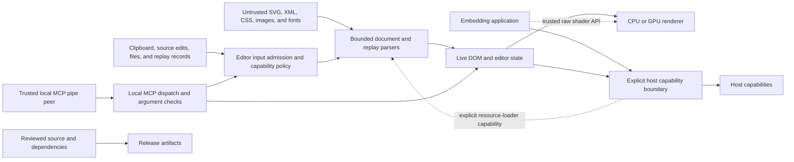

# Donner Threat Model {#DonnerThreatModel}

This document describes the security boundaries for Donner v0.8. It is for application developers
embedding Donner, contributors changing parsers or renderers, and operators packaging the editor.
Donner v0.8 is the only supported release line; see
[`SECURITY.md`](https://github.com/jwmcglynn/donner/blob/main/SECURITY.md).

## Security goals {#ThreatModelGoals}

Donner aims to:

- parse and render untrusted SVG, XML, CSS, image, and font bytes without memory corruption;
- reject documents whose retained state or processing work exceeds defined limits;
- keep the last valid DOM, editor document, and presented frame usable after malformed input,
  resource refusal, cancellation, or device loss;
- prevent document content from gaining filesystem, network, shader-compilation, or release
  authority that the host did not explicitly grant;
- bind local file changes to an intentional user or tool request without following an unexpected
  link or special file; and
- publish only the reviewed source and artifacts for an exact release candidate.

These are safety boundaries, not conformance promises. A correctly rejected SVG may still be valid
according to the SVG specification when it exceeds Donner's resource limits.

## System and trust boundaries {#ThreatModelBoundaries}

The arrows show admission and authority boundaries, not a claim that every required check is
enforced today. The controls and remaining validation requirements are described below.

The following principals are distinct:

- A **document author** controls document bytes and all values derived from them. The author is not
  trusted by the parser, resource manager, editor, or renderer.
- The **local editor user** chooses files, clipboard actions, saves, exports, and replay operations.
  Donner assumes the operating-system account and its explicitly selected paths belong to that user.
- An **MCP pipe peer** controls every argument sent to the editor-control server. The server is a
  local developer tool with the same authority as its launching process; it is not a remote or
  multi-user service.
- An **embedding application** may grant external-resource access, raw GPU shader access, window or
  surface handles, and output destinations. Those are host capabilities, not document capabilities.
- A **build or release actor** controls dependency resolution, build inputs, and artifact selection.
  Release authorization is separate from document-processing safety.

## Untrusted document processing {#ThreatModelDocuments}

### SVG, XML, and CSS {#ThreatModelParsing}

The default SVG parser admits at most 16 MiB of encoded or expanded SVG. XML parsing separately
bounds tree nodes, structural depth, attributes, entity declarations, entity nesting,
substitutions, and expanded entity text. SVG projection, CSS parsing, selectors, path data, points,
references, shadow trees, and retained computed state have independent cardinality and work limits.
Checked arithmetic protects sizes, offsets, and aggregate reservations.

SVGZ inflation uses the same maximum as plain SVG input. External XML entities are not fetched or
expanded. Scripts and `foreignObject` content are not executed.

Resource limits are part of the public security behavior. An embedder may choose stricter parser
options but must not assume that increasing one limit safely increases related recursion, work, or
retained-memory limits.

### References and nested documents {#ThreatModelReferences}

Internal references, including `use`, gradients, patterns, markers, masks, clip paths, filters,
text paths, and `feImage`, are graph inputs. Each consumer must enforce cycle detection together
with an acyclic depth or aggregate-work limit. Shadow-tree and external-subdocument construction
also bound generated entities, parse attempts, retained documents, and parsed payload.

Nested SVG images use secure-static processing and share the root document's resource family
budget. They cannot introduce another layer of SVGZ compression or gain external-resource access.

### External resources {#ThreatModelResources}

Donner performs no general network fetch by itself. An application grants external-resource
authority by installing `ResourceLoaderInterface` on a document. No loader means no external
resource access, and secure processing modes refuse external image loads and all document font
loads. Embedded data URI images need no loader.

The loader is an application security boundary. It must enforce URL policy, credentials, redirects,
protocols, response limits, decompression limits, caching, cancellation, and tenant or origin scope
before returning bytes. Donner's CLI uses a descriptor-relative loader confined to the input
document's directory; it rejects absolute paths, parent traversal, symlinks, non-regular files, and
oversized resources.

A `<use>` that references an external document inherits the host's supported computed styles in
each occurrence. Explicit child declarations and `context-fill`/`context-stroke` keep their own
paint semantics, and ordinary inherited gradients keep the host resource identity while using the
consuming shape's bounds. Inherited host patterns, markers, URL cursors, and URL-based masks,
clips, or filters are refused at this boundary rather than resolving their IDs in the child
document. Full shadow stylesheet scoping and merging host `@font-face` catalogs are not supported.

### Images, fonts, and filters {#ThreatModelMedia}

Raster input is limited by encoded bytes, supported magic, dimensions, checked RGBA size,
decode-amplification ratio, and aggregate document bytes. Nested SVG follows the secure subdocument
path.

Document fonts are untrusted. WOFF, WOFF2, sfnt, TrueType, and CFF processing uses input, output,
table, transform, glyph-complexity, and aggregate validation-work limits. The compact text backend
refuses untrusted fonts because its outline API has no byte-length parameter. Catalog fonts are
compiled identities fetched from the package origin with redirect refusal, exact byte limits, and
SHA-256 verification.

Filter planning bounds graph nodes, primitive data, surface dimensions and area, executions, work,
and live intermediate memory. The default frame-memory ceiling is 128 MiB for WebAssembly and
256 MiB for native rendering. New allocation and dispatch paths must check the applicable budget
before work begins; a limit in a later rendering stage does not cover earlier work.

## Editor boundaries {#ThreatModelEditor}

The v0.8 editor parses and renders untrusted SVG in its own process. A document can therefore reach
the parser, layout, CPU decoder, GPU driver, and editor worker within that process. Process
isolation is not a v0.8 boundary.

Source-pane typing reparses incrementally when safe and compares the result with a fresh bounded
parse. Invalid or ambiguous source preserves the last valid DOM. Clipboard fragments pass through
the SVG parser before DOM mutation. New code must apply size limits before making unbounded
clipboard or undo copies, not only when the final parse begins.

File open, save, export, recording, and capture are local capabilities. Reads must be nonblocking,
regular-file checked, and bounded before allocation. Writes must not follow symlinks or race through
mutable path components; temporary outputs must be created exclusively and committed atomically.

### Replay files {#ThreatModelReplay}

`.rnr` files are untrusted documents, not scripts with host authority. Parsing bounds file and line
bytes, frames, items, strings, dimensions, duration, and pixel work. Playback separately reserves
frames, pixel-frames, semantic actions, selection changes, input mutations, and source-rewrite work.
Retained diagnostics also require an aggregate byte and item budget. At the v0.8 source-review
checkpoint, the replay collector had not yet enforced its declared diagnostics budget;
[issue #1422](https://github.com/jwmcglynn/donner/issues/1422) tracks validation and disposition
before release qualification.

Replay-relative SVG paths stay below the replay directory through descriptor-relative, no-follow
loading. Replays disable normal editor filesystem actions and replace the host clipboard with an
isolated in-memory clipboard. Helper subprocesses use fixed executable identities, discrete argv
values, output caps, deadlines, and process-group termination.

## Editor-control MCP server {#ThreatModelMcp}

The editor-control MCP server is a local, trusted developer tool. It reads JSON-RPC messages over
stdio, has no network listener, and provides one in-process editor session. Possession of its pipes
grants the launching user's intended tool authority, including caller-selected SVG and replay paths,
captures, recordings, rebuilds, and restarts. Do not expose its pipes through a remote, shared, or
less-privileged service.

Tool descriptions and JSON schemas document shape; handlers remain responsible for finite numeric
ranges, byte and cardinality limits, regular-file checks, output confinement, deadlines, and parser
admission. The transport must reject missing, negative, malformed, or over-limit `Content-Length`
before allocation or a blocking read. Model output and tool arguments are always untrusted data,
even though the pipe peer itself is trusted to request local operations.

The server is not a security sandbox, authorization service, or multi-tenant boundary. Source
revision fields prevent stale edits; they do not authenticate a caller.

## Browser and WebAssembly boundaries {#ThreatModelBrowser}

The browser editor is a static package. Untrusted SVG is copied into WebAssembly and rendered to
pixels; it is not inserted as active browser SVG or HTML. The page-to-worker mirror has a fixed,
asserted memory layout and transfers values rather than native pointers.

WebAssembly threads require cross-origin isolation. The deployment must provide correct TLS,
COOP/COEP headers or the packaged same-origin isolation worker, immutable versioned asset paths,
same-origin catalog fonts, and old-bundle retention appropriate to the release policy. These are
deployment controls and cannot be proved by library source alone.

Standalone renderer Wasm exports form a separate C ABI. Every pointer and length pair must be
validated against linear memory, dimensions and output sizes must be checked before allocation,
and ownership must remain explicit across synchronous and Asyncify/WebGPU paths.

## GPU boundary {#ThreatModelGpu}

Document content selects geometry, paint, textures, sizes, and draw work, but it does not provide
shader source. Production WGSL is validated and projected at build time into the one representation
used by the platform: MSL on Metal, SPIR-V on Vulkan, or WGSL in the browser. Generated interfaces,
binding maps, declared buffer lengths, and native entry points must describe the same program.

The `gpu::Device` interface is an internal, trusted same-process capability in v0.8. Raw WGSL, MSL,
or SPIR-V passed through that interface is trusted application code, never document data. The caller
must supply metadata that exactly matches raw shader resource use and entry-point requirements.
Donner validates descriptor shape and resource handles but cannot infer the security intent of
arbitrary application shaders.

CPU-to-GPU sizes, strides, offsets, origins, counts, indices, and allocation totals use checked or
widened arithmetic. Resource handles carry device and generation identity. Mapping, export,
submission, surface, cancellation, device-loss, and teardown paths must preserve ownership until
the backend has retired every use. Ordinary rendering has no CPU readback fallback; export,
screenshot, pixel query, diagnostics, and tests are explicit readback capabilities.

## Build, package, and release boundary {#ThreatModelRelease}

Dependencies and generated inputs are executable supply-chain inputs. Release builds must bind
reviewed source, resolved dependency state, build identity, qualification evidence, security review,
artifact inventories, and final artifact digests into one immutable candidate. Publication must
verify that candidate and promote its exact bytes without rebuilding or selecting a different
artifact by mutable name. The v0.8 review is checking the current publication path against this
requirement.

Source, CLI, editor, and documentation packages must use explicit intended-file inventories or an
equivalent privacy check. They must exclude credentials, private paths, local configuration,
developer worktrees, internal handoffs, undeclared corpora, and unrelated test output. The v0.8
source-review checkpoint found private local paths and internal handoff material in its candidate
source archive. The affected members are intentionally omitted here to avoid redisclosure;
[issue #1422](https://github.com/jwmcglynn/donner/issues/1422) requires a clean intended-file
inventory before publication. Archive readers reject absolute paths, traversal, duplicates,
links, special files, excessive members, and excessive expanded bytes.

## Refusal and recovery {#ThreatModelRecovery}

A limit violation is an expected error. It must not call `abort`, weaken a later check, leave a
partly applied edit, retain detached work, or replace valid state with invalid state. Sticky budget
objects prevent continued work after refusal. Device loss is terminal for that device. Editor
cancellation and shutdown keep document access closed until workers release borrowed state, discard
stale generations, and preserve the last coherent presentation when no new frame is available.

## Out of scope and assumptions {#ThreatModelOutOfScope}

The following are not v0.8 security boundaries:

- isolation from a malicious process running as the same operating-system user;
- remote or multi-user exposure of local developer tools, including editor-control MCP;
- network, credential, cache, redirect, or tenant policy inside an embedder's resource loader;
- correctness of arbitrary raw shaders supplied by a trusted embedding application;
- browser headers, TLS, driver behavior, code signing, notarization, branch protection, environment
  reviewers, or registry policy that is not present in this repository; and
- security support for historical releases before v1.0.

Out of scope does not mean harmless. It identifies the application, deployment, or platform owner
that must supply the missing control.

## Validation requirements {#ThreatModelValidation}

Security qualification is bound to an exact, clean release-candidate revision. It combines source
review with targeted boundary tests, checked corpora, fuzzing, sanitizers, browser tests, native GPU
validation, package inventory checks, and independent review. A skipped test, unobserved hardware
path, or source-only hypothesis is recorded as needing validation rather than treated as evidence.

At minimum, release qualification covers:

- exact-limit and one-past-limit cases for parser, entity, reference, resource, replay, filter,
  geometry, compositor, and tool budgets;
- malformed image and font metadata plus production-budget decode amplification;
- negative, maximum, and one-past-end GPU sizes and shader indices;
- generated-shader interface and binding agreement, including reserved Metal binding slots;
- cancellation, timeout, device-loss, allocation-refusal, and shutdown state consistency;
- regular-file, symlink, special-file, and path-replacement cases using dummy filesystem objects;
- artifact membership, private-path scanning, dependency identity, provenance, and digest binding;
  and
- Metal API and shader validation on supported hardware for Metal-specific claims.

Security fixes include a regression test that fails on the parent revision and passes on the fixed
candidate. The final review record distinguishes source-established controls, locally observed
results, and deployment or hardware facts that still need owner validation.
